# IBM数据工程专业证书 课程11：《使用Spark和Hadoop进行大数据介绍》｜big-data-with-spark-hadoop｜ - P5：4_大数据工具和生态系统.zh_en - GPT中英字幕课程资源 - BV12h4y1D7hF

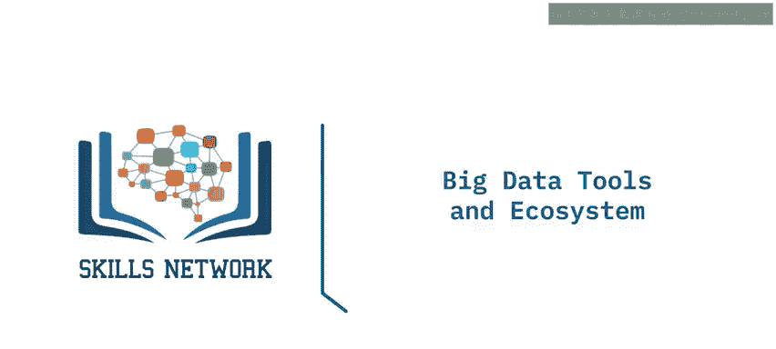

Welcome to Big Data Tools and ecosystemst。

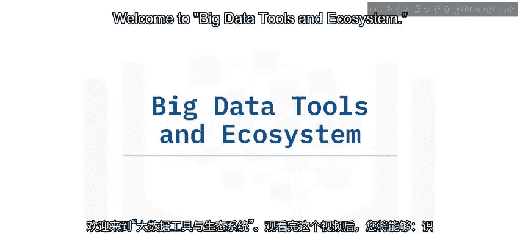

After watching this video， you'll be able to identify the key tooling categories within the Big data ecosystem。

 describe the role of each tooling category in the big data lifecycle。

 list major tools and vendors within each big data tooling category。

Big data tools have six different categories， data technologies， analytics and visualization。

 business intelligence， cloud service providers， NoSQL databases and programming tools Let's take a look at each of these components in detail。

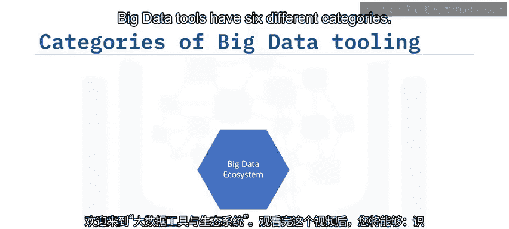

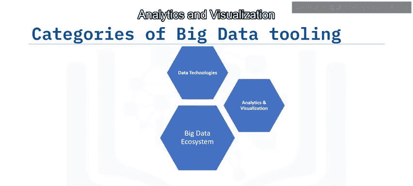

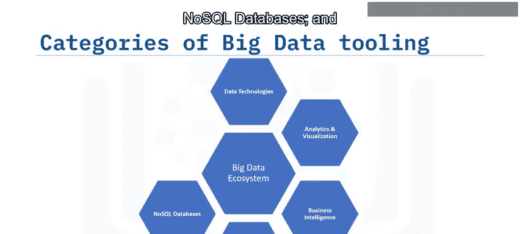

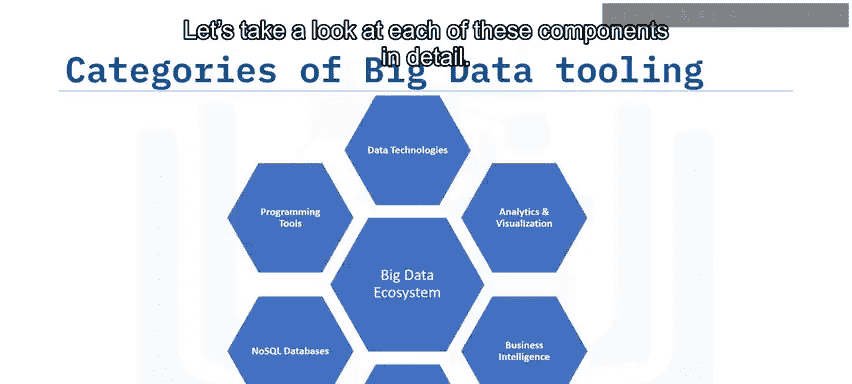

Data technologies are specially designed to analyze。

 process and extract meaningful information from big data。

 These functions are beyond the capabilities of traditional data processing tools。

 these technologies capture process and share big data work with structured and unstructured data and offer high performance parallel processing of big data Data technologies for big data are dominated by open source projects including Apache Hadoop。

 Apache HDFS and Apache Spark， major commercial vendors such as Clouddera and Databricks contribute to and support these projects。

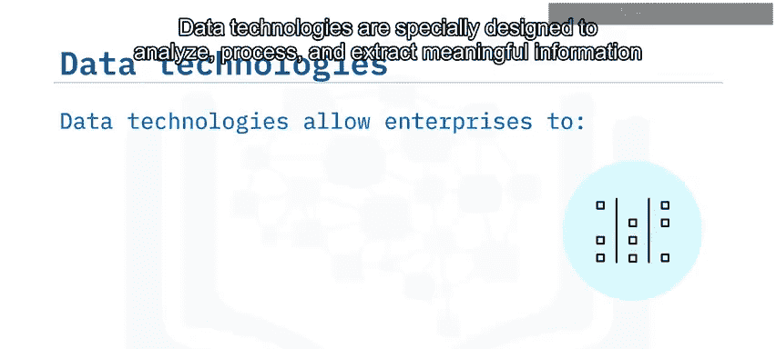

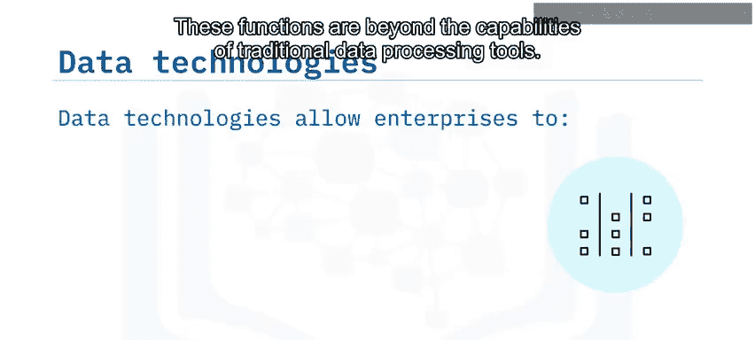

Data analytical tools examine large amounts of data to uncover hidden patterns。

 correlations and trends data visualization， on the other hand。

 provides a visual representation of these trends in the form of graphs， charts and maps。

 These tools provide an accessible way to view and understand trends。

 outliers and patterns in data Tableau， Pantteier， SAS。

 pintaho and Terraada are leading examples of analytics and visualization tools。

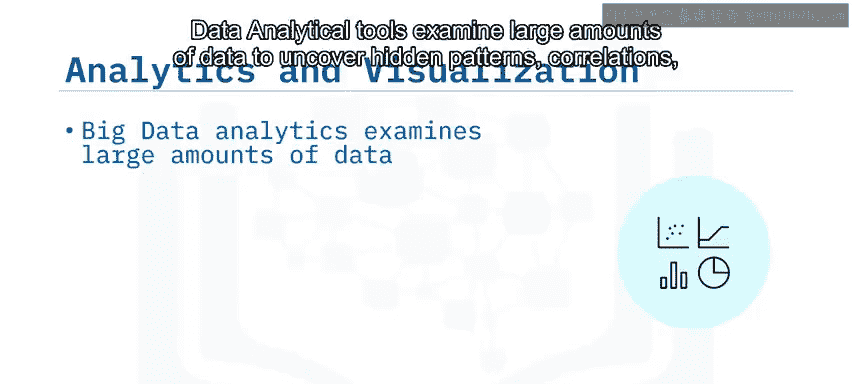

It's not enough to only analyze the visualized data Business intelligence tools transform raw data into meaningful。

 actionable information that is suitable for business analysis business intelligence techniques also involve basic mathematical concepts such as probability。

 statistics and flowchars， the insights gained from business intelligence help drive business decisions。

 some examples of BI tools or cgnos， oracle， power BI， business objects and Hyperion。

Big data presents challenges to storing， transporting， processing， mining。

 and serving enormous amounts of data Cloud providers offer fundamental infrastructure and support with shared computing resources including computing。

 storage， networking and analytical software， cloud providers also provide software as a service models with point solutions to allow enterprises to easily aggregate process and visualize data。

 examples of cloud service providers include AWS， IBM， GCP and Oracle。

Another key component of big data commercial tools are NoSQL databases that are tailored made for big data processing。

 NoSQL databases are built from the ground up to store and process vast amounts of data at scale。

 and support a growing number of modern businesses。

 NoSQL databases store data in documents rather than relational tables。

 types of NosQL databases include pure document databases， key value stores， wide column databases。

 and graph databases such as Mongo DB， catchDB， Cassandra and Redis。

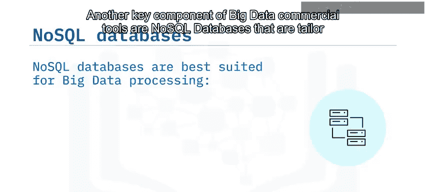

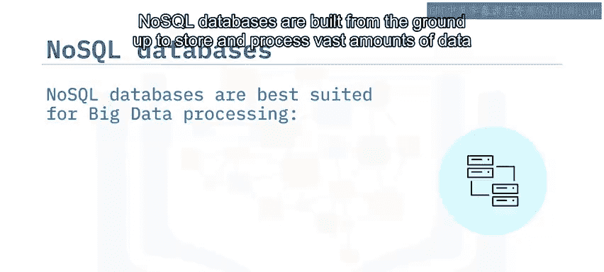

Programming tools are the final component of big data commercial tools These programming tools perform large scale analytical tasks and operationalize big data。

 They also provide all necessary functions for data collection， cleaning， exploration。

 modeling and visualization， some popular tools you can use for programming include R， Python， SQL。

 Scala， and Julia。

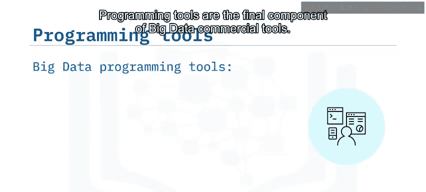

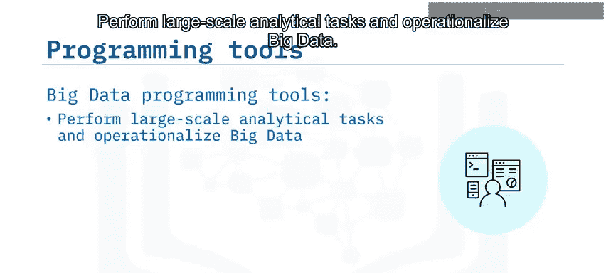

In this video， you learned that there are six main components of big data tools。

 namely data technologies， analytics and visualization， business intelligence， cloud providers。

 NoSQL databases and programming tools， each tooling category plays a very specific and critical role in the big data lifecycle。

 several major commercial and open source vendors provide tools and support for big data processing。

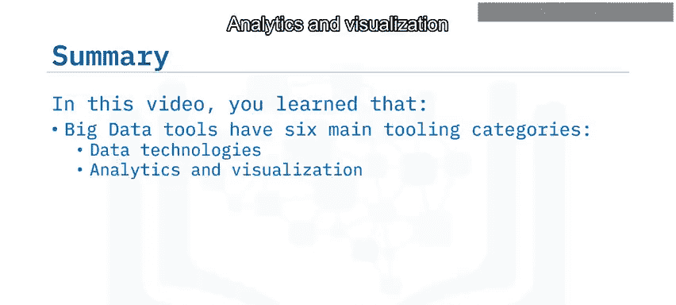

。

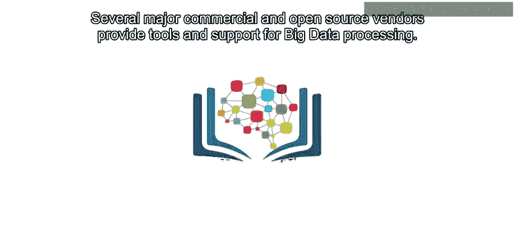