# IBM数据工程专业证书 课程11：《使用Spark和Hadoop进行大数据介绍》｜big-data-with-spark-hadoop｜ - P6：5_开源和大数据.zh_en - GPT中英字幕课程资源 - BV12h4y1D7hF

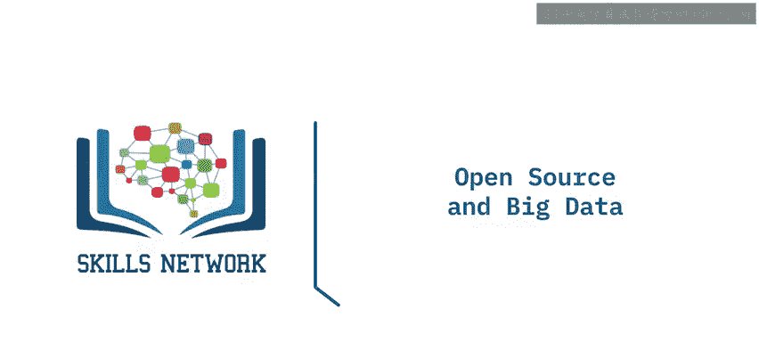

Welcome to open source and Big data。😊。

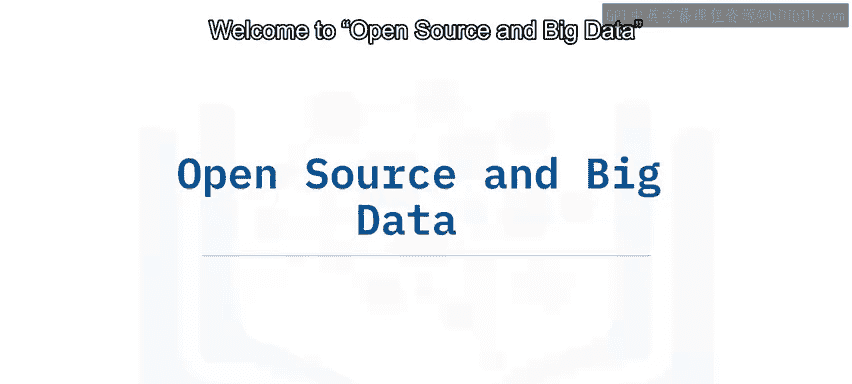

After watching this video， you'll be able to explain the role of open source in big data。

 describescribe platforms for coordinating open source， De the most popular open source frameworks。😊。

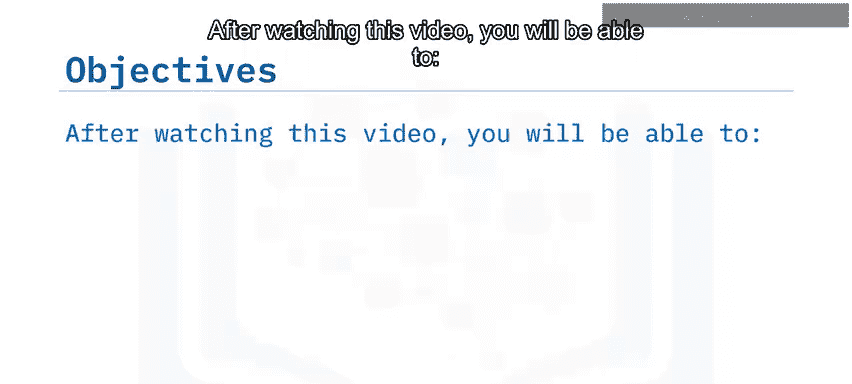

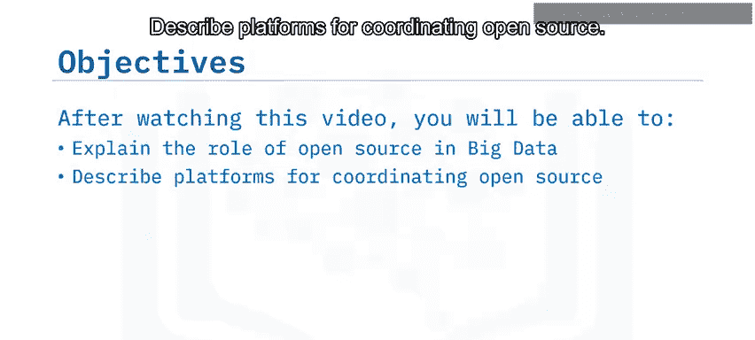

What is an open source software。 A simple definition of an open source software is that it is free。

 not only is the runnable version of the code free， but the source code is also completely open。

 meaning that every line of code is available for people to view， use and reuse as needed。 However。

 a project becomes truly open source once it embraces the open governance model。

 This action ensures that any contributor from any organization can propose changes to the code and the overall project can be steered to serve the community's needs。

 It's important to note that not all open source software is the same。

 The type of license associated with the software prescribes how you can use it before using any open source software。

 it is important to check for the type of license is available under and to understand the permissions available under the specific license type。

😊。

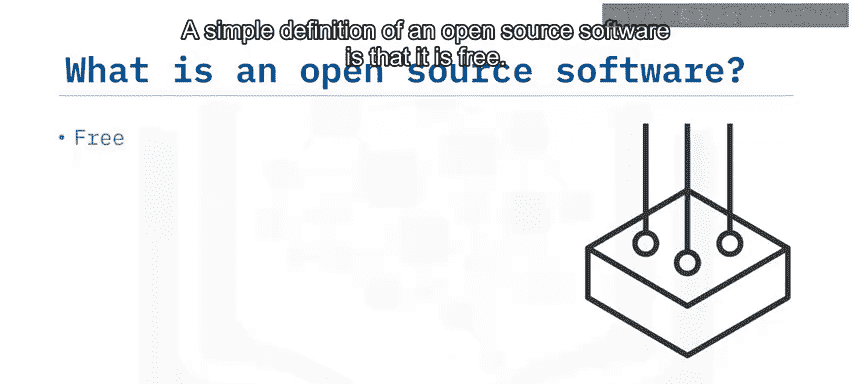

Accordingly， we need to ask why is the open source model used for big data Open source projects are massive efforts while many projects are started within one organization。

 the truly open source projects persist beyond the efforts of any single organization these projects formed the foundation of all the modern big data infrastructure Consider the Linux kernel when Linus Trvals first began developing this kernel as an open source。

 there were many players in the operating system space and many were offering only proprietary versions of their code it was not clear at the time who would ultimately emerge as the OS standard nearly 30 years later。

 Linux is the standard for all servers， This is true for almost every data server in every part of the world regardless of hardware。

 software or service provider This happened because the projects took on a life of its own beyond any single company's interest and persists beyond any。

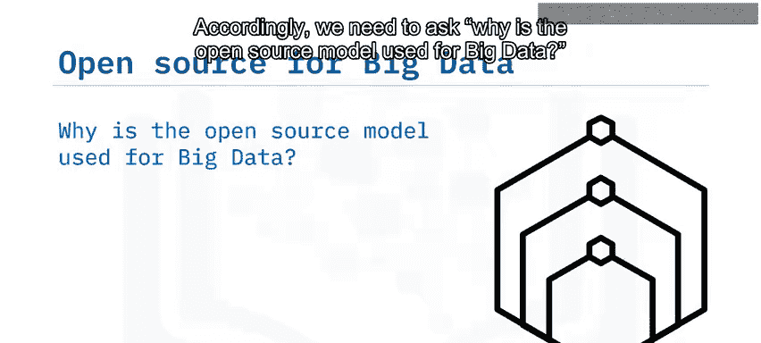

One organizations cycles of interest。The open source development model is to software development。

 what democracy is to the government， it is the most transparent way to conduct a project and ultimately serves the will of the people participating in it。

 in some senses， it is a surprising result that a completely open model will ultimately be a more profitable solution。

 but this has proven to be the case time and time again。

 and we now embrace the model without controversy。Most open source projects have formal processes for contributing to code and also include various levels of influence and obligation to the project Comter contributor。

 user user group， typicallyypically， committers have the ability to modify the code directly。

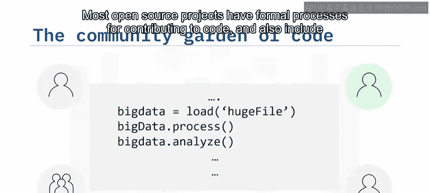

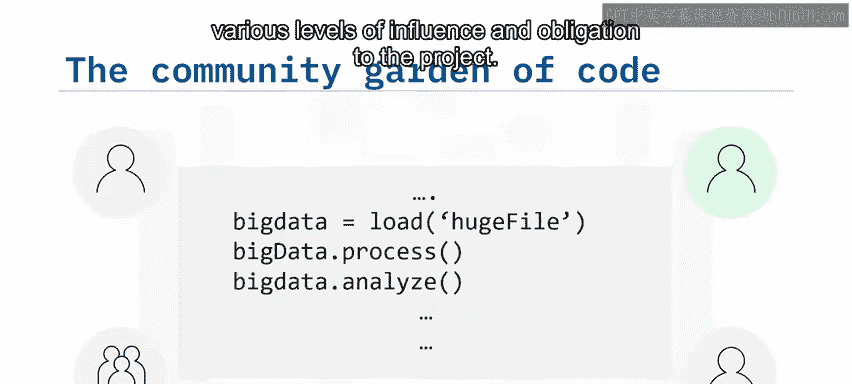

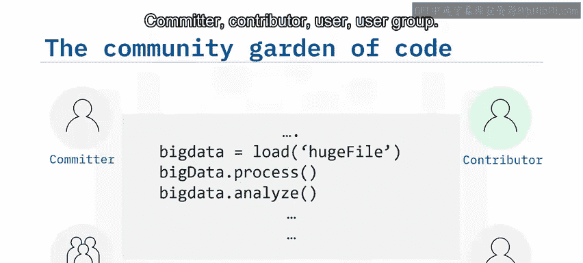

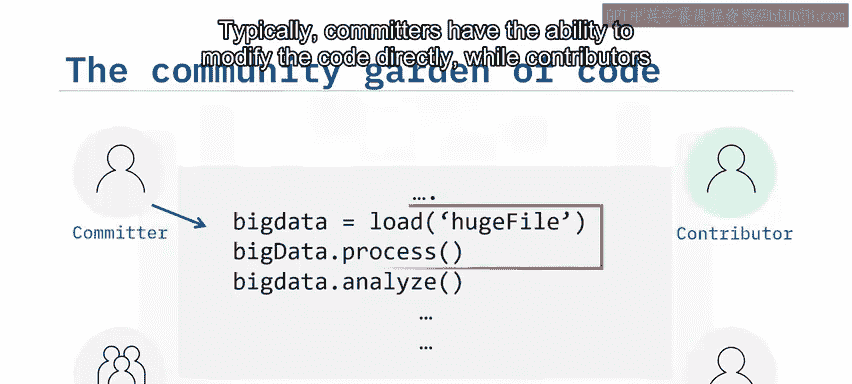

While contributors submit their code for review by a committer before the code is modified。

 many more people are simply users of the code。

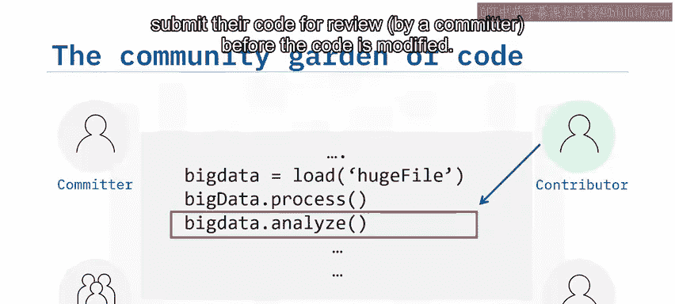

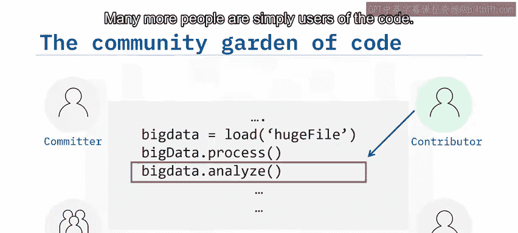

Most but not all major open source projects belong to one of the major open source foundations and follow a similar governance procedure。

 Open source means that the code is freely visible。

 which is an important distinction from proprietary software。 Open governance， however。

 is what makes the project truly open and Democratic Open source foundations Prescribe best practices for open source development。

 as well as open governance。

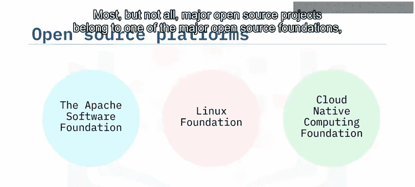

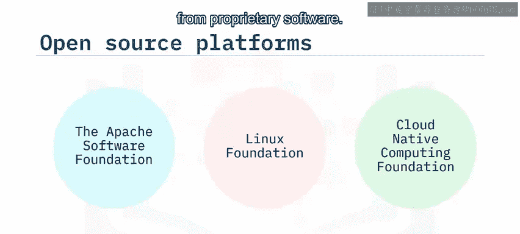

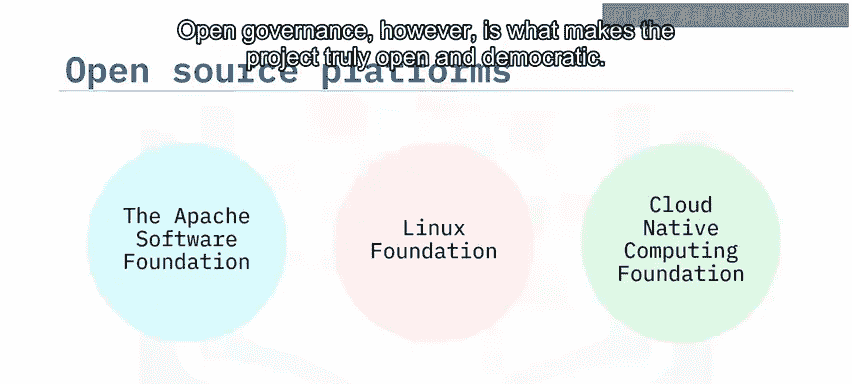

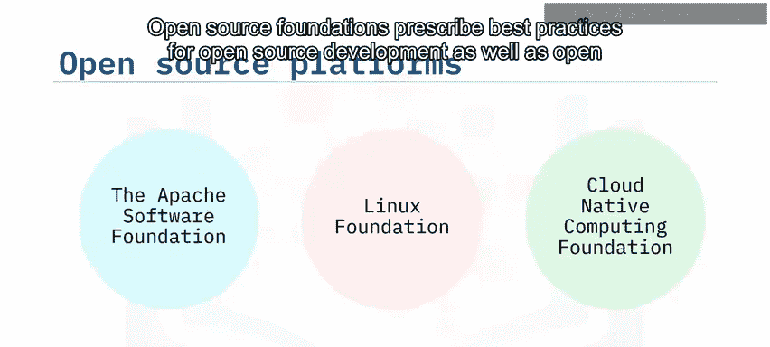

The biggest component of big data is by far the Hadoop project in its three main components。

 Mapproduce， the Hadoop file system， HDFS， and the resource manager yarn。

 Mapproduce is a framework that allows code to be written to run at scale on a Hadoop cluster。

 It is still used， but not as much as more modern big data computation frameworks like Apache Spark。

 HFS is the file system that stores and manages big data files。

 It manages all of the issues around large and distributed data sets。

 including resilience and partitioning。 It is still a mainstay of the industry。

70% of the world's big data resides on HFs。 More modern approaches to distributed storage such as S3 and object storage are coming into use。

 but they are based on the design principles of HFS。

 yarn is the resource manager that comes with Hadoop， and it is the default resource manager for。😊。

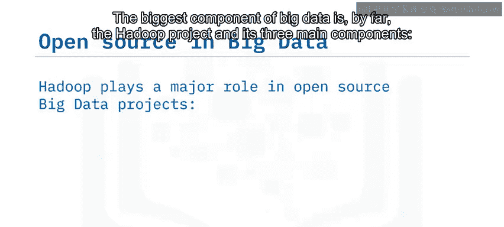

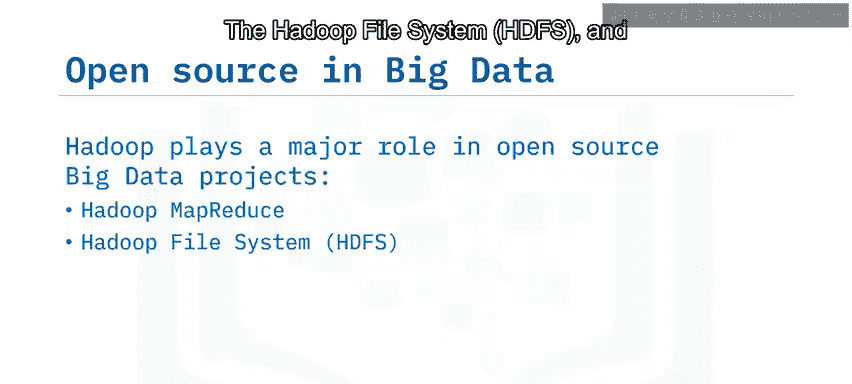

Big data applications including Hve and Spar it is one of the most robust resource managers in use today。

 but more modern containerbased resource managers like Kubernetes are solely becoming the new de facto standards。

 concluding these are the main components of the Hadoop ecosystem and most big data applications are built on top of them。

The array of big data applications available to the user is dizzying。

 They all build upon the basic Hadoop framework or interact with it in some way， however。

 frameworks like Hve and Spark support lots of ETL extract， transform， load。

 and computation tasks on Hadoop systems， some systems that integrate tightly with the Hadoop ecosystem R Apache Hbase。

 which is a large NosqL data store， it manages storage and computation resources outside of the Hadoop ecosystem。

 but often reside on the same cluster Open source packages like the Hortonworks data platform HP provide a set of big data tools that are already configured to work together and include most of the important open source packages。

 Hadoop， Spar， hive， Hbase and others。

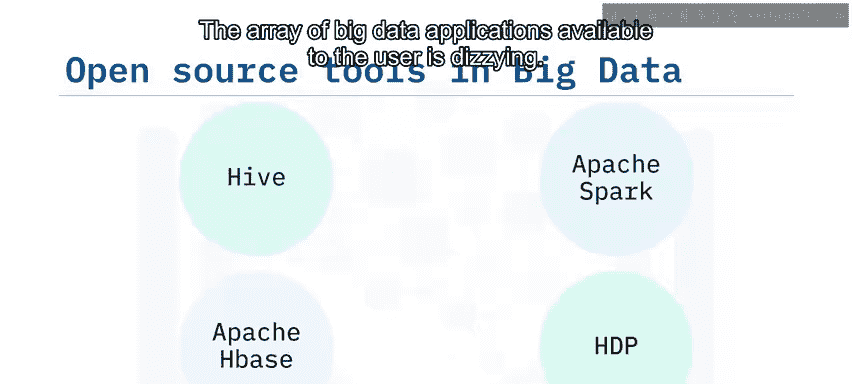

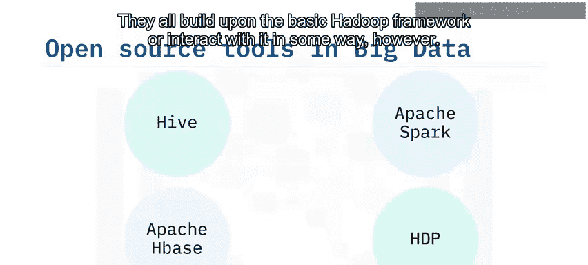

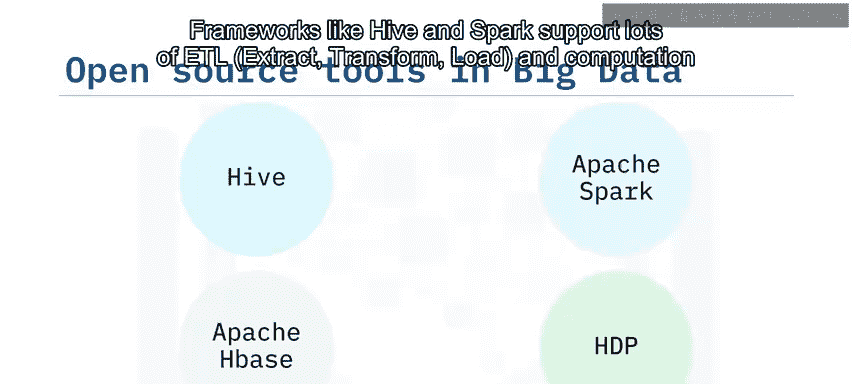

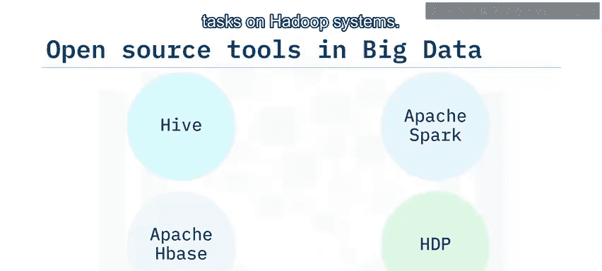

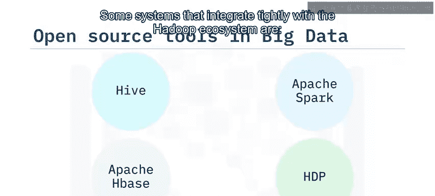

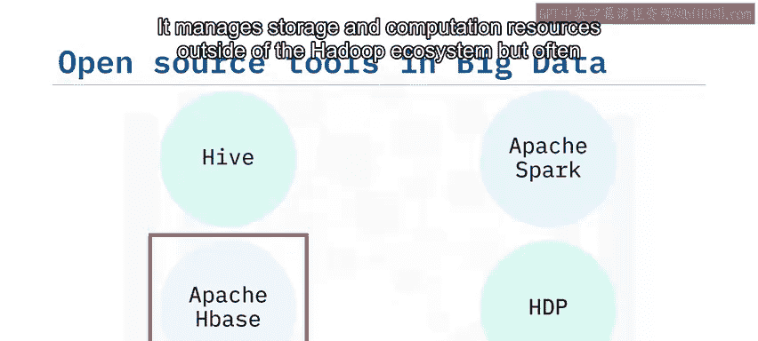

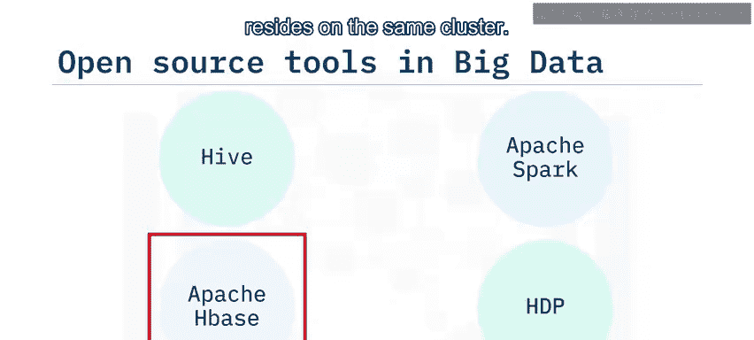

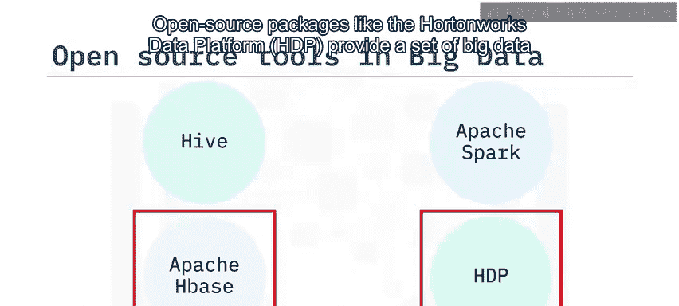

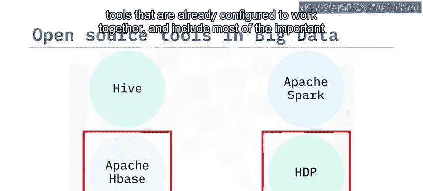

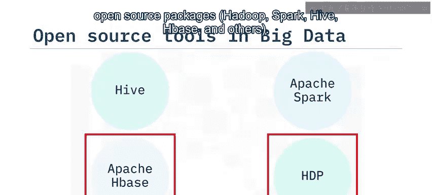

In this video， you learned that open source runs the world of big data。

 Open source projects are free and completely transparent。

 The biggest component of big data is by far the Hadoop project， including Mapreduce， HDFS and yarn。

 Open source has big data tools like Apache hive and Apache Spark。😊。

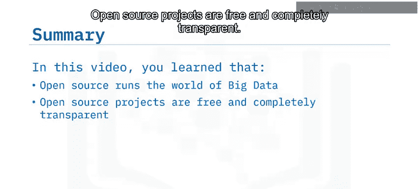