# IBM数据工程专业证书 课程11：《使用Spark和Hadoop进行大数据介绍》｜big-data-with-spark-hadoop｜ - P8：7_大数据用例.zh_en - GPT中英字幕课程资源 - BV12h4y1D7hF

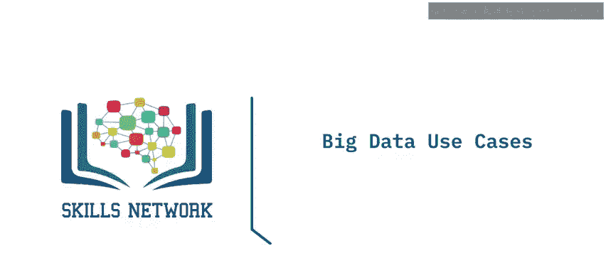

Welcome to big Data use cases。

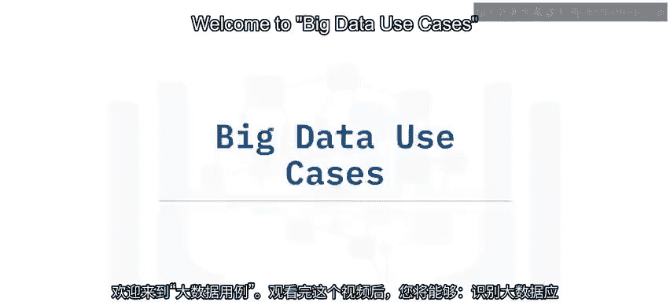

After watching this video， you will be able to identify industries where big data is leveraged。

 discuss and outline the usage of big data in key industries。

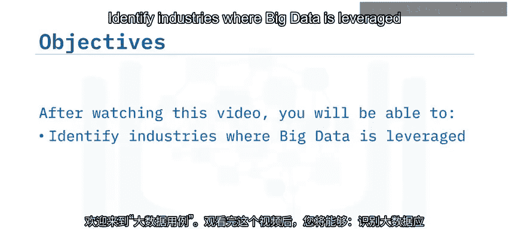

Data is getting generated at unprecedented volumes。

 and data drivenve companies can develop a competitive edge over their peers if the data can be aggregated and analyzed effectively to generate breakthrough insights。

 every major industry is taking advantage of data insights to improve decision making。

 enter new markets and deliver better customer experiences。

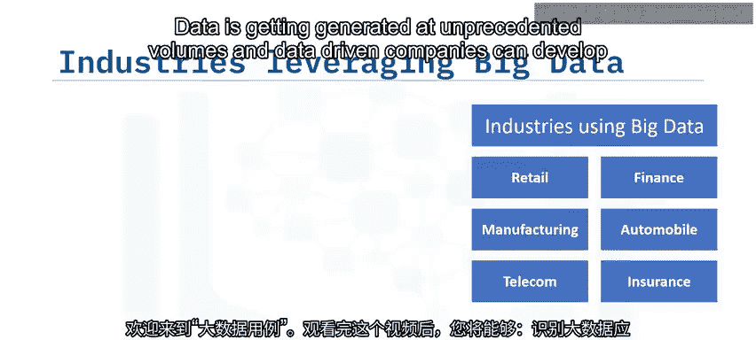

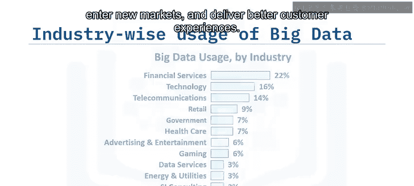

Looking at industry trends， it is no surprise that financial services。

 technology and telecommunications companies are the leading users of big data this is where most of the innovation is currently taking place these industries are closely followed by retail。

 government， healthcare， advertising and entertainment and the gaming industry Finally。

 data services， energy and utilities， system integrator consulting shipping and transportation round out the top industries that leverage big data Let's now take a look at how some industries are leveraging the insights gained from big data analytics。

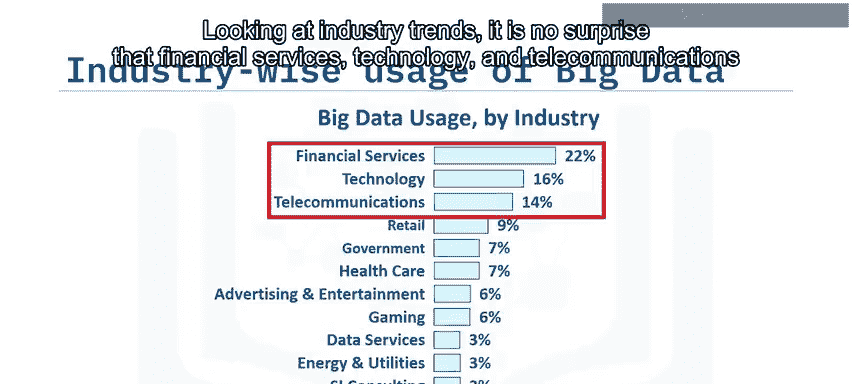

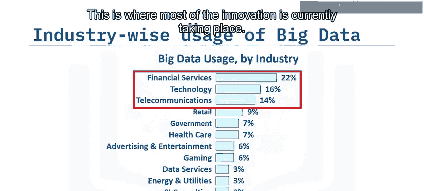

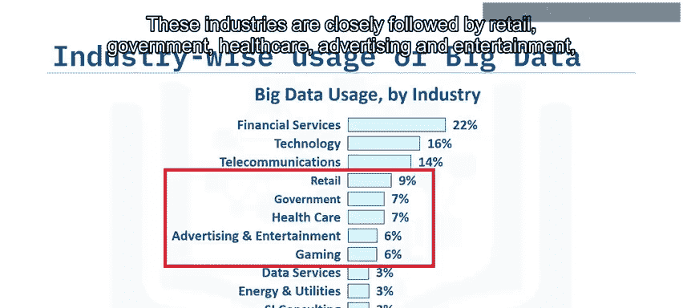

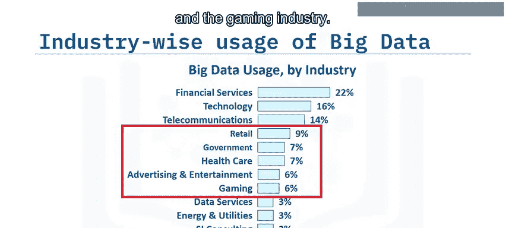

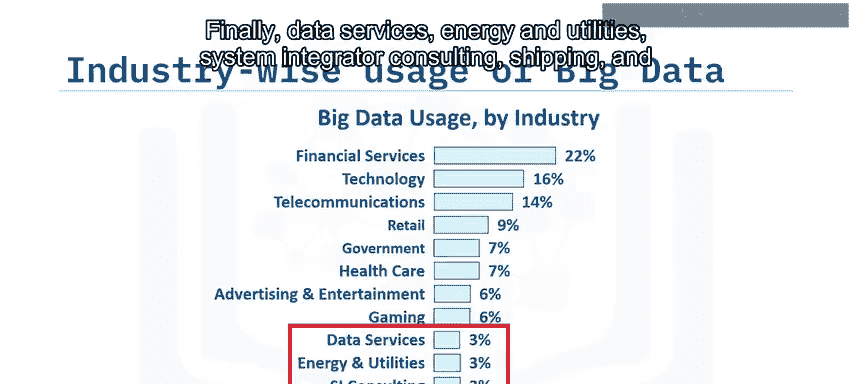

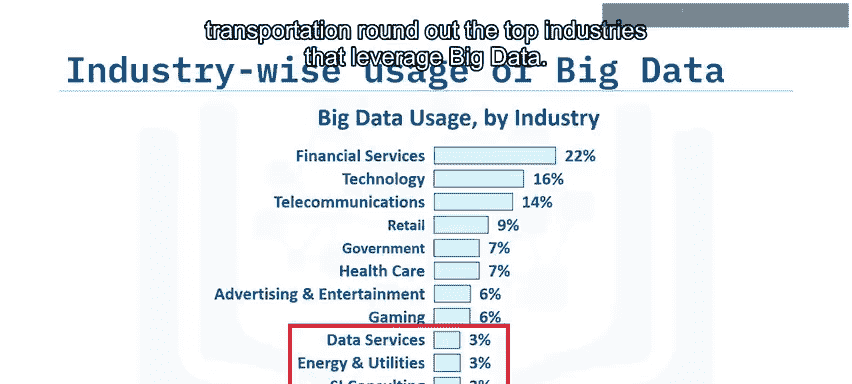

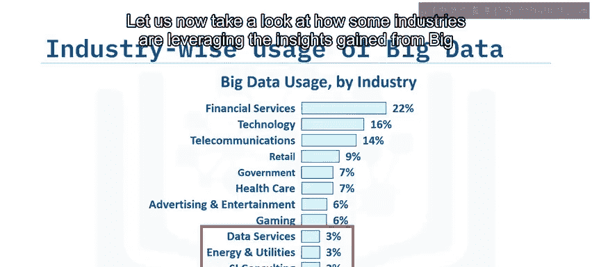

In the retail industry， key uses of big data include price analytics and sentiment analysis。

 price analytics helps understand market segmentation。

 identify the best price points for a product line and perform margin analysis for maximum profitability。

 on the other hand， sentiment analysis leverages social media conversations to understand what consumers think of a product。

 and subsequently to devise an effective marketing strategy to connect with the customers。

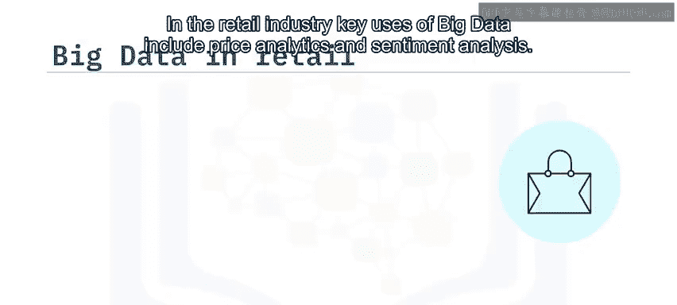

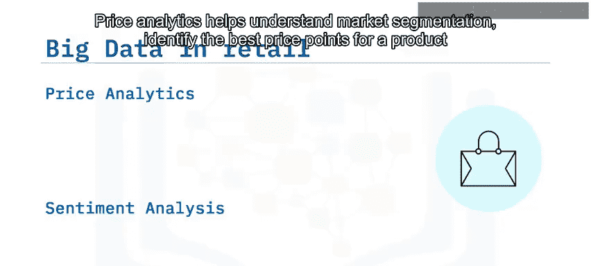

Insurance companies use big data for fraud analytics。

 big data helps them spot fraudulent claims and detect any anomalies in trends and prevent suspicious activities。

 insurers also perform risk assessments using big data。 For example。

 they may use predictive modeling based on user history and behavioral analytics to identify customers at higher risk of getting into accidents or having their vehicle stolen。

😊。

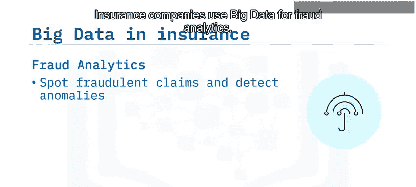

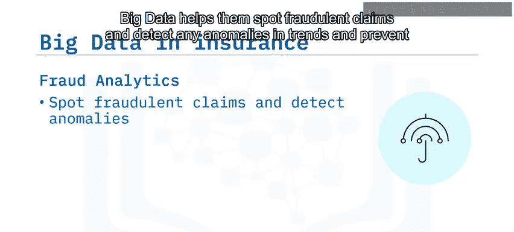

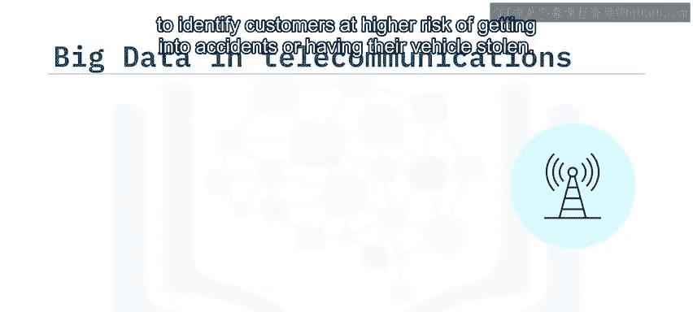

Telecom companies are some of the top users of big data analytics。

 They use big data for improved network security。 Mach learningbased pattern analysis identifies any threats to the network and predictive maintenance resolves these threats before any serious damage to the network。

 Conualized promotions based on user locations are another way telecoms leverage big data。

 For example， if a user is near a specific restaurant around lunchtime。

 they may receive a discount coupon for that restaurant。 therebyby increasing conversion rates。

 Telecoms continuously monitor their network for traffic patterns that would soon impact customer experience。

 Ana alerts them on when is the right time to upgrade the network。

 thereby helping them focus investment for maximum returns。

 telecoms also run pricing promotions based on realtime factors。

 These promotions are tested with targeted customer groups to produce optimized pricing packages。

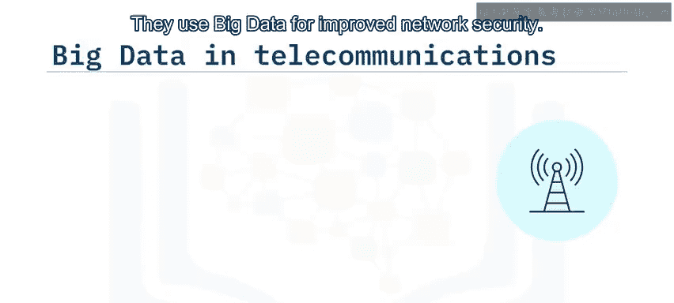

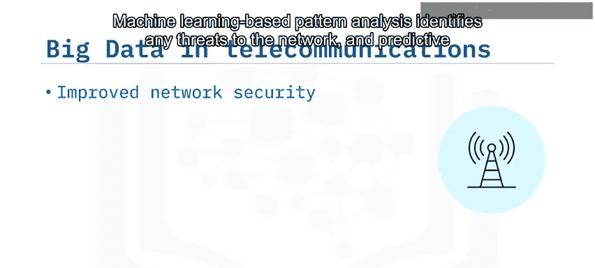

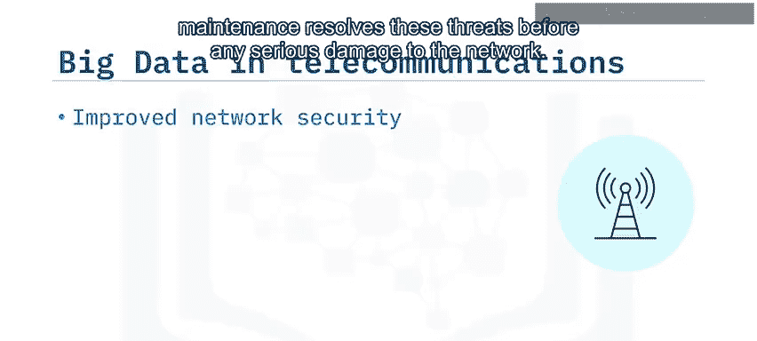

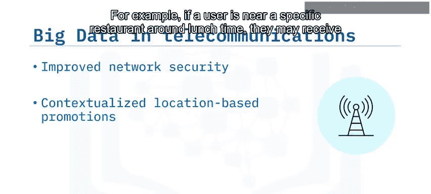

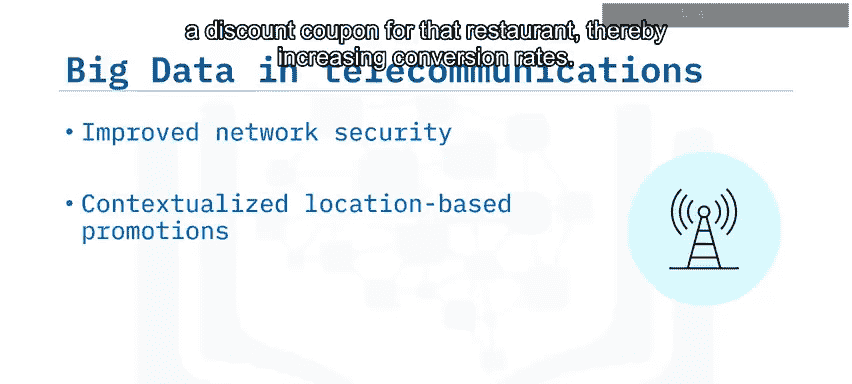

In manufacturing， big data helps with predictive maintenance of machines。

 the data from sensors are used to analyze equipment usage patterns to predict equipment failure。

 maintenance requirements and parts replacement， big data is also used to optimize production by using AI algorithms to understand production lines and recommend optimizations where production time is higher than necessary。

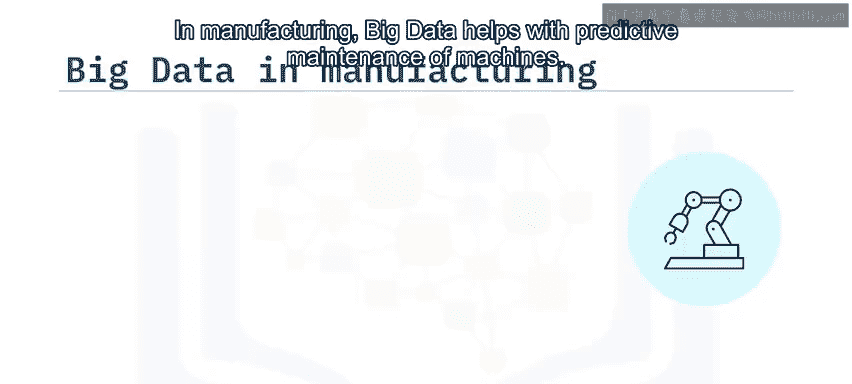

From supply chain analytics to targeted marketing， traffic management and insurance premiums。

 the automotive industry relies heavily on big data Autoe service is a high revenue area for manufacturers companiesies are predicting breakdowns and bringing in customers for repairs based on sensor data。

 preemptive parts ordering reduces customer wait times and increases customer satisfaction realtime data harnessed from connected cars is driving the self-driving car and truck industry The vehicle can make realtime adjustments to speed and direction based on the data it constantly gathers from its surroundings。

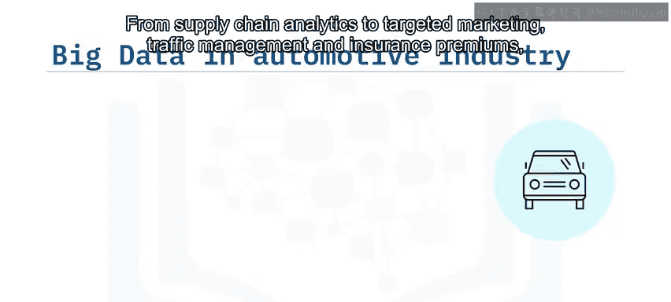

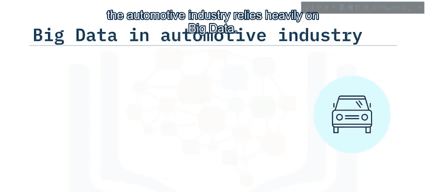

Like the insurance companies， financial companies use big data for fraud detection and risk assessment。

 other use cases for big data in finance include customer segmentation by grouping customers into distinct segments such as demographics。

 period of transactions， social media and customer service interactions。

 companies offer deeply personalized and targeted solutions to their customers。

 Alic trading is another major area where big data is used extensively。

 often financial transactions are time sensitiveitive and use mathematical predictive models。

 therefore， these are the perfect candidates to apply machine learning to make quicker and constantly improving decisions。

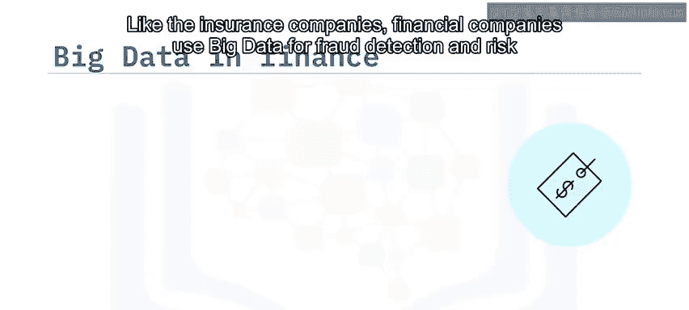

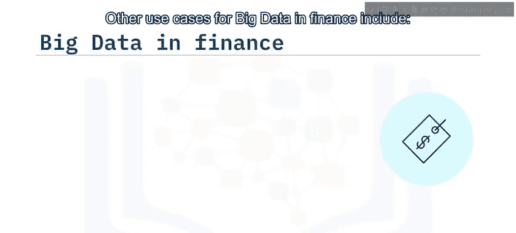

In this video， you learned that companies are relying heavily on big data to differentiate themselves from the competition。

 and there are several ways in which the retail insurance telecom， manufacturing。

 automotive and finance industries are leveraging big data to reduce cost。

 increase customer satisfaction， and make competitive business decisions。

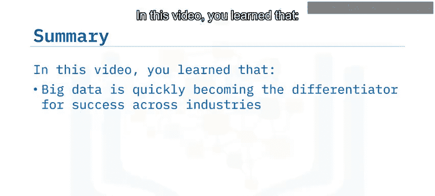