# IBM数据工程专业证书 课程12：《使用Spark进行数据工程和机器学习》｜machine-learning-using-spark｜ - P1：0_spark 结构化流.zh_en - GPT中英字幕课程资源 - BV17h4y1k79A

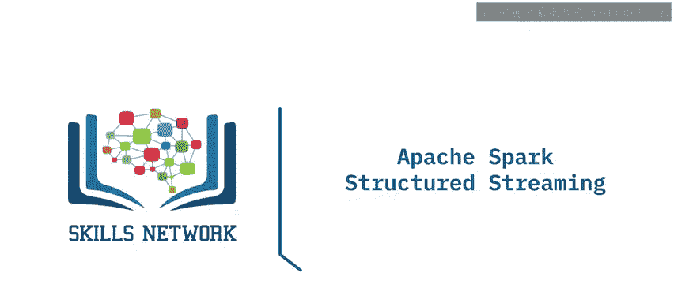

Welcome to Apache Spark Strd streaming。

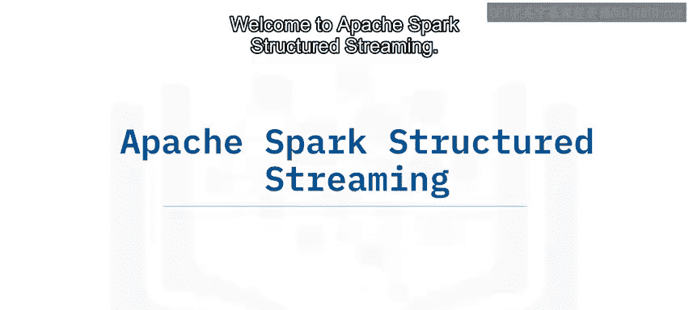

After watching this video， you will be able to define streaming data， describe structured streaming。

 identified structured streaming data sources， streaming output modes and supported data syncs。

 describe streaming data operations， describe streaming listeners and checkpointing。

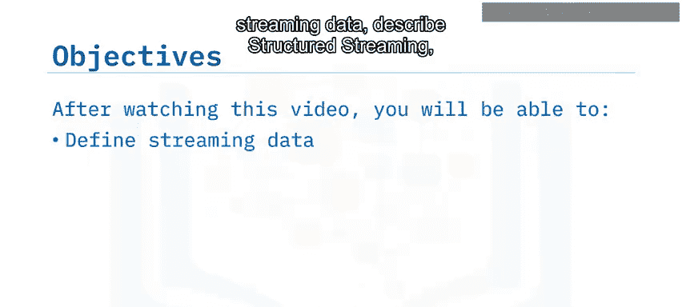

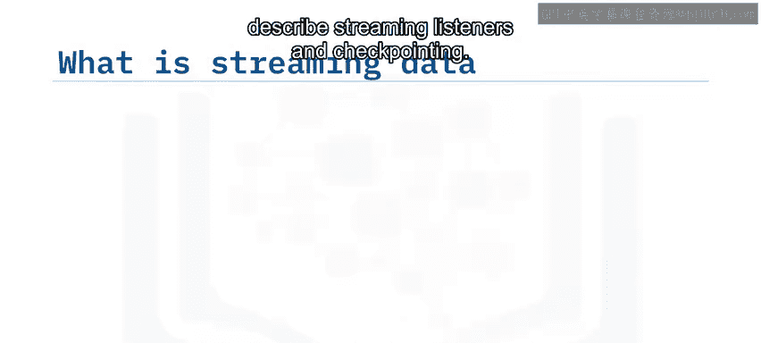

Streaming data is data that is continuously generated and often originates from more than one source Data is unavailable as a complete data set data is continuously created。

 thus past data is often unavailable because the data volume is too much to store as data is processed。

 new data arrives， therefore streaming data requires incremental processing。

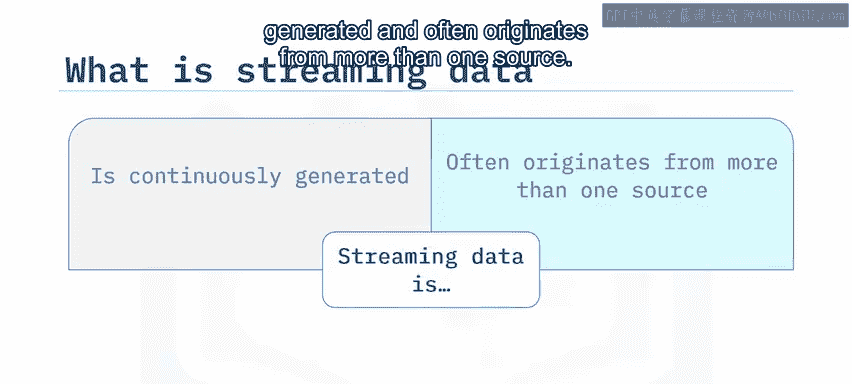

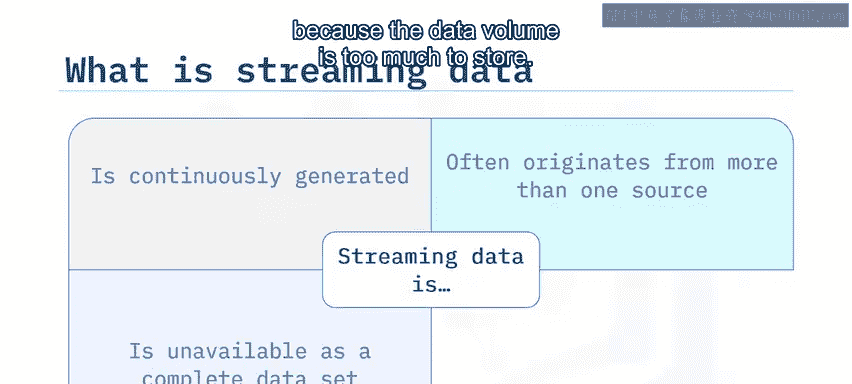

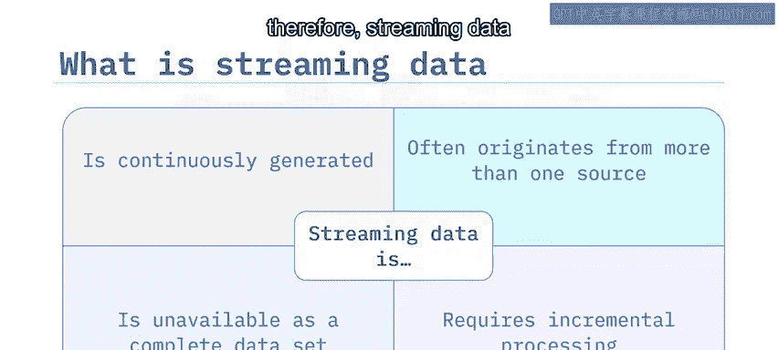

Apaches Spark structured streaming supports the processing of streaming data using SparkSQL Spark structured streaming uses the same data frame and data set APIs Spark processes the data in microcrobaches or most recently using continuous processing。

 and finally， Spark structured streaming optimizes queries using the same SparkSQL engine。

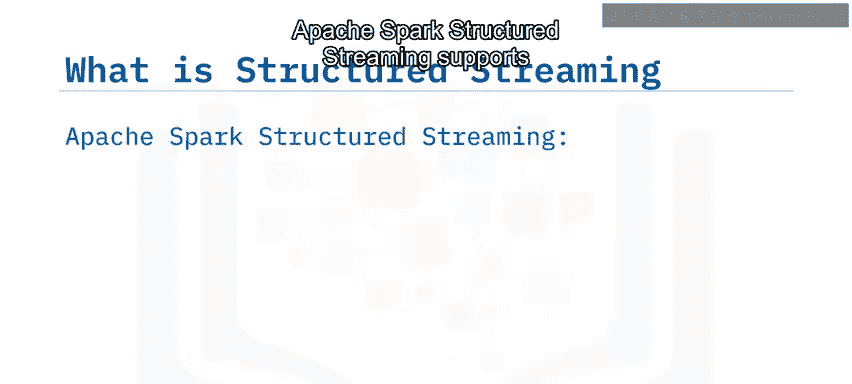

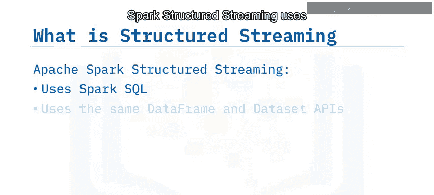

Let's look at some structured streaming terms。 source。 A source defines where data comes from。

 The data origination location。 Snc。 a sync specifies where to output the structured streaming data results。

 Event time。 Event time is the record creation time and is the timetamp at which a data point is created。

 Event time is not the same time as arrival time or processing time。 End to end latency。

 End to end latency is the amount of time needed for the data to process from source to sync。

 Watermarking。 Watermarking is the process that manages late data。

 Water marking enables the inclusion of late arriving data stream processing and update results after initial data processing。

 Let's now explore each of these terms in more detail。

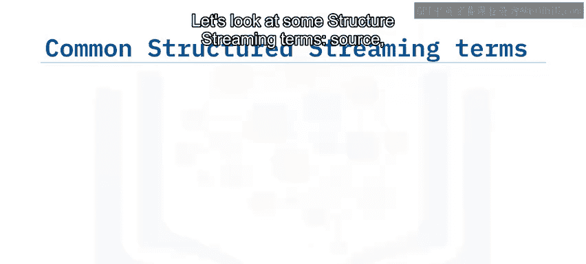

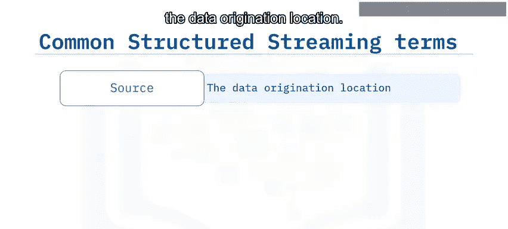

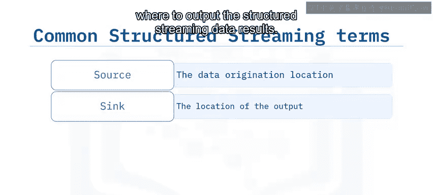

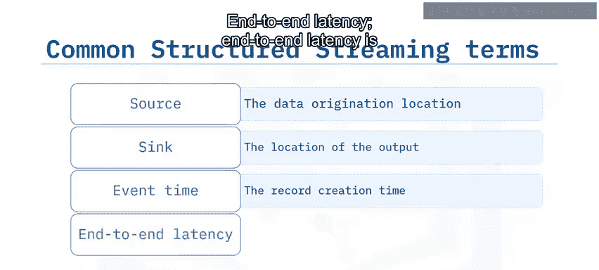

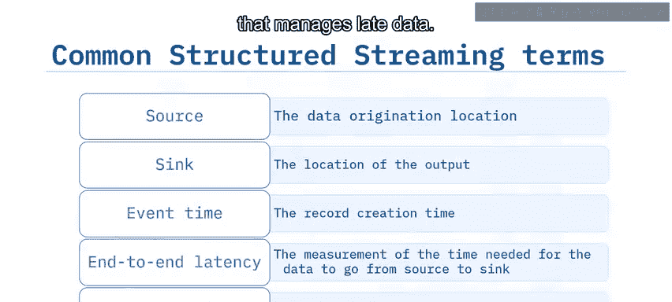

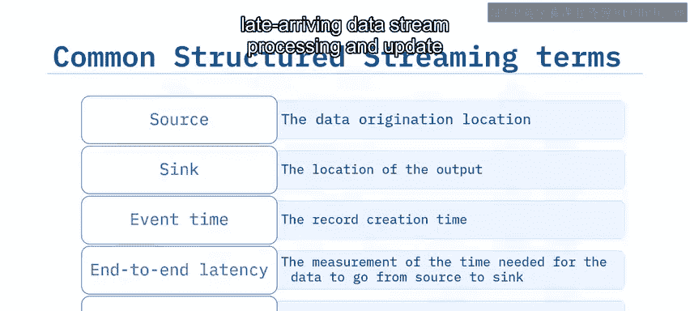

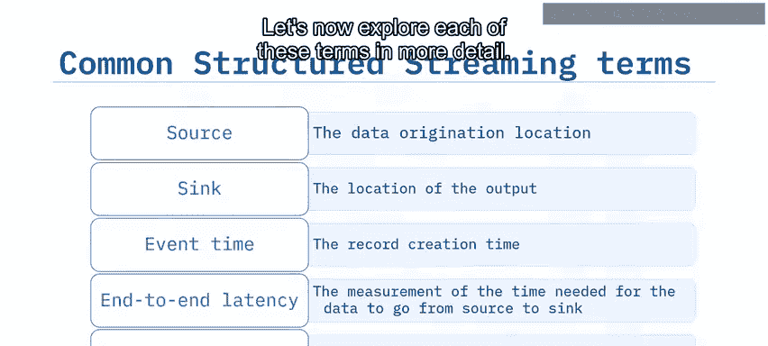

Spark structured streaming allows for many different data sources， including files， Kafka。

 IP Sockets and rate sources， and others。Spark structured streaming runs on top of the SparkSQL engine that supports standard SQL operations including select。

 projection and aggregation on sliding windows over event time that support aggregations within each window。

 you can even join your streams with persistent data on data frames or other streams。

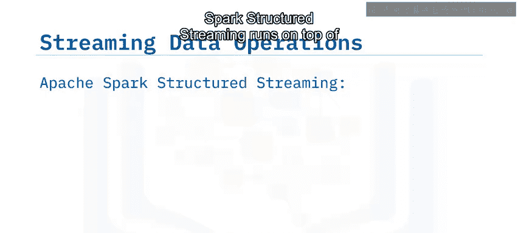

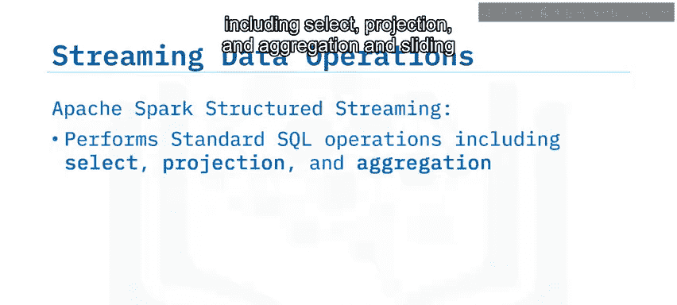

While writing data， you can specify to append the data and only add new rows of data。

 completete the data， which deletes the existing targeted data and starts the output from the beginning。

 or update existing rows。 These output modes are helpful when implementing specific requirements。

 The update output mode is especially helpful to enable and manage late arriving data points。

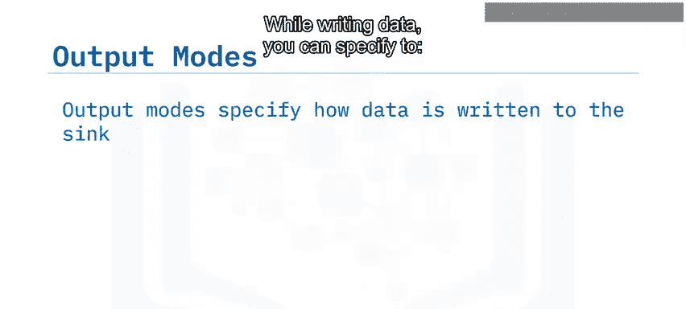

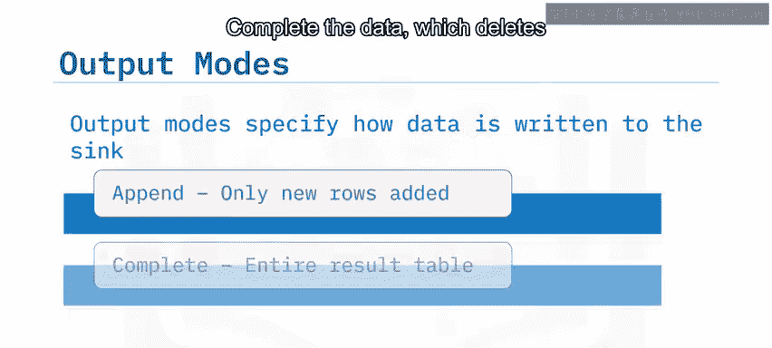

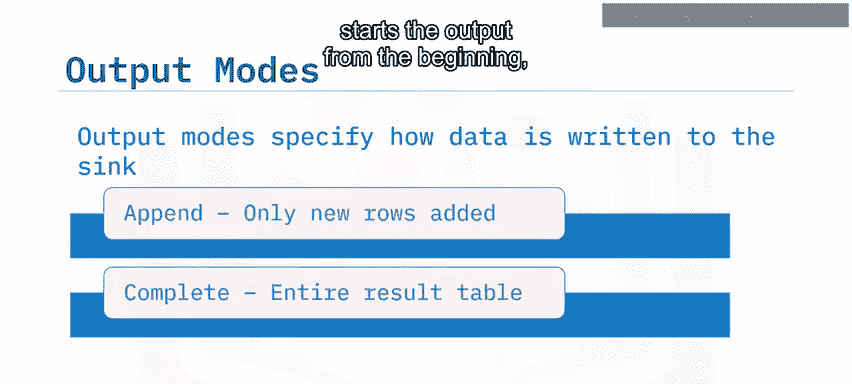

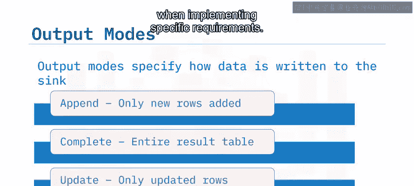

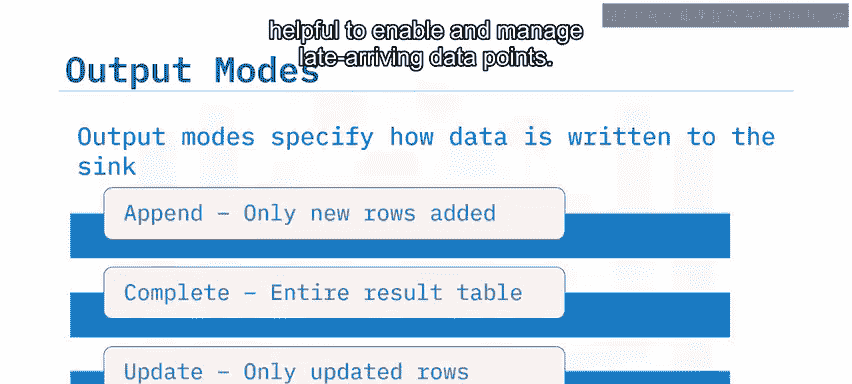

In addition to the already specified data sources like fileile。

 which outputs files to a directory or Kafka， which outputs to Kafka topics。

 structured streaming supports useful syncs， including for reach and for reach batch。

 which apply a function to each record or batch， and console and memory。

 note that the console and memory data syncs are recommended for debugging only as these data syncs are not fault tolerant。

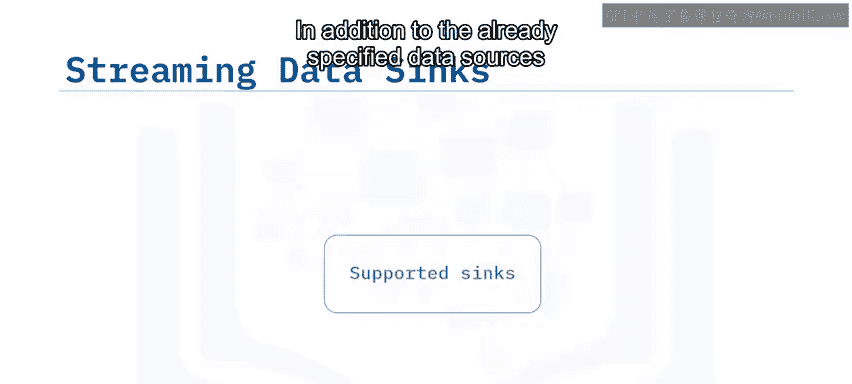

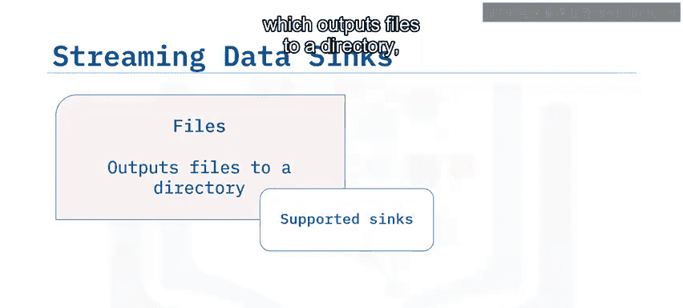

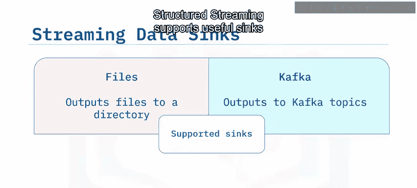

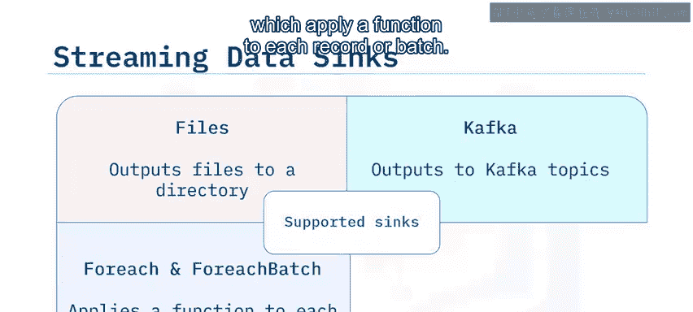

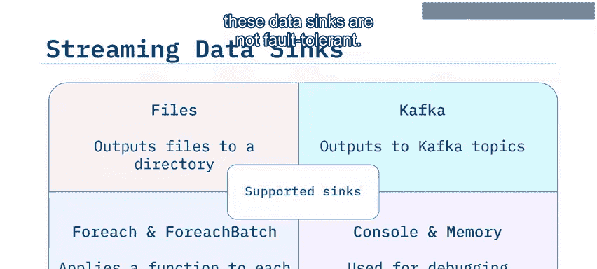

Spark streaming supports advanced features such as external listeners。

 external listeners working both through external frameworks or programmatically act as monitors on data streams to trigger events。

 to compensate for node failures， checkpointing recovers query progress on failure and enables writing streams to disk。

In this video， you learned that Apache Spark structured streaming processes a data stream with the SparkSQL engine using the data frame or data set APIs output modes of a stream append only new rows。

 complete the entire result table and update only the updated rows。

 Apache Spark structured streaming support standard SQL operations。

 window on event time and joints with static or streaming data frames。

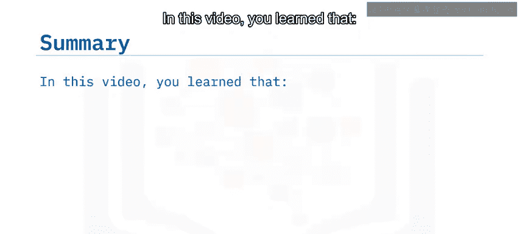

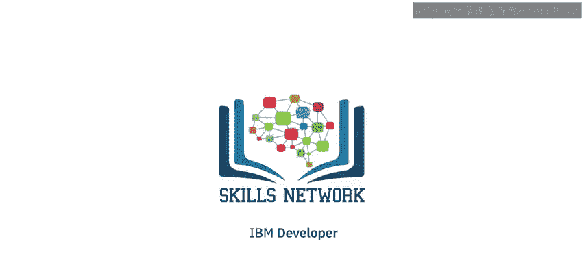