# IBM数据工程专业证书 课程12：《使用Spark进行数据工程和机器学习》｜machine-learning-using-spark｜ - P2：1_graphframes on apache spark.zh_en - GPT中英字幕课程资源 - BV17h4y1k79A

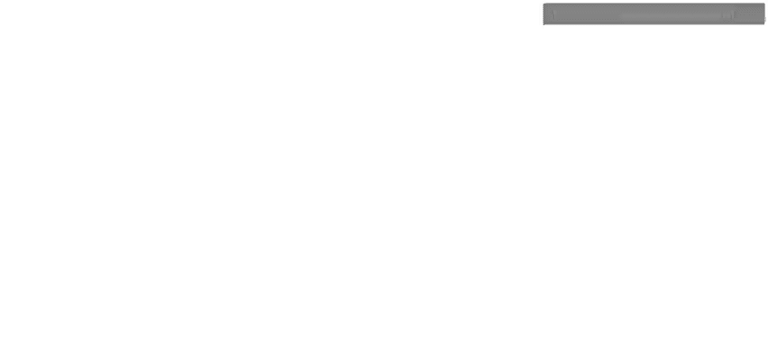

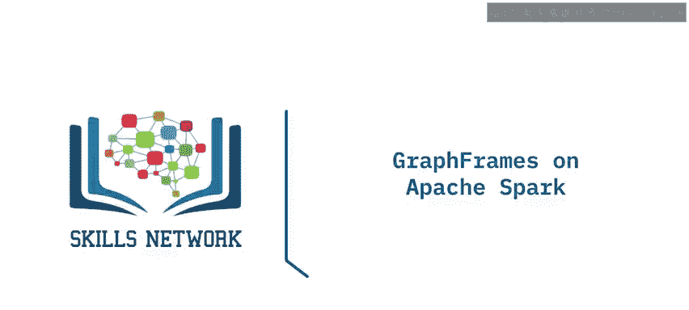

Welcome to Graph framemes on Apache Spark After watching this video。

 you'll be able to define graph theory， define graph frames。

 explore data suitable for use with graph frames。

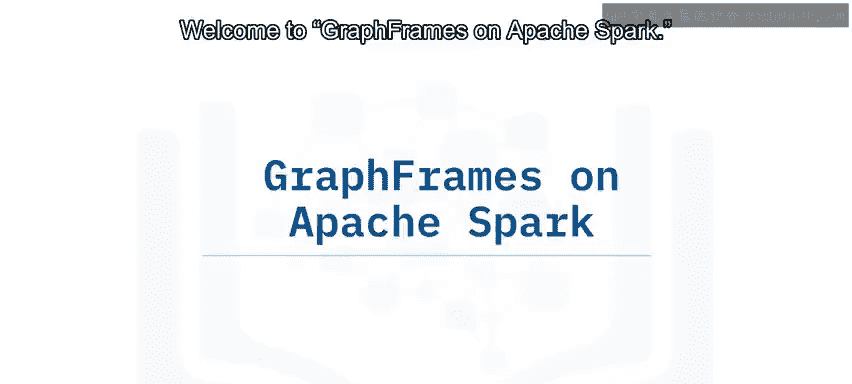

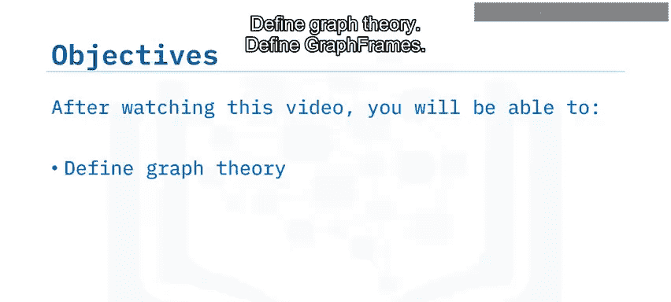

Graph theory is the mathematical study of modeling relationships between objects；

 the graph is a construct that contains a set of vertices with pairwise edges that connect one vertex to another。

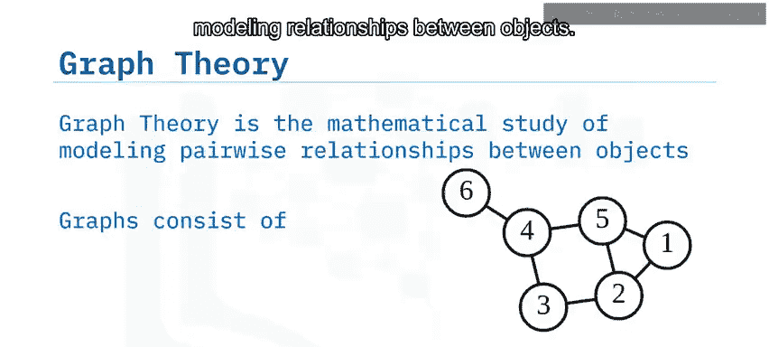

Graphs can be directed or undirected。 A directed graph contains edges with a single direction between two vertices。

 indicating a one way relationship illustrated here by the use of the lines with arrows。

 Exles include manufacturing optimization， project scheduling， train and airline route analysis。

 traffic recommendations and others。

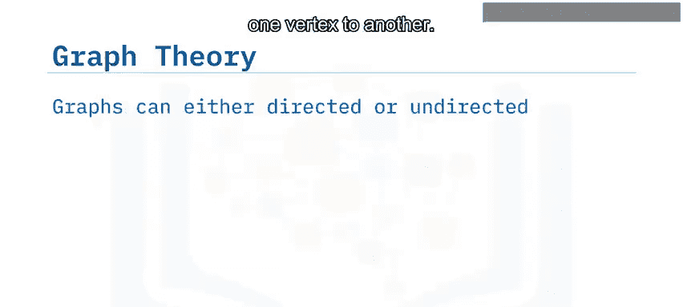

Undirectected graphs have edges that represent a relationship without a direction illustrated here by the use of liness without arrows。

 Exles include social relationship analysis， marketing analysis， genomics analysis。

 knowledge repositories and others。

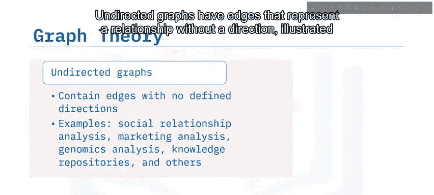

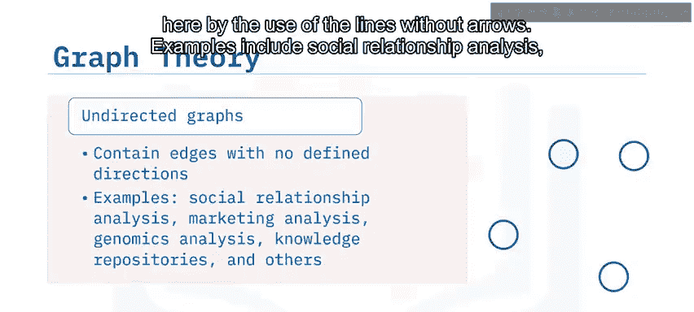

Graphras is an extension to Apache Spark that enables Spark to perform graph processing。

 run computations and analyze standard graphs Graphframes based on Spk data frames uses the same APIs and represents data as a data frame the use of data frames is the main difference between graphph frames and Gph X which is based on RDDs Graphras contains standard graph-based algorithms capable of covering most use cases Graphras is not currently included in the Spark installation and must be downloaded as a separate package。

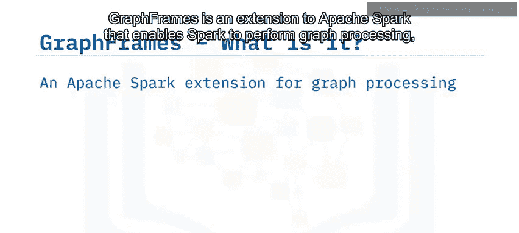

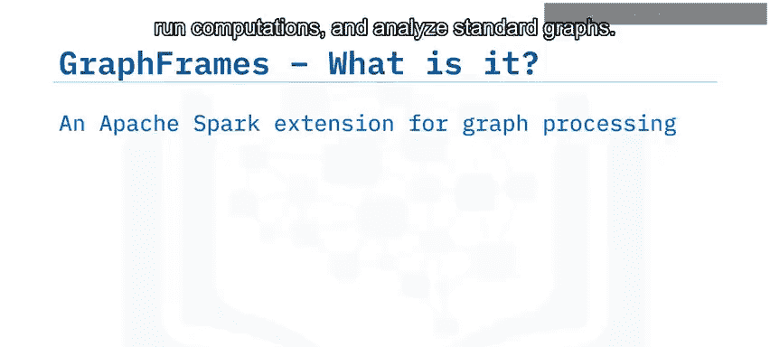

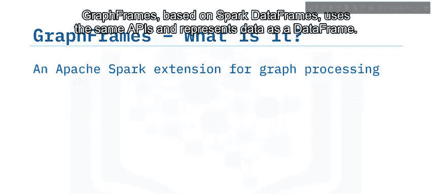

You can download and use graph frames with Spark automatically using the package framework。

 use the Spkpackages。org website to locate the correct available versions；

 otherwise the package might be unusable when submitting your Spark application with Spark Submit include the argument dash packages followed by the package group name and version as shown in the onscreen example remember to select the correct identifiers for your version of Spark this onscreen example will download and use Graras version 0。

8。1 for Spk 3。0 with Scha version 2。12。

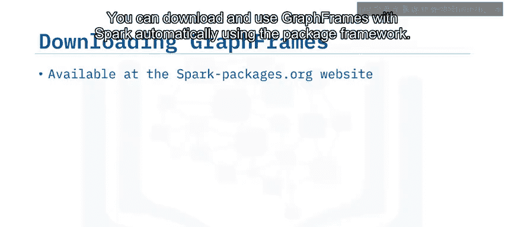

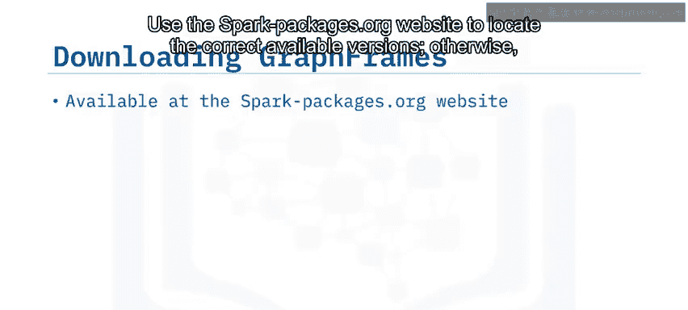

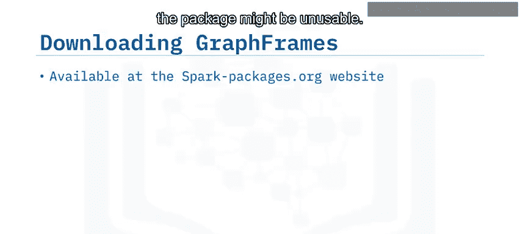

Because graphraphras is based on SparkSQL， you can use the same APIs to run SQL queries directly on the provided vertex and E data frames Graphras requires that you set a directory for checkpoints。

 Graphras supports motif finding motif finding is the search for structural patterns or a subgraph that repeats itself Graphras supports motif finding with the find method that uses domainspec language DSL to specify the search query in terms of edges and vertices。

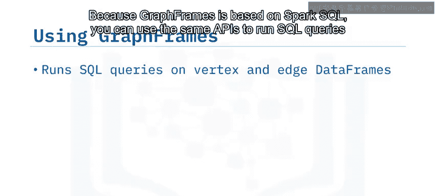

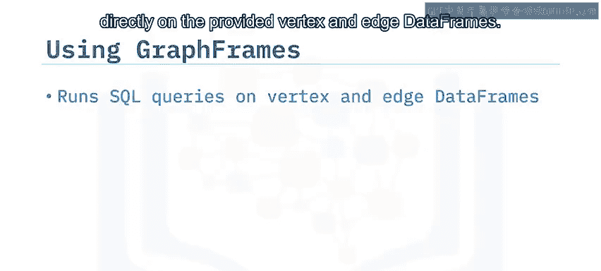

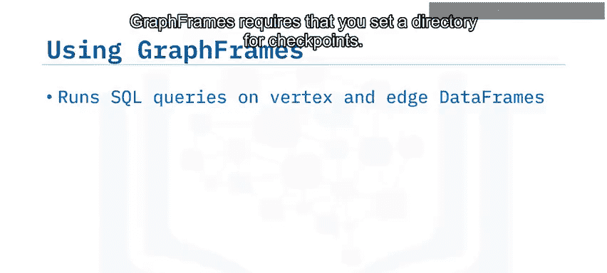

Graph frames currently supports the following widely used algorithms， breadth first search。

 connected components， label propagation algorithm， page rank， shortest paths and triangle count。

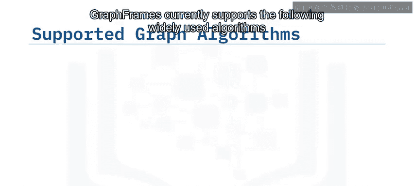

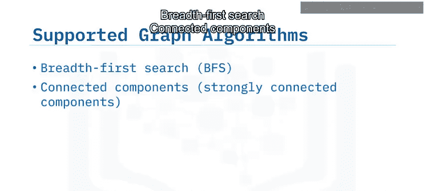

A notable everyday use of an algorithm is Page ranknk。

 as reported by Wikipedia Page ranknk originally developed by Google is the algorithm used to measure importance and rank web pages for their search engine If you're interested in how Google currently returns search results。

 the Google search blog pages provide algorithm descriptions in nontechnical but interesting detail。

Generally speaking， the type of data suited for graphras is any data that can be modeled with connecting relationships。

 you can use graph frames to compute the strength and direction of the relationship。

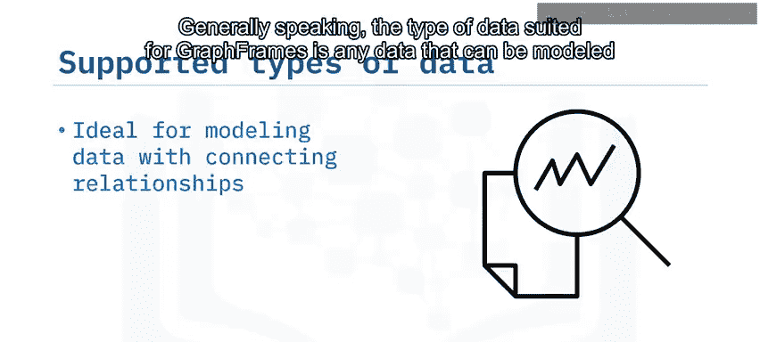

In this example， a graph where people are vertices and the relationship between people is represented by an edge with a property indicating if they are friends with a person or follow another person on a social media site In this example。

 we can see that Alice and Esther are friends。 graphraph frames produces two data frames from this data。

 one data frame for the vertices that list the people。

 and one data frame for the edges that display the relationships among the people。

 you can query these data frames individually with SpSQL or use any of the graph frames provided algorithms。

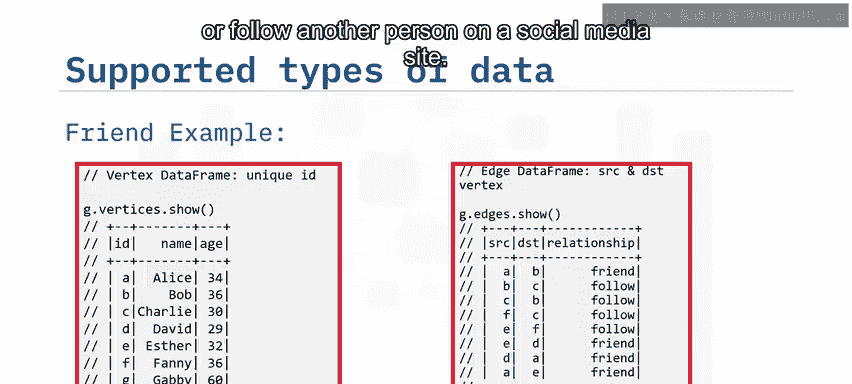

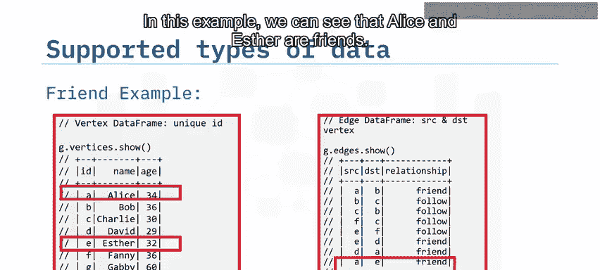

In this video， you learned that graphraph frames allows for graph processing within Apache Spk using data frames。

 Graphras provides one data frame for graph vertices and one data frame for edges that can be used with Sp SQL for analysis。

 Graph frames come with popular built in graphph algorithms or used with the edge and vertex data frames。

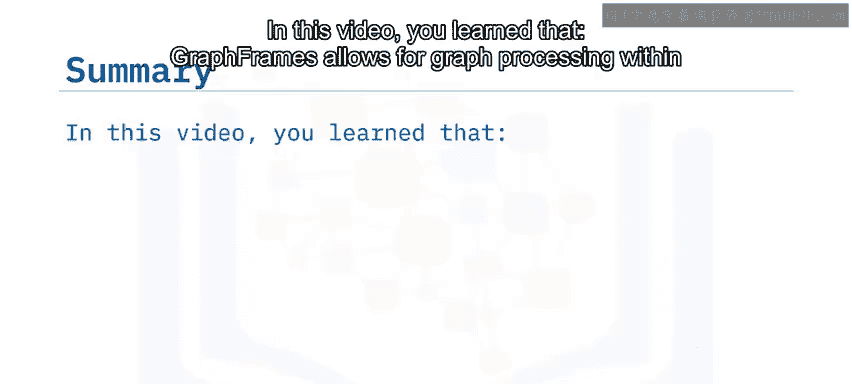

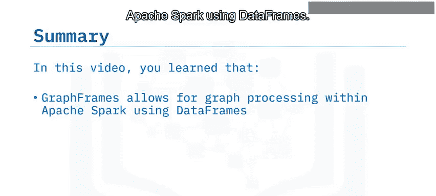

