# IBM数据工程专业证书 课程12：《使用Spark进行数据工程和机器学习》｜machine-learning-using-spark｜ - P3：2_etl 工作负载.zh_en - GPT中英字幕课程资源 - BV17h4y1k79A

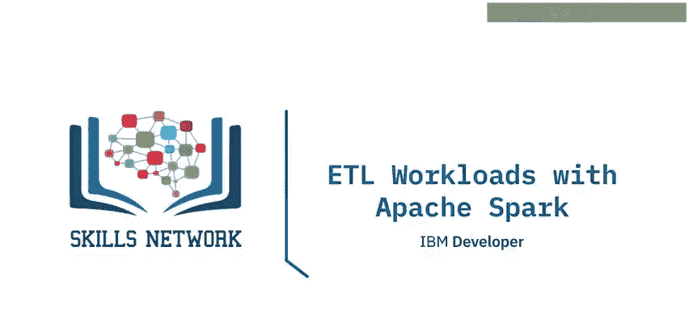

Welcome to ETL Workloads with Apache Spark。

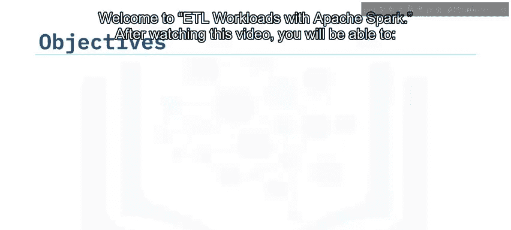

After watching this video， you will be able to define ETL， extract， transformform， and load。

 describe how to extract， transform， and load data using Apache Spark。

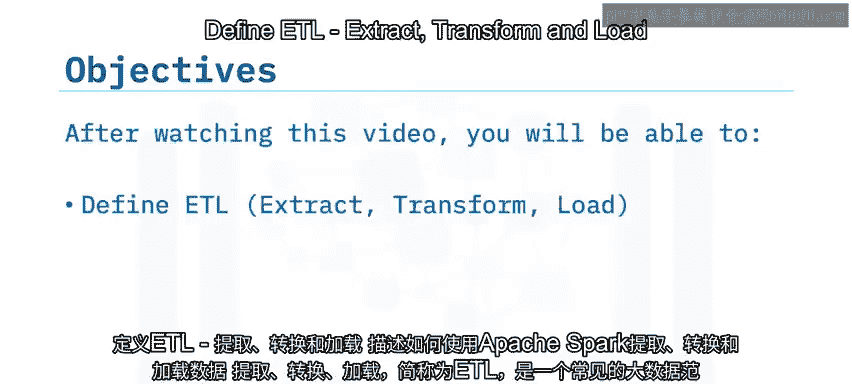

Extract transform， load abbreviated as ETL is a common big data paradigm。

 ETL describes the process of moving data from a source to another destination that has a different data format or structure。

 The extract step obtains the data from a source and reads the data into an application during the transformation step。

 you clean the data and change the data into a suitable format for the destination。

 The final load step takes the transform data and loads the data into a data warehouse database or other data sync for further transformation and analysis as needed。

Apache Spark directly integrates the standard Big data ecosystem with support for native HDFS and file formats like Parquet and other data sources。

 Another spark benefit is that you can easily clean and transform the data after extraction using the SparkSQL framework and Spark scales to handle small to large ETL workloads with ease so that you can use the same application as the data sizes increase。

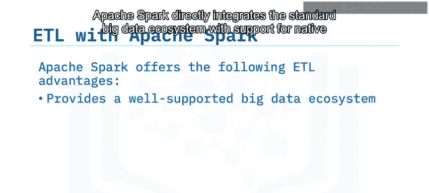

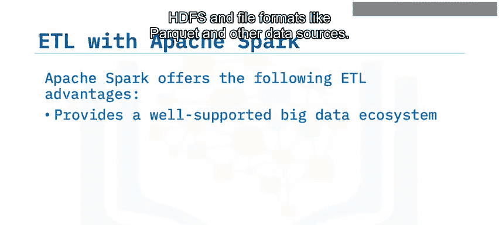

Spark supports HDFS data extraction from Parquet， Apache orRC， Hve and JDBC During the extract step。

 data can originate from more than one data source such as a parquet data set and a hive table along with built- in support for many of the most popular data sources。

 Spark also has an extendable data source API for extracting data from custom sources here you can see on screen how to load a parquet file named people into a data frame。

The goal of transformation is to clean the data after extraction。

 making the data more accessible and removing the need for additional cleaning and formatting。

 you can join data frames and group and aggregate data for later ease of use。 For example。

 eliminating unneeded columns or trimming white space from strings can result in clean data in the required format and ready for loading into the new data syncync。

 The sample here uses SpSQL first to create a view of the people data set and then uses the select operation to transform the data to people between ages 13 and 19。

The load step places your transform data in its next repository for use such as a data warehouse。

 database or other data syncs。 you can use the same Sp data sources for this process as in the extract step For example。

 the load process could write the transform data frame using a JDBC driver In this example。

 you first add the PostgresSQL driver to the application class path for use in the cluster Next。

 you write the Trans data frame to a database using the supplied PostgresSQL driver and the provided username and password。

Here is a basic example of an ETL workflow The first data source extracts a parquet file to create a data frame with a name column The next data source extracts other information such as age from a database into a second data frame data stored in the name column is cleaned and transformed into two columns to separate first and last names These two data frames are then joined and loaded into the data warehouse for further analysis using the new format。

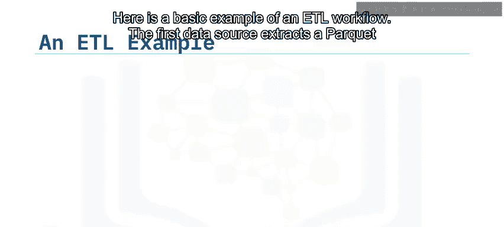

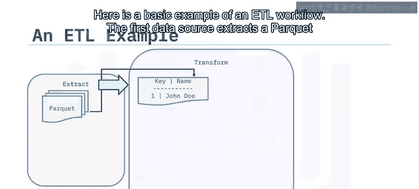

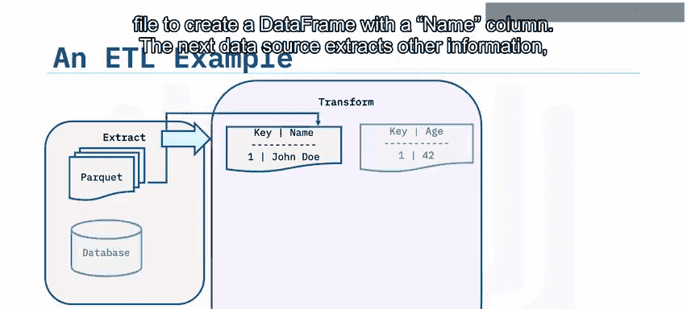

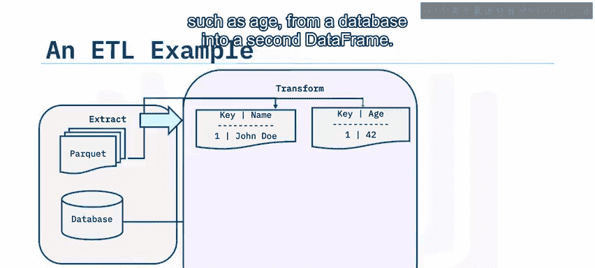

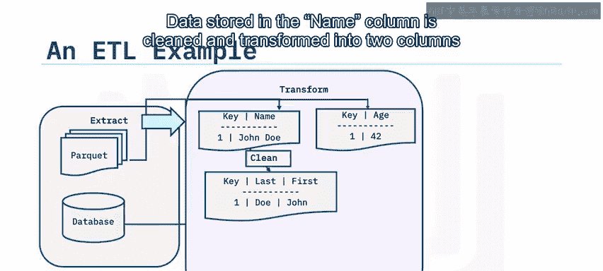

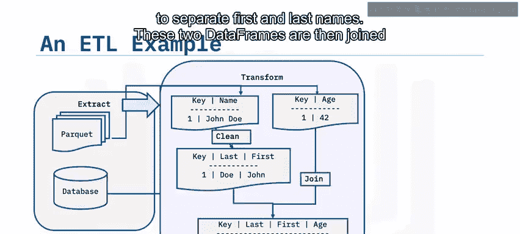

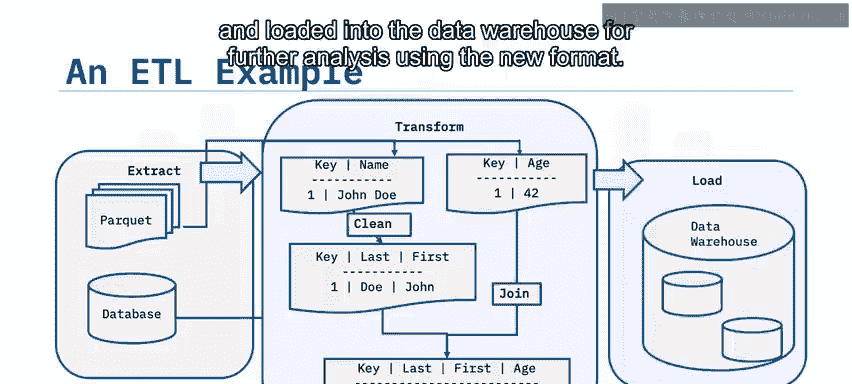

In this video， you learned that ETL is the process of extracting source data from a source。

 transforming data into a new format and loading data into a database。

 Data warehouse or other storage。 Spark can extract data from multiple supported sources。

 You can apply the Spark select command and other commands for data transformations。

 Then load the data to a new repository。😊。

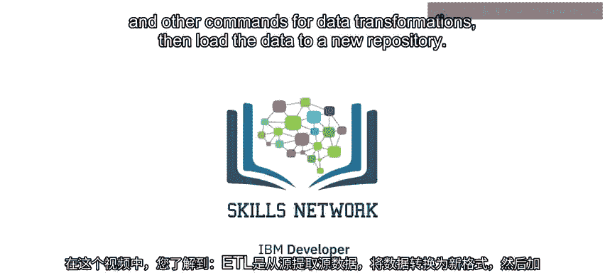