# IBM数据工程专业证书 课程12：《使用Spark进行数据工程和机器学习》｜machine-learning-using-spark｜ - P4：3_introduction to the pipeline editor in elyra 可选的.zh_en - GPT中英字幕课程资源 - BV17h4y1k79A

Today， I want to walk you through the pipeline editor of Elilira。And as you can see here。

 we are running EliLra in Kubernetes in the IBM Kubernetes engine。

 but you can run EliLRA in any environment， in Docker on your laptop or any Kubernetes environment。

So let's have a look what we have here。 So I will cover two things which aren't that important to me first。

 but then I will directly dive into the pipeline editor because Elira has a couple of more functions than only the pipeline editor。

 So here we see one thing。 This is a gi。😊，Extension， So let's actually go into a gi repository。

 which I have cloned。 And then you see here， you are actually seeing the untraed files and you can stage your changes and you can。

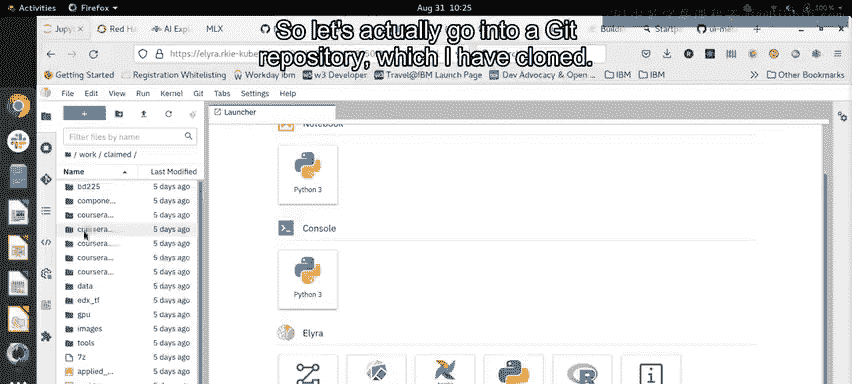

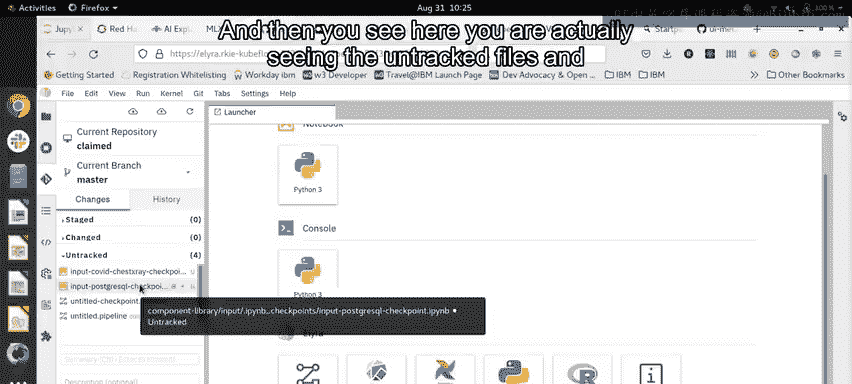

Commit and push and pull here。 You can pull。 and here you can push and all that stuff。 Okay。

 then another thing is you have here a T， O C table of content extension。

 So let's just create a new notebook。

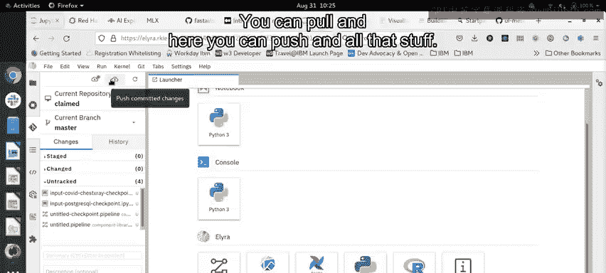

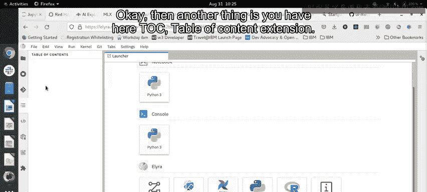

And then create a markdown cell。 And let's say here section1。

And then let's create another markdown cell and say。Sap， sap section one，1。Okay。

 so if you know go to go to the T， O C， you see here that you have actually。A TOC here。

 and also you can automatically create a number and that's quite handy。

Then another thing we have here code snippets and of course you can import code snippet libraries for different programming languages and it then comes very handy to just drag and drop the code。

 snap snippets in to the notebook and without a necessity to actually search for the code snippets。

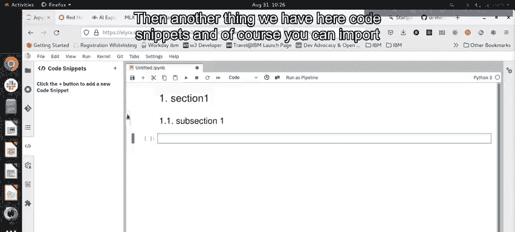

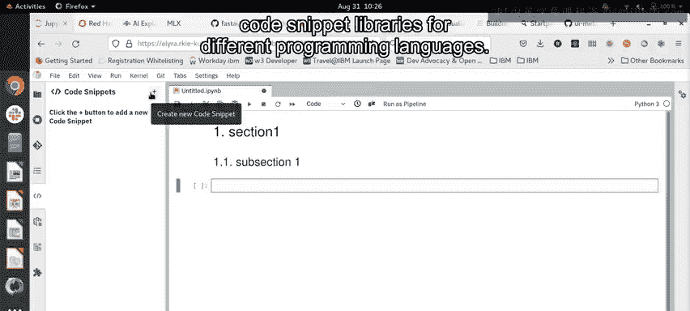

Then what we see here is configuration of run times I will come back to that later and also here。

A configuration of runtime images。 Just keep in mind that you have those two。

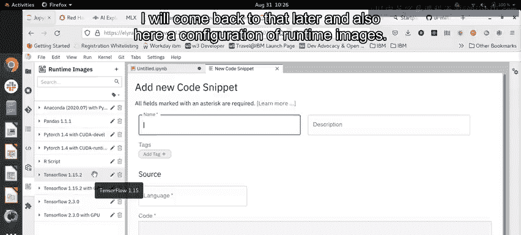

Ts here。 And then， of course， the last one is the extension manager。 Okay。

 so now let's start with the pipeline editor。

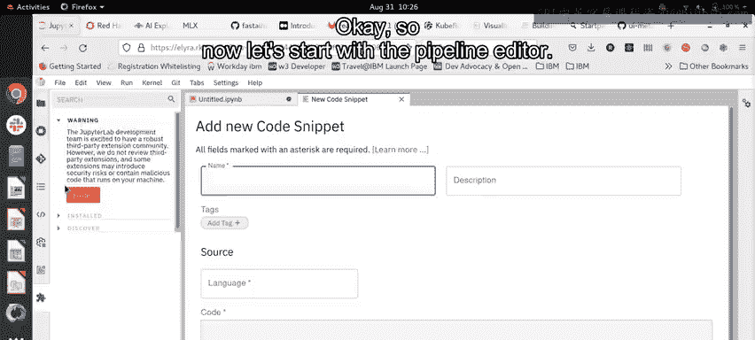

The pipeline editor is actually pretty cool。 so you can just create a new pipeline and the pipeline。

 you can then push to an execution engine。 So either you have local execution or you can use Qflow or airflow at the moment。

😊，And if you use the generic pipeline editor， you can push to local execution to Qflow and airflow。

 but we have here too specific to the execution engine pipeline editors。

 and that actually allows for using pipeline engine specific components。

 So let me just illustrate that。

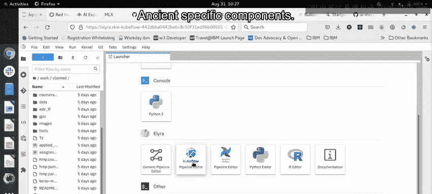

So you have here on the left hand side。A list of generic components which are， for example。

 Jupyter notebooks or Python scripts or R scripts， which we can drag and drop to the canvas。

 but now here we are starting to add cubeubeflow specific components。

 Let's have a look what we have here so that's a notebook that's of course the same as we have here。

 so then we have here for example， a filter component。Of course。

 we will have some more components in the near future， but let's have a look at ourflow。😊。

Peline data。 So we have a couple of more components already。 So batch operator。

 email operator to send emails， HTP operator。And sparkark SQL operator where you can submit SQL statements against Spar also here a Spark submit where you can submit Sp applications against the Sp cluster and then a select connector or something okay but now let's go back to the generic。

😊。

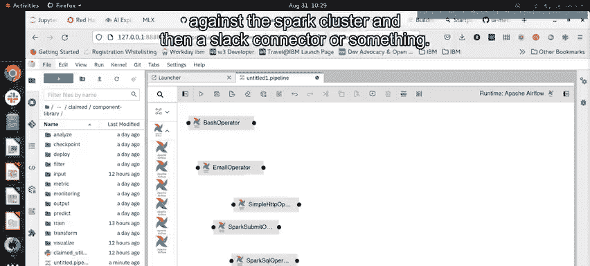

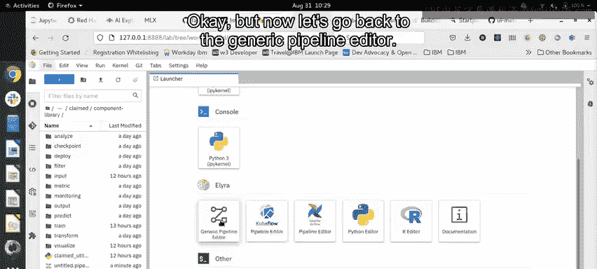

Pipeline editor。So as you are used to， you can drag and drop notebooks， Python scripts。

 and R scripts on top of the canvas and then later push it to the execution engine。

And the cool thing is， if you have a component library， then， of course。😊。

A lot of work is being done for you。 Okay， so let's consider， for example here in the input section。

 a postqre connector。

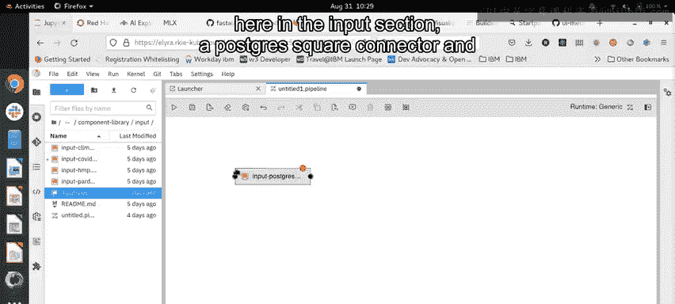

And why this is read is because you have to tell Elira which runtime image it has to sign。

To this component， that means this component here is running in its own container。And this container。

 of course， needs a runtime image， and you can actually。

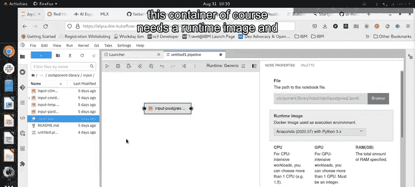

Configure those runtime images here。 Okay， so this this is the Ananaconda image。

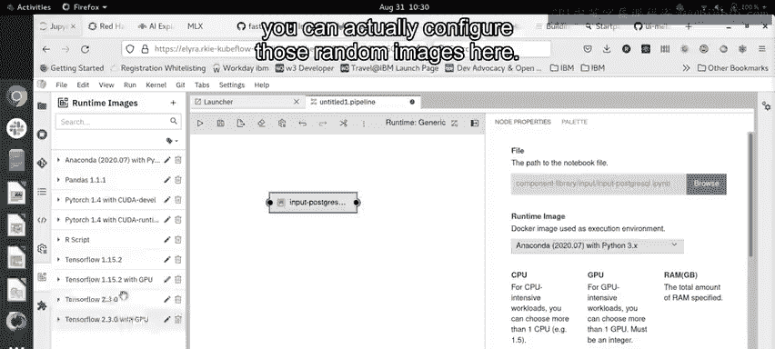

You see here that's the image name， pull policy， and so on。

 and of course you can also connect to other registries。

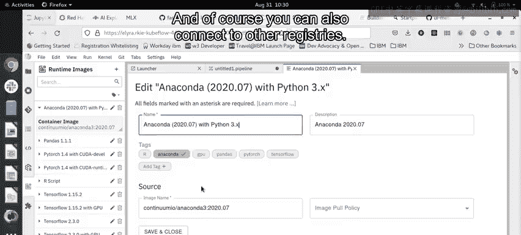

So let's go back to the editor。

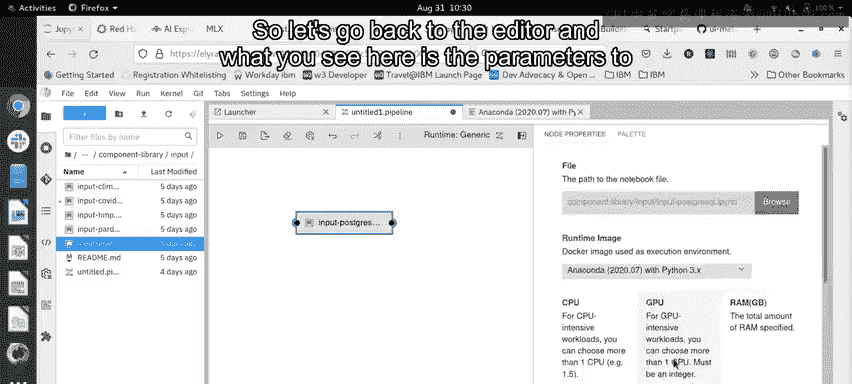

And what you see here is the parameters to that component are automatically generated in this UI here。

 So so this is a Postgres connector。 that means it pulls data from a Postgresql database。

 and of course， you need the host name， the database name， the user， the password， the port。

 the the actual SQl statement， you want to run against the Postgresql database and also some temporary directory and here also then the name of the output CV5 via the component has to store the file tool。

 And then of course， you can attach other。😊，Components of for example。

 if you want to pull data from a PostgresQl database and you want to upload this directly。

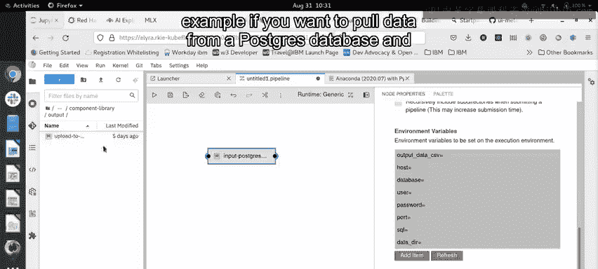

To count objects， though。

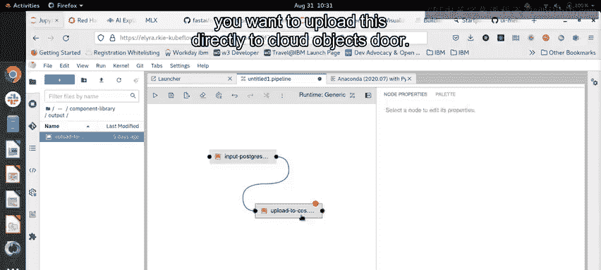

It's very easy。So you just then specify here the properties of the cloud object store。 So access key。

 secret access key， endpoint， bucket name， and so on and so on。

 And the cool thing is it works with IBM cloud object store。

 It works with Amazon S3 and with mini Mino and every S3 complyant cloud object store。Yeah， that's。

 that's more or less it for now。 So if you now drop double click on， on one。

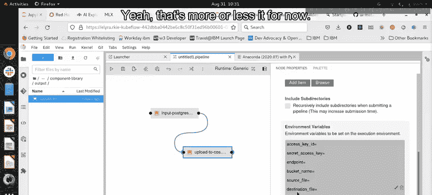

Component， the underlying Jupyter notebook opens and you see here that's the design by contract configuration of the interface of the component。

 so you have different environment variable names and those are actually set and injected through a LRA so if you go back to the pipeline you see here all those parameters are extracted for you you have to set those and they are then injected into this notebook so all those parameters are set。

😊。

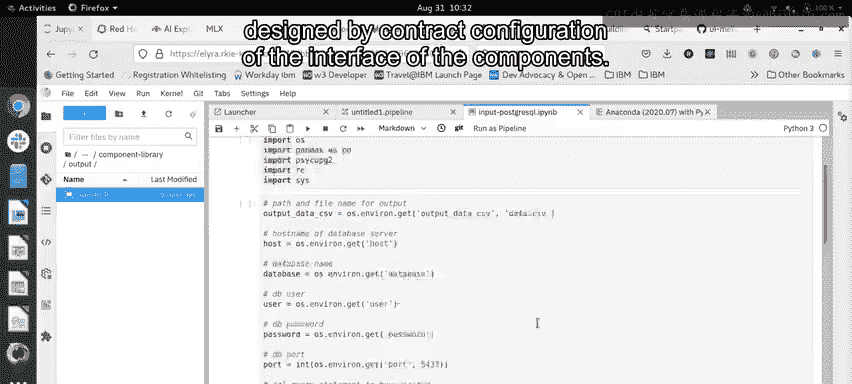

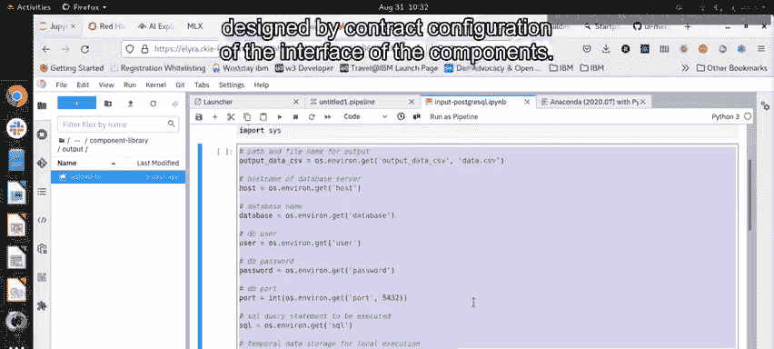

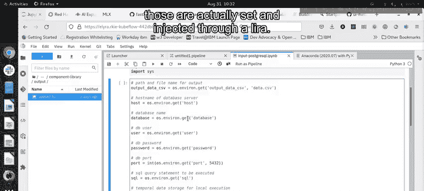

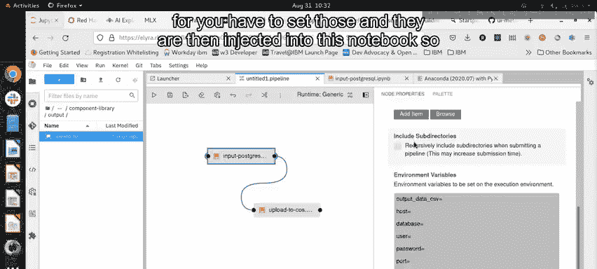

And then they are actually used。 though， it's pretty straightforward。

 You just connect to the database and you execute the SQA query against the database。

 and then you just write the data frame you obtain from the query to a C file。 I mean。

 that's work of around 5 to 10 minutes。 If you search for the code snippets and put it together。

 But that way， first of all， it's test that。 It's like opinionated。😊，And on the other hand。

 if you just drag and drop it， you don't have to code。 No。

 you still have direct access to the underlying source code。 you can modify it if you like。

 but if you don't， you have just the pure， no code experience here。 Okay， and it's fully open source。

 And the really， really cool thing here is if we say run if it will fail， of course。

 because all the parameters are not set， but just to illustrate it can have a local execution。

 but we can just send it to Kubernetes。 So to Q Pro pipelines。

 it gets packaged up and send to Kubernetes。 And also this。😊。

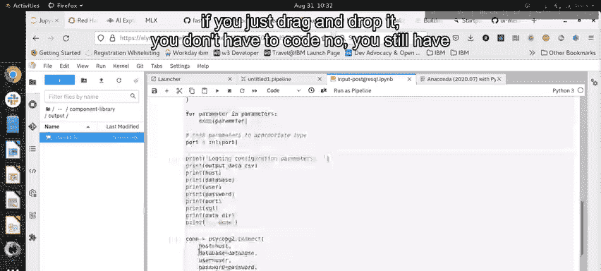

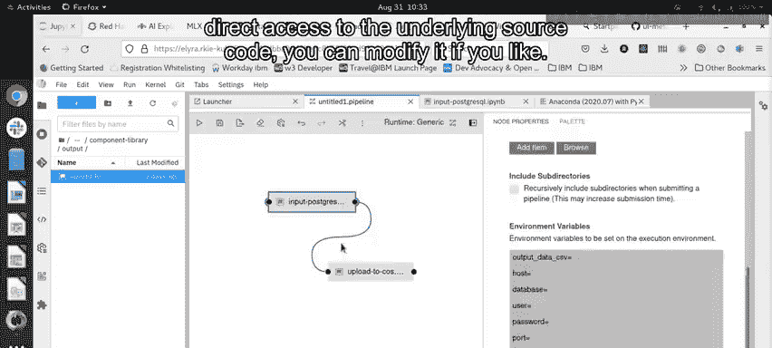

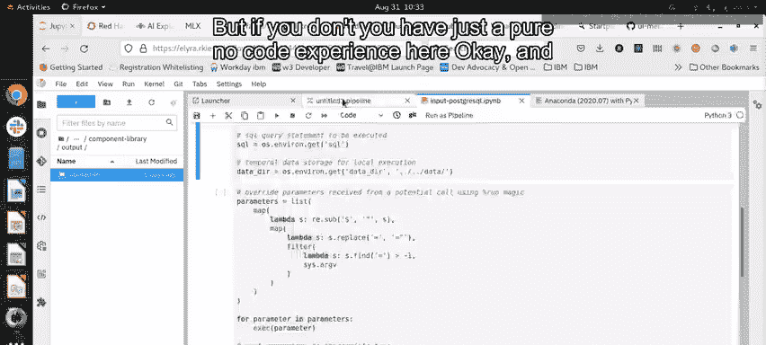

Cubeflow instance here is running the IBM cloud。 You see that here at the at the URL。

 but it can run anywhere， of course and。

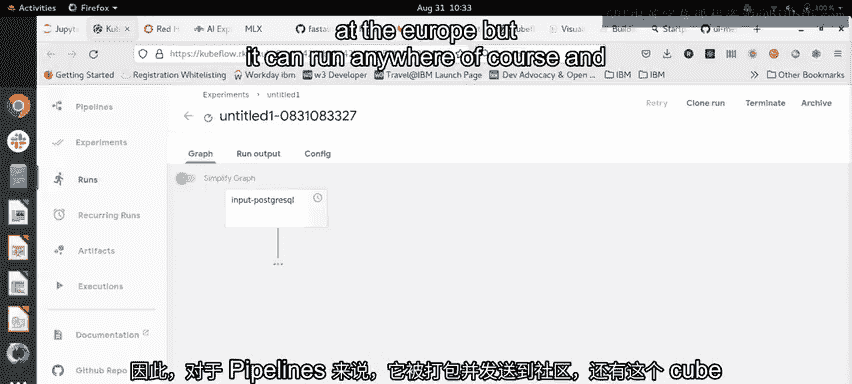

You directly get a lock。 So every execution stage， which is backed by one single notebook is running inside a container。

 Those containers， of course， running in a pot in Kubernetes and you directly get the standard outstreamed。

😊。

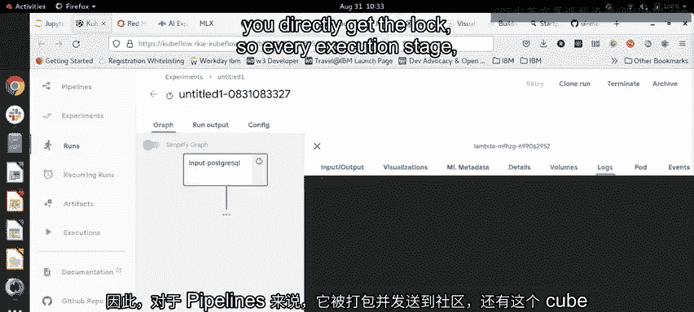

And of course， here， we have an exception because we didn't set the variables。 But anyway。

 this is how it works。 In addition， if you don't want to use the low code， no code style。

 you can still just。😊。

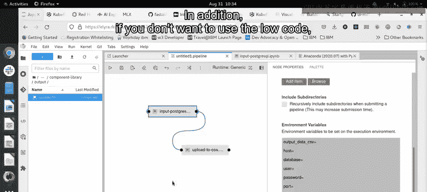

Use a pure Python based script or notebook。 So the library， by the way。

 this library is called claimed componentent library for AI machine learning and data science。

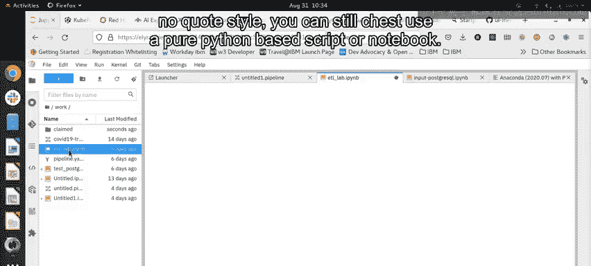

No， component library for AI machine learning EL and data science。 So I will just cover everything。

 you can use this library also without Elilira and without a UI。

 The only thing to use a component is such a call here。 So you have i Python。

 and then you address the component， which is a notebook。

 And then you can pass all the available parameters。

 And the way how this is done is basically through this loop。😊。

I have already externalized this from the notebook， but just to illustrate here。

 we are just passing all the environment variables， which are sorry。

 the the arguments which have been passed to the notebook。

 and then we just use the exactec function of Python to set this as an environment， sorry as a as a。

😊，Variable， okay。And then that's basically also you can use this library from anywhere。

 and then finally that's just one thing I want to mention we have created C3。

 This is the claimed component compiler which takes such a notebook and creates a Qeflow pipeline component for you and those get uploaded to ML exchange okay so that means you can create your components by simply creating a Jupyter notebook。

😊。

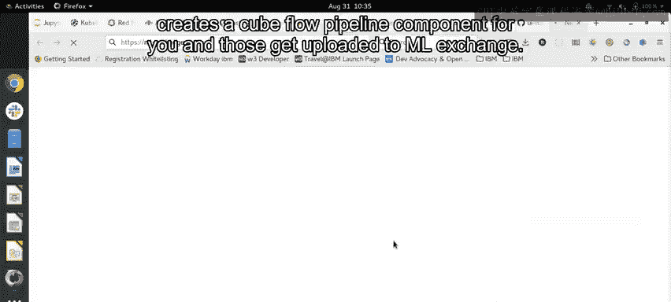

And use C3 sort of claim component compiler， which creates a Qflow component out of you this you can upload to ML exchange and then you have it in a repository where you can also search for the components and later on you can use those components in any Qeflow environment So in pure Qubeflow or in the IBM Watson pipelines tool or in EliIra itself。

😊，Okay， so I hope this makes it a bit more clear and if you have any questions。

 just post them to the forum or to the comment section Thanks a lot bye。😊。

