# IBM数据工程专业证书 课程12：《使用Spark进行数据工程和机器学习》｜machine-learning-using-spark｜ - P5：4_sparkml 基础.zh_en - GPT中英字幕课程资源 - BV17h4y1k79A

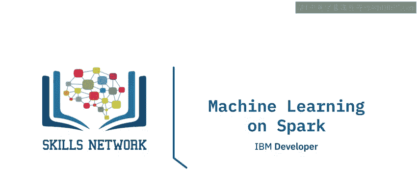

Welcome to Machine Learning on Spark。

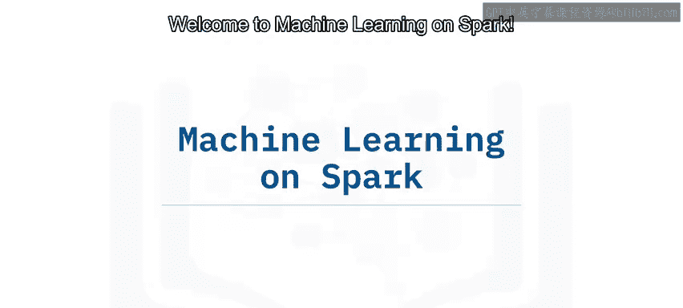

After watching this video， you'll be able to define machine learning。

 summarize Spark ML Lib capabilities， describes Spark ML Lib pipeline capabilities and benefits。

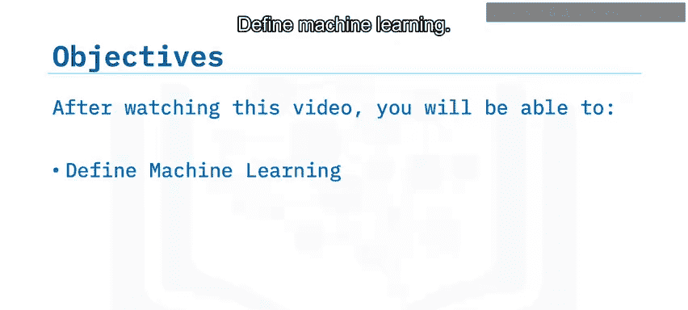

What is machine learning， Mach learning is a branch of computer science and statistics that deals with algorithms that automatically learn from data。

 These algorithms are not explicitly programmed to do a task。 Instead。

 these algorithms learn from data and experience。 Ma learning systems generally tend to improve in performance with more data provided to them。

 Ma learning applies statistical tools that are the backbone of artificial intelligence。

 A machine learning system applies a specific machine learning mode to train data models。

 After training the model。 The system infers or predicts results on previously unseen data。😊。

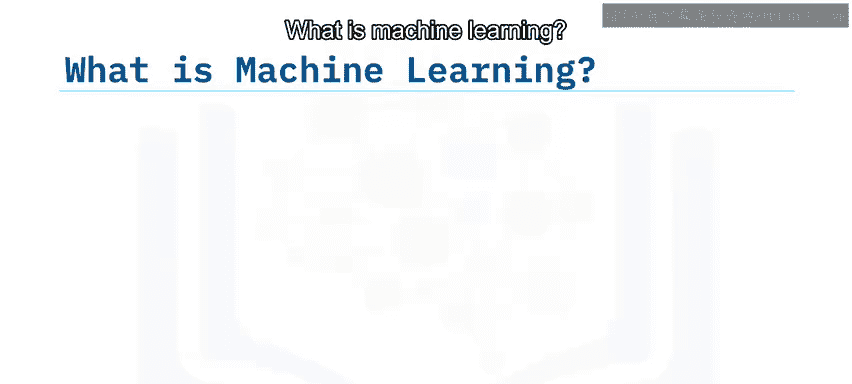

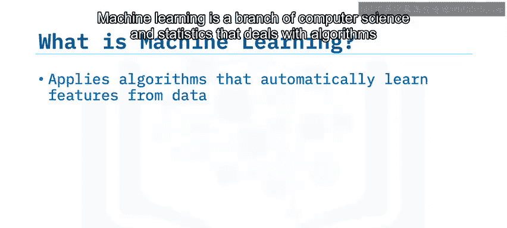

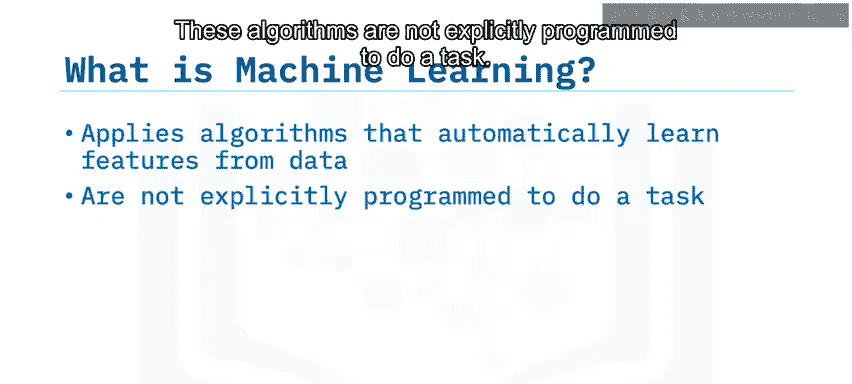

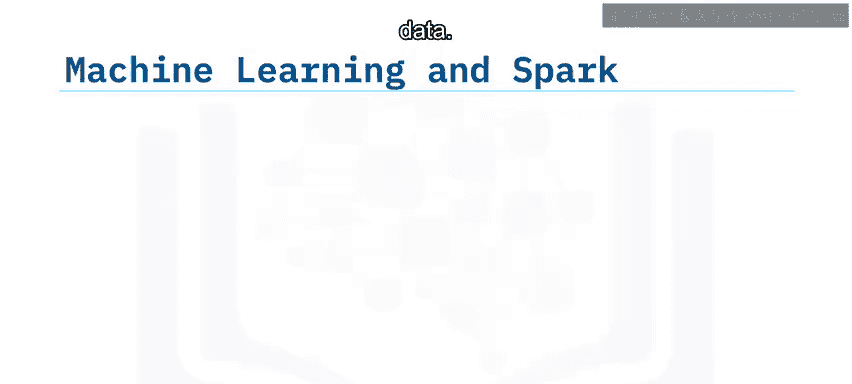

The Spark ML Library is commonly referred to as MLLB MLLB stands for Machine Learning Library and isPAark's Maine Learning API MLLB applies practical machine learning algorithms and is scalable MLLB performs machine learning operations including training models using data frame based APIs。

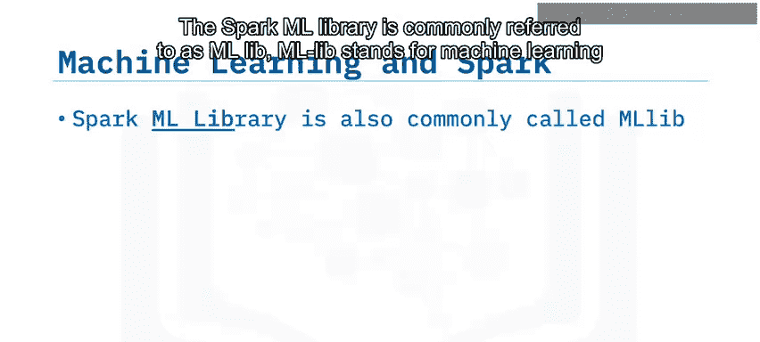

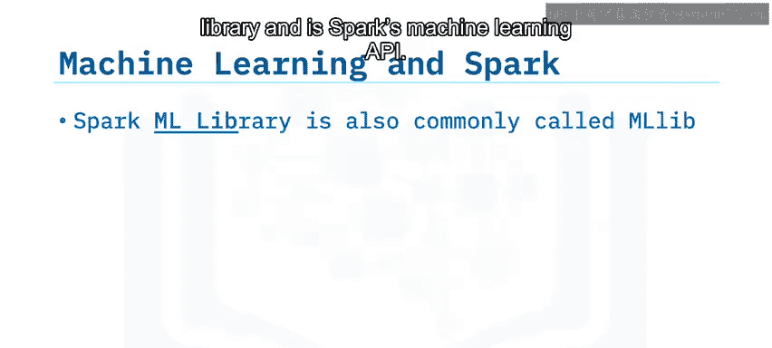

MLlib provides many tools to implement a machine learning system。

 such as machine learning algorithms。 Spark MLlib comes prepackaged with standard machine learning algorithms for clustering。

 classification， regression and other tasks。 In addition。

 MLlibB offers feturization with functions that easily extract features of interest from raw data。

 including functions for feature extraction， dimensionality reduction and string tokenization and others。

 Let's check out three Spar functions。

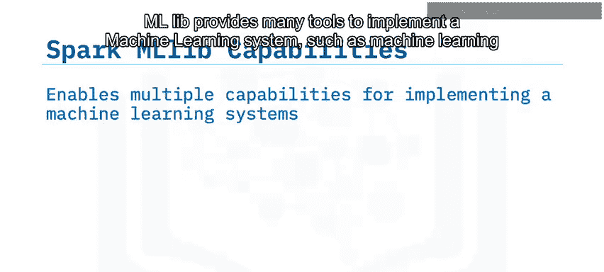

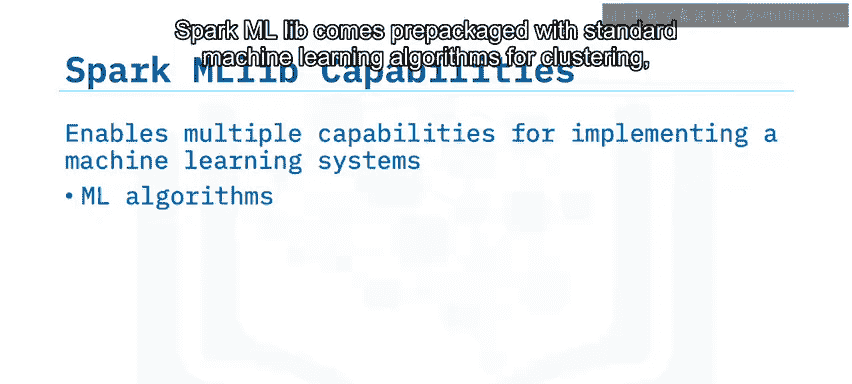

Pipelines Spark MLlibB exposes a pipeline API that makes the machine learning end to end system easier to develop。

 train and deploy Perence you can save and load models and pipelines easily using Spark MLlibB Perence is beneficial for models trained on large dataset sets that require multiple training checkpoints utilitiesities Spark MLlib eases day to- day machine learning tasks with handy functions from statistics。

 linear algebra， image processing and others。MLLP supports standard Spark supported data sources。

 including Parquet， CSV， JSON， and JDBC。

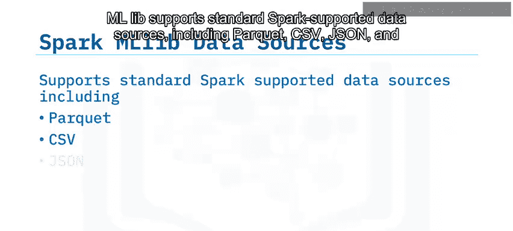

MLlibB also has special libraries to support images and LibB SVM data types and supports both a feature vector and a label column data Images are a common and frequently used data source for machine learning models。

 especially for computer vision applications LibB SVM is a type of data frame that has a feature vector and a label column。

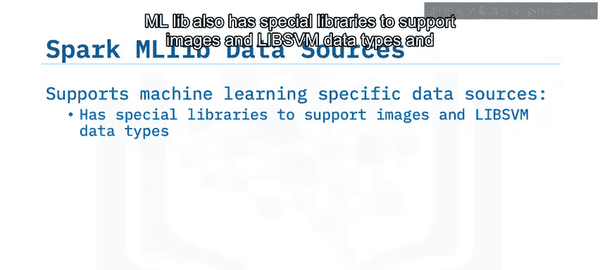

MLlib includes many inbuil utility functions， which help during the intermediate steps of data processing。

 cleaning and model building。 Here are several commonly used utilities。

 The linear algebra package implements basic linear algebra data types such as vectors and matrices。

 the statistics package contains functions to calculate correlation and perform hypothesis testing。

 The feature module converts raw data into useful features that train the machine learning models。

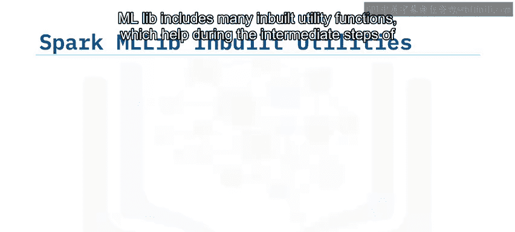

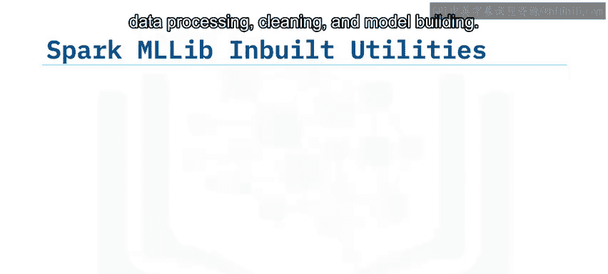

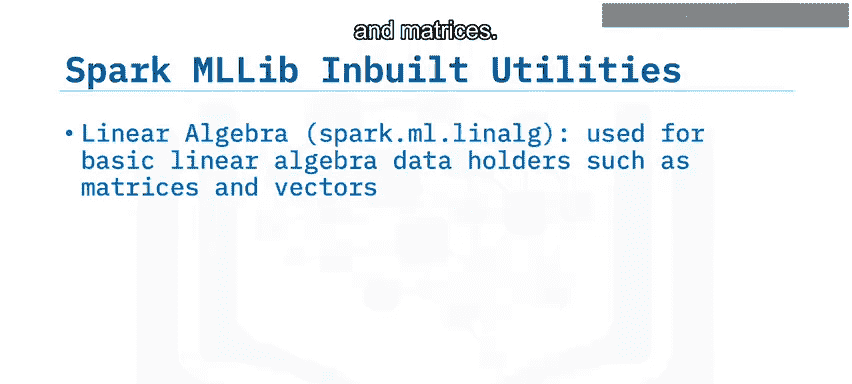

Let's check out this example that shows the use of the correlation utility functions。

 This example uses the linear algebra library to create vectors。

 then the Stas library determines the correlation between these vectors。

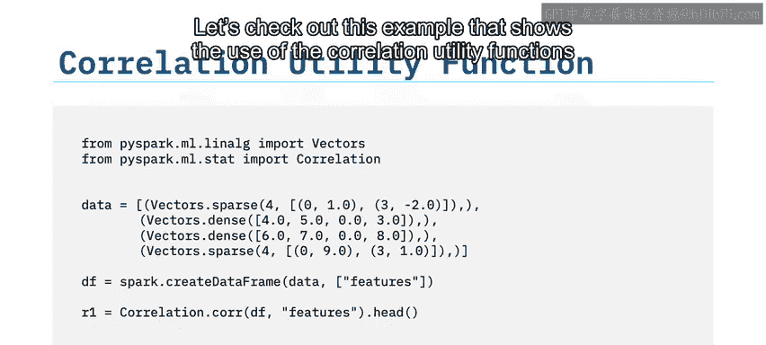

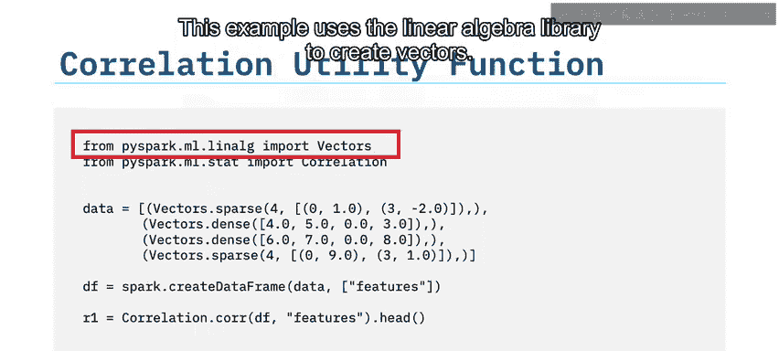

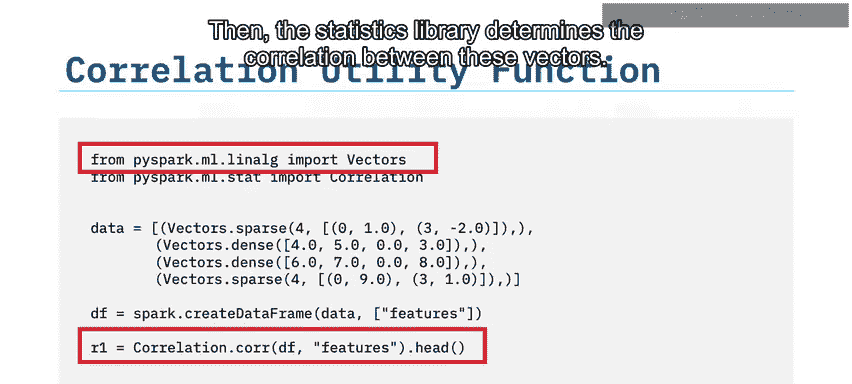

Another essential member of the Spark machine learning ecosystem is machine learning Pis。

 Spark exposes a pipeline API to build machine learning pipelines。

 Ma learning pipelines combine multiple algorithms and pieces of a machine learning system into a single workflow or pipeline。

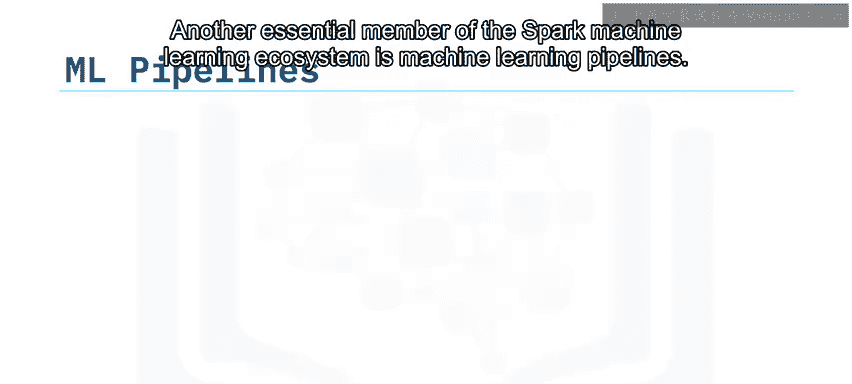

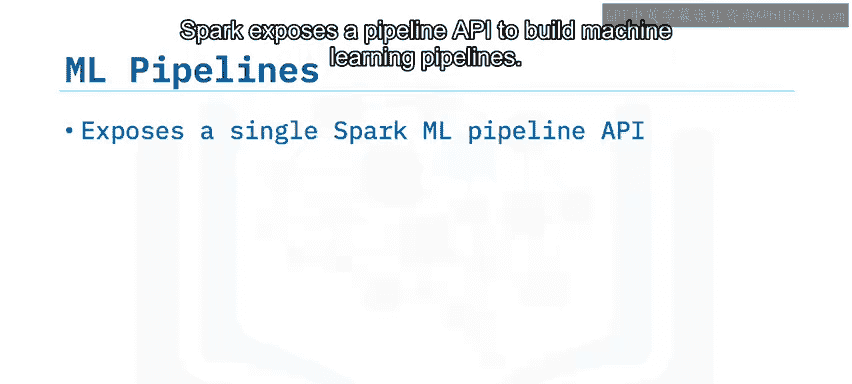

Transformers， as the name suggests convert the data in one data frame into a different data frame For example。

 a machine learning model is a transformer object that converts feature data into predictive data estimators encapsulate the algorithm and the learning process that the models undergo on training data you can use transformers estimators and the pipeline API to build machine pipelines on Spark。

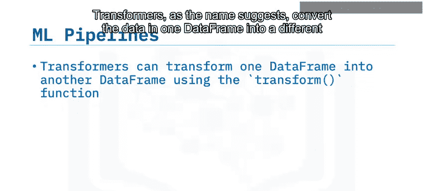

In this video， you learned that machine learning is a branch of computer science and statistics that deals with algorithms that automatically learn from data。

 In addition to supporting standard data types， Spark Mlibib also has special libraries to support images and Lib SVM data types。

 Spark Mlib provides many tools to implement a machine learning system。

 including machine learning algorithms， feturization， pipeline persistence and utilities。

 Spark exposes a pipeline API to build machine learning pipelines， machine learning pipelines。

 save developers time and effort by combining multiple algorithms and pieces of a machine learning system into a single workflow or pipeline。

😊。

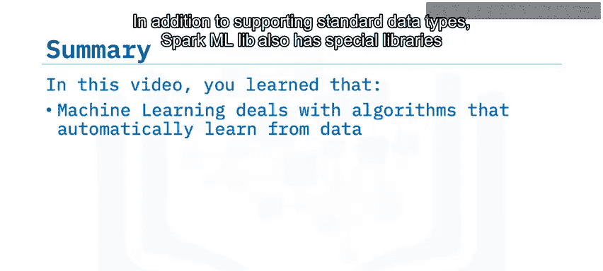

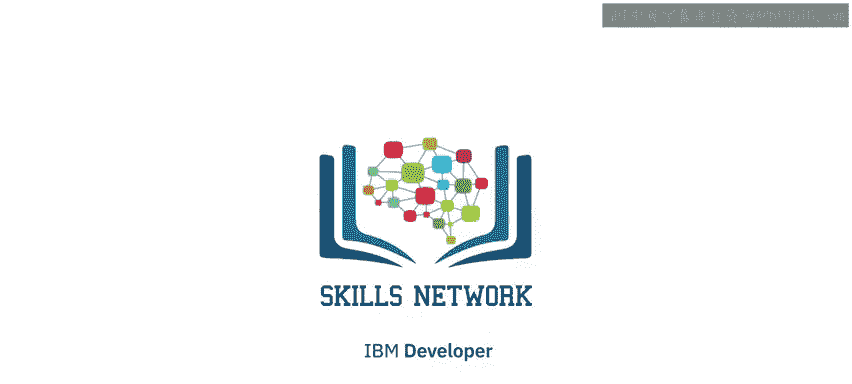