# IBM数据工程专业证书 课程12：《使用Spark进行数据工程和机器学习》｜machine-learning-using-spark｜ - P6：5_分类和回归使用 apache spark.zh_en - GPT中英字幕课程资源 - BV17h4y1k79A

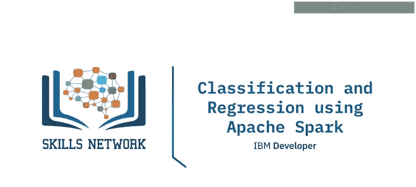

Welcome to Class and regressionion using Apache Spark。

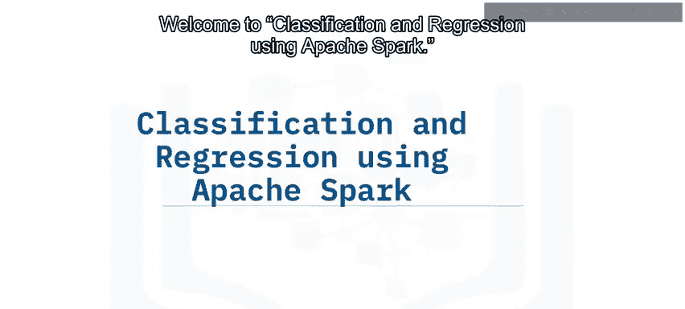

After watching this video， you'll be able to describe supervised learning and its relationship to regression。

 explain the differences between classification and regression。

 describe how Spark ML supports machine learning tasks。

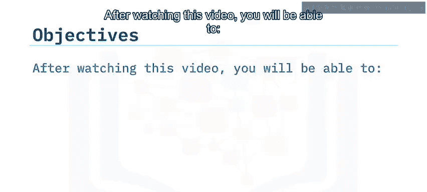

Supervised learning is a subset of machine learning algorithms In supervised learning。

 the machine learning model learns from data and corresponding labels。

 The explicit labeling of data imparts the supervision aspect to supervised learning。 In most cases。

 a supervised learning model improves with more high quality labeled data。 However。

 labeling data is often time consuming and expensive。

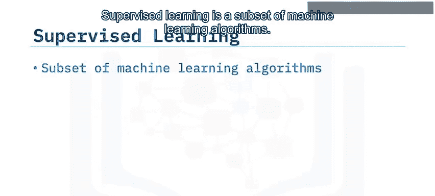

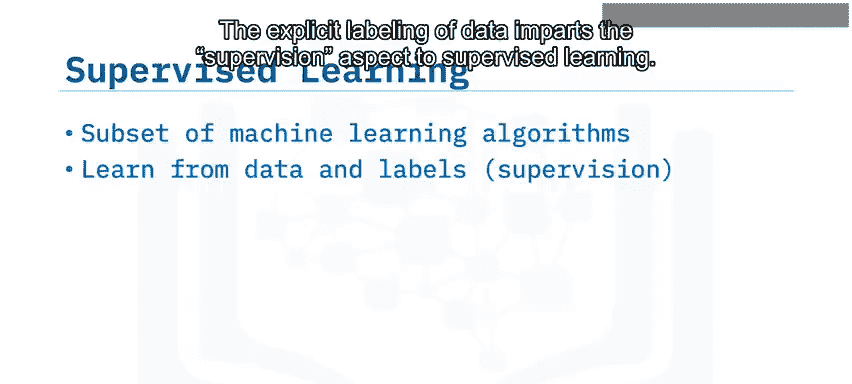

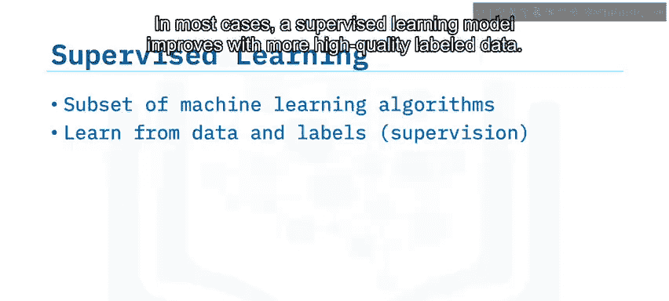

Classification is a supervised machine learning task that produces a prediction or output from a discrete set of possible outcomes。

 The model in this case tries to predict the class each object belongs to， For example。

 predicting the winner in a sports tournament， predicting heads or tails on a coin toss。

 classifying images and others， in each of these examples。

 the model determines each outcome by assigning a class to the input object。On the other hand。

 when a model approximates an implicit function and predicts values for an input variable。

 we call this taskask regression。 The predicted value is usually a continuous real number such as a float or an integer。

 weather predictions， stock market price prediction。

 house value estimation and others make use of regression， Note how the model estimates F of x。

 where x is a variable in each example， with weather prediction。

 we can think of whether as F of T a function of time and the regression task is to estimate what the function looks like。

 or what value F of T has for all possible。

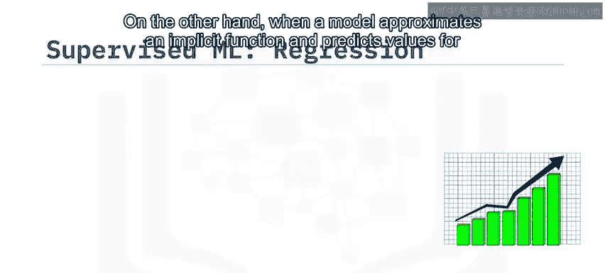

How do you perform supervised machine learning on Apache Spark Spark ML LibB provides libraries for both classification and regression use the Spk。

ml。class library for classifications and use the Spark。ml。re library for regressions。

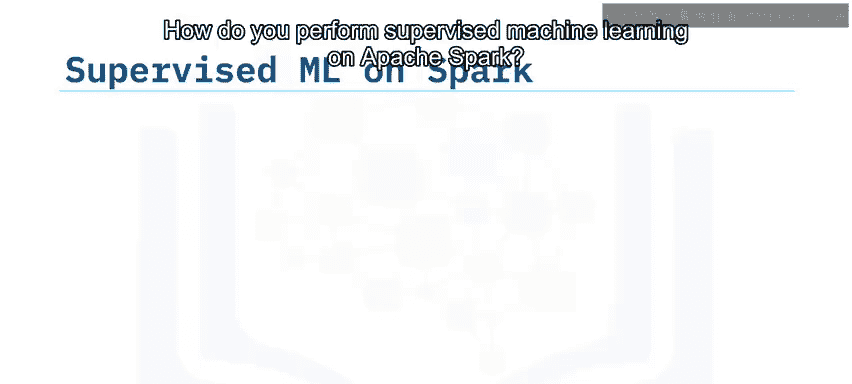

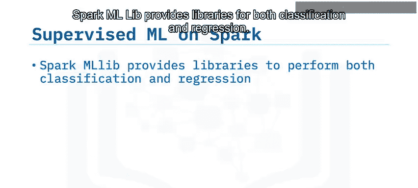

Let's look at the classification library in more detail The Spark ML classification Library comes with inbuilt implementations of standard classification algorithms such as logistic regression classifier。

 decision trees， random forests， support vector machines， naive bays。

 one versus all classifiers and others。

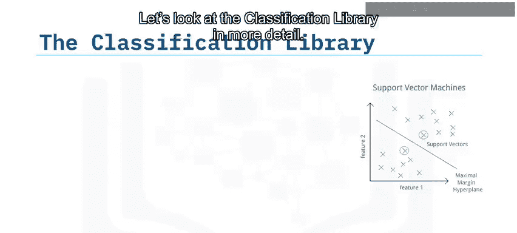

Similarly， the Spark regression Library provides inbuilt implementation standard regression algorithms such as linear regression。

 generalized linear models， decision tree regression， survival regression。

 isoonic regression algorithms， and others。In this video。

 you learned that supervised learning is a subset of machine learning that includes classification and regression。

 Classs produce a prediction from a discrete set of possible outcomes。

 regression is a form of an implicit function approximation。

 where the model predicts real valued outputs for a given input。

 Spark ML supports both classification and regression tasks with an abundance of parallel scalable algorithms。

😊。

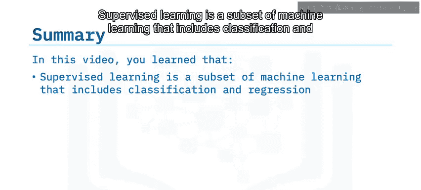