# IBM数据工程专业证书 课程12：《使用Spark进行数据工程和机器学习》｜machine-learning-using-spark｜ - P7：6_sparkml 聚类.zh_en - GPT中英字幕课程资源 - BV17h4y1k79A

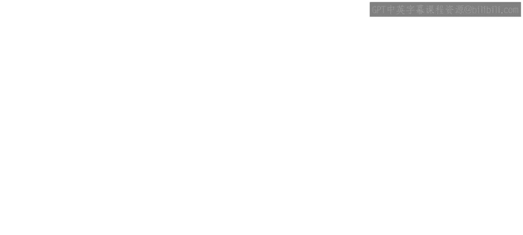

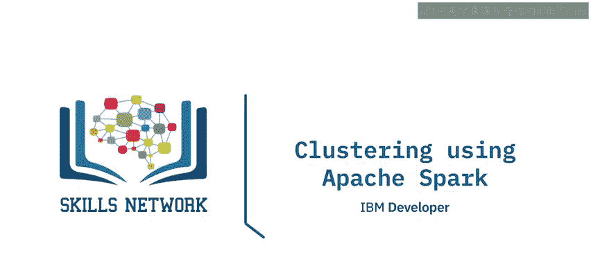

Welcome to clustering Using Apache Spark。

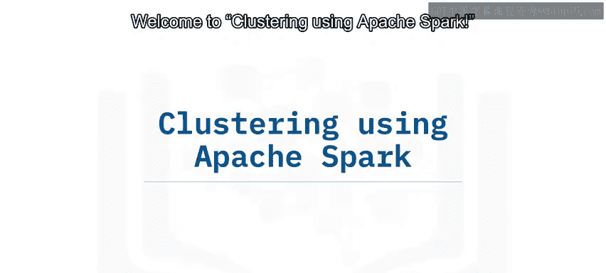

After watching this video， you'll be able to compare supervised and unsupervised learning。

 Def clustering one type of unsupervised learning。 applyly the K means clustering algorithm with Spar ML Llib。

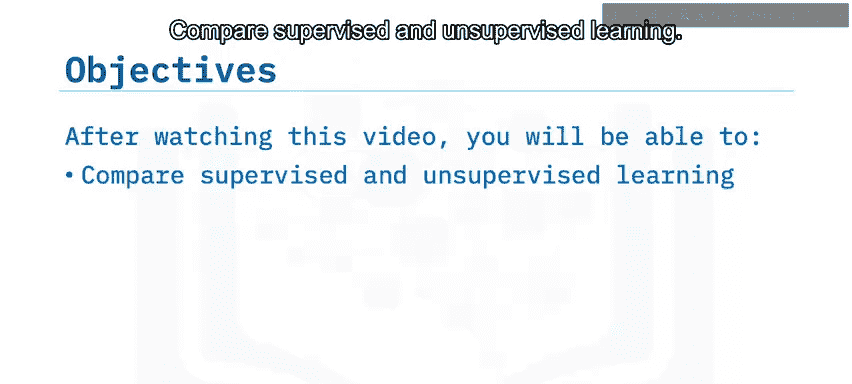

One popular subset of machine learning is unsupervised learning， as the name suggests。

 unsupervised learning does not involve any supervision。 In contrast to supervised learning。

 unsupervised learning does not use explicitly labeled datasets comprised to features mapped to labels to train the model。

 Instead， the model automatically learns patterns and groups。

 also known as latent spaces within the data。 unsupervised learning is generally more advanced and more complex to perform than supervised learning。

 Exles of unsupervised learning include clustering algorithms and recommender systems。😊。

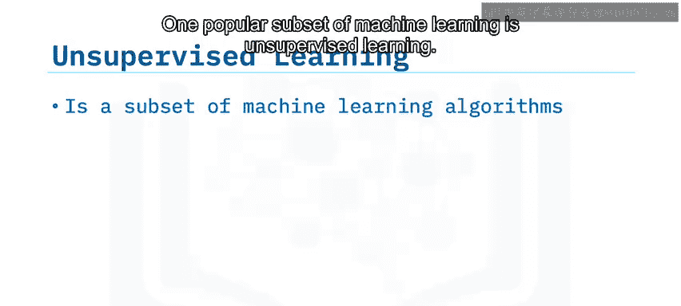

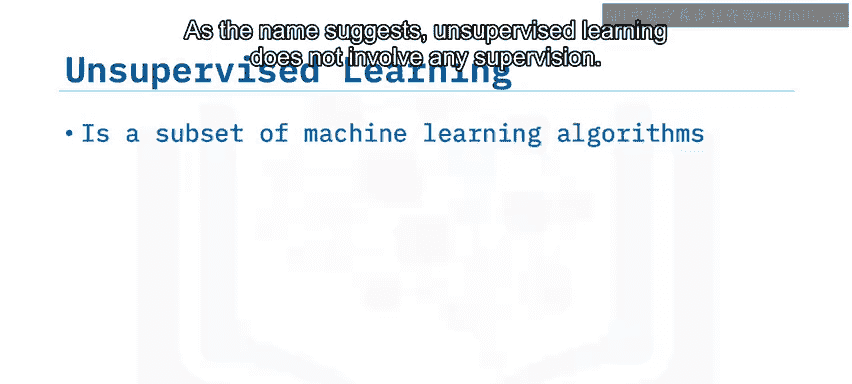

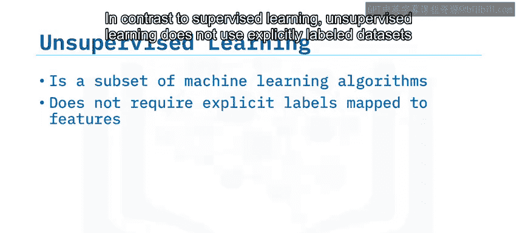

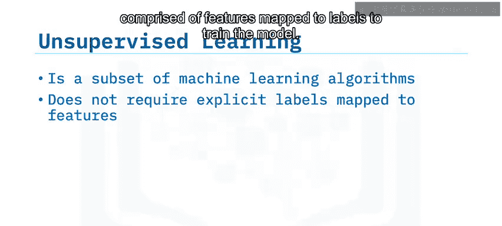

Clustering is an unsupervised machine learning technique used to predict clusters in a data set。

 In clustering， a machine learning model tries to divide the data set into clusters or groups。

 All elements within a cluster share similar characteristics。

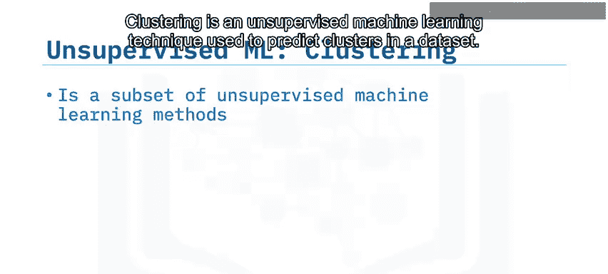

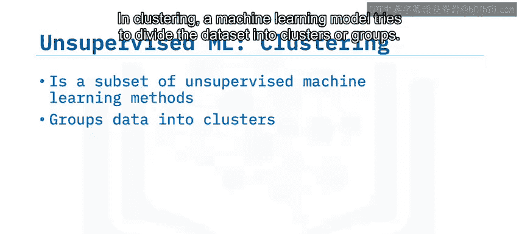

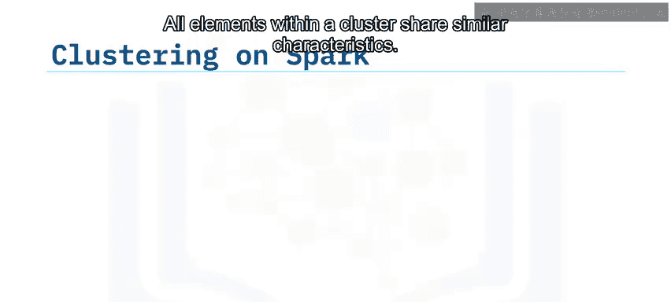

How does Spark enable clustering Spark ML Lib provides a clustering library that includes commonly used clustering algorithms such as K means。

 latent deishle allocation， Gaussian mixture models and others。

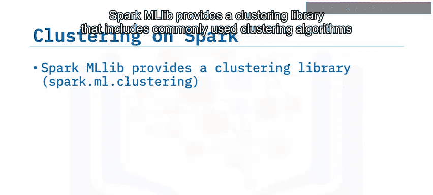

Let's view an example of how to perform clustering using Spark clustering is useful for market segmentation。

 image segmentation， image compression， document clustering based on topics and other segmentation tasks。

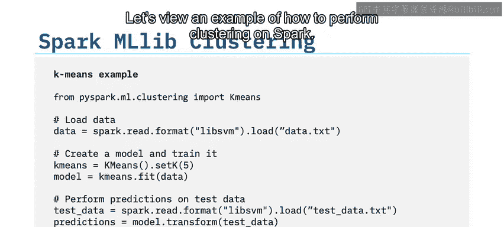

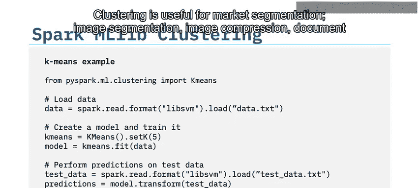

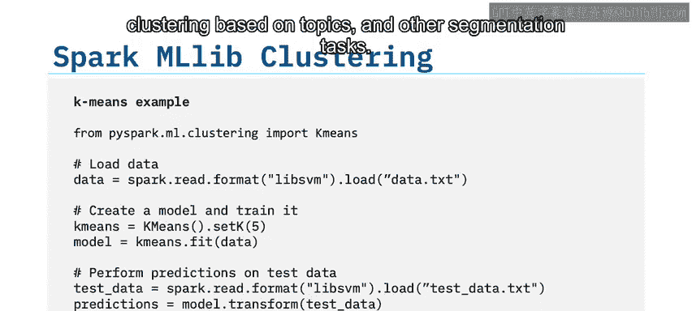

The first line displays the import of the clustering library。

 where you can see the K means algorithm in use。

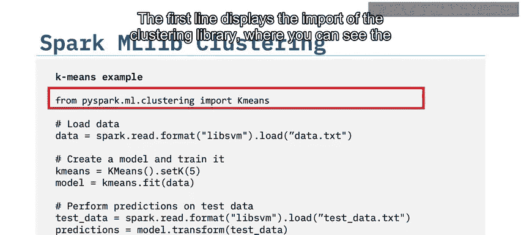

The line of code loads the data using the Read function。

 you'll see how LibB SVM within ML LibB enables the direct reading of that format。

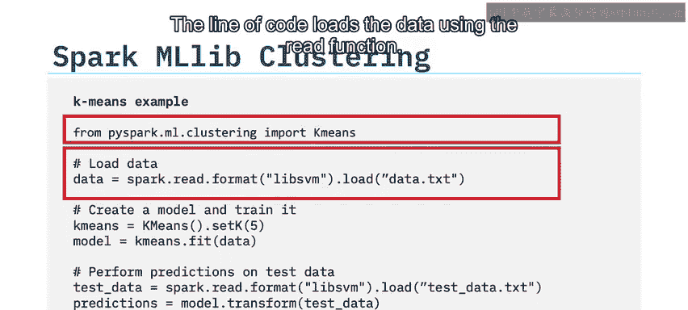

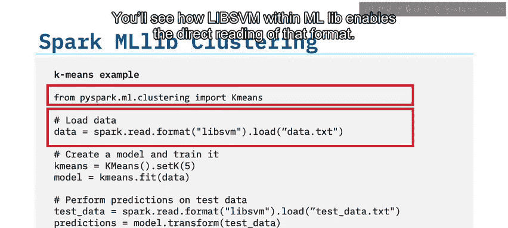

The next step is to create a clustering model。 In this case， the clustering model uses K equals 5。

 specifying that K equals 5 means that the model will split the data set into five clusters。

 you'll use the fit function with K means as an estimator to train the model。

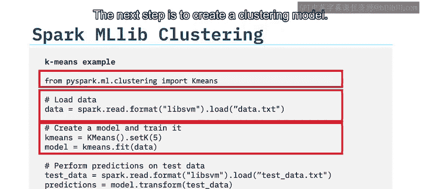

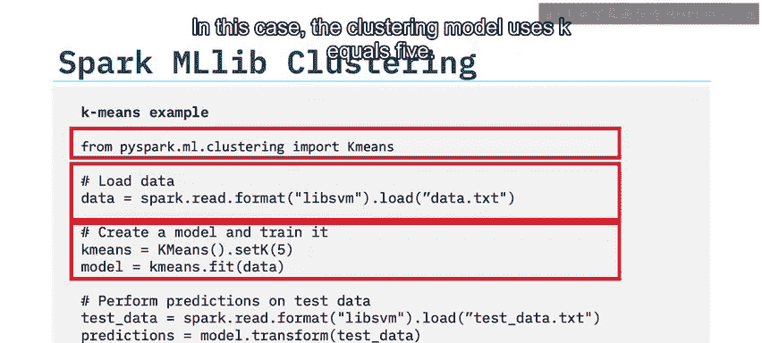

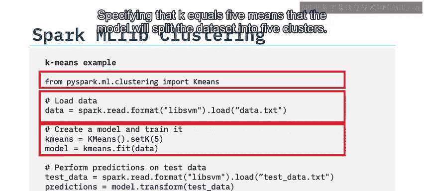

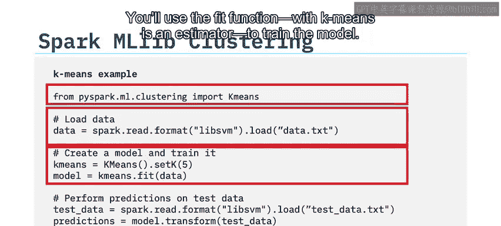

Finally， you'll perform inference or predictions on new unseen data The model assigns each element of the new dataset set to one of the five existing clusters the model created during the training process。

 you will then see the Trans function， which converts test data into predictions cluster assignments in this case。

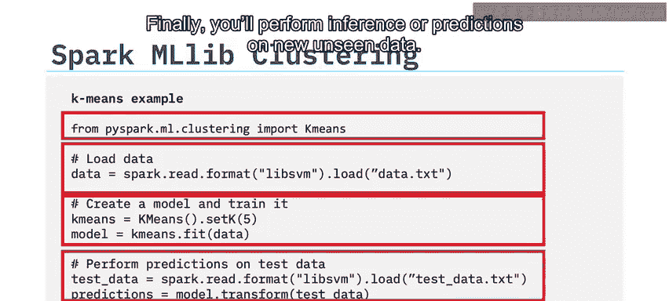

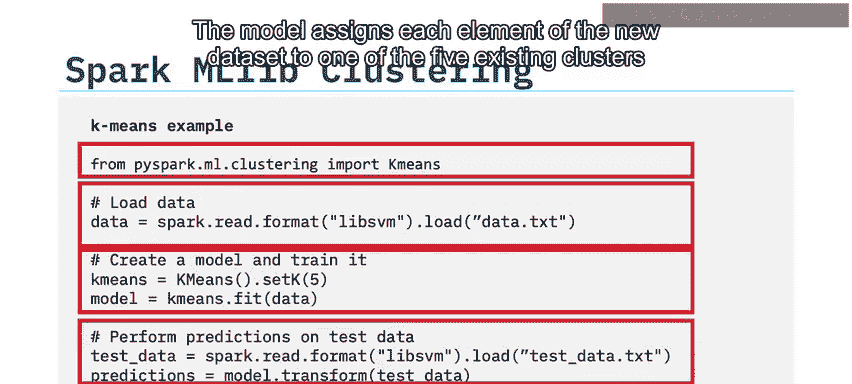

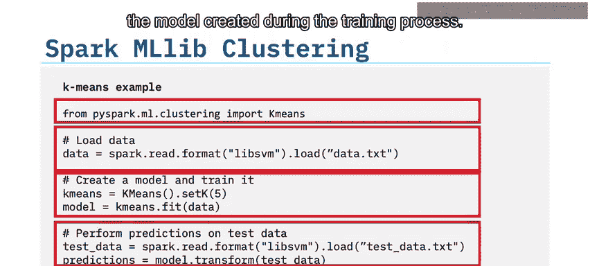

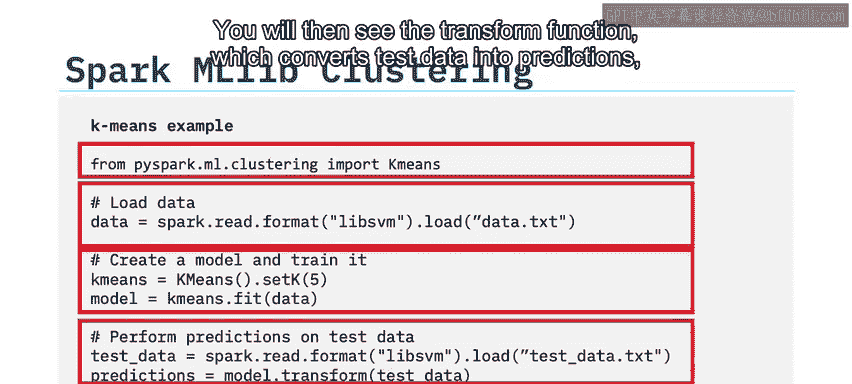

In this video， you learned that unsupervised learning does not use explicitly labeled dataset sets comprised of features mapped to labels to train the model。

 clustering is one type of unsupervised learning that groups data with similar characteristics into clusters。

 The Spar M Llib clustering libraries supports the following commonly used clustering algorithms。

 including K means latent deersle allocation。 Gaussian mixture models and others。😊。

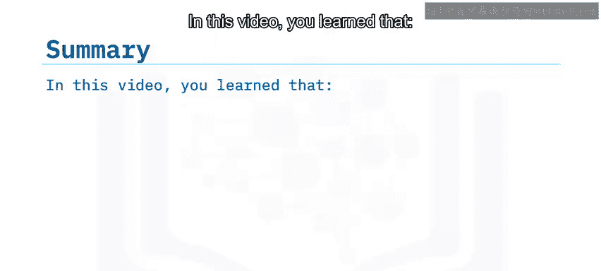

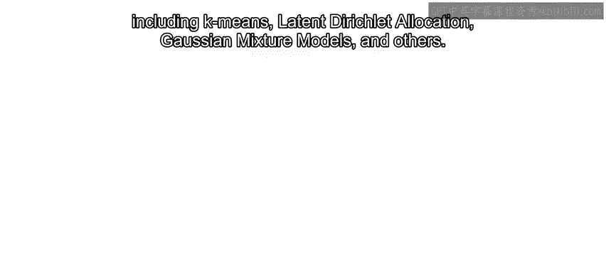