# IBM数据工程专业证书 课程13：《数据工程毕业项目》｜data-enginering-capstone-project｜ - P1：0_introduction to capstone project.zh_en - GPT中英字幕课程资源 - BV1ej411z7Fi

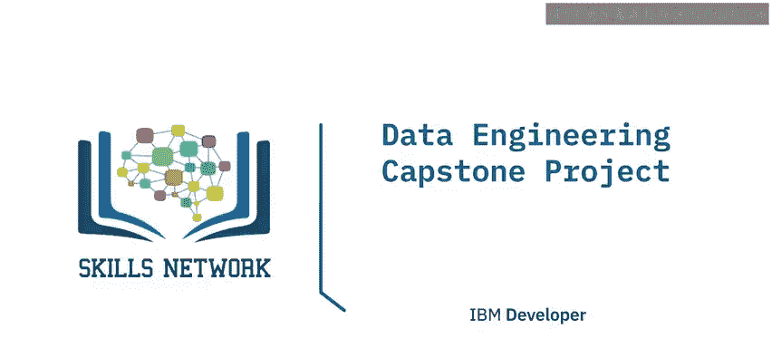

Welcome to the Data Engineering Capstone Project congratulations on making it this far At this point。

 you've made it through all 12 courses in the data engineeringering professionalfessional certificate program and you now have the opportunity to demonstrate the skills you have acquired while following the program This capstone provides you with the opportunity to demonstrate all the practical handson data engineering skills you have acquired while following the program。

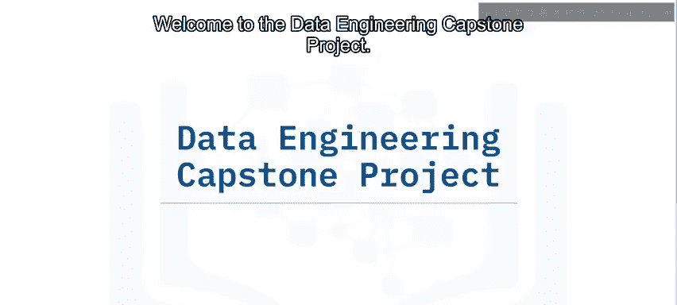

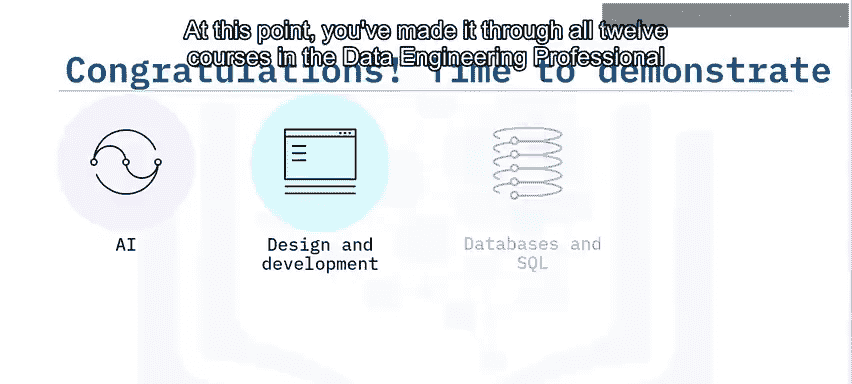

As part of the capstone project， you will assume the role of an associate data engineer who has recently joined an e-commerce organization。

 you will be presented with a business challenge that requires building a data platform for retailer data analytics。

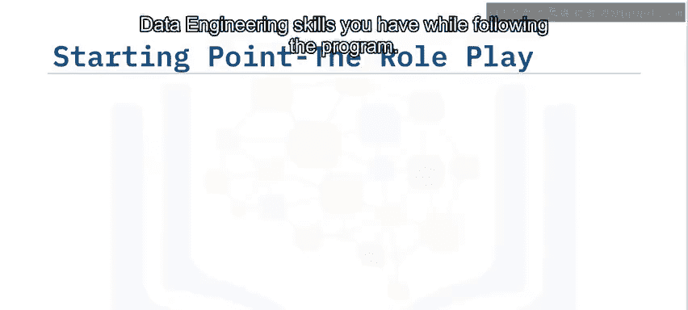

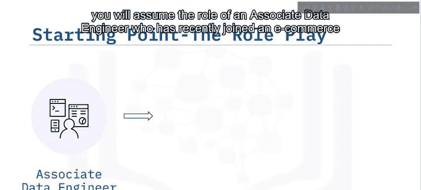

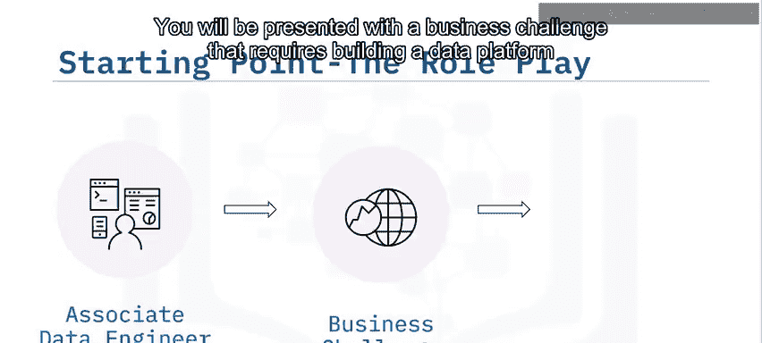

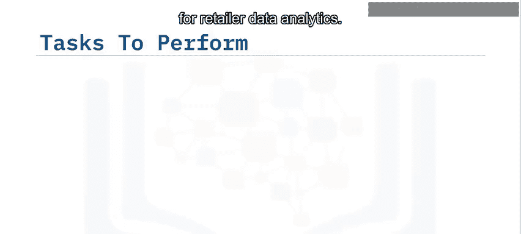

In this capstone project， you will design a data platform that uses MySQL as an OLTP database and MongoDB as a no SQL database。

 design and implement a data warehouse and generate reports from the data。

 design a reporting dashboard that reflects the key metrics of the business。

 extract data from OLTP and no SQL databases， transform it and load it into the data warehouse。

 and then create an ETL pipeline， and finally， create a spark connection to the data warehouse and then deploy a machine learning model。

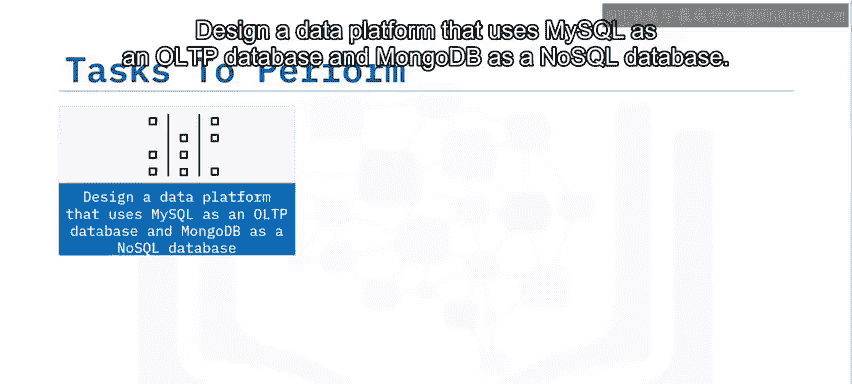

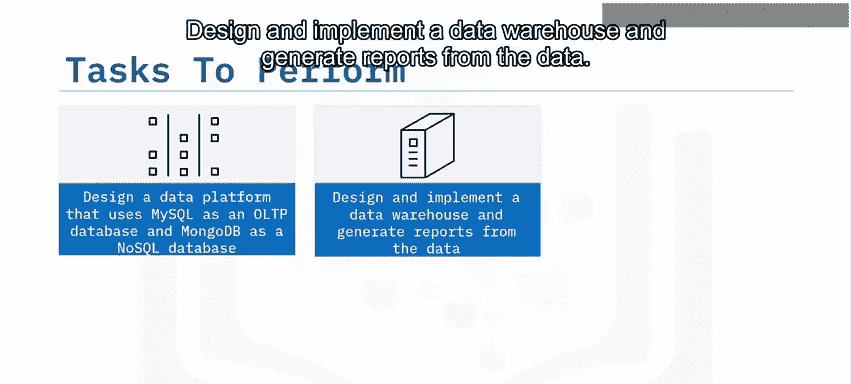

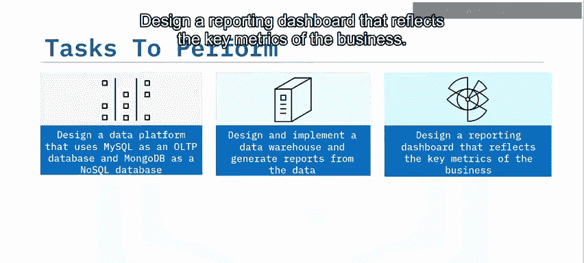

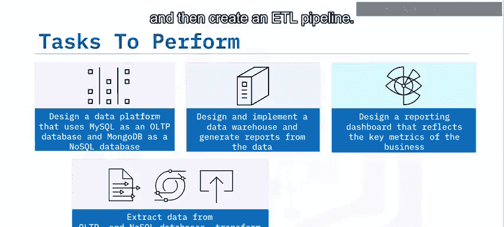

In moduleule1， you will design the OLTP database for an e-commerce website。

 populate the OLTP database with the data provided。

 and automate the export of the daily incremental data into the data warehouse。

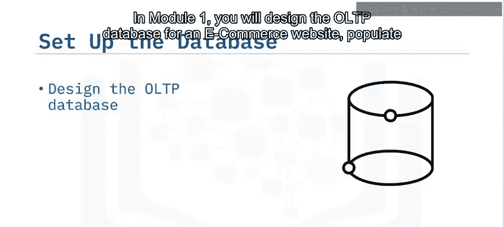

In moduleule 2， you will set up a noSQL database to store the catalog data for an e-commerce website。

 load the E-commerce catalog data into theOSQL database。

 and query the E-commerce catalog data in the NoSQL database。

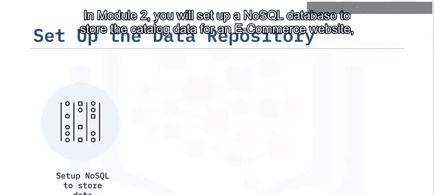

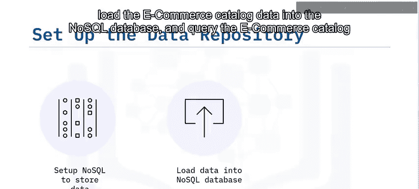

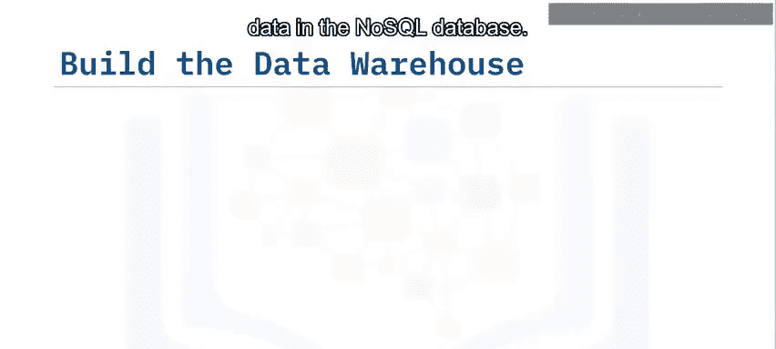

In module3， you will design the schema for a data warehouse based on the schema of the OLTP and no SQL databases。

 you'll then create the schema and load the data into fact and dimension tables。

 automate the daily incremental data insertion into the data warehouse。

 and create cubes and rollups to make the reporting easier。

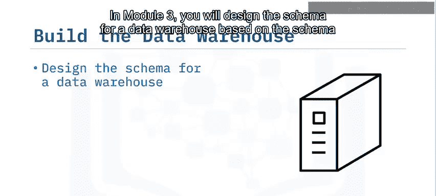

In module4， you will create a cgnos data source that points to a data warehouse table。

 create a bar chart of quarterly sales of cell phones。

 create a pie chart of sales of electronic goods by category。

 and create a line chart of total sales per month for the year 2020。

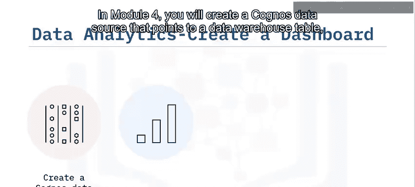

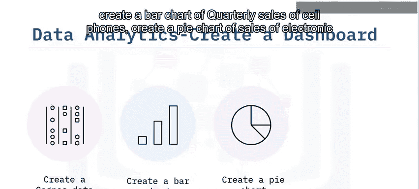

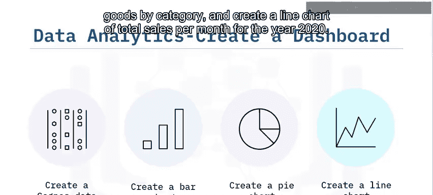

In moduleule 5， you will extract data from OLTP， NoSQL and MongoDB databases into CSV format you will then transform the OLTP data to suit the data warehouse schema and then load the transform data into the data warehouse Finally you will verify that the data is loaded properly。

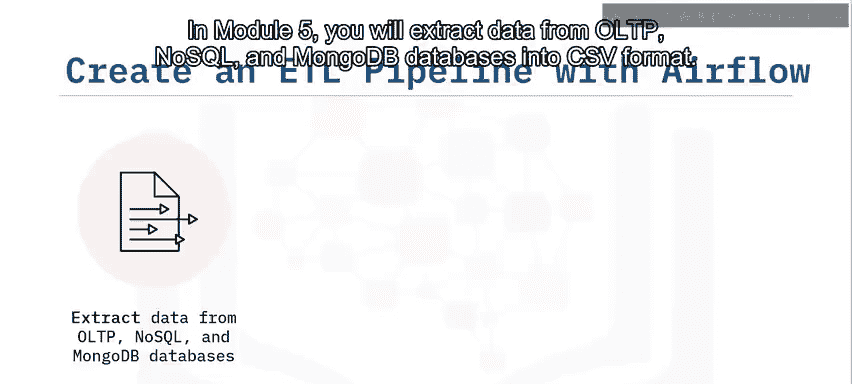

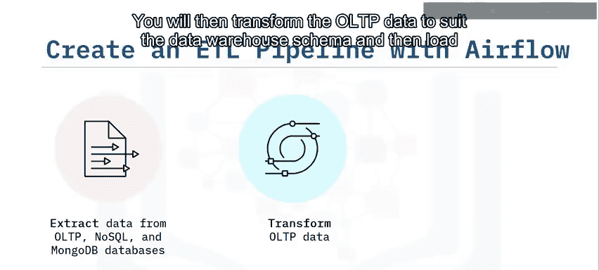

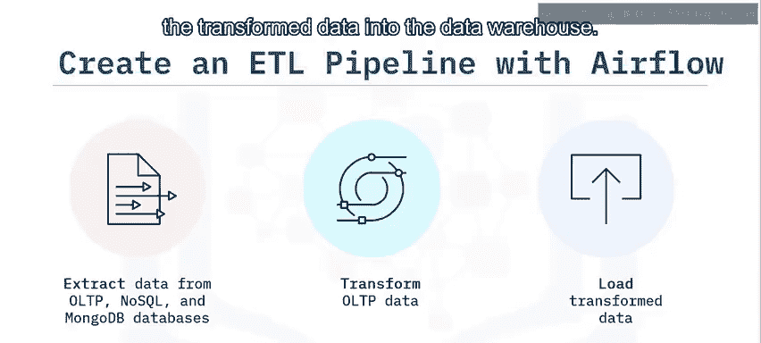

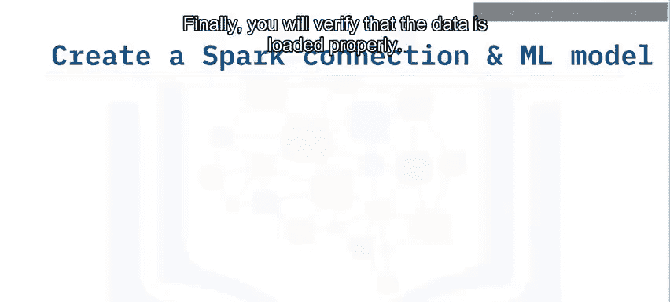

In the sixth and final module， you will use your skills in Big data analytics to create a Sp connection to the data warehouse and then deploy a machine learning model on Spark ML for making sales projections。

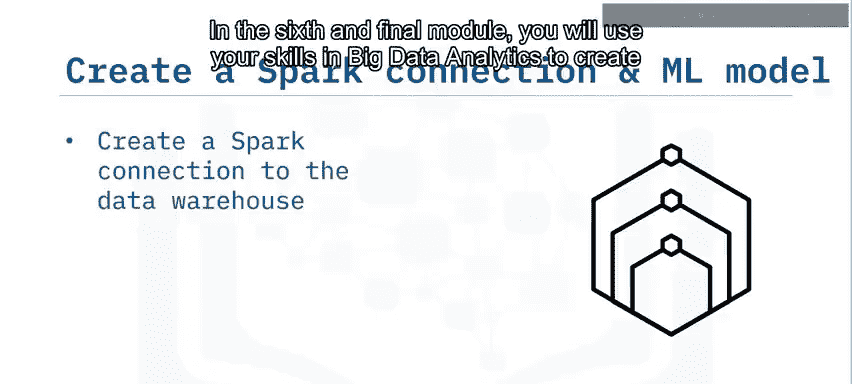

Each module includes a graded checklist that acts as a self check for your submission and a short quiz to test your knowledge you will be evaluated based on the checklist and the quizzes in each module。

For your final submission， you will finish the assignments and upload the screenshots of all tasks as proof of completion your peers will then review and grade your final submission of the project you will also perform a peer review for a fellow student。

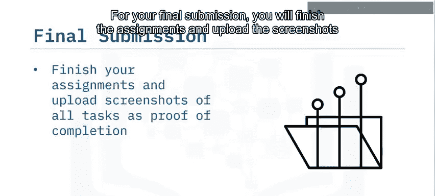

To begin， take a few minutes to explore the course site。

 review the material that will be covered each week and preview the assignments you'll need to complete to pass the course。

 explore the forums where you can discuss the course material with fellow learners and the course team if you have any questions about the course content。

 post them in these forums to get help from others in the course community for technical problems with the platform。

 visit the help or support center。

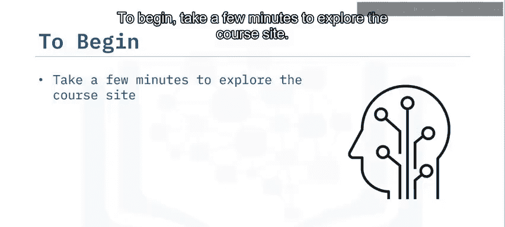

When you successfully complete all the courses in this program。

 you will earn your data engineering professional certificate。

 we are excited to have you join us and hope you enjoy the course Good luck and let's get started。

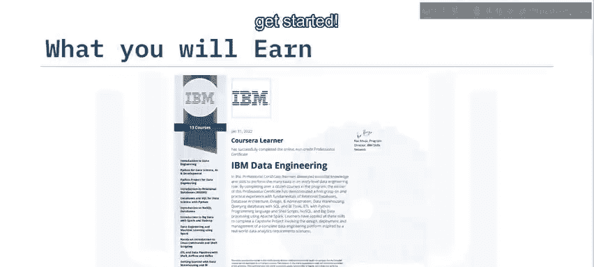