# IBM数据工程专业证书 课程13：《数据工程毕业项目》｜data-enginering-capstone-project｜ - P2：1_assignment overview.zh_en - GPT中英字幕课程资源 - BV1ej411z7Fi

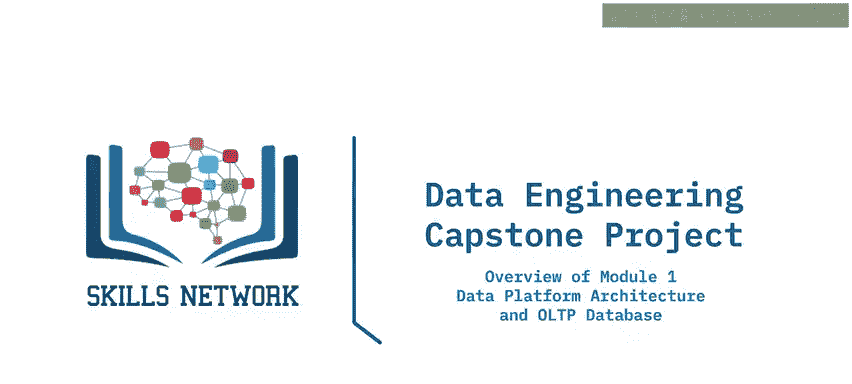

Welcome to the Data Engineering Capstone Project this video will give you an overview of the first module。

 data Platform Archecture and OLTP database。

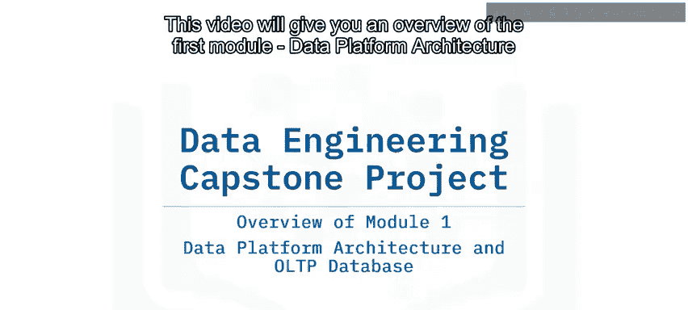

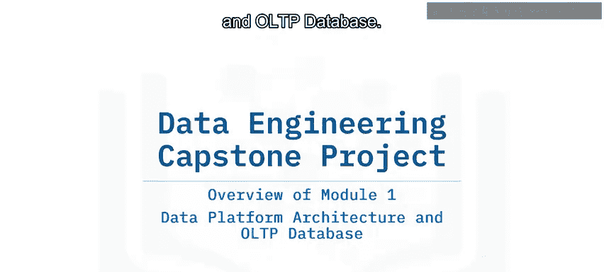

In this module you will perform three exercises with multiple tasks。

 but before proceeding with the assignment， you will check the lab environment by starting the MySQL server。

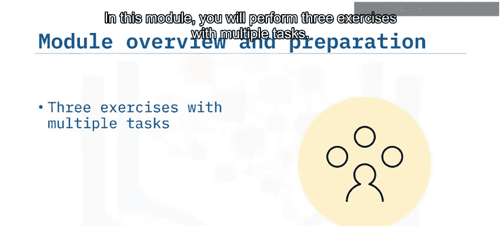

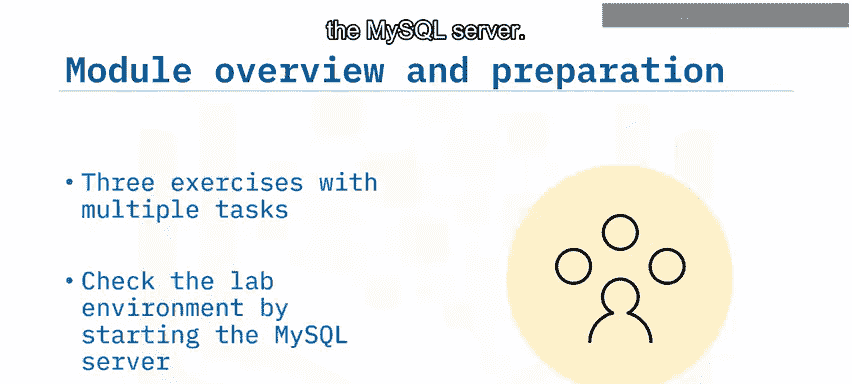

The first exercise requires you to design the schema for the OLTP database by storing data like product ID。

 customer ID， price， quantity， and timestamp of sales in a sales database。In the second exercise。

 you will load this data into the OLTP database by importing the data from the downloaded CSV file into the data table using PHP MyAdmin Further。

 you will list the tables in the database and you will also write a query to find out the count of the records in the tables。

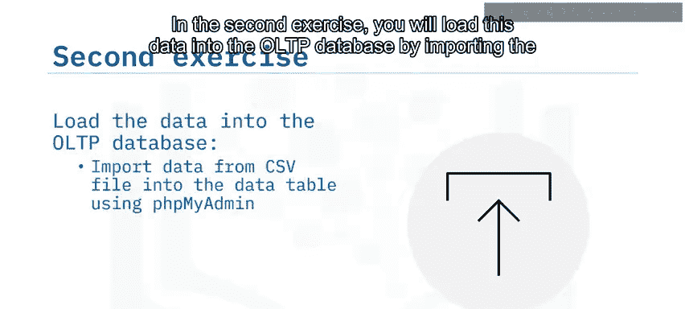

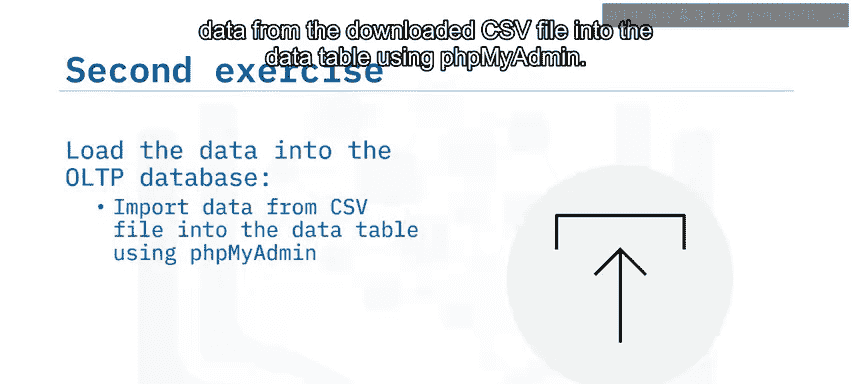

In the third and final exercise， you will set up admin tasks by creating an index on the timestamp field and then listing the indexes on the table Finally。

 you will write a bash script that exports all the rows in the data table to the SQL file。

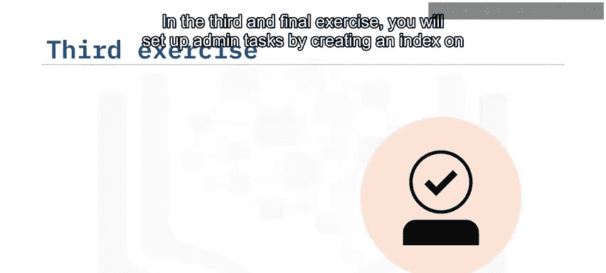

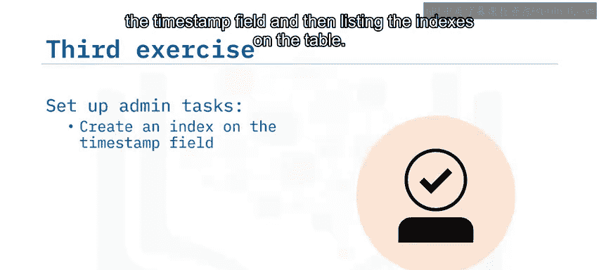

After performing each task， you will take a screenshot of the command used and the output obtained and give a name to the screenshot。

 Good luck， and let's get started。

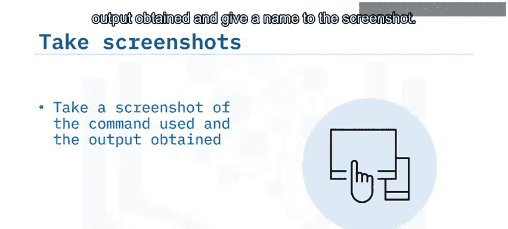

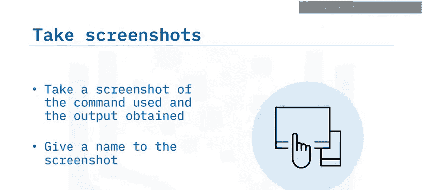