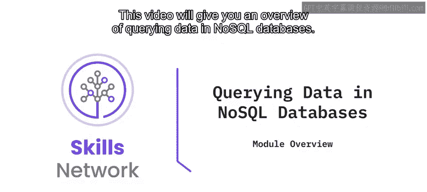
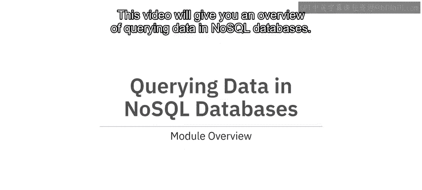
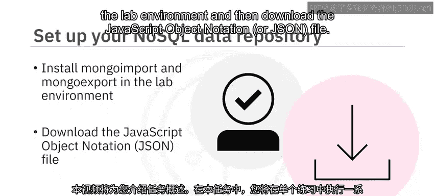
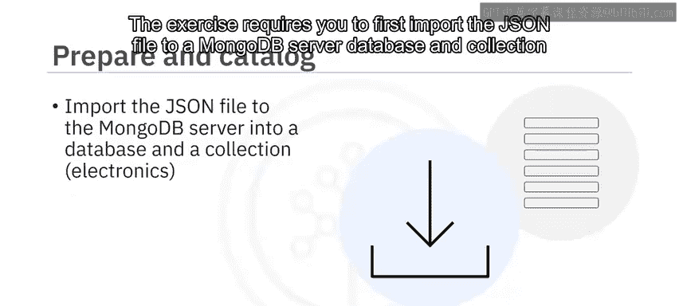
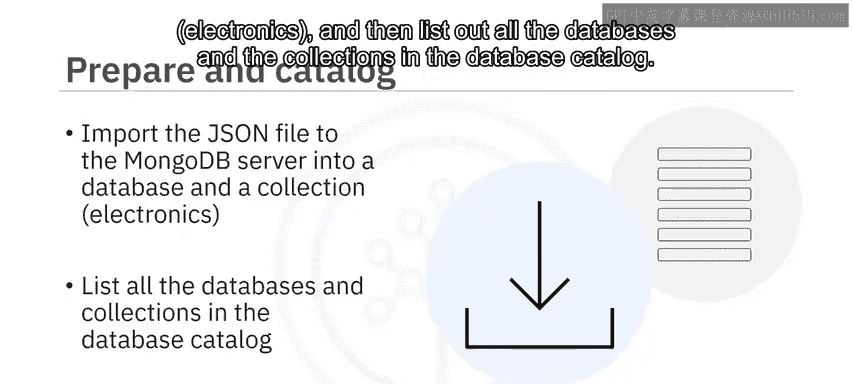
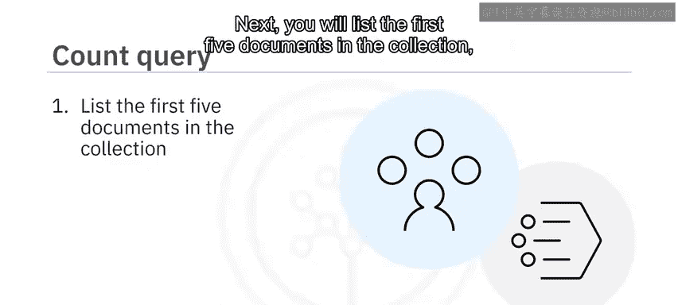
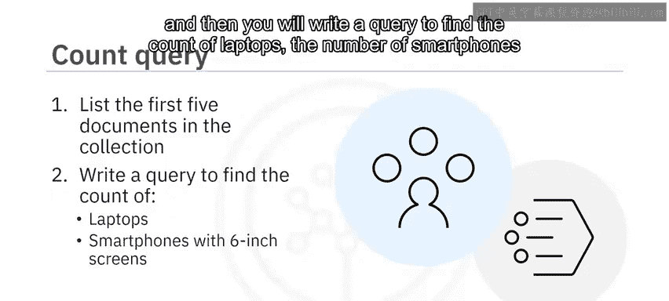
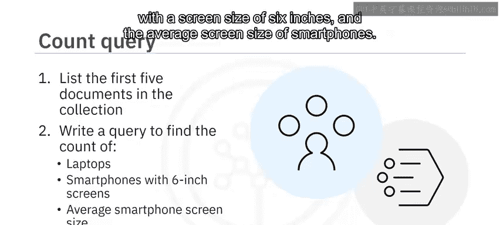
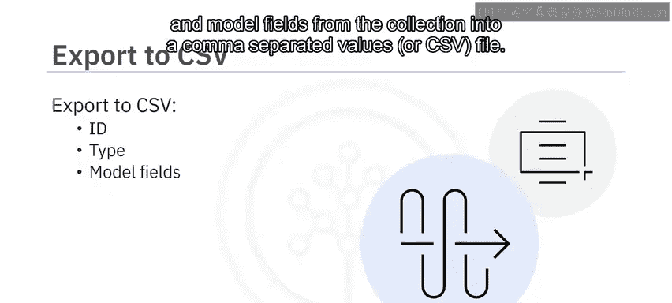
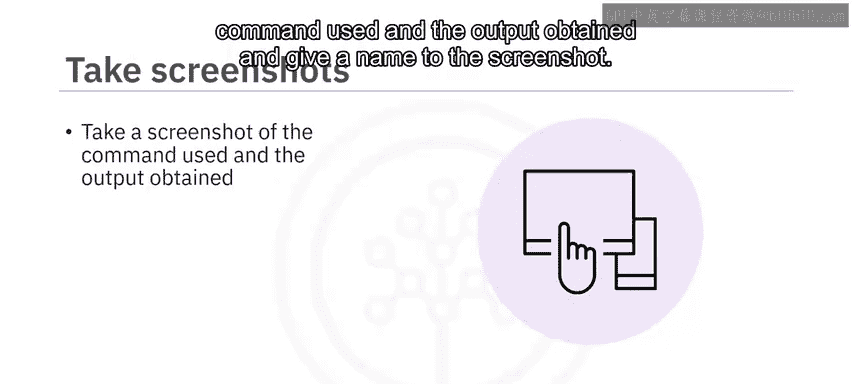

# IBM数据工程专业证书 课程13：《数据工程毕业项目》｜data-enginering-capstone-project｜ - P3：2_assignment overview querying data in nosql databases.zh_en - GPT中英字幕课程资源 - BV1ej411z7Fi

This video will give you an overview of querying data in NoSQL databases in this assignment you will perform a series of tasks in a single exercise。

 but before proceeding with the assignment， you will install Mongo Iport and Mongo Export in the lab environment and then download the JavaScript Ob notation or JON file。

The exercise requires you to first import the J file to a MongoDB server database and collection electronics。

 and then list out all the databases and the collections in the database catalog。

Next， you will list the first five documents in the collection and then you will write a query to find the count of laptops。

 the number of smartphones with a screen size of six inches。

 and the average screen size of smartphones。

Finally， you will export the ID， type and model fields from the collection into a comma separated values or CSV file。

After performing each task， you will take a screenshot of the command used and the output obtained and give a name to the screenshot。

