# IBM数据工程专业证书 课程13：《数据工程毕业项目》｜data-enginering-capstone-project｜ - P4：3_assignment overview data warehouse design setup.zh_en - GPT中英字幕课程资源 - BV1ej411z7Fi

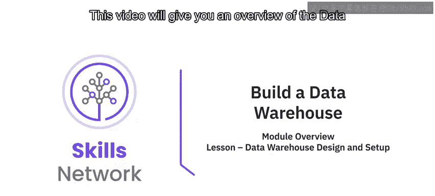

This video will give you an overview of the data warehouse design and setup lesson of theBuild a data warehouse module。

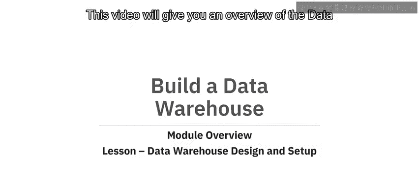

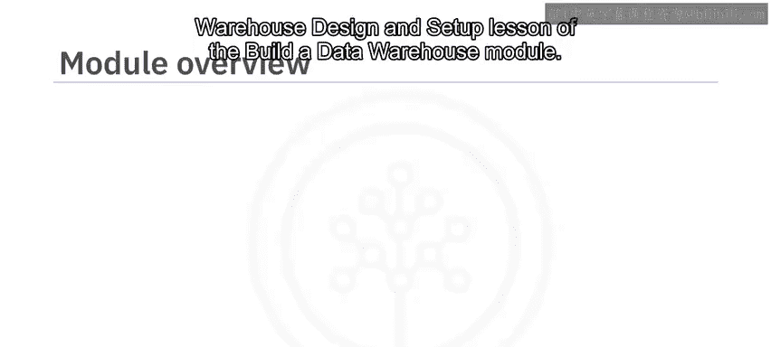

In this module you will perform a couple of assignments in the first assignment covered in this video。

 you will design and create a staging data warehouse environment using PG admin and PostgresQL In the second assignment covered in the next video you will deploy the production warehouse for reporting purposes using DB2 on cloud。

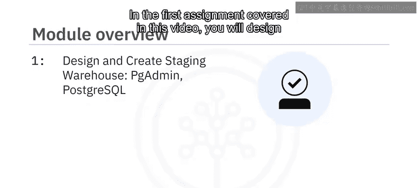

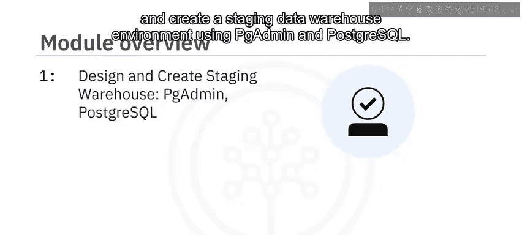

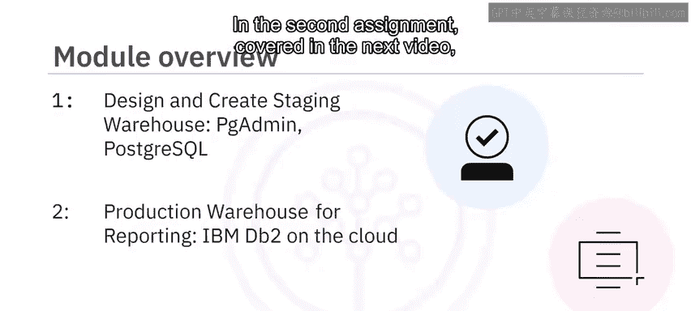

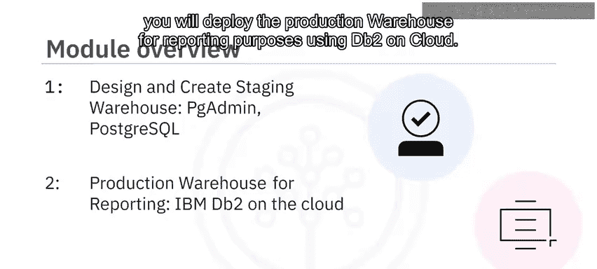

The first exercise in this assignment requires you to design a data warehouse The E-commerce company has provided you with sample data and you will start your project by designing a star schema for the warehouse by identifying the columns for the various dimension and fact tables in the schema you will name your database soft cart and then use the ERD design tool in PG admin to design the table softcart dim date using fields such as date ID。

 month month name and so on and the company would also like to have the ability to generate reports on a yearly。

 monthly， weekly and daily basis you will use the ERD design tool to design the dimension tables。

 softcart dim category Socart dim country and softcart fact sales you will also use the ERD design tool to design the required relationships for example。

 one to one， one to many and so on。

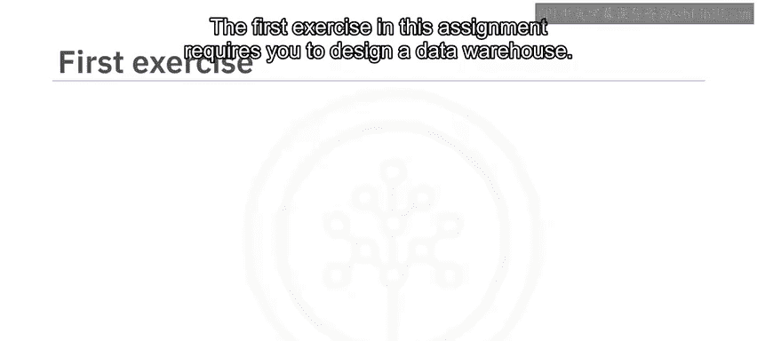

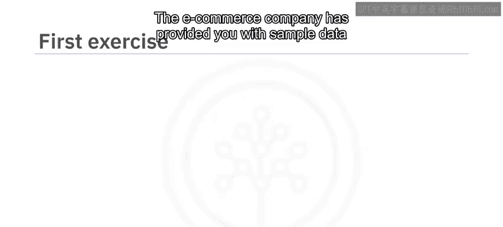

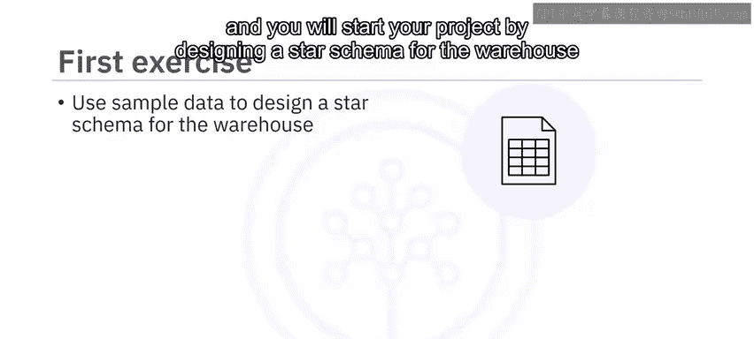

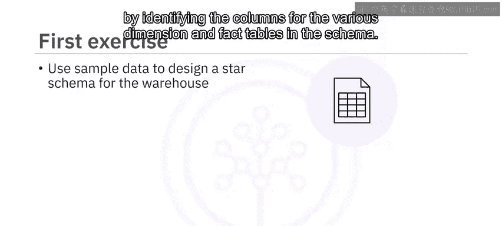

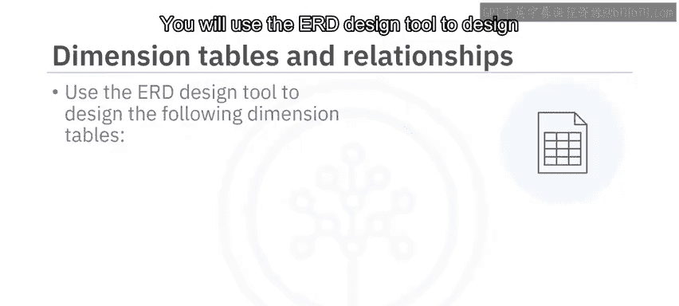

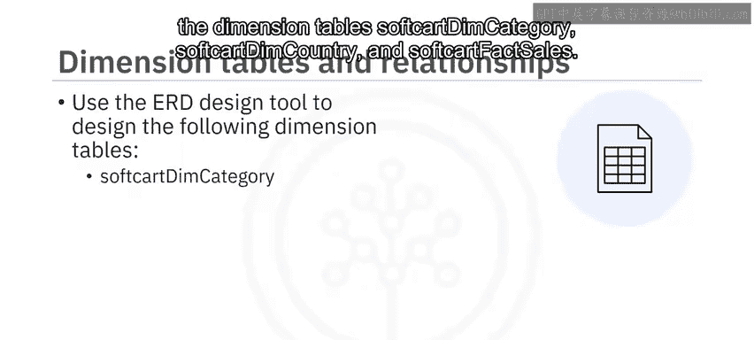

tablesAnd finally， after performing each task， you will take a screenshot of the entire ERD。

 clearly showing all the field names， data types， and relationships among the tables。

In the second exercise， you will load the data into the data warehouse your senior data engineer reviews your design and makes a few improvements to your schema design the data as per the improved schema is available at a link you will download the data and restore it into a database named staging using the PG admin tool。

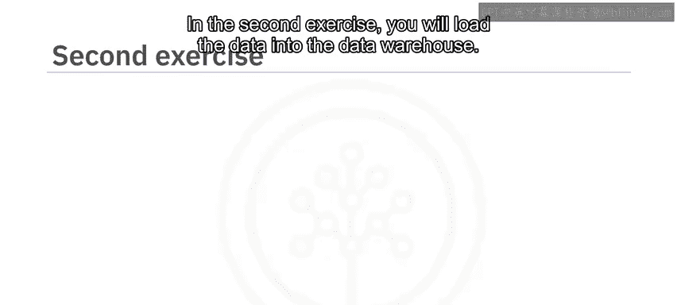

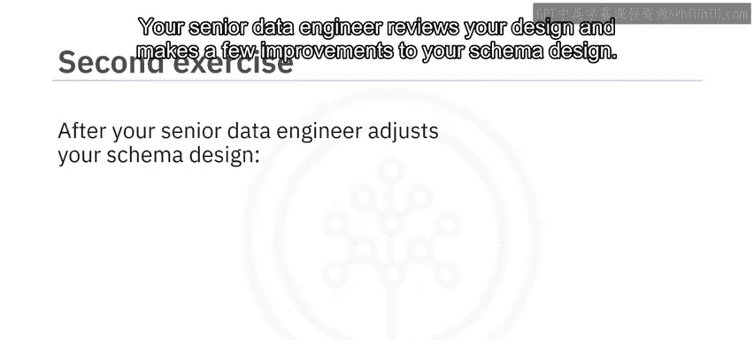

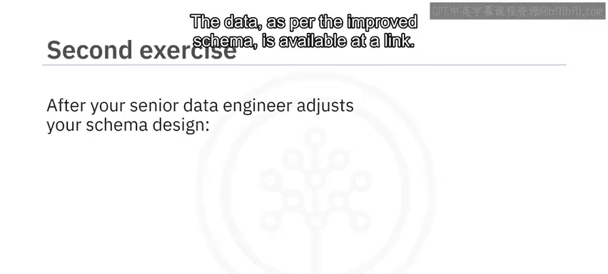

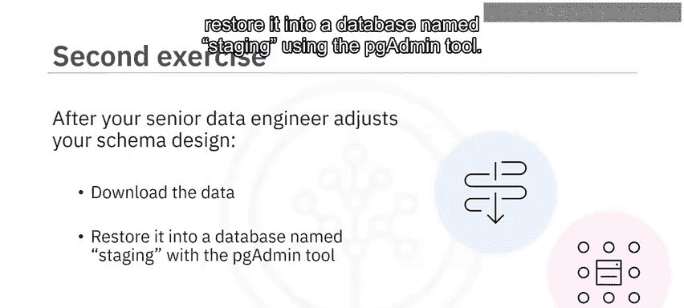

And after performing this task， you will take a screenshot showing the success of data restoration。

 Good luck， and let's get started。

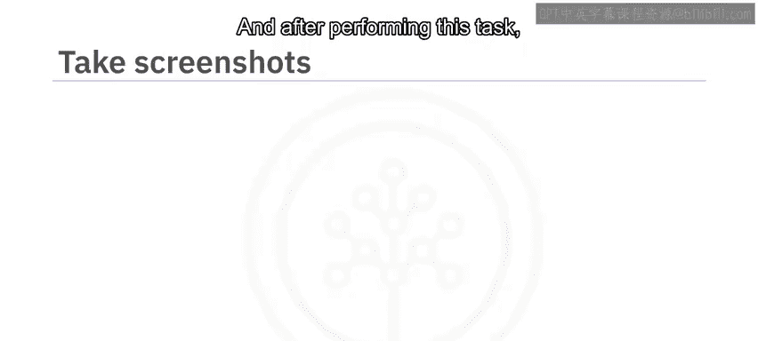

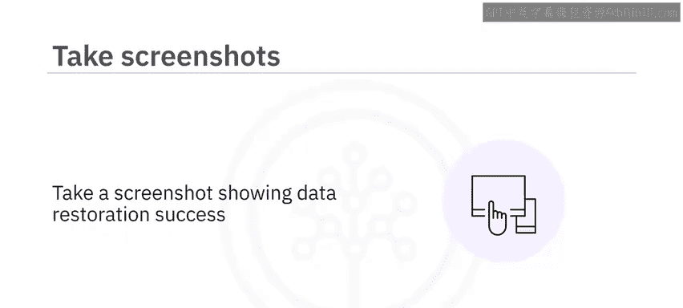

