# IBM数据工程专业证书 课程13：《数据工程毕业项目》｜data-enginering-capstone-project｜ - P5：4_assignment overview data warehouse reporting.zh_en - GPT中英字幕课程资源 - BV1ej411z7Fi

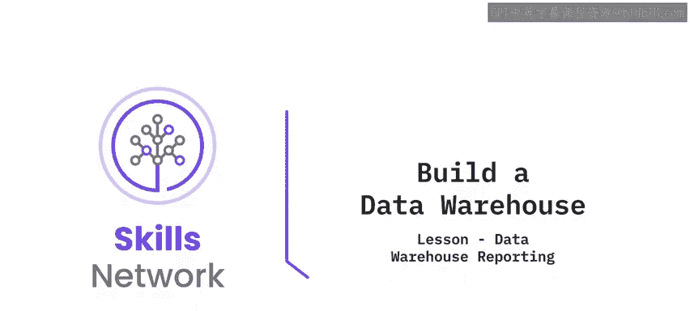

This video will give you an overview of the data warehouse reporting lesson of theBuild a data War module。

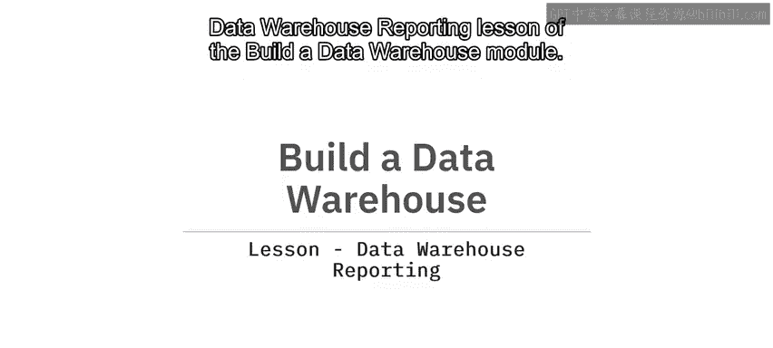

In this assignment you will perform a couple of exercises， but before proceeding with the assignment。

 you will create an instance of IBMDB2 on the cloud by following the instructions given in the link provided if you have already created a DB2 instance in previous courses。

 you can continue using that to perform the exercises but you may need to clean up old tables in case your database instance is running low on space。

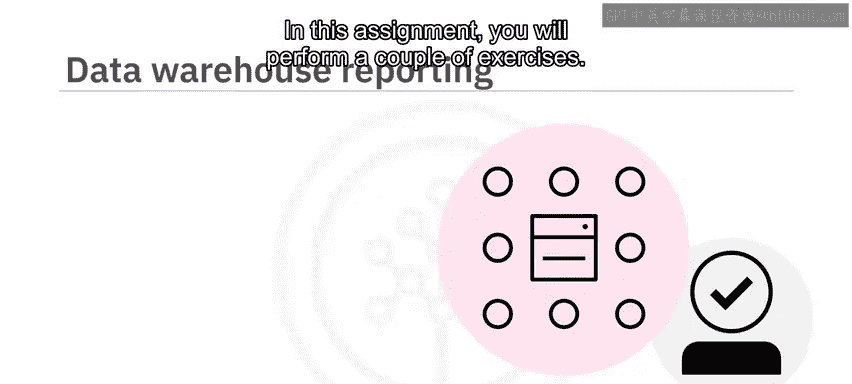

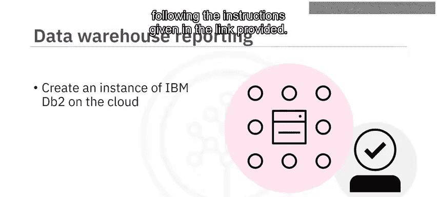

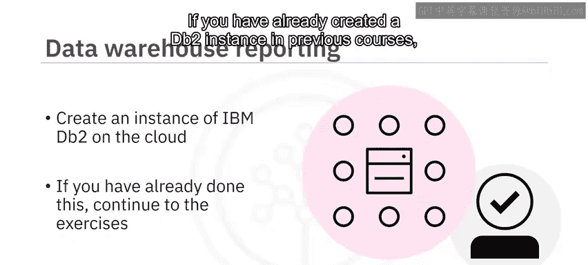

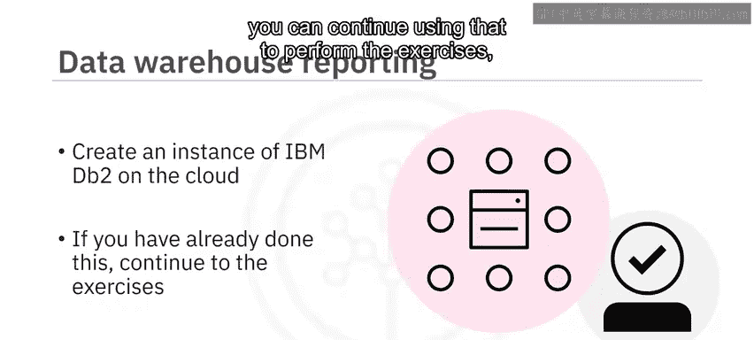

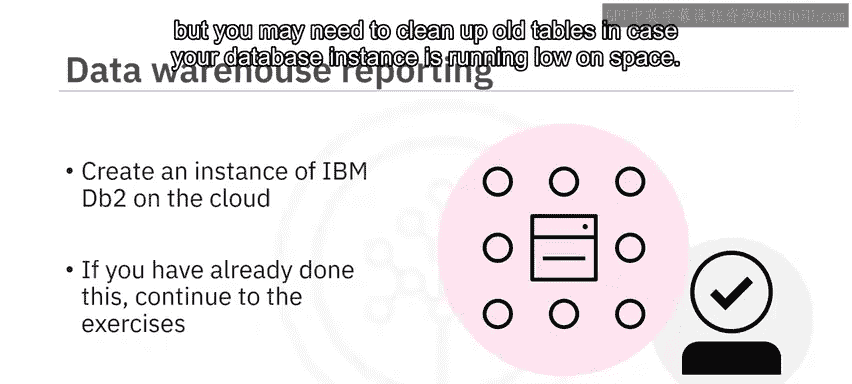

The first exercise requires you to load the data provided by the company into the tables in CSV format by performing a series of tasks。

 you will start by downloading the data from the links provided and then load that data into the D date table。

 D category table，D Count table and factact table， factact sales， and after loading the data。

 you will take a screenshot of the first five rows in each table and name the screenshot。

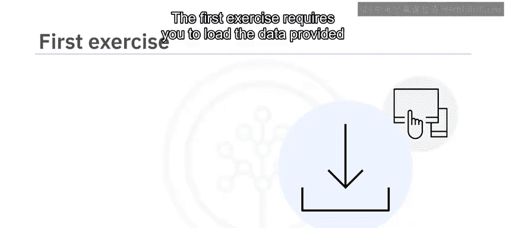

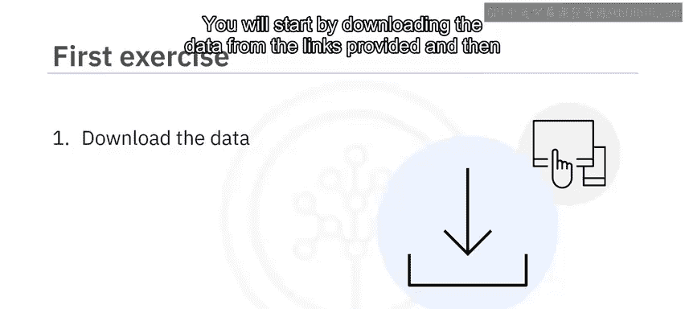

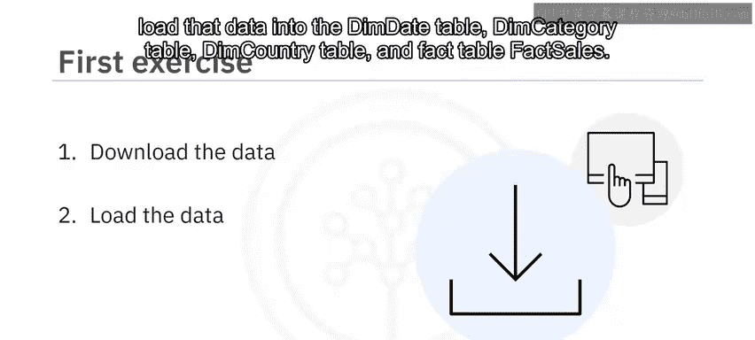

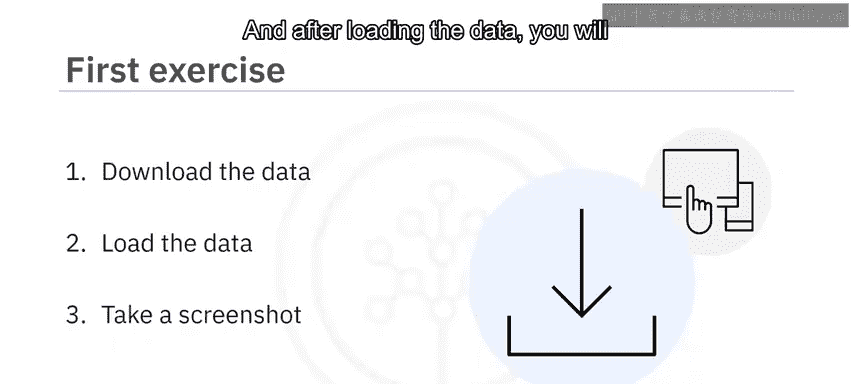

In the second exercise， you will query the loaded data by creating a grouping sets query。

 rollup query， and cubeB query using the columns order ID， category and price collected。

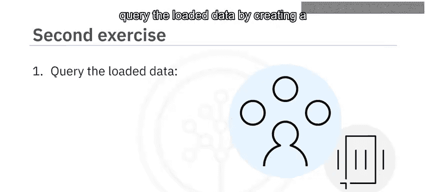

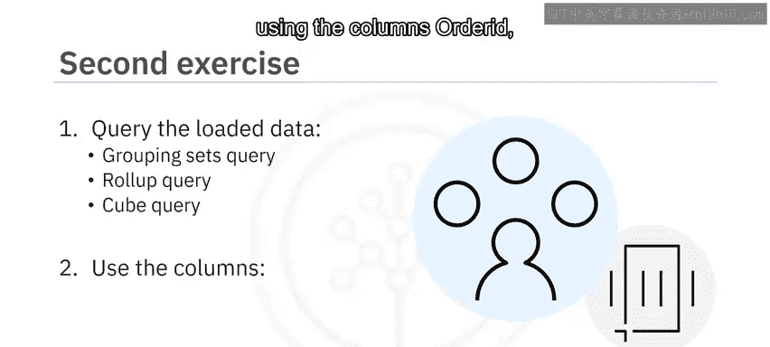

Finally， you will create a materialized query table or MQT named totaltal sales per country using the country and total sales columns。

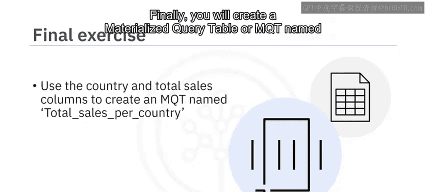

After performing each task， you will take a screenshot of the SQL and the output rows and then name the screenshot。

 Good luck and let's get started。

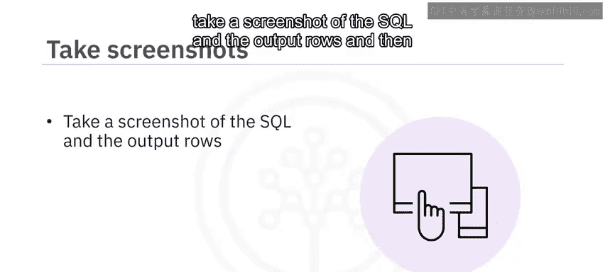

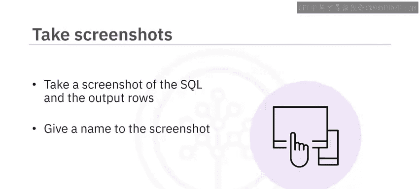