# IBM数据工程专业证书 课程13：《数据工程毕业项目》｜data-enginering-capstone-project｜ - P6：5_assignment overview.zh_en - GPT中英字幕课程资源 - BV1ej411z7Fi

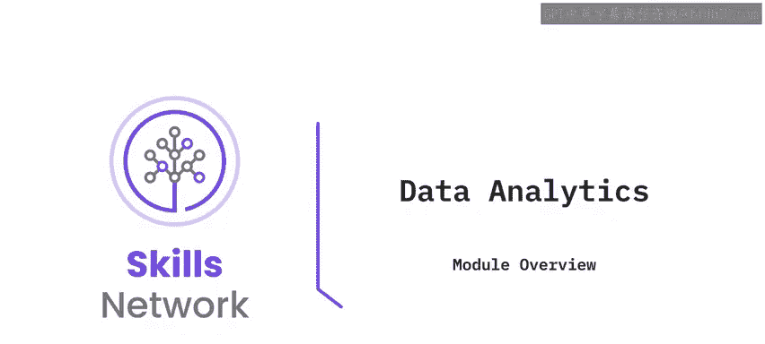

This video will give you an overview of the data analytics module In this assignment you will perform a couple of exercises with multiple tasks。

 but before proceeding with the assignment you will check the lab environment by ensuring that you have access to a cloud instance of the IBM DB2 database and IBM Cgnos Anatic after you have access to the cloud instance of both you will download the data from the link provided。

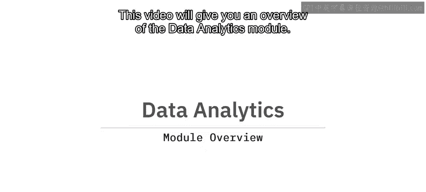

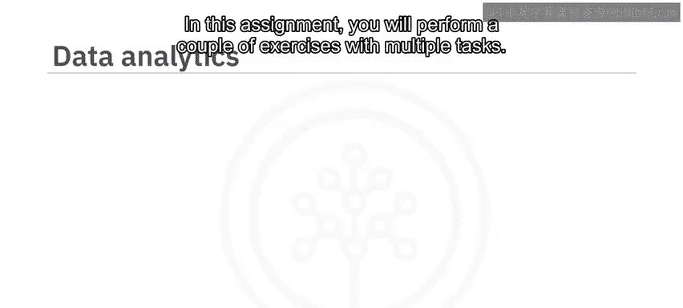

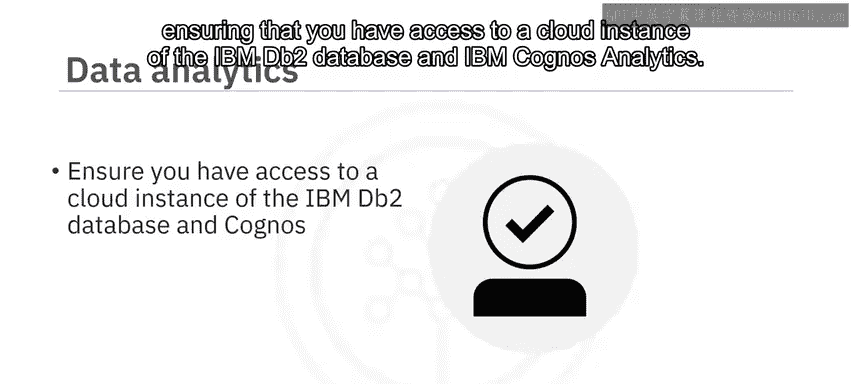

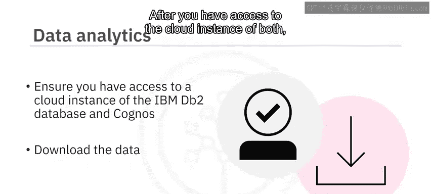

The first exercise requires you to load data into the data warehouse you will first import data from the downloaded CSV file into a table and then list the first 10 rows in the table in the second exercise you will create a data source in Cgnosse that points to the table in your IBMDB2 database。

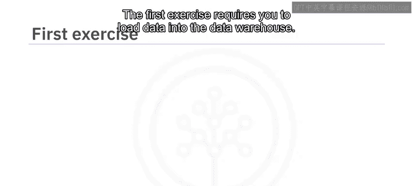

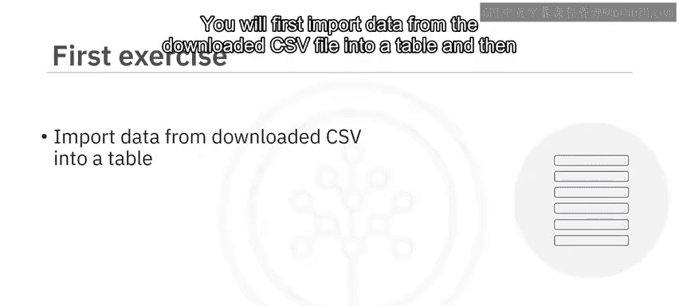

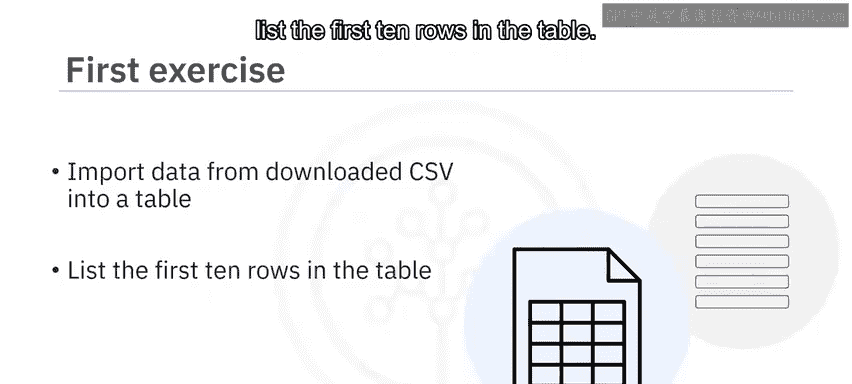

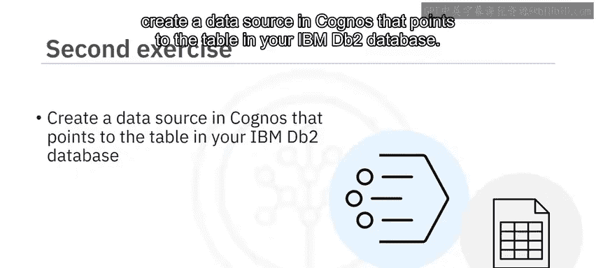

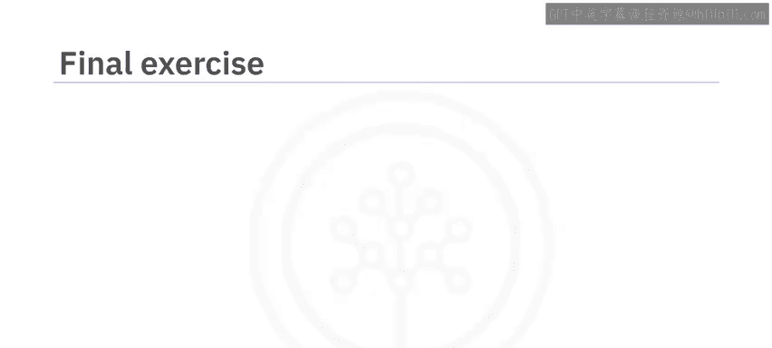

In the final exercise， you will create a dashboard by performing tasks。

 such as creating a bar chart of quarterly sales of mobile phones。

 a pie chart of category wise sales of electronic goods。

 and a line chart of monthwise total sales for a given year。

 After performing each task you will take a screenshot of the command you used and the output you obtained。

 You will also give a name to each screenshot。 Good luck， and let's get started。

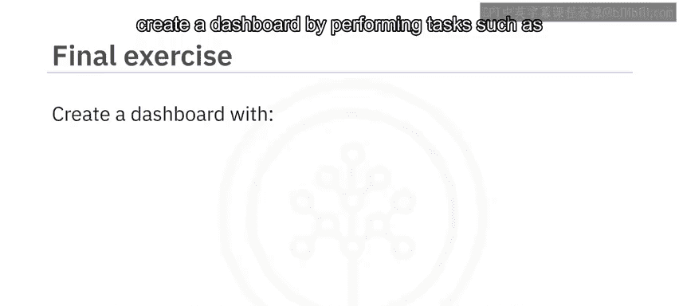

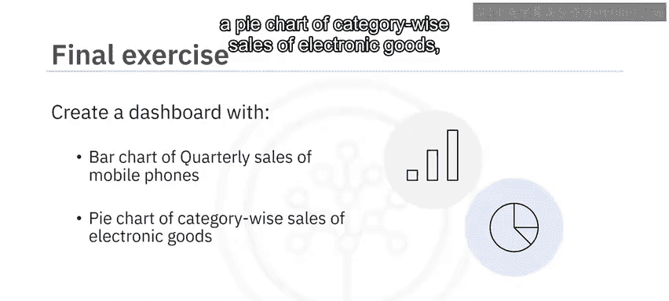

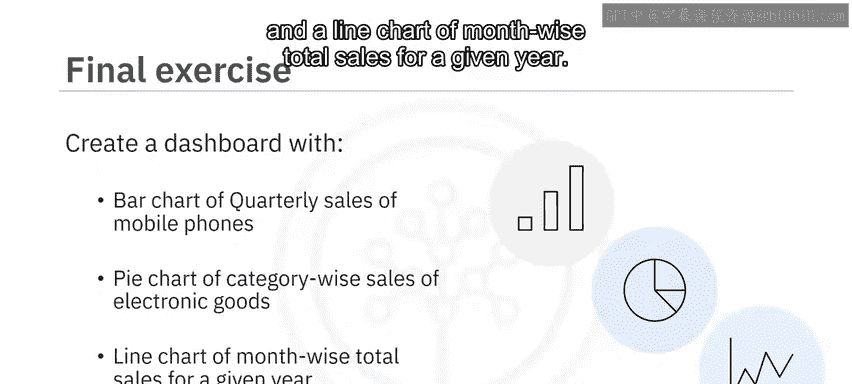

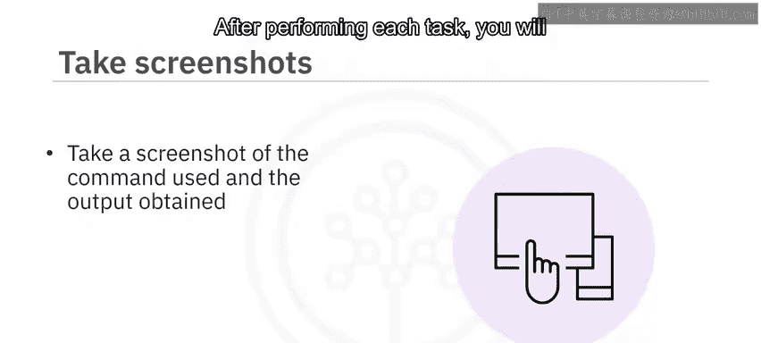

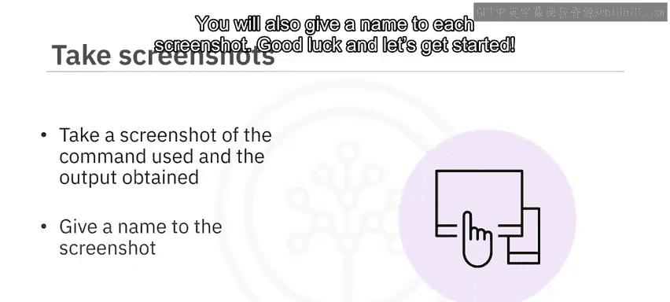

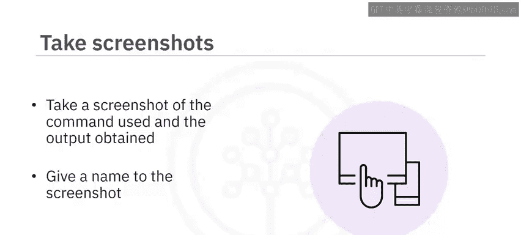