# IBM数据工程专业证书 课程13：《数据工程毕业项目》｜data-enginering-capstone-project｜ - P7：6_assignment overview etl.zh_en - GPT中英字幕课程资源 - BV1ej411z7Fi

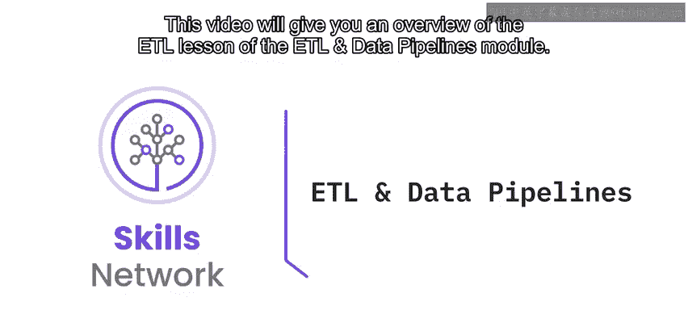

This video will give you an overview of the ETL lesson of the ETL and data Pis module In this module。

 you will perform two assignments each with several exercises in the first assignment covered in this video you will create an ETL pipeline using Python to get new data for the day from the WellTP database and load the data warehouse In the second assignment covered in the following video you will create a data pipeline using Apache airflow to feed the big data cluster in this assignment you will perform four exercises but before proceeding with the assignment you will need to perform these tasks Pre the lab environment by starting MySQL server and downloading the files database from the given link further you will also need to perform these tasks Iport the data in the JSON file to a database in a collection and the data in a SQL file to the MysQL server you will also verify your access to the cloud instance of the IBM DB2 server first。

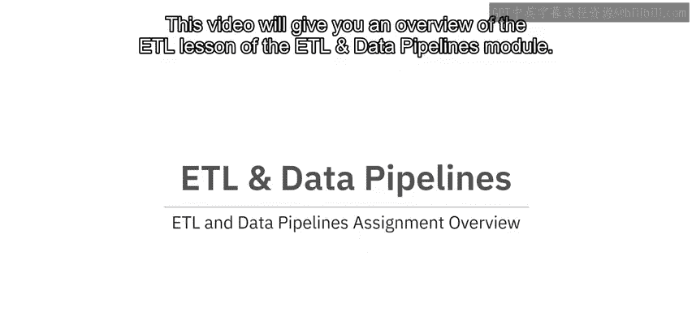

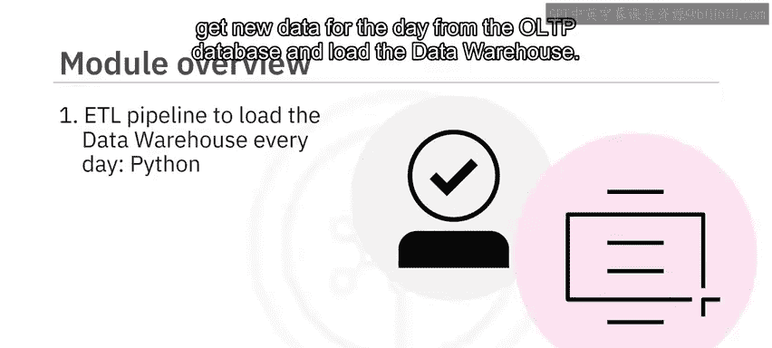

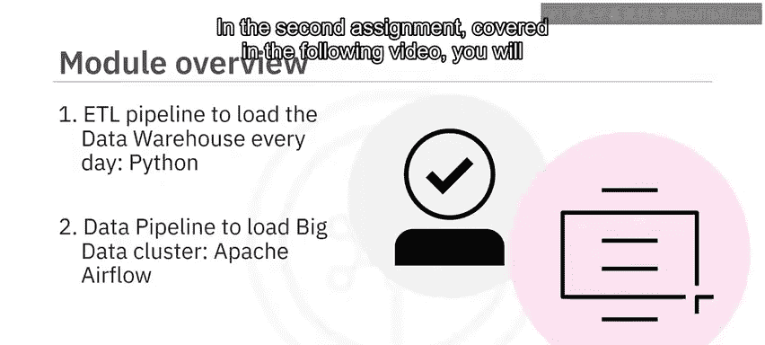

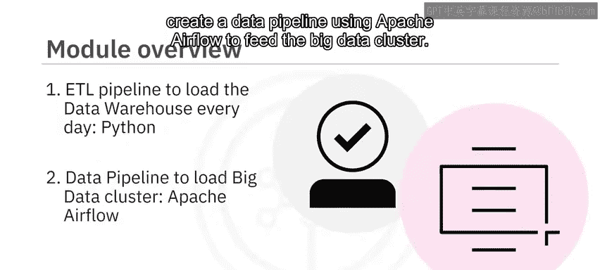

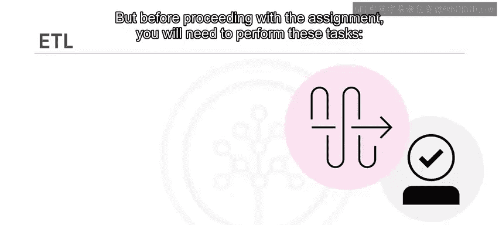

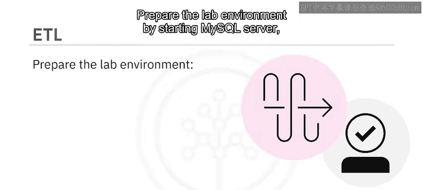

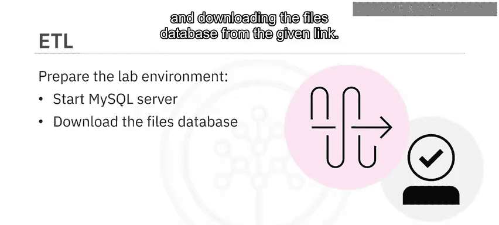

Exercise requires you to extract the data from the sales tables in MySQL into CSV format In the second exercise。

 you will complete the following tasks， Trans the OLTP data to suit the data warehouse schema Read the OLTP data in the CSV format。

 add editit and drop columns based on the data warehouse schema and then save the transform data into a new CSV file In the third exercise。

 you will perform tasks to load the transform data into the data warehouse you will need to perform the following tasks read the transform data in the CSV format load the data into the data warehouse and then verify that the data is loaded properly The final exercise requires you to perform the following task。

 automate the extraction of daily incremental data and load yesterday's data into the data warehouse then you will download the Python script from the link provided and use it as a template to write a Python script that automatically loads yesterday's data。

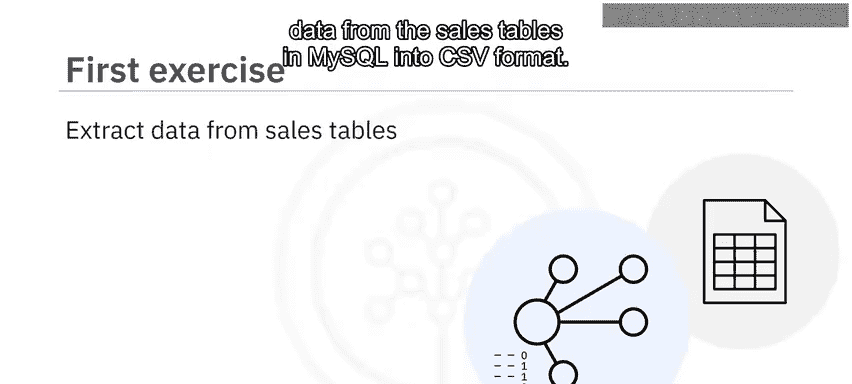

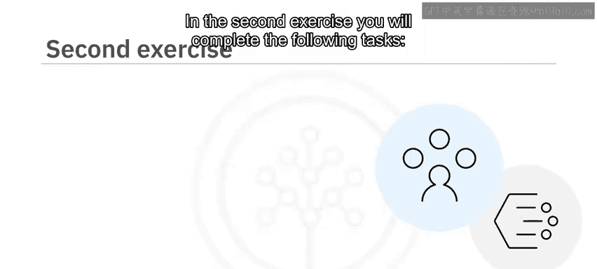

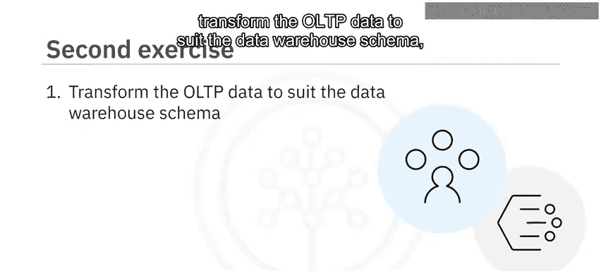

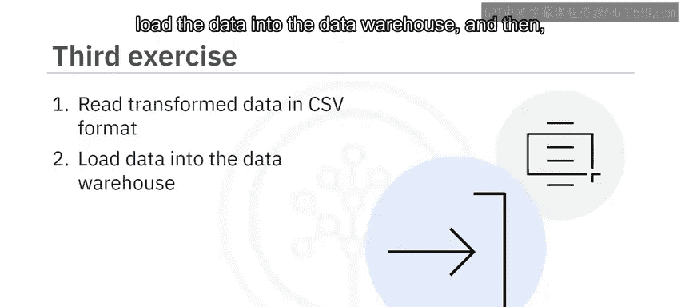

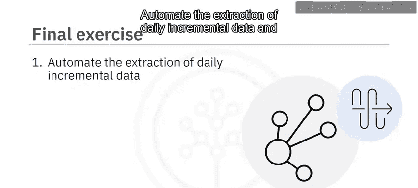

From the production database into the data warehouse。 After performing each task。

 take a screenshot of the command you used and its output and name the screenshot。 Good luck。

 and let's get started。

