# IBM数据工程专业证书 课程13：《数据工程毕业项目》｜data-enginering-capstone-project｜ - P8：7_assignment overview data pipelines using apache airflow.zh_en - GPT中英字幕课程资源 - BV1ej411z7Fi

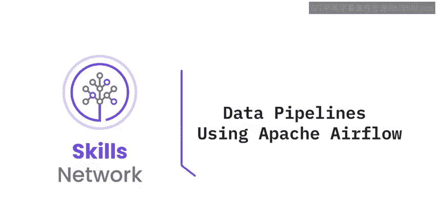

This video will give you an overview of the data pipelines using Apache airflow lesson of the ETL and data pipelines module In this assignment。

 you will perform a couple of exercises to create， run and monitor a data pipeline using Apache airflow to feed the big data cluster from the web server log but before proceeding with the assignment。

 you will prepare the lab environment by starting Apache airflow and then using the link provided download the data set from the source to the appropriate destination In the first exercise you will perform a series of tasks to create a directed acyclic graph dag that runs daily you will create a task that extracts the IP address and the date fields from the web server log file and then save them to a CSV file The next task requires you to transform the date field into yearmonday format and save the output to a CSv file in the final task of the first exercise you will load the data by archiving the transform CSV file into a。

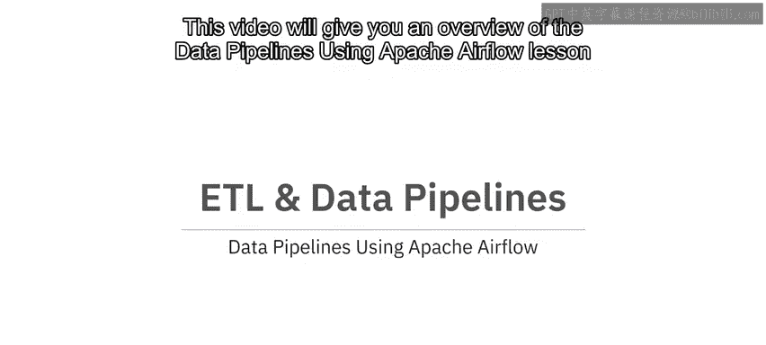

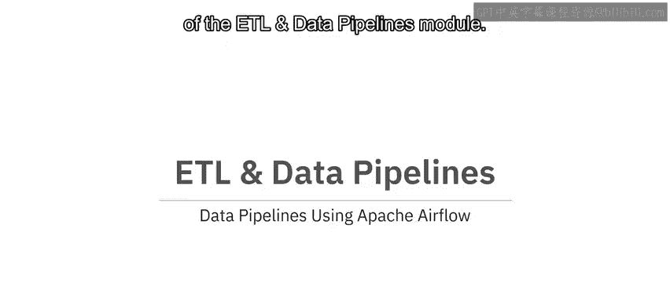

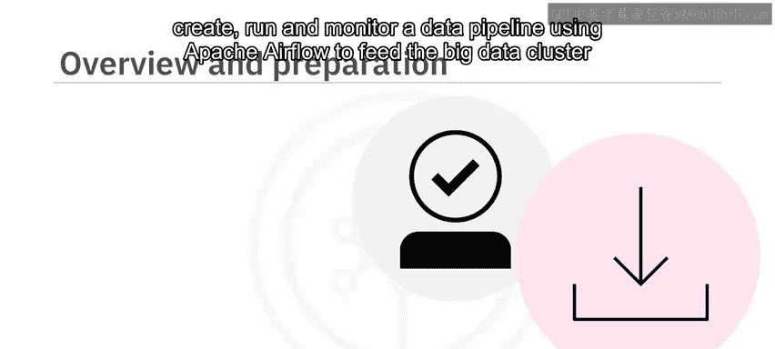

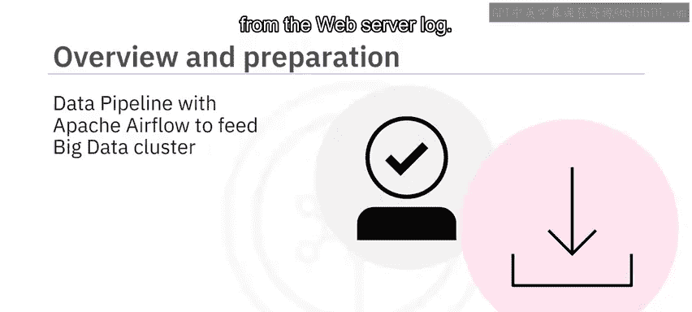

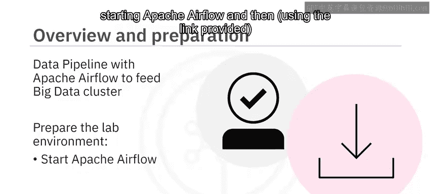

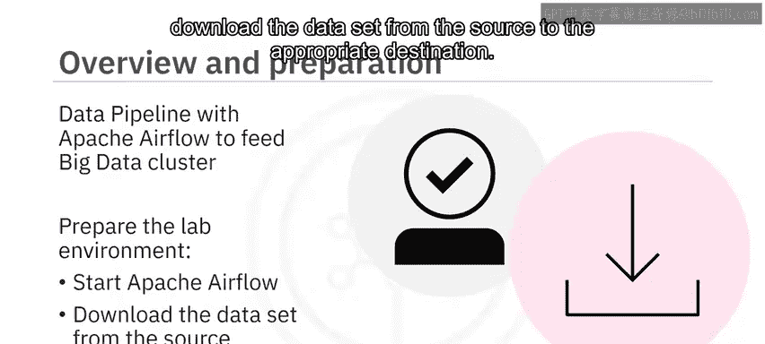

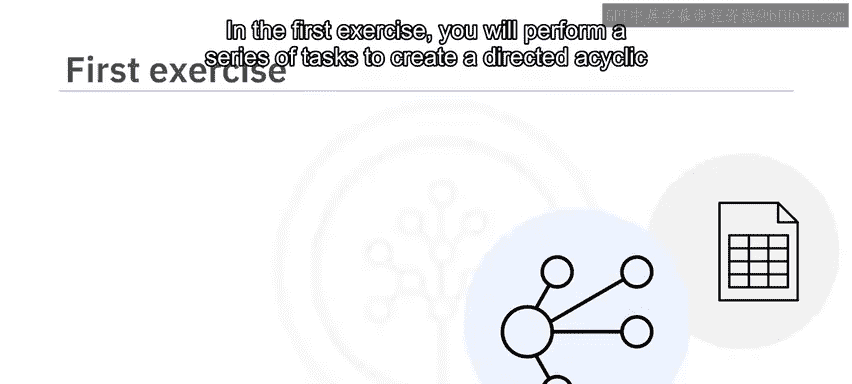

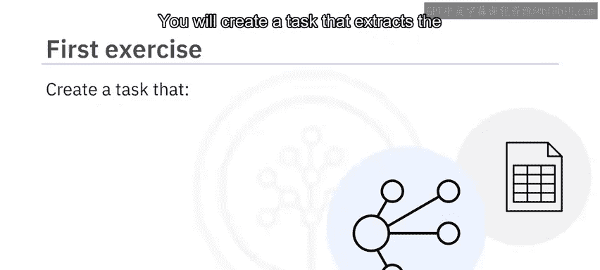

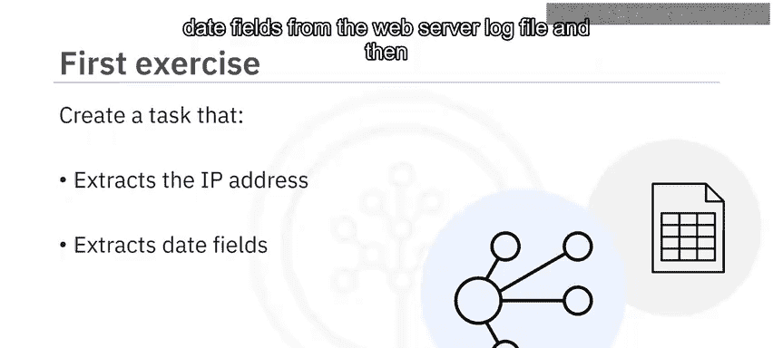

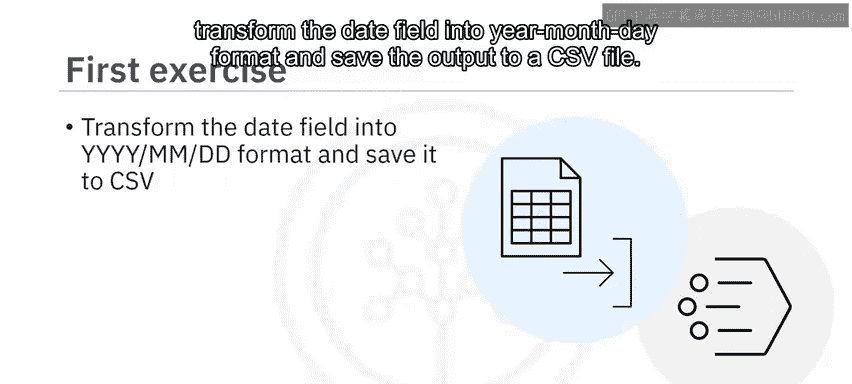

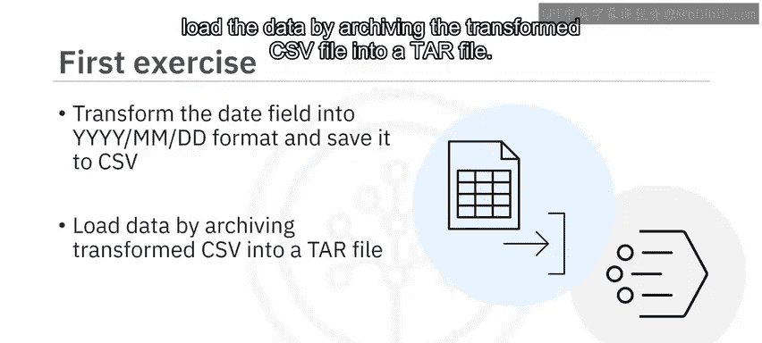

File before moving on to the next exercise， you will define the task pipeline as per the given details in the second exercise you will get the DAG operational by saving the defined Dg into a dot PY or Python file Further you will submit。

 stop and then monitor that the DAg runs for the airflow console after performing each task。

 take a screenshot of the command you used and its output， and name the screenshot。

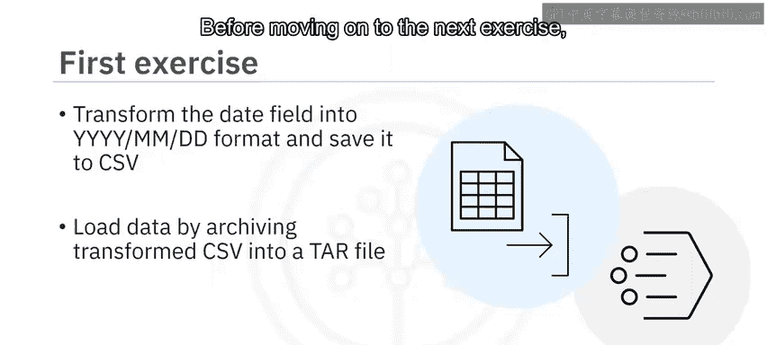

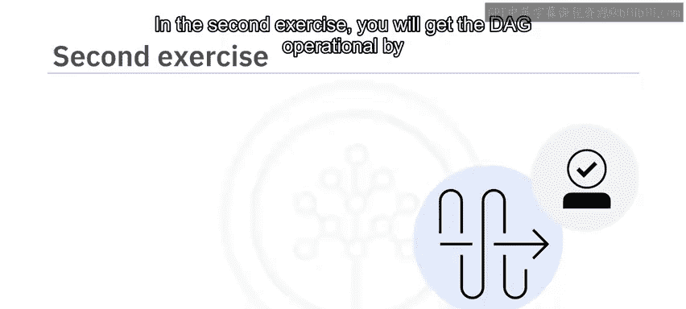

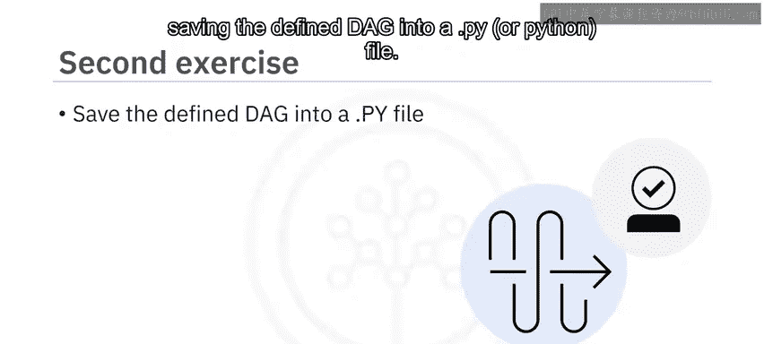

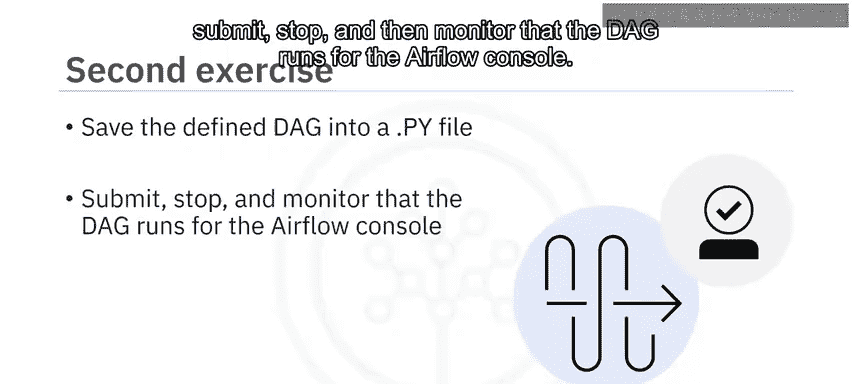

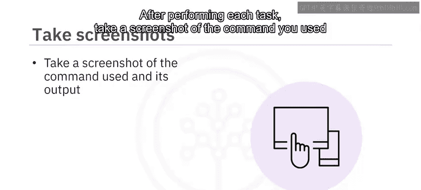

Good luck。 And let's get started。

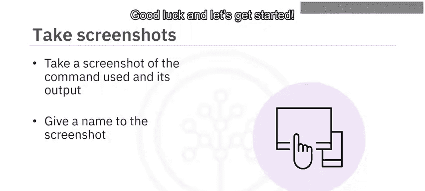