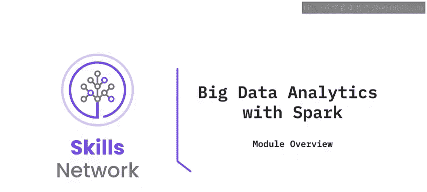
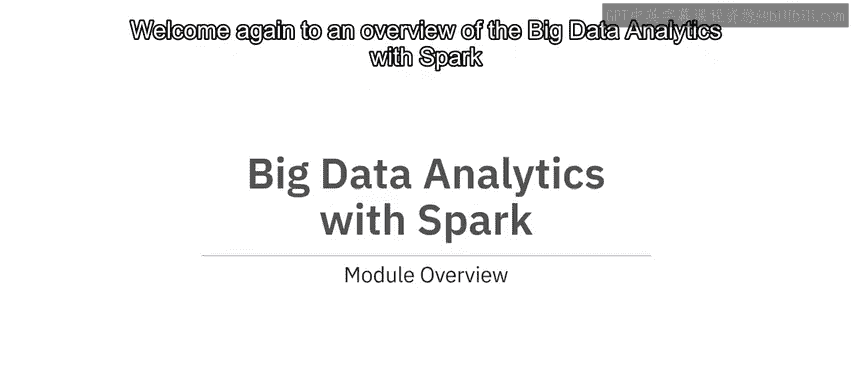
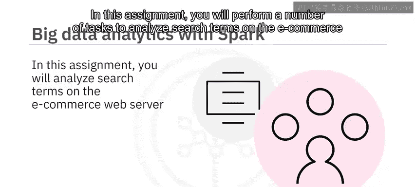
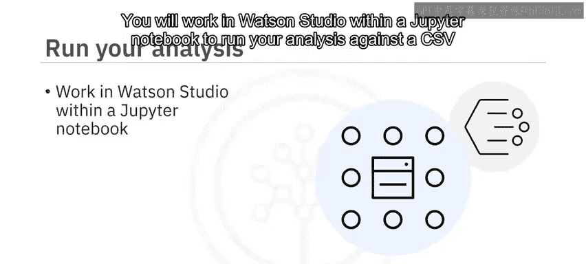
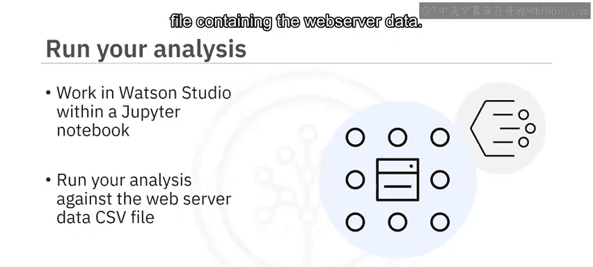
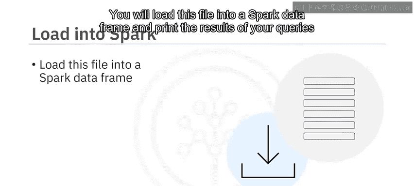
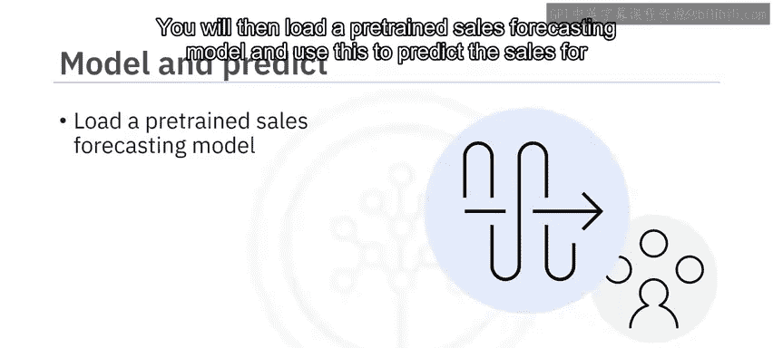
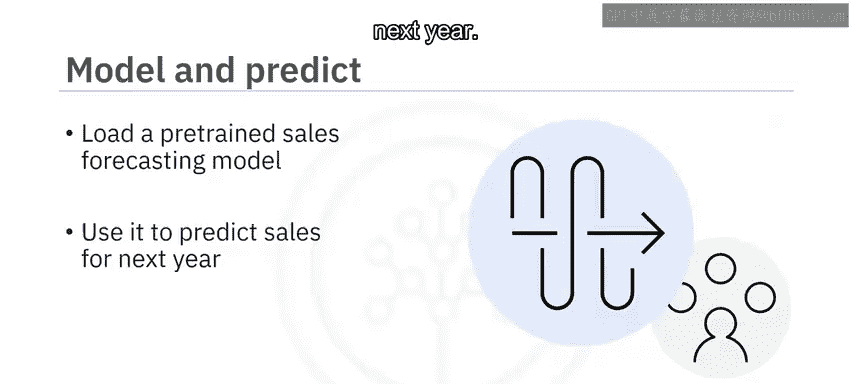
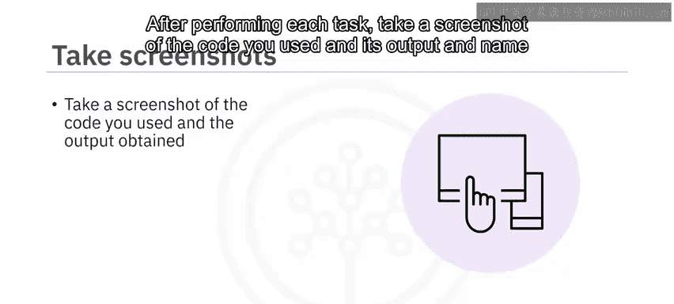

# IBM数据工程专业证书 课程13：《数据工程毕业项目》｜data-enginering-capstone-project｜ - P9：8_assignment overview big data analytics with spark.zh_en - GPT中英字幕课程资源 - BV1ej411z7Fi

Welcome again to an overview of the big Data Anatic with Spark。

In this assignment you will perform a number of tasks to analyze search terms on the E-commerce Web server you will work in Watson Studio within a Jupiter notebook to run your analysis against a CSV file containing the web server data You will load this file into a Spark data frame and print the results of your queries against this data set You will then load a pretrained sales forecasting model and use this to predict the sales for next year。

After performing each task， take a screenshot of the code you used and its output and name the screenshot。

 Good luck。 and let's get started。😊。

