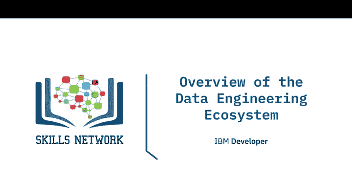
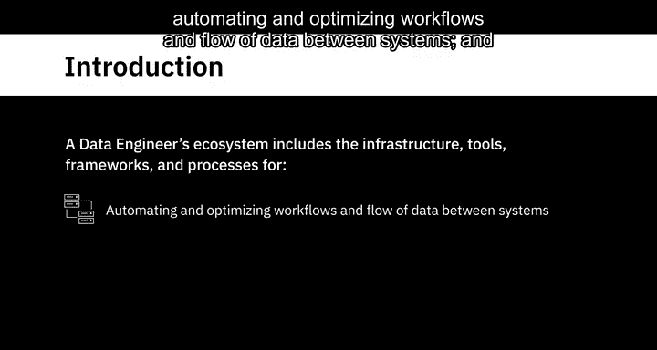
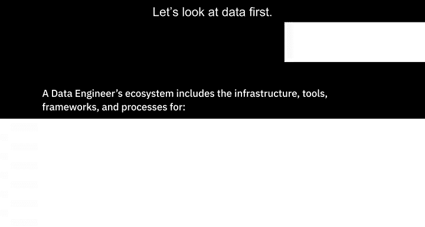
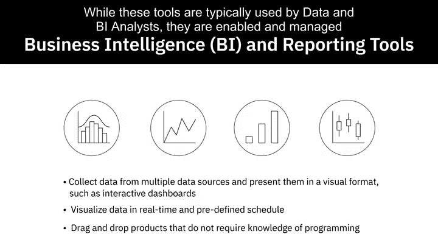
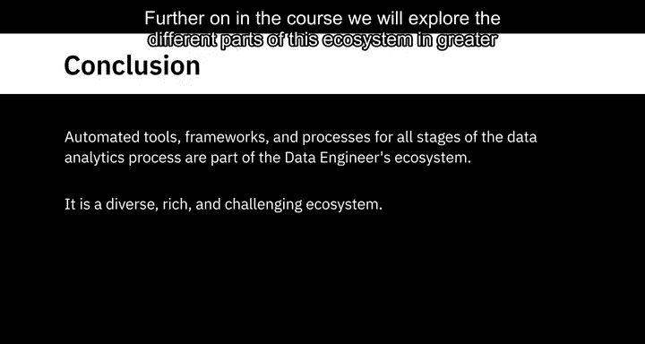
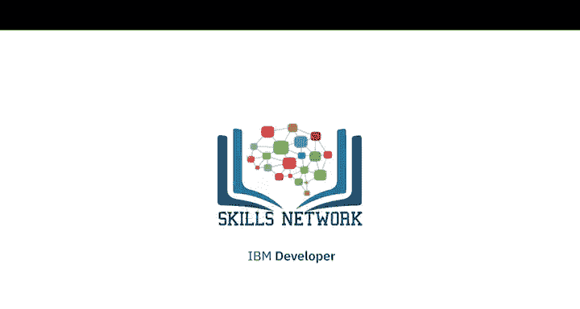

# IBM数据工程专业证书第1课：《数据工程入门课程（IBM）》introduction-to-data-engineering - P10：9_数据工程生态系统概览.zh_en - GPT中英字幕课程资源 - BV1G94y1y7oT

A data engineer's ecosystem includes the infrastructure， tools。

 frameworks and processes for extracting data from disparate sources。

 architecting and managing data pipelines for transformation。

 integration and storage of data Arching and managing data repositories。

 Automating and optimizing workflows and flow of data between systems and developing applications needed through the data engineering workflow。

 Let us look at data first based on how well defined the structure of data is data can be categorized as structured semistructured or unstructured。

 data that follows a rigid format and can be organized neatly into rows and columns is structured data。

 This is the data that you see typically in datas and spreadsheets， for example。

 semistructured data is a mix of data that has consistent characteristics and that doesn't conform to a rigid structure For example。

 emails and。

Email has a mix of structured data such as the name of the sender and recipient。

 but also has the contents of the email， which is unstructured data。

 and then there is unstructured data data that is complex and mostly qualitative information that is impossible to reduce to rows and columns for example。

 photos， videos， text files， PDFs and social media content the type of data drives the kind of data repositories that the data can be collected and stored in and also the tools that can be used to query or process the data data also comes in a wideraning variety of file formats being collected from a variety of data sources ranging from relational and non-relational databases to APIs。

 web services， data streams， social platforms and sensor devices a data engineers ecosystem also includes data repositories。

 There are two main types of data repositories。Aal and analytical transactional systems。

 also known as online transaction processing or OLTP systems are designed to store high volumee day to day operational data。

 such as online banking transactions ATM transactions and airline bookings while OLTP datas are typically relational。

 they can also be nonrelational analytical systems also known as online analytical processing or Oap systems are optimized for conducting complex data analytics。

 These include relational and non-relational databases data warehouses， data marks。

 data lakes and big data stores The type format sources of data and context of use influence which data repository is ideal Once data from disparate sources has been collated。

 it needs to be processed， cleansed and integrated so that it can be accessed via。

ing interface by users data integration tools combine data from disparate sources into a unified view accessed by users to query and manipulate the data。

 This brings us to data pipelines a set of tools and processes that cover the entire journey of data from source to destination systems。

 data is integrated within a pipeline using processes such as the extract。

 transform and load process or the extract load and transform process。

 The ecosystem also includes languages that can be classified as query languages。

 programming languages and shell and scripting languages。

 from query and manipulating data with SQL to developing data applications with Python and writing shell scripts for repetitive operational tasks。

 These are important components in a data engineers workbench。

BI and reporting tools are used to collect data from multiple data sources and present them in a visual format。

 such as interactive dashboards using these tools， you can connect and visualize your data in real time and on a predefined schedule these are drag and drop products that do not require the users to know any programming While these tools are typically used by data and BI analysts。

 they are enabled and managed by data engineers Auto tools。

 frameworks and processes for all stages of the data analytics process are part of the data engineers ecosystem。

 It's a diverse， rich and challenging ecosystem further on in the course we will explore the different parts of this ecosystem in greater detail。

