# IBM数据工程专业证书第1课：《数据工程入门课程（IBM）》introduction-to-data-engineering - P12：11_文件格式类型解析.zh_en - GPT中英字幕课程资源 - BV1G94y1y7oT

嗯。As a data professional， you will be working with a variety of data file types and formats。

 It is important to understand the underlying structure of file formats。

 along with their benefits and limitations。 This understanding will support you to make the right decisions on the formats best suited for your data and performance needs。

 Some of the standard file formats that we will cover in this video include delimited text file formats。

 Microsoft Excel Open X M L spreadsheet or X LS X Extensible markup language or XM L Port document format or Pf Javascript object notation or J。

😊。

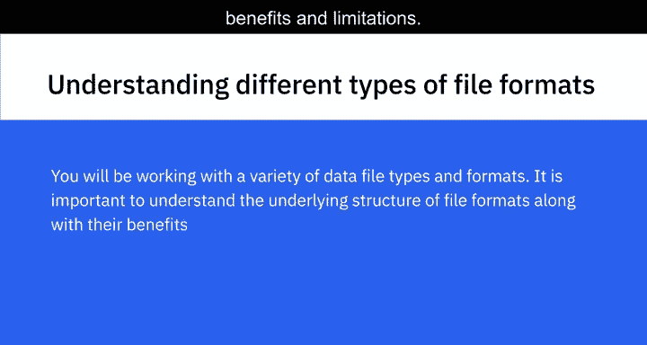

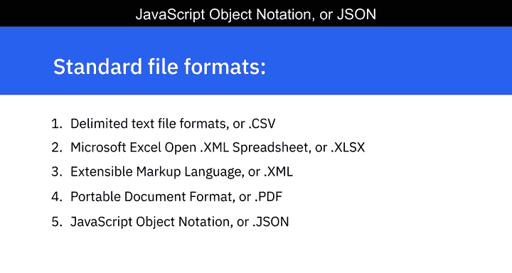

Delimited text files are text files used to store data as text in which each line or row has value separated by a delimiter。

 where a delimiter is a sequence of one or more characters for specifying the boundary between independent entities or values。

 Any character can be used to separate the values， but most common delimiters are the comma tab。

 colon vertical bar and space。 comma separated values or Csvs and tab separated values or Tsvs are the most commonly used file types in this category。

 In Csvs， the delimiter is a comma while in T Svs， the delimiter is a tab。

 When literal commas are present in text data and therefore cannot be used as delimiters。

 T Svs serve as an alternative to CV format。

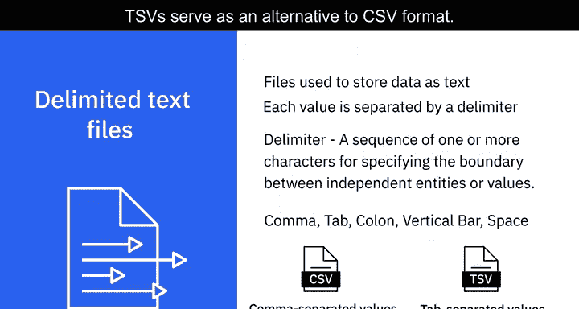

Tab stops are infrequent in running text。

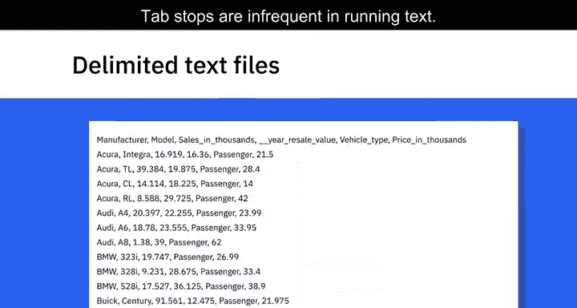

Each row or horizontal line in the text file has a set of values separated by the delimiter and represents a record。

 The first row works as a column header where each column can have a different type of data。

 For example， a column can be of date type。 While another can be a string or integer type data。

 Delimited files allow field values of any length and are considered a standard format for providing straightforward information schema。

 They can be processed by almost all existing applications。

 Delimiters also represent one of various means to specify boundaries in a data string。

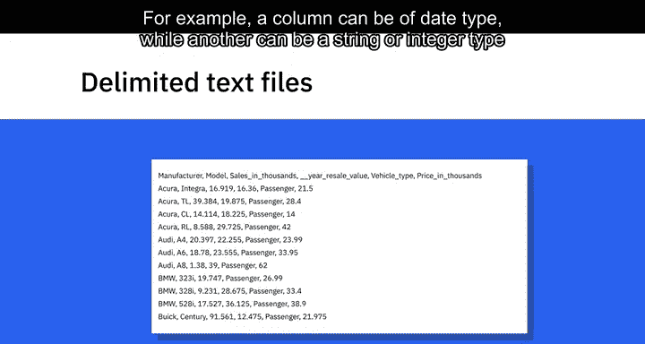

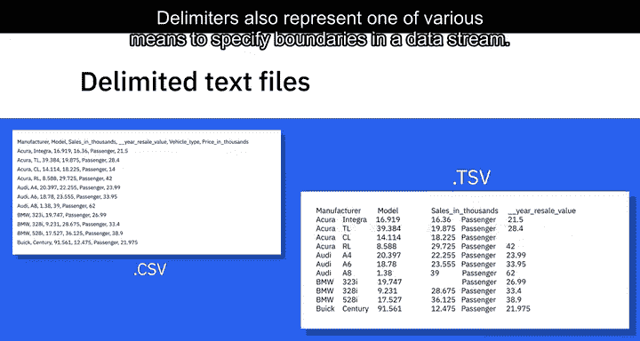

Microsoft Excel， Open X M L spreadsheet， or X LS X。

 is a Microsoft Excel open Xml file format that falls under the spreadsheet file format。

 It is an X ML based file format created by Microsoft in an X L S X also known as a workbook。

 There can be multiple worksheets， and each worksheet is organized into rows and columns at the intersection of which is the cell。

 Each cell contains data。 X LS X uses the open file format。

 which means it is generally accessible to most other applications。

 It can use and save all functions available in Excel。

 and is also known to be one of the more secure file formats， as it cannot save malicious code。😊。

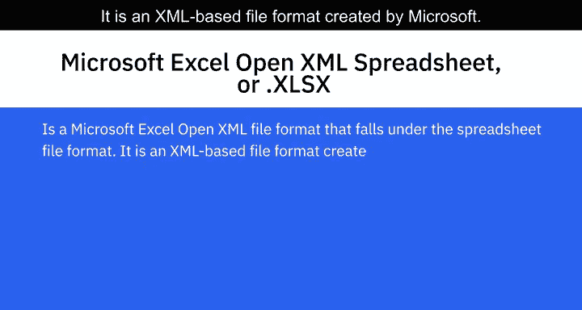

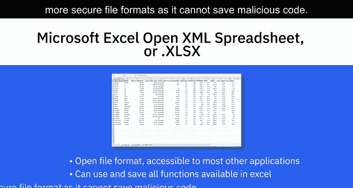

Extensible markup language or X， M L is a markup language with set rules for encoding data。 The X。

 M L file format is both readable by humans and machines。

 It is a self descriptive language designed for sending information over the Internet。

XML is similar to HML in some respects， but also has differences， for example。

 and XML does not use predefined tags like HL does。

 XML is platform independent and programming language independent and therefore simplifies data sharing between various systems。

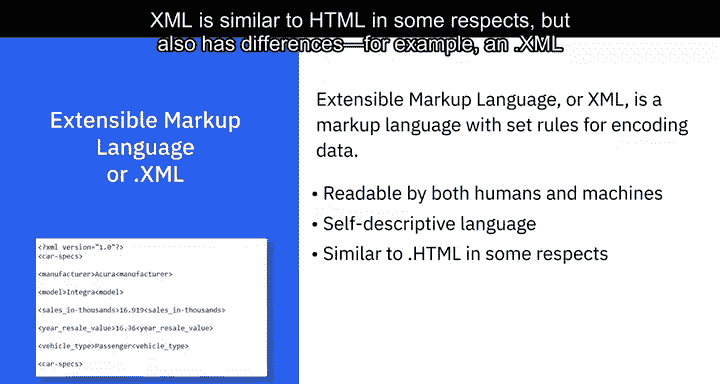

Portable document format or Pf is a file format developed by Adobe to present documents independent of application。

 software， hardware and operating systems， which means it can be viewed the same way on any device。

 This format is frequently used in legal and financial documents and can also be used to fill in data such as forms。

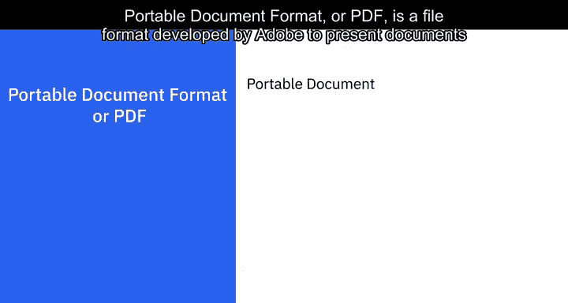

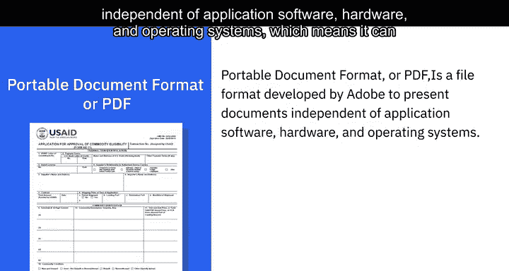

Javascript objectject notation or Jason is a text based open standard designed for transmitting structured data over the web。

 The file format is a language independent data format that can be read in any programming language。

 Jason is easy to use， is compatible with a wide range of browsers and is considered as one of the best tools for sharing data of any size and type。

 Even audio and video。 That is one reason many As and web servers return data as Jason。

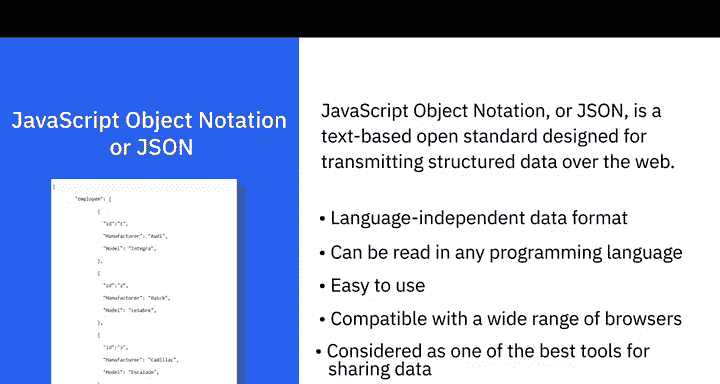