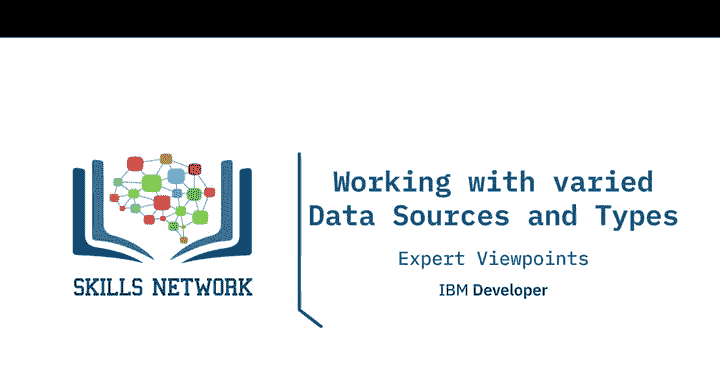
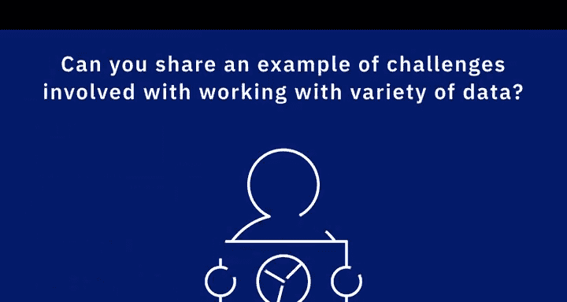
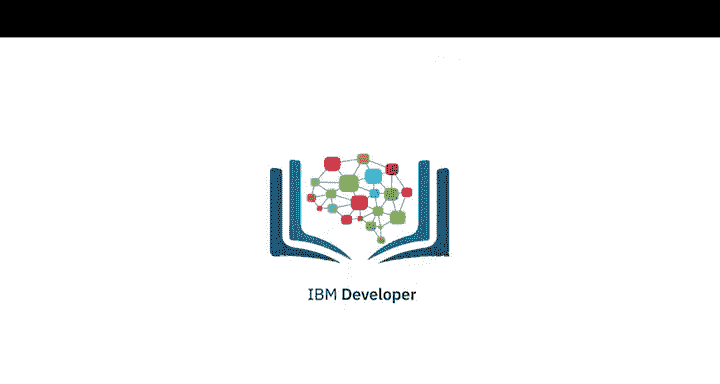

# IBM数据工程专业证书第1课：《数据工程入门课程（IBM）》introduction-to-data-engineering - P15：14_多源多类型数据处理视角.zh_en - GPT中英字幕课程资源 - BV1G94y1y7oT

In this video we will listen to several data professionals talk about their experience of working with varied data sources and types of data so you'd be surprised the different ways that data can come at you I tend to be a relational database fan and so I spend a lot of time with SQL and using the power of SQL to deal with moving data from one place to another to deal with structuring of data to deal with all the security details around data but obviously that doesn't apply to every scenario and even when we're dealing entirely in relational databases or're often moving data from one relational database to another and especially when we're talking about one vendor to another that can be challenging the things that also get in the way tend to be the versioning so sometimes the feature of something that you want is in a version two levels above where you are or's。

Doesn't work the same way as it did two versions ago so working with multiple data sources is about flexibility。

 it's about finding the function that works and works with the performance you need moving data one time is usually not all that hard as long as we're subterabyte but moving data consistently and continually in a performant way can cause cause us to evaluate a lot of different solutions。

 so we really need to be open to new ideas and looking for new solutions that meet the requirements that we have mostly I work with relational databases they're extremely flexible and which took the test of time。

 however， with the evolution of unstructured data such as logs。

 documents X on JSON the reputation as a queue for all of your data problems came under intense scrutiny and most of。

Da intensive applications such as IoT and social media applications started to look elsewhere。

 for example， Google released a white paper back in 2006 called Google BigT。

 and that idea quickly caught fire， for example， Cassandra and HBase came out of the same architectural model as the Google BigT。

 and they became widely popular databases to solve some of the problems that relational databases failed to solve。

 for example relational databases struggle a little bit with heavyr intensive applications such as IoT or sensor data social media data because the B3 data structures that drive or power these relational databases。

Slows down due to their nature of the random reads and random rides for the heavy ride applications。

 it's an inevitable part of a data engineer's job to work with a variety of data。

You will need to work with standard formats like CSV， J， XML。

 but also you'll need to work with propriety formats。

And you will need to get data in different sources， whether it be relational databases， No SQL。

 or big data repositories。You know you will need to work with data at rest。

 streaming data or data in motion。And。You might not have the skills to work with all of these different types of data sources from day one。

But you need to be able to learn as you go and pick up the skills required for the project to work with different data sets。

 different data formats， and different data sources。When it comes to the data formats， log data。

 XML data， GSN， except for each of them comes with their own challenges， for example， log data。哦。

I extremely challenging because it's unstructured and you may need to write your own custom tools to pass the data depending on what you want to look at。

 whereas XML was widely popular like a decade ago especially with the so protocol of the web applications。

 however it soon the web developers and the corporations discovered that it can be a resource intensive especially memory because it has both the starting and ending tags so then JSON came into the picture they got it off the ending tags and they looked like a key value pairers and it saved some resources and it is now。

widely used as part of the Rashful APIs， and then even newer versions of the data format such as Apache Aro were gaining a wide popularity because of the efficiency on how they store the data。

One particular situation where we were convertfering data from a DB2 database into a SQL server database and it was challenging because the way that each of those expect imports and exports to happen is a little bit different the data was particularly challenging and that's where a lot of your challenge might come from in these project is from the data itself in this particular case the data had a lot of different characters in it so usually we're looking for a character we can use as a delimiter。

 oftentimes that's comma separate comma delimited so we can separate our fields using commas but we also have to about think about situations where we have data that has commas in it。

 how do we properly separate that data， how do we properly define our fields。

And in this particular case， we had to use different separators for different tables because every single special character that we could think of was in one of those tables and the special characters that weren't were sometimes ones we couldn't use for separation such as the be character。

