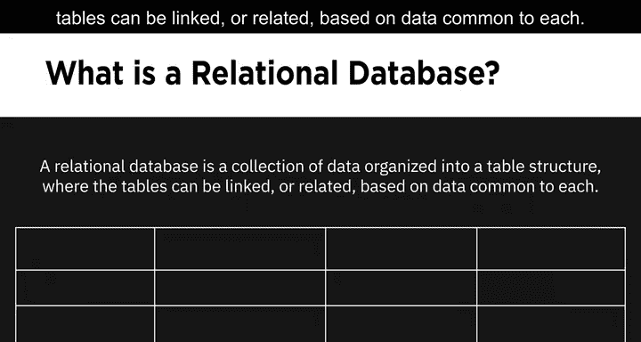
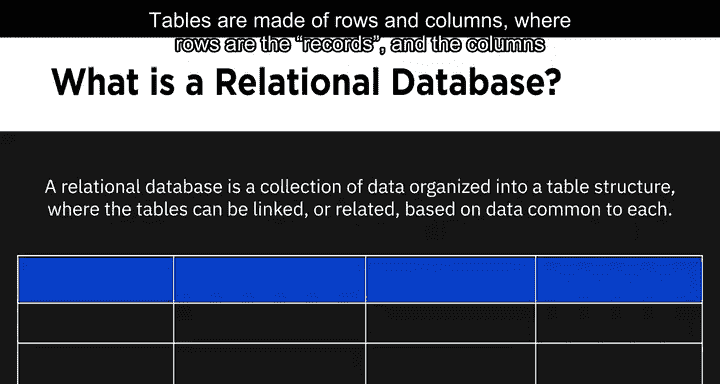
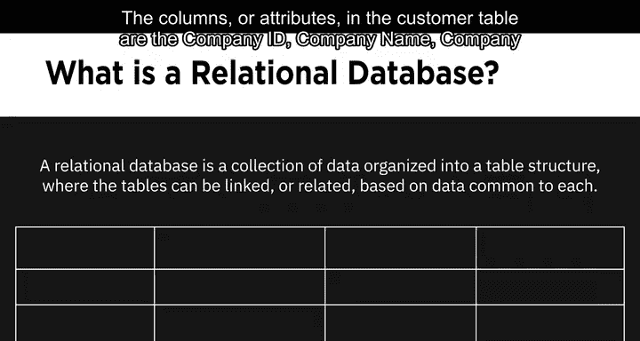
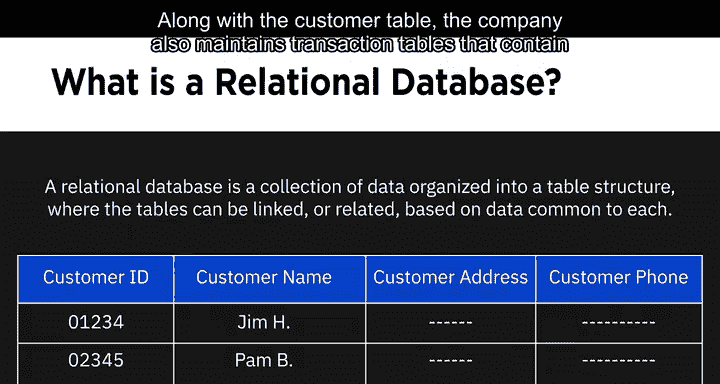
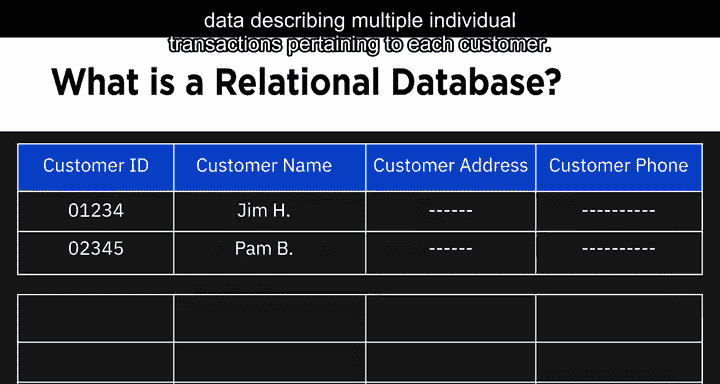
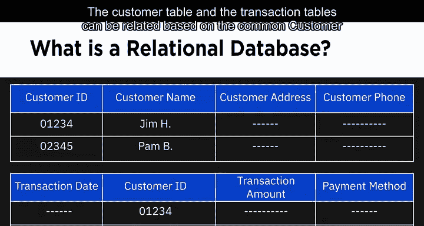
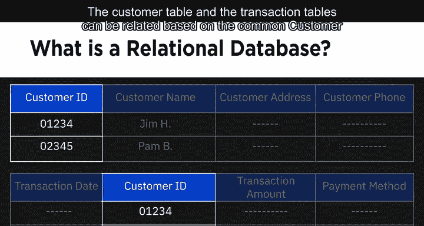
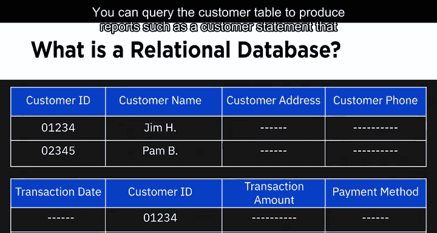
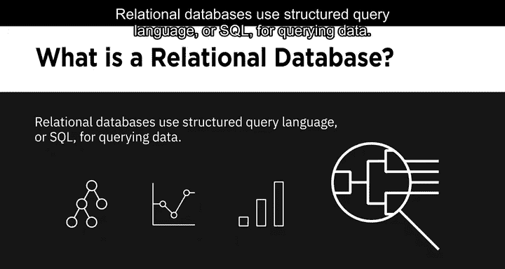
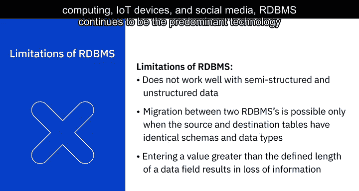

# IBM数据工程专业证书第1课：《数据工程入门课程（IBM）》introduction-to-data-engineering - P17：16_关系型数据库管理系统.zh_en - GPT中英字幕课程资源 - BV1G94y1y7oT

嗯。

A relational database is a collection of data organized into a table structure where the tables can be linked or related based on data common to each。

Tables are made of rows and columns where rows are the records and the columns， the attributes。

 Let's take the example of a customer table that maintains data about each customer in a company。

 The columns or attributes in the customer table are the customer Id， customer name。

 customer address and customer primary phone。 and each row is a customer record。

Now， let's understand what we mean by tables being linked or related based on data common to each。

Along with the customer table， the company also maintains transaction tables that contain data describing multiple individual transactions pertaining to each customer。

The columns for the transaction table might include the transaction date， customer ID。

 transaction amount， and payment method。The customer table and transaction tables can be related based on the common customer ID field。

 you can query the customer table to produce reports such as a customer statement that consolidates all transactions in a given period。

 This capability of relating tables based on common data enables you to retrieve an entirely new table from data in one or more tables with a single query。

 It also allows you to understand the relationships among all available data and gain new insights for making better decisions。

 relational databases use structured query language or SQl for querying data will learn more about SQl later in this course。

 Real databases build on the organizational principles of flat files such as spreadsheets with data organized into rows and columns following a welldefin structure and schema。

😊。

But this is where the similarity ends。 relationlational databases by design are ideal for the optimized storage。

 retrieval and processing of data for large volumes of data。

 unlike spreadsheets that have a limited number of rows and columns。

Each table in a relational database has a unique set of rows and columns。

 and relationships can be defined between tables， which minimizes data redundancy。Moreover。

 you can restrict database fields to specific data types and values。

 which minimizes irregularities and leads to greater consistency and data integrity relationlational databases use SQL for querying data。

 which gives you the advantage of processing millions of records and retrieving large amounts of data in a matter of seconds。

Moreover， the security architecture of relational databases provides controlled access to data and also ensures that the standards and policies for governing data can be enforced。

 relational databases range from small desktop systems to massive cloud based systems。

 They can be either open source and internally supported。

 open source with commercial support or commercial closed source systems。IBM DB2， Microsoft SQL Ser。

 My SQL， Oracle database and PostgresqL are some of the popular relational databases Cloud based relational databases also referred to as database as a service are gaining wide use as they have access to the limitless compute and storage capabilities offered by the cloud。

Some of the popular cloud relational databases include Amazon relationlational database service or RDS。

 Google Cloud SQ IBM D2 on cloud， Oracle cloud and SQL Azure RDB M is a mature and well documented technology。

 Ma it easy to learn and find qualified talent。 One of the most significant advantages of the relational database approach is its ability to create meaningful information by joining tables。

 Some of its other advantages include flexibility， using SQl。 you can add new columns。

 add new tables， rename relations and make other changes while the database is running and queries are happening。

 Red redundancy， relational databases minimized data redundancy。 For example。

 the information of a customer appears in a single entry in the customer table。

 and the transaction table pertaining to the。😊，Customer stores a link to the customer table。

Ease of backup and disaster recovery relational databases offer easy export and import options。

 making backup and restore easy exports can happen while the database is running。

 making restore on failure easy。Cloud based relational databases do continuous mirroring。

 which means the loss of data on restore can be measured in seconds or less。

Aid compliance As stands for atity， consistency， I and durability。

 As compliance implies that the data in the database remains accurate and consistent。

 despite failures and database transactions are processed reliably。

 Now we'll look at some use cases for relational databases。😊。

Online transaction processing OLTP applications are focused on transaction oriented tasks that run at high rates。

 relational databases are well suited for OLTP applications because they can accommodate a large number of users。

 They support the ability to insert， update or delete small amounts of data。

 and they also support frequent queries and updates as well as fast response times。

 Data warehouses in a data warehousing environment。

 relational databases can be optimized for online analytical processing or OL。

 where historical data is analyzed for business intelligence， Io solutions。

 Internet of things or Io solutions require speed as well as the ability to collect and process data from edge devices。

 which need a lightweight database solutions。 This brings us to the limitations of RDBMS。

 RDBm does not。Work well with semistructured or unstructured data and is therefore not suitable for extensive analytics on such data for migration between two RDBMSss。

 schemas and type of data need to be identical between the source and destination tables。

Relational databases have a limit on the length of data fields。

 which means if you try to enter more information into a field than it can accommodate。

 the information will not be stored， despite the limitations and the evolution of data in these times of big data。

 cloud computing， IoT devices and social media， RDBMS continues to be the predominant technology for working with structured data。

