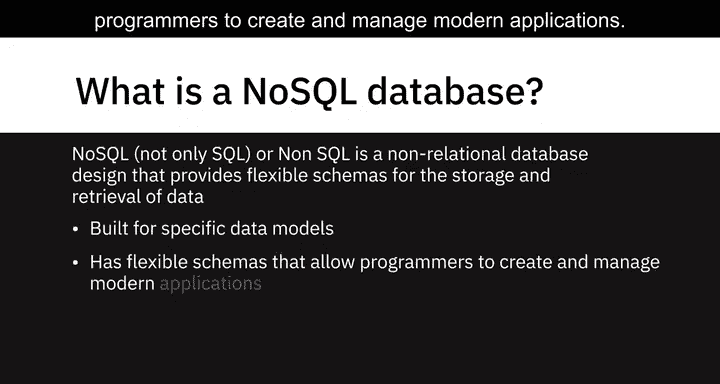
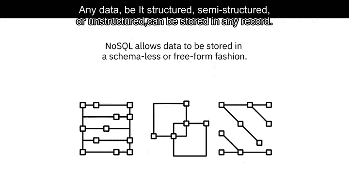
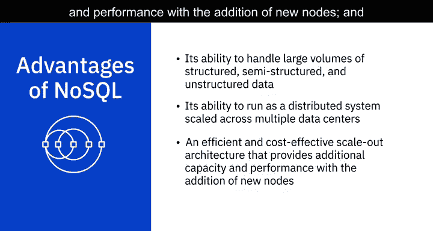
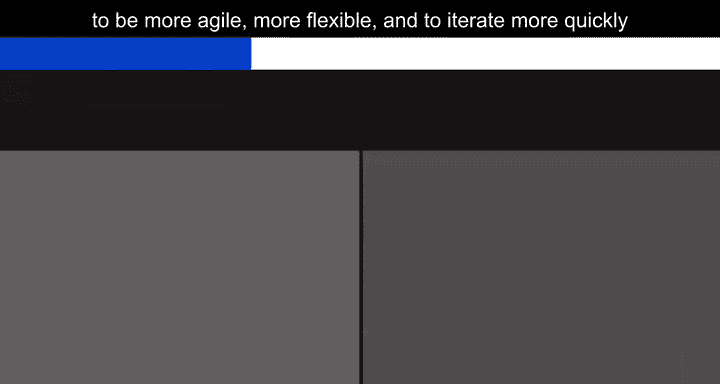
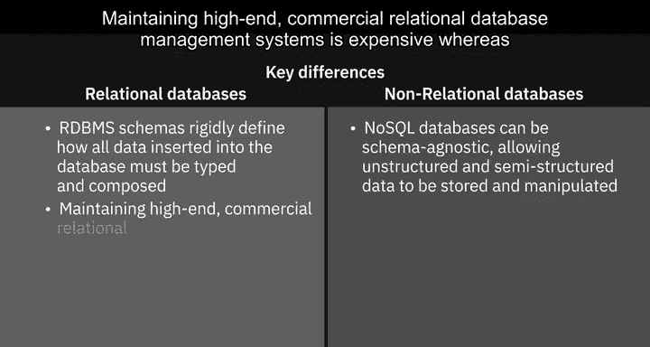

# IBM数据工程专业证书第1课：《数据工程入门课程（IBM）》introduction-to-data-engineering - P18：17_NoSQL.zh_en - GPT中英字幕课程资源 - BV1G94y1y7oT

嗯。No SQL， which stands for not only SQL， or sometimes non SQL。

 is a nonreal database design that provides flexible schemas for the storage and retrieval of data。

No SQL databases have existed for many years， but have only recently become more popular in the era of cloud。

 big data and high volume web and mobile applications。

 They are chosen today for their attributes around scale， performance and ease of use。

 It's important to emphasize that the no in no SQL is an abbreviation for not only and not the actual word no。

 No SQL databases are built for specific data models and have flexible schemas that allow programmers to create and manage modern applications。

 They do not use a traditional row column tabled database design with fixed schemas and typically not use the structured query language or SQL to query data。

 although some may support SQL or SQL like interfaces。😊。

No SQL allows data to be stored in a schemaless or free form fashion。 Any data， be it structured。

 semistructured or unstructured can be stored in any record。

Based on the model being used for storing data， there are four common types of no SQL databases。

Key value store， document based， column based and graph based。

Key value store data in a key value database is stored as a collection of key value pairs。

 The key represents an attribute of the data and is a unique identifier。

Both keys and values can be anything from simple integers or strings to complex JO documents。

Key value stores are great for storing user session data and user preferences。

 making real time recommendations and targeted advertising and in memory data caching。😊，However。

 if you want to be able to query the data on specific data value。

 need relationships between data values or need to have multiple unique keys。

 a key value store may not be the best fit。Redis， Mem Caashti and Dynamo DB are some well known examples in this category。

Document based document databases store each record and its associated data within a single document。

 They enable flexible indexing， powerful ad hoc queries and analytics over collections of documents。

Document databases are preferable for e-commerce platforms， medical records storage。

 CRM platforms and analytics platforms， however， if you're looking to run complex search queries and multiop transactions。

 a document based database may not be the best option for you。MongoDB， Document DB。

 CouchDB and Cloudant are some of the popular document based databases。

Column based column based models store data in cells grouped as columns of data instead of rows。

 A logical grouping of columns that is columns that are usually accessed together is called a column family。

For example， a customer's name and profile information will most likely be accessed together。

 but not their purchase history， so customer name and profile information data can be grouped into a column family。

Since column databases store all cells corresponding to a column as a continuous disk entry。

 accessing and searching the data becomes very fast。

Column databases can be great for systems that require heavy write requests。

 storing time series data， weather data and Io data。

 But if you need to use complex queries or change your querying patterns frequently。

 this may not be the best option for you。The most popular column databases are Cassandra and Hbase。

Graph based graph based databases use a graphical model to represent and store data。

 They are particularly useful for visualizing， analyzing and finding connections between different pieces of data。

 The circles are nodes， and they contain the data。 The arrows represent relationships。

Graph databases are an excellent choice for working with connected data。

 which is data that contains lots of interconnected relationships。

Graph databases are great for social networks， real time product recommendations， network diagrams。

 fraud detection， and access management。But if you want to process high volumes of transactions。

 it may not be the best choice for you because graph databases are not optimized for large volume analytics queries。

Neio4j and Cosmos DB are some of the more popular graph databases。

No SQL was created in response to the limitations of traditional relational database technology。

 The primary advantage of no SQL is its ability to handle large volumes of structured。

 semistructured and unstructured data。Some of its other advantages include the ability to run as distributed systems scaled across multiple data centers。

 which enables them to take advantage of cloud computing infrastructure。

 an efficient and cost effectiveff scale out architecture that provides additional capacity and performance with the addition of new nodes and simpler design。

 better control over availability， and improved scalability that enables you to be more agile。

 more flexible， and to iterate more quickly。

To summarize the key differences between relational and nonrelational databases。

 RDBMS schemas rigidly define how all data inserted into the database must be typed and composed。

 whereas no SQL databases can be schema agnostic， allowing unstructured and semistructured data to be stored and manipulated。

 maintaining high end commercial relational database management systems is expensive。

 whereas no SQL databases are specifically designed for low cost commodity hardware。

Relational databases， unlike most no SQL， support acid compliance。

 which ensures reliability of transactions and crash recovery。

RDBMS is a mature and well documented technology， which means the risks are more or less perceivable as compared to no SQL。

 which is a relatively newer technology。Nonetheless。

 no SQL databases are here to stay and are increasingly being used for mission critical applications。

