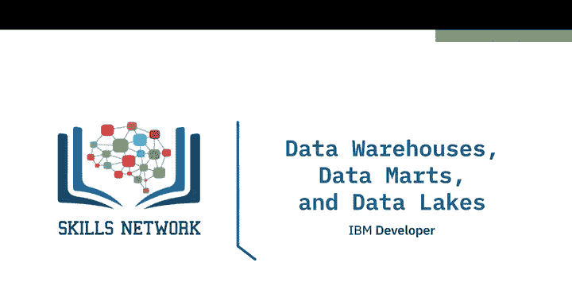
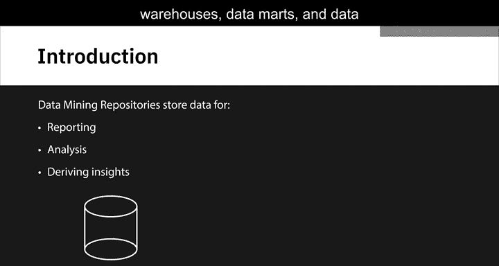
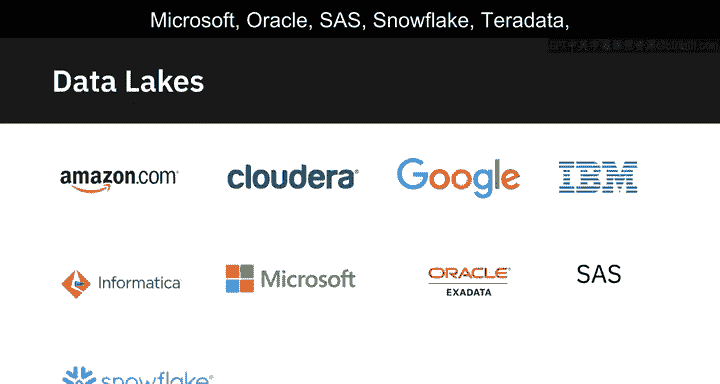
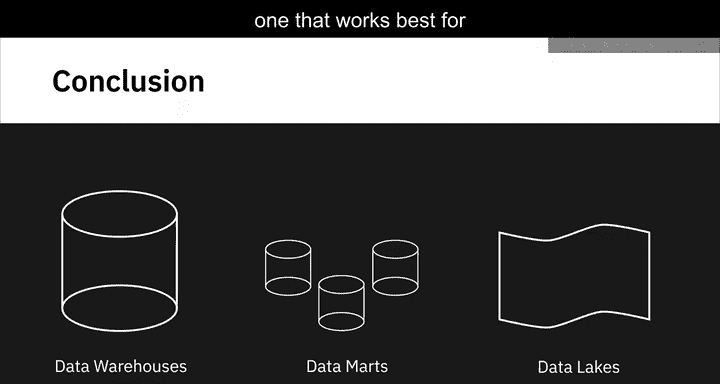
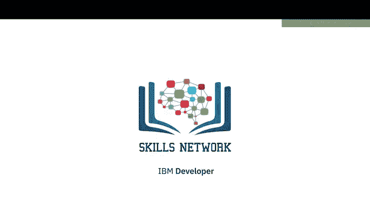

# IBM数据工程专业证书第1课：《数据工程入门课程（IBM）》introduction-to-data-engineering - P19：18_数据仓库、数据集市与数据湖.zh_en - GPT中英字幕课程资源 - BV1G94y1y7oT

All data mining repositories have a similar goal， which is to house data for reporting analysis and deriving insights。

 but their purpose types of data stored and how data is accessed differs in this video we will learn about some of the characteristics and applications of data warehouses。

 data mars and data lakes。

A data warehouse is a central repository of data integrated from multiple sources。

 Data warehouses serve as the single source of truth。

 storing current and historical data that has been cleansed， Con and categorized。

 when data gets loaded into the data warehouse， it is already modeled and structured for a specific purpose。

 meaning its analysis ready。 Traditionally， data warehouses are known to store relational data from transactional systems and operationalal databases。

 such as CRM， ERRP， HR and finance applications， but with the emergence of no SQl technologies and new data sources。

 nonrelational data repositories are also being used for data warehouseehousing。 Typ。

 a data warehouse has a three tier architecture。 The bottom tier of the architecture includes the data servers。

 which could be relational， nonrelational or both that extract data from different sources。

 The middle tier of the architecture。Consists of the OLAP server。

 a category of software that allows users to process and analyze information coming from multiple database servers。

 and the topmost tier of the architecture includes the client frontend layer This tier includes all the tools and applications used for query。

 reporting and analyzing data In response to the rapid data growth and today's sophisticated analytics tools。

 Data warehouses that once resided in on- premisemise data centers are moving to the cloud compared to their on- premisemise versions。

 some of the benefits offered by cloudbased data warehouses include lower costs。

 limitless storage and compute capabilities scale on a pay as you go basis and faster disaster recovery As an organization you would opt for a data warehouse when you have massive amounts of data from your operational systems that needs to be readily available for reporting and analysis Some of the popularly used data warehouses。

Tara Data Enterprise Data War Platform， Oracle Exadata， IBM2 Warhouse on Cloud。

 IBM Natia Performance Server， Amazon Redshift， Big Que by Google Clouddera's Enterprise Data Hub and Snowflake Cloud Data Warhouse。

A data mart is a subsection of the data warehouse built specifically for a particular business function。

 purpose or community of users， for example， sales or finance groups in an organization accessing data for their quarterly reporting and projections There are three basic types of data mars dependent independent and hybrid data mars dependent data mars are a subsection of an enterprise data warehouse Since a dependent datamart offers analytical capabilities for a restricted area of the data warehouse。

 it also provides isolated security and isolated performance In data mars are created from sources other than an enterprise data warehouse such as internal operational systems or external data hybrid data mars combined inputs from data warehouses。

 operational systems and external systems The difference also lies in how data is extracted from the source systems The transformations that need to be applied and how the data。

Is transported into the Mart dependentent datamarts， for example。

 pull data from an enterprise data warehouse where data has already been cleaned and transformed Independ data mars need to carry out the transformation process on the source data since it is coming directly from operational systems and external sources。

 whatever the type， the purpose of a datamart is to provide data to users that is most relevant to them when they need it。

 accelerate business processes by providing efficient response times provide a cost and time efficientff way in which data-driven decisions can be taken。

 improve and user response time and provide secure access and control。

A data lake is a data repository that can store large amounts of structured semistructured and unstructured data in their native format。

 while a data warehouse stores data that has been cleaned。

 processed and transformed for a specific need。 You do not need to define the structure and schema of data before loading into the data lake。

 You do not even need to know all of the use cases for which you will ultimately be analyzed the data。

 a data lake exists as a repository of raw data in its native format straight from the source to be transformed based on the use case for which it needs to be analyzed。

 which does not mean that a data lake is a place where data can be dumped without governance。

 while in the data lake， the data is appropriately classified， protected and governed。

 A data lake is a reference architecture that is independent of technology。

 Data lakes combine a variety of technologies that come together to facilitate agile data exploration for analysts and data science。

です？Data lakes can be deployed using cloud objectject storage。

 such as Amazon S3 or large scale distributed systems such as Apache Hadoop used for processing big data。

 They can also be deployed on different relational database management systems。

 as well as no sQL data repositories that can store very large amounts of data。

 Data lakes offer a number of benefits， such as the ability to store all types of data。

 unstructured data such as documents， emails， Pdfs， semistructured data， such as JO， Xml。

 Cv and logs， as well as structure data from relational datas。

 The agility to scale based on storage capacity， growing from terabytes to petabytes of data。

 saving time in defining structures， schemas and transformations since data is imported in its original format。

 and the ability to repurpose data in several different ways and wideraning use cases。

 This is extremely。Beenneicial as it is hard for businesses to foresee all the different ways in which you could potentially leverage their data in the future。

 Some of the vendors that provide technologies， platforms and reference architectures for data lakes include Amazon。

 Clouddera， Google， IBM， Inforatica， Microsoft， Oracle， SAS， Snowflake。

 Terraadata and Zalonone In this video， we learned about some of the capabilities of data mining repositories such as data warehouses。

 data Marts and data lakes。 While they all have a similar goal。

 they need to be evaluated within the context of the use case and technology infrastructure for selecting the one that works best for an organization's needs。

