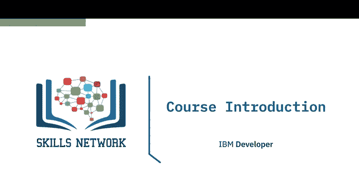
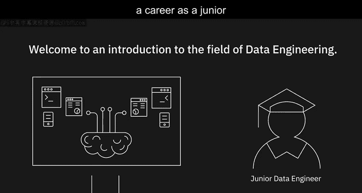
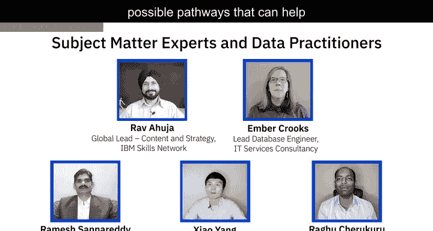
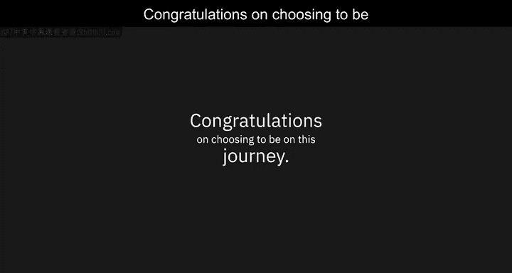
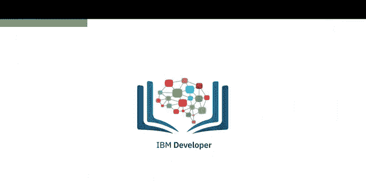

# IBM数据工程专业证书第1课：《数据工程入门课程（IBM）》introduction-to-data-engineering - P1：0_欢迎来到数据工程导论.zh_en - GPT中英字幕课程资源 - BV1G94y1y7oT

Welcome to this introductory course on data engineering。

 the first in a series of courses designed to prepare you for a career as a junior data engineer。

Data is growing at an unprecedented rate， and so are the ways in which data is being tapped by businesses。

 industries， institutions and governments all over the world for making decisions that guide their future and the future of the people they serve how much value we derive from data really depends on just two things。

 The accuracy of data and the efficiency with which we're able to access the data we need when we need it。

 That in a nutshell is the job of a data engineer。 and the opportunity is huge。

 Dce tech job report of 2020 lists data engineering as the fastest growing tech occupation with year over year growth of 50%。

 This course is for you if you want to become a data engineer。

 You may have a background in engineering or computer science。

 you may be a graduate from a non-related stream or you may be a non-graduate who loves coding。

 you can start your journey on this path by taking this course。 you may。

be a data professional who is excited about engineering or a working professional with a technical role in whichever capacity this course will help you upkill and gain an opportunity in this field This course introduces you to the core concepts。

 ecosystem and lifecycle of data engineering you will learn about data， data repositories。

 data pipelines， data integration platforms and big data you will also learn about the architecture of a data platform。

 the design considerations for a data store， how to extract transform and clean data to make it ready for analytics and the principles of data security。

 privacy and compliance regulations。At different points through the course。

 you will hear from a panel of subject matter experts and practitioners sharing their knowledge and advising you on possible pathways that can help you become a data engineer Hi。

 I'm Ravahucha。

I'm a computer engineer by education。A data engineer by training and I currently lead the content and strategy team for IBM skillskis Network My name is Amber crooks and I have been a data professional for about 20 years now I started my career with databases straight out of college with IBM I was a DB2 database administrator currently I am a lead database engineer for an organization that does a lot of work with DevOs I am at I am the CEO of a company called Mongo Factory。

At Mononggo factory， we provide data engineering consulting。 My name is Xo Yang。

 I'm a data engineer as Cosera。Hi， my name is Ragu Ckuru I work as a lead database administrator for a large retailer out here in the Midwest Today we are going to talk about data engineering We are very excited to bring this course to you congratulations on choosing to be on this journey and good luck。

。

