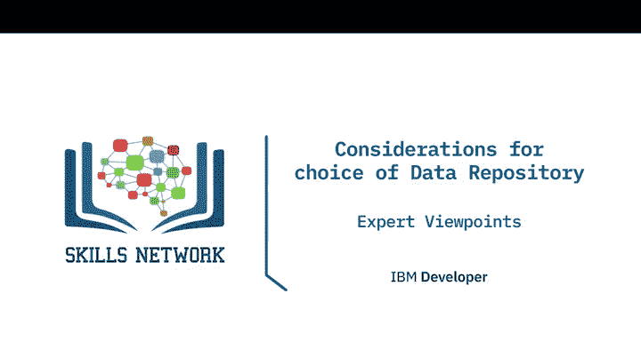
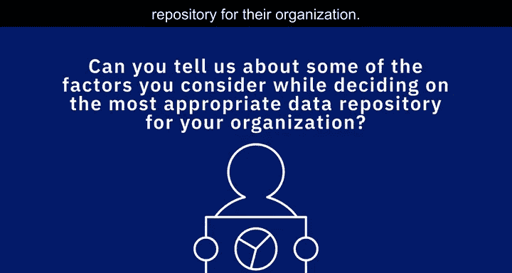

# IBM数据工程专业证书第1课：《数据工程入门课程（IBM）》introduction-to-data-engineering - P21：20_数据存储库选择考量视角.zh_en - GPT中英字幕课程资源 - BV1G94y1y7oT

In this video we will listen to several data professionals talk about some of the factors they consider while deciding on the most appropriate data repository for their organization there's a number of factors to keep in mind while picking the right database for the job。

You need to look at the use case， what is the data？Repository going to be used for。

Is it going to be used for storing？Structured information。

 semi structured or unstructured information。Or。Do you know beforehand what the schema of the data is？

Do you， is there performance requirements， are you working with data at rest or streaming data or data in motion？

Does the data need to be encrypted？Does there is there you know what's the volume of data that you're working with。

 do you need a big data system？And what are the storage requirements。

 does the data need to be updated frequently and accessed frequently that it just need to be stored and kept in avault for a long time and is needed for backup purposes。

 for example。And then。Your organization might have certain。

Standards that might have put in place of of which databases or which data repositories you're allowed to use for different kinds of tasks。

 so all of these factors need to be kept in mind so when we consider what data repository we want to choose。

We look at these factors， we look at what are the kind of capacities that this data report is supposed to handle。

And then we also look at the type of access that that we need this for。

 do we access it in short intervals or do we run long running queries on it？

Am I using it more for transaction processing or am I using it for analytics or archival purpose or for data warehousing purpose？

We also look for compatibility， how compatible this new data repository is with my existing ecosystem of programming languages。

 tools and。Any processes that we have？We also consider the security features this repository gives us。

And the most important thing is scalability We may be happy with its performance today。

 but is it scalable enough can it scale along with the organization I don't often get to choose the type of data repository that my organization uses and very few organizations use one data repository these days on my team that I work on these days we have a set of preferred solutions we have a preferred enterprise relational database we have a preferred open source relational database for some of the smaller projects and for the microservices and then we also have a preferred unstructured data source so those are our three main ones a important thing is to think about the skills that you have within your organization or that you want to foster within your organization and consider the costs of the various solutions in our case we have some experts on DB2 so our enterprise database of choice is D。

2。However， there are other projects that use different ones for open source we've changed that a couple of times we've gone a couple of different directions with where we really want to be there。

 and all of these the hosting platform makes a difference as well because now it's not just do I want to use IBMDB2 or do I want to use some other vendors Microsoft SQL Ser or whatever。

 it's not between those two choices it's when I do those do I want to do them on AWS RDS maybe I should consider Amazon's aurora。

 maybe I should consider Google's relational offerings。

 there's so many different choices there that you have to consider there's the decision of how should the data be stored。

 there's the decision of how should the data be retrieved and there's also the decision of where those are all very important questions when you're deciding。

On data storage， I would say the structure of the data。

 the nature of the application and the volume at which the data is getting ingesed into your database。

 these all these factors determine the nature of the data source that you should pick in most cases。

 a relational database should be enough however， there will be edge cases where relational database such as IBMDB2 oracq or Postrus won't necessarily do the job for you in those cases。

 so depending on the use case for example if you are。

Inesting like gigabytes or terabytes of data per day then。

Document stores such as Mongo TV or white column stores such as Cassandra might be a good fit for you at the same time if you're trying to build a product recommendation engines or trying to show the network of relationships between different people on the social media then graph data structures such as Ne4j or Apache Tingker popop would be an ideal fit for you at the same time if you are mining through terabytes or  petabytes of data for analytics Hadoop engine with mapred would be a good fit for you so it really boils down to the nature of the application and the volume of the data。

On the structure of the data before you can pick the right database or data source for your use case。

