# IBM数据工程专业证书第1课：《数据工程入门课程（IBM）》introduction-to-data-engineering - P22：21_ETL、ELT与数据管道.zh_en - GPT中英字幕课程资源 - BV1G94y1y7oT

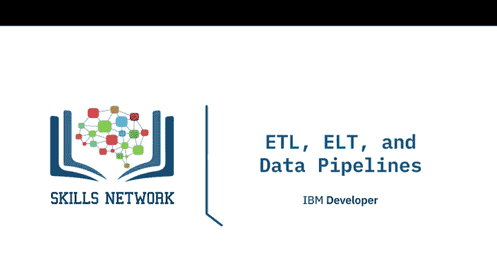

In this video， we will learn about some of the different tools and processes that work to move data from source to destination systems。

 such as ETL or the Ex Transform and load process， ELT or the Ex load and transform process。

 and data Pis。Now we come to the process that is at the heart of gaining value from data。

 the extract， transform and load process or ETL ETL is how raw data is converted into analysis ready data。

 It is an automated process in which you gather raw data from identified sources。

 extract the information that aligns with your reporting and analysis needs。 clean。

 standardize and transform that data into a format that is usable in the context of your organization and load it into a data repository while ETL is a generic process。

 The actual job can be very different in usage， utility and complexity。

 Extract is the step where data from source locations is collected for transformation。

 data extraction could be through batch processing。

 meaning source data is moved in large chunks from the source to the target system at scheduled intervals tools for batch processing include stitch and blendo。

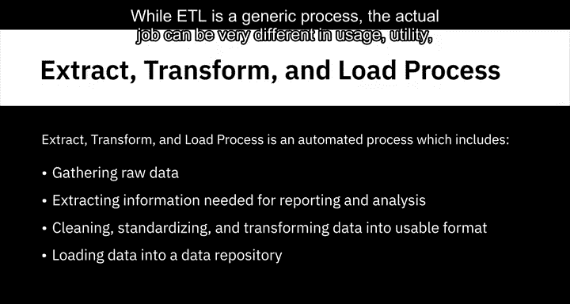

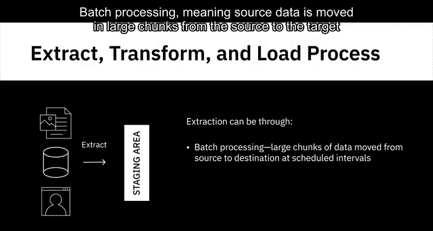

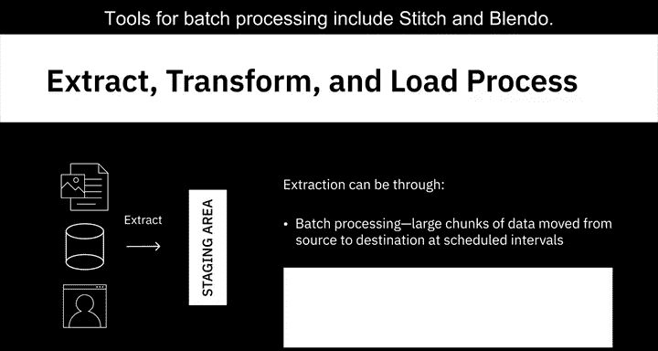

Stream processing， which means source data is pulled in real time from the source and transformed while it is in transit and before it is loaded into the data repository。

 tools for stream processing include Apache SAMsa， Apache storm and Apache Kafka Transform involves the execution of rules and functions that convert raw data into data that can be used for analysis。

 For example， making date formats and units of measurement consistent across all source data。

 Re duplicate data， filtering out data that you do not need， enriching data， for example。

 splitting full name to first middle and last names， establishing key relationships across tables。

 applying business rules and data validations。 load is the step where process data is transported to a destination system or data repository。

 It could be initial loading that is populating all the data in the repository。

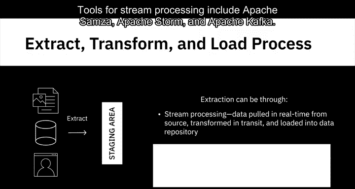

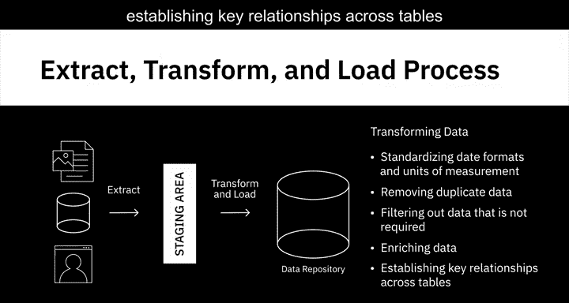

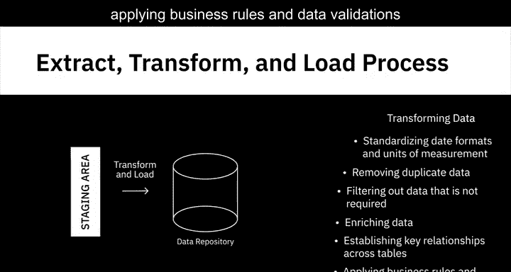

Incremental loading that is applying ongoing updates and modifications as needed periodically or full refresh That is erasing contents of one or more tables and reloading with fresh data load verification。

 which includes data checks for missing or null values。

 server performance and monitoring load failures are important because of this process step。

 It is vital to keep an eye on load failures and ensure the right recovery mechanisms are in place。

 ETL has historically been used for batch workloads on a large scale。 However。

 with the emergence of streaming ETL tools， they are increasingly being used for real time streaming event data as well。

 Some of the popular ETL tools available include IBM insphere information server， AWS glue I Provado。

 Skyvia， Evo and Inmatica Power center。😊。

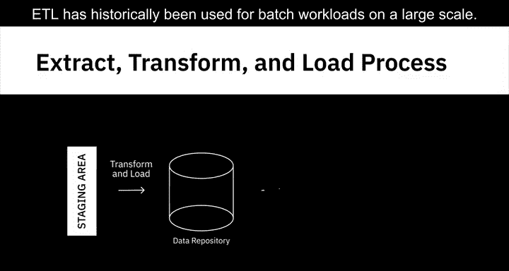

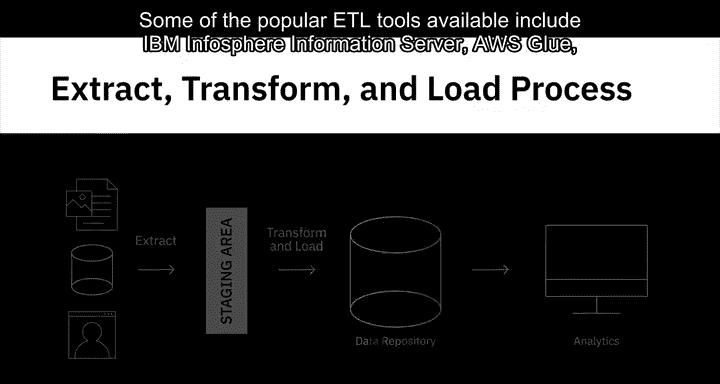

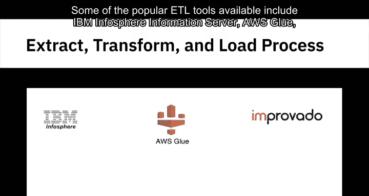

Now， let us look at a variation of the E T L process。

 the extract load and transform or ELT process in the ELT process。

 extracted data is first loaded into the target system and transformations are applied in the target system。

 The destination system for an ET pipeline is most likely a data lake。

 though it can also be a data warehouse。 ELT is a relatively new technology powered by cloud technologies。

 Why do we need an ELT process。 ELT is useful for processing large sets of unstructured and nonrelational data。

 It is ideal for data lakes where transformations on the data are applied once the raw data is loaded into the data lake。

 the ELT process has several advantages。 Since the raw data is delivered directly to the destination system rather than a staging environment。

 This shortens the cycle between extraction and delivery E。

aired with a data lake allows you to ingest volumes of raw data as immediately as the data becomes available compared to the ETL process。

 ELT affords greater flexibility to analysts and data scientists for exploratory data analytics ELT transforms only that data which is required for a particular analysis so it can be leveraged for multiple use cases in the ETL process the entire structure of the data in the warehouse may need to be modified if it is not suited for a new use case。

 ELT is more suited to work with big data。It is common to see the terms ETL or ELT and data pipelines used interchangeably。

 and although both move data from source to destination。

 data pipeline is a broader term that encompasses the entire journey of moving data from one system to another of which ETL and ELT may be subsets data pipelines can be architected for batch processing for streaming data and a combination of batch and streaming data in the case of streaming data。

 data processing or transformation happens in a continuous flow。

 this is particularly useful for data that needs constant updating such as data from a sensor monitoring traffic a data pipeline is a highper system that supports both long-running batch queries and smaller interactive queries the destination for a data pipeline is typically a data lake。

 although data may also be loaded to different target destinations such as another application or a visual。

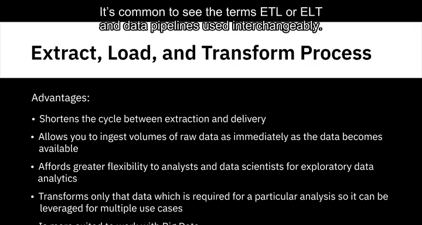

There are a number of data pipeline solutions available， most popular among them bean， Apache beam。

 airflow and dataflow。

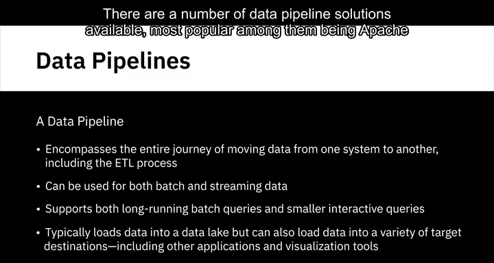

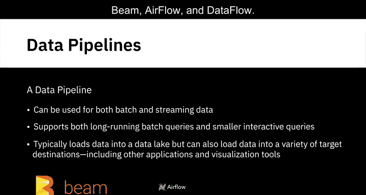

In this video， we learned about some of the different data movement approaches。

 the ETL or extract transform and load process， and ELT。

 the extract load and transform process we also learned about data pipelines encompassing the complete journey of data from one system to another。

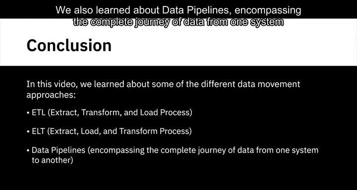

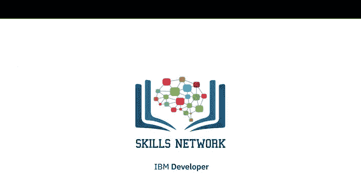