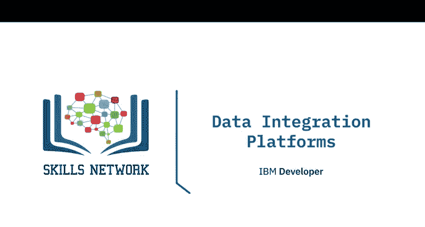
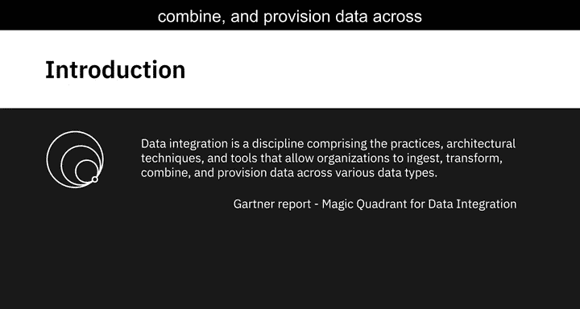
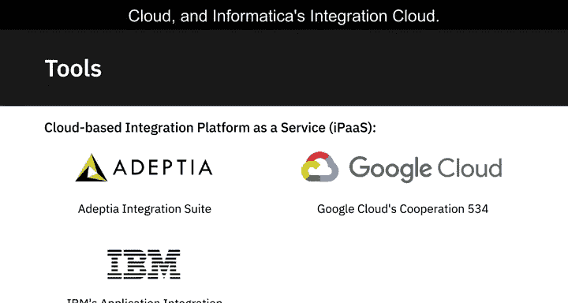
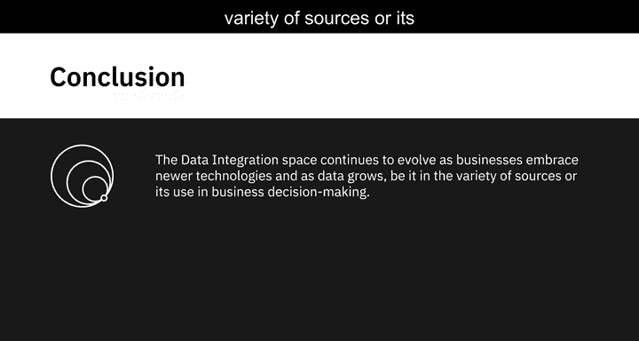
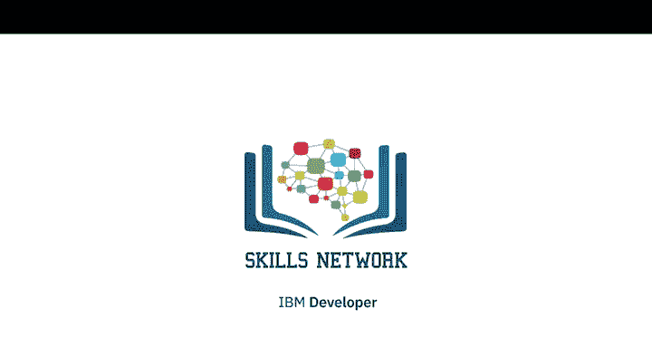

# IBM数据工程专业证书第1课：《数据工程入门课程（IBM）》introduction-to-data-engineering - P23：22_数据集成平台.zh_en - GPT中英字幕课程资源 - BV1G94y1y7oT

Gartner defines data integration as a discipline comprising the practices， architectural techniques。

 and tools that allow organizations to ingest， transform。

 combine and provision data across various data types。

The report further explains that data integration has several usage scenarios such as data consistency across applications。

 master data management， data sharing between enterprises and data migration and consolidation in the field of analytics and data science。

 data integration includes accessing， queuing or extracting data from operational systems。

 transforming and merg extracted data either logically or physically， data quality and governance。

 and delivering data through an integrated approach for analytics purposes。For example。

 to make customer data available for analytics， you would need to extract individual customers information from operational systems such as sales。

 marketing and finance， you would then need to provide a unified view of the combined data so that your users can access query and manipulate this data from a single interface to derive statistics。

 analytics and visualizations。How does a data integration platform relate to ETL and data pipelines while data integration combines disparate data into a unified view of the data。

 a data pipeline covers the entire data movement journey from source to destination systems in that sense。

 you can use a data pipeline to perform data integration while ETL is a process within data integration。

There is no one approach to data integration， however。

 modern data integration solutions typically support the following capabilities。

 an extensive catalog of pre-built connectors and adopters that help you connect and build integration flows with a wide variety of data sources such as datas。

 flat files， social media data APIs， CRM and ERP applications。

 open source architecture that provides greater flexibility and avoids vendor lockin Op for both batch processing of largescale data and continuous data streams or both integration with big data sources。

 support for big data is increasingly driving the decision regarding choice of integration platforms additional functionalityities。

 for example， specific demands around data quality and governance compliance and security portability which ensures that as businesses move to cloud models they should be able。

To run their data integration platforms anywhere and data integration tools are able to work natively in a single cloud multicloud or hybrid cloud environment There are many data integration platforms and tools available in the market。

 ranging from commercial off thehelf tools to open source frameworks IBM offers a host of data integration tools targeting a range of enterprise integration scenarios such as Inphere information server。

 CloudpackC for data IBM Cloudpack for integration IBM data replication。

 IBM data Viualization Manager， IBM Insphere Information server on cloud and IBM Insphere data stage。

TalN's data integration tools include T data fabric， T Cloud， T data catalog， T data management。

 T big Data， Tal data Services and Talent Open Studio， SAP， Oracle， Denodo， SAS， Microsoft。

 KUli and Tbco are some of the other vendors that offer data integration tools and platforms。

Examples of open source frameworks include Dell Boie。

 Jterbit and SnapLogic There are a significant number of vendors who are offering cloudbased integration platform as a service or iPads as a hosted service via virtual private cloud or hybrid cloud。

 such as the Adepia integrationration Suite， Google Cloud's Cooper 534 IBM's application integrationration Suite on Cloud and Informatica's integrationration Cloud。

The data integration space continues to evolve as businesses embrace newer technologies and as data grows。

 be it in the variety of sources or its use in business decision making。

