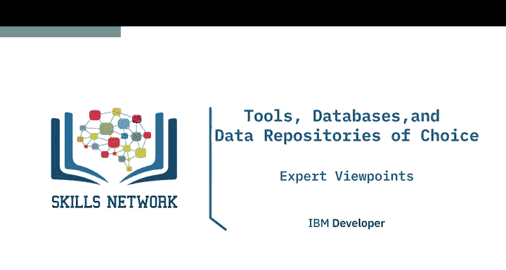
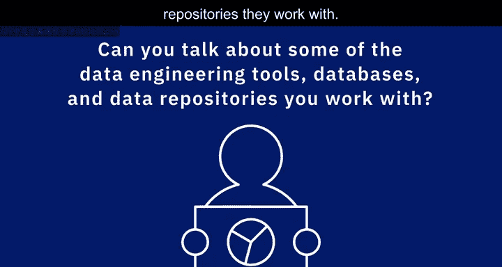
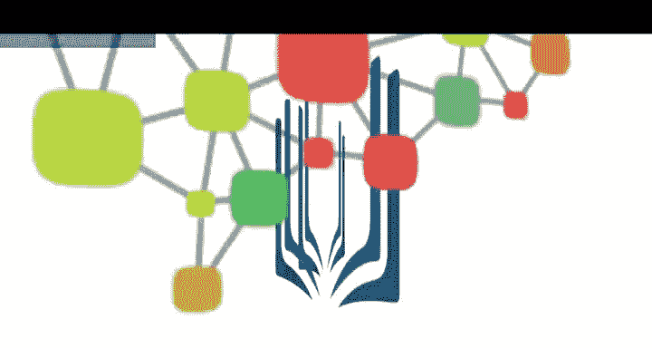

# IBM数据工程专业证书第1课：《数据工程入门课程（IBM）》introduction-to-data-engineering - P24：23_工具数据库与存储库选择视角.zh_en - GPT中英字幕课程资源 - BV1G94y1y7oT

In this video， we will listen to data professionals talk about some of the data engineering tools。

 databases， and data repositories they work with。

The ecosystem of data engineering is very， very vast。

We work especially with mostly with open source tools， so we work with RDBMS databases like MySQL。

 we work with No SQL databases like MongoDb Cassandra graph databases like Neo4j Python is pretty much indispensable。

 so whatever feature we feel missing in our data engineering space。

 we first try to use Python to get that into place and an order a period of time we see if any product can take its place。

We also work with tools like Apache airflow to create。Data pipelines。

 we work with tools like Spark for big data processing， we work with Kafka to handle streaming data。

 we work with talent for ETL functionality， we also work with tools like beautiful soup and scrappy for web scraping。

 and we also look at a variety of cloud storages， for our archival and then for our daily storage purposes。

Before Cora， I was in a nonprofits where SQL Server was the data repository。

 and we used SQL Server integration service as well as WaAto to do data integration。And in Cosera。

 AWA's Works is our Data warehouse and we use AWAs AS3 as our Data lake。

 we have an internal tool to build our ETO Powerline and schedule our ETO Power。

 but now we are moving to use open source tool called Apache Aflow data orchestration。

 I work with relational databases such as IBMDB2 push a SQL and Microsoft SQL server and I also have exposure to working NosQL database such as Cassandra and MongoDB and I worked on streaming technologies for replication such as WebPMQ and also for back and processing by moving the transactional data by using the CAfka。

Use onto the back office databases at the same time。

 I also worked on data engineering tools or data moment tools for moving data from one data source to another for example I worked on SSIS by building these data moment packages at the same time I also worked on this school tool called NFI I think this NIFfi is now maintained by Apache foundation which is an open source foundation。

 which I highly recommend looking at some of their projects because they're all open source。

 the core is open can go through the source code and learn a lot about some of these projects and even projects and you can if you're enthusiastic can have a lot of time on your hands you can even contribute to some of these projects I digress but。

NI can be used to move data between heterogeneous data sources and I also download my own scripts such as Shell and Pearl and writtenri Java APIs to move data between different applications and vendors So most people myself included who've done work in data engineering have had to work with a number of databases and tools。

Having spent a good part of my data career at IBM。I had to do a lot of work with the IBMDB2 database。

And later became a product manager for it。But I've also had to work with other databases like MySQL and Postgress。

And then as part of my job evolved， I had to pick up skills in big data systems like Hadoop and Spark。

So it's important that as a data engineering， a field that continues to evolve， you need to。You know。

 come up with， you need to become a lifelong learner and keep picking up skills that are going to be required for your job and the problems that you're trying to solve。

So as long as you're good with。Data fundamentals， you should be able to quickly pick up these new skills and technologies The primary product that I've worked with my entire career is IBMs DB2 on midrange platforms so on Linux Uniix and Windows to me this is a great choice in the relational database space I also work very heavily with AWS products I've been working with databases on RDS Microsoft SQL server we've done a little bit of Maria Db there we also do Maria Db outside of that on our own servers those are the primary relational database products that we work with there are a ton of other tools we work with in order to properly manage those or to manage workflows around those of course GiHub or Gi you have to be familiar with those those are our integral to any process in a DevOs organization or in most non DevevOs organizations。

usingsing Jenkins， we use Jenkins for a lot of things to spin up containers to do maintenance jobs to manage code deploys。

 there's a lot of important stuff that we do with Jenkins as well。

 we use liquidbase liquidases actually excellent， we use it with containers to very easily have some management of the changes that are made to our database schemas。

