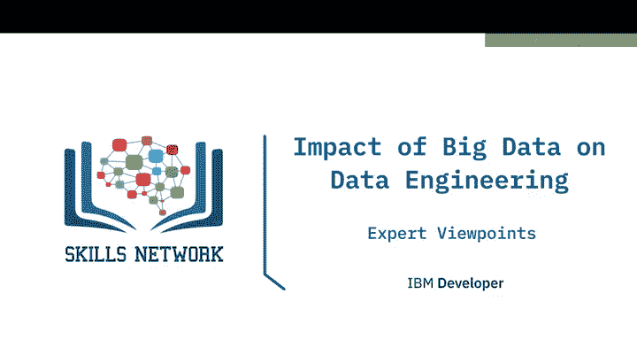
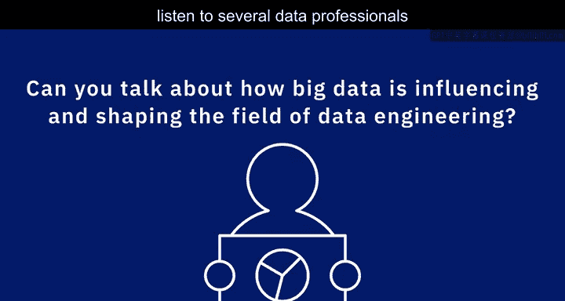
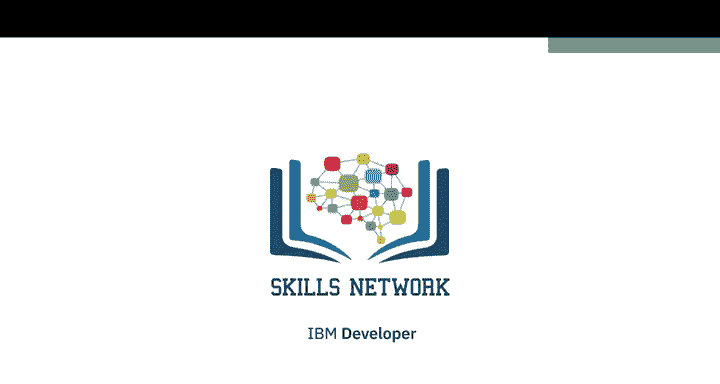

# IBM数据工程专业证书第1课：《数据工程入门课程（IBM）》introduction-to-data-engineering - P27：26_大数据对数据工程的影响视角.zh_en - GPT中英字幕课程资源 - BV1G94y1y7oT

In this video， we will listen to several data professionals talk about the impact of big data on data engineering。

So how is big data changing and shaping the field of data engineering。

 big data can be described as the data that has these four characteristicss， also known as four Wiis。

 velocity， ver， volume and variety， big data has had a major impact on data engineering。

 making it a much more diverse in a rich field。It's quite natural。

Because with all the data that the organizations are collecting these days。

Being able to make sense of it and derive insights from it is becoming more and more relevant and critical。

And that has opened up a vast opportunity， not only have we seen the emergence of new technologies and products related to working with big data。

It's also created a huge demand for professionals who can effectively work with large volumes and variety of data。

Both for building and managing these big data systems， but also for analyzing data within them。

In the preIoT on social media days， the number of ways you can ingest the data into database are really small。

 like for example， you have a data entry analyst that's putting data into these databases at a very slow pace。

 but in the past decade， especially with with these new gadgets and devices talking to each other on these APIs。

 pushing latest updates to these different gadgets the nature of the data itself changed as a result of these evolution。

 the data engineering evolved as well， because your traditional BBMSSs are not a one- size with all solution like a lot of database administrators and data engineers discovered in a hard way with these variety of data sources and volumes。

 the field of data engineering itself have significantly and data engineers。

Ended up inventing these new data sources such as Google Big table， Cassandra， Gph databases。

 Hadop mapreuce to analyze these petabytes of data so data engineers ended up writing their own tools under also learning and working on new technologies so there was a big evolution of big data big data has fundamentally changed things and that organizations are much more accepting of storing large amounts of data storage for data actual disk space is no longer a big issue we've gotten to the point where we stored a lot more data and that's what the big data buzzword storm has really brought about that and better ways of handling large amounts of data you know it's we can think of big data in different ways there's obviously unstructured data which has become a huge thing and is usually not hand。

Within databases if it is， it's handled in something like MongoDB。

And then there's also just the vast amount more of data that we're dealing with。

