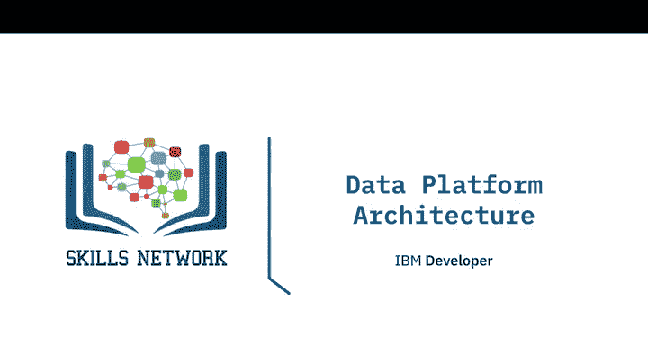
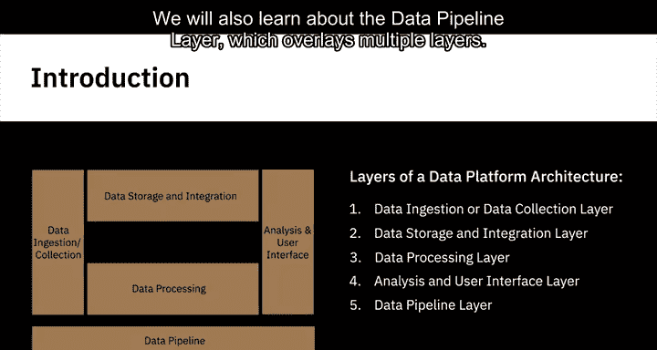
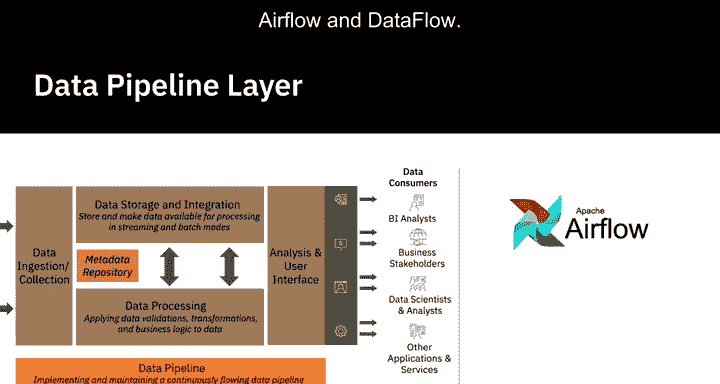
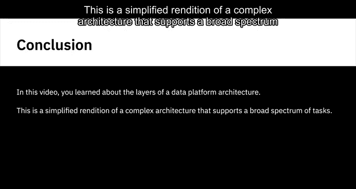
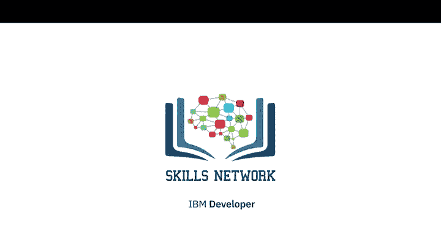

# IBM数据工程专业证书第1课：《数据工程入门课程（IBM）》introduction-to-data-engineering - P28：27_数据平台架构设计.zh_en - GPT中英字幕课程资源 - BV1G94y1y7oT

In this video we will learn about the layers of a data platform architecture a layer represents functional components that perform a specific set of tasks in the data platform。

 the layers that we are going to explore include data ingestion or data collection layer。

 data storage and integration layer， data processing layer and analysis and user interface layer。

 we will also learn about the data pipeline layer which overlays multiple layers。

The data collection layer is responsible for connecting to the source systems and bringing the data from these systems into the data platform This layer performs the following key tasks。

 connect to data sources， transfer data from these data sources to the data platform in streaming。

 batch or both modes， and maintain information about the data collected in the metadata repository。

 for example， how much data was ingested in a batch， data source and other descriptive information。

Google Cloud Dataflowlow， IBM Streams， IBM streamaming Analytics on Cloud。

 Amazon Kinesis and Apache Kafka are some of the tools used for data ingestion。

 supporting both batch and streaming modes。Once data is ingested。

 it needs to be stored and integrated， The storage and integration layer in a data platform needs to store data for processing and long termm use。

 transform and merge extracted data either logically or physically and make data available for processing in both streaming and batch modes。

The storage layer needs to be reliable， scalable， high performing and cost efficient IBM DB2 Microsoft SQL server。

 My SQL， Oracle database and PostgresqL are some of the popular relational databases Cloudbased relational databases also referred to as database as a service have gained great popularity over the recent years such as IBM DB2 on cloud。

 Amazon relational database service or RDS and Google Cloud SQL and SQL Azure in the No SQL or nonrelational database systems on cloud we have IBM Cloudant。

 Redis， Mongo DB， Cassandra and Neo4j。Tools for integration include IBM's Cloudpack for data and Cloudpack for integration。

 Ts， data fabric， and Open Studio。Open source tools such as Dell Boie and SnapLogic are also very popular integration tools。

 There are a number of vendors offering cloudbased integration platform as a service or iPadPAs。

 for example， adaptptia integration suite， Google Clouds cooperation 534 IBM's application integration suite on cloud and Inatica's integration cloud Once the data has been ingested。

 stored and integrated， it needs to be processed data validations。

 transformations and apply business logic to the data are some of the things that need to happen in this layer。

 the processing layer should be able to read data in batch or streaming modes from storage and apply transformations support popular querying tools and programming languages scale to meet the processing demands of a growing data set。

 and provide a way for analysts and data scientists to work with data in the data platform。

Some of the transformation tasks that occur in this layer include structuring。

 essentially actions that change the form and schema of the data。

 this change may be as simple as changing the order of fields within a record or data。

 or as complex as combining fields into complex structures using joins and unions。

 normalization which focuses on cleaning the database of unused data and reducing redundancy and inconsistency。

 deormalization， which combines data from multiple tables into a single table so that it can be queried more efficiently for reporting and analysis。

 and data cleaning， which fixes irregularities in data to provide credible data for downstream applications and uses。

There are a host of tools available for performing these transformations on data selected based on the data size。

 structure and specific capabilities of the tool such as spreadsheets， openRefine。

 Google Data prep Watson Studio Refry and trifacta wrangler Python and R also offer several libraries and packages that are explicitly created for processing data It is important to note that storage and processing may not always be performed in separate layers。

 for example， in relational databases， St and processing can occur in the same layer while in big data systems。

 data can be first stored in the Hadoop file distribution system or HDFS and then processed in a data processing engine like Spark and the data processing layer can also pre the data storage layer where transformations are applied before the data is loaded or stored in the database the analysis and user interface layer。

Delivers process data to data consumers data consumers can include business intelligence analysts and business stakeholders who consume this data through interactive visual representations such as dashboards and analytical reports。

 data scientists and data analysts that further process this data for specific use cases and other applications and services that may need this data as input for further use。

The analysis and UI layerer needs to support querying tools and programming languages， for example。

 SQL for querying relational databases and SQL like querying tools for non-relational databases such as CQL for Cassandra。

 programming languages such as Python R and Java， APIs that can be used to run reports on data for both online and offline processing。

 APIs that can consume data from the storage in real time for use in other applications and services。

 and dashboarding and business intelligence applications， for example， IBM Cgnos Ana， Tau。

 Jupiter notebooks， Python in R libraries and Microsoft Power BI。Overlaying the data ingestion。

 data storage and integration and data processing layers is the data pipeline layer with the extract transform and load tools。

 This layer is responsible for implementing and maintaining a continuously flowing data pipeline。

 There are a number of data pipeline solutions available。

 most popular among them being Apache airflow and data flow。

In this video you learned about the layers of a data platform architecture。

 this is a simplified rendition of a complex architecture that supports a broad spectrum of tasks。

