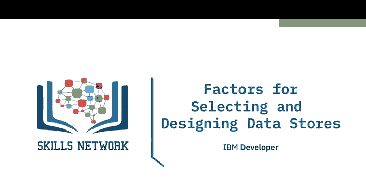
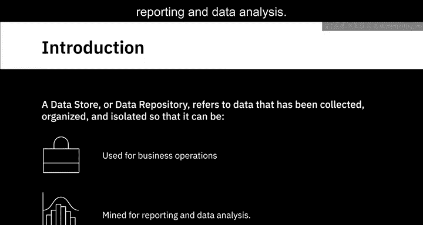
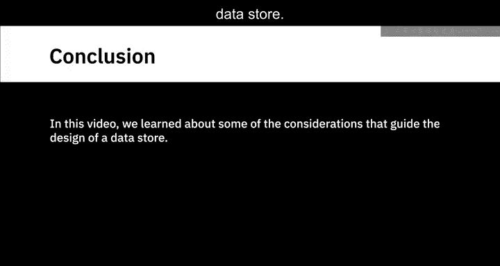

# IBM数据工程专业证书第1课：《数据工程入门课程（IBM）》introduction-to-data-engineering - P29：28_数据存储选型与设计要素.zh_en - GPT中英字幕课程资源 - BV1G94y1y7oT

A data store or data repository is a general term used to refer to data that has been collected。

 organized， and isolated so that it can be used for business operations。

 or mined for reporting and data analysis。

A repository can be a database， data warehouse， datamart， big data store， or a data lake。

 a well- designedigned data repository is essential for building a system that is scalable and capable of performing during high workloads in this video we will look at some of the primary considerations for designing a data store such as the type of data you want to store。

 volume of data， intended use of data， storage considerations。

 and privacy security and governance needs of your organization。

There are multiple types of databases and selecting the right one is a crucial part of designing a database is essentially a collection of data designed for the input。

 storage， search and retrieval， and modification of data。Depending on the type of data。

 databases can be categorized in two primary ways， relational and non relational。

Relational databases or RDBMSSs are best used for structured data。

 which has a well-defined schema and can be organized into a tabular format。

 non-relational databases or no SQL are best for semistructured and unstructured data that is schema list and freeform data non-relational databases based on the type of data and how you want to query the data。

 are of four different types， key value， document， column and graph based。

 if you're looking to run complex search queries and multi-operation transactions， for example。

 a documentbased database may not be the best option for you。

Like you would not opt for a graphbased database if you need to process high volumee transactions because graphbasedase databases are not optimized for large volumee analytics queries another important consideration that goes into the design of a data store is the volume or scale of data when you need to store large volumes of raw data in its native format straight from its source a data lake would be the appropriate choice for you with a data lake you can store both relational and non-relational data at scale without defining the data structure and schema or when you're dealing with big data that is data that is not only high volume but also high velocity of diverse types and needs distributed processing for fast analytics。

 then a big data repository would be an option you would explore big data stores split large files across multiple computers allowing parallel access to them computation。

Run in parallel on each node where data is stored。How you intend to use the data you are collecting is also an important consideration for the choice and design of a data store the number of transactions。

 frequency of updates， type of operations performed on the data response time and backup and recovery requirements all need to be provisioned for in the design of a data store。

 whether you need to use the data store for recording high volumee transactional data。

 or executing complex queries for analytical purposes。

 your processing and storage needs will differ transactional systems that is systems used for capturing high volumee transactions need to be designed for highpe。

 read， write and update operations analytical systems on the other hand need complex queries to be applied to large amounts of historical data aggregated from transactional systems they need faster response times to complex queries schema design。

 indexing and partitioning strategies。Have a big role to play in performances of systems based on how data is getting used。

The intended use of data also drives scalability as a design consideration scalability of a data store is its capability to handle growth in the amount of data workloads and users。

 normalization of the database is another important consideration at the design stage normalization is the process of efficiently organizing data in a database done right。

 it helps in the optimal use of storage space makes database maintenance easier and provides faster access to data normalization is important for systems that handle transactional data but for systems designed for handling analytical queries。

 normalization can lead to performance issues Now we'll look at some key design considerations from the perspective of storage。

 These are performance availability， integrity and recoverability of data performance parameters include throughput and latency That is the rate at which information can be。

Read from and written to the storage and the time it takes to access a specific location and storage availability。

 your storage solution must enable you to access your data when you need it without exception。

 there should be no downtime。Integrity your data must be safe from corruption。

 loss and outside attack and recoverability。 your stored solution should ensure that you can recover your data in the event of failures and natural disasters。

A secure data strategy is a layered approach， it includes access control， multizone encryption。

 data management， and monitoring systems。Regulations such as GDPR。

 CCPA and HIPAA restrict the ownership use and management of personal and sensitive data data needs to be made available through controlled data flow and data management by using multiple data protection techniques This is an important part of a data store design strategies for data privacy security and governance regulations need to be a part of a data store's design from the start done at a later stage it results in patchwork。

In this video， we learned about some of the considerations that guide the design of a data store。

