# IBM数据工程专业证书第1课：《数据工程入门课程（IBM）》introduction-to-data-engineering - P2：1_现代数据生态系统.zh_en - GPT中英字幕课程资源 - BV1G94y1y7oT

To quote a Forbes 2020 report on data in the coming decade。

 the constant increase in data processing speeds and bandwidth。

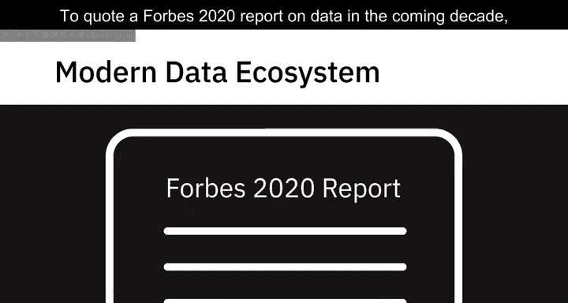

The nonstop invention of new tools for creating， sharing。

 and consuming data and the steady addition of new data creators and consumers around the world ensure that data growth continues unabated。

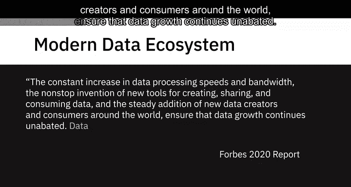

Data begets more data in a constant virtuous cycle。

A modern data ecosystem includes a whole network of interconnected， independent。

 and continually evolving entities。

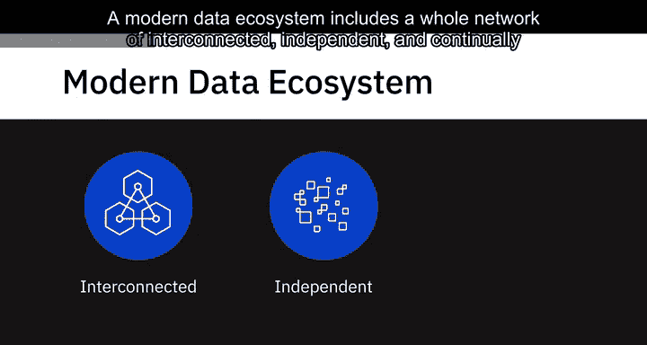

It includes data that has to be integrated from disparate sources。

 different types of analysis and skills to generate insights。

 active stakeholders to collaborate and act on insights generated and tools。

 applications and infrastructure to store， process and disseminate data as required。

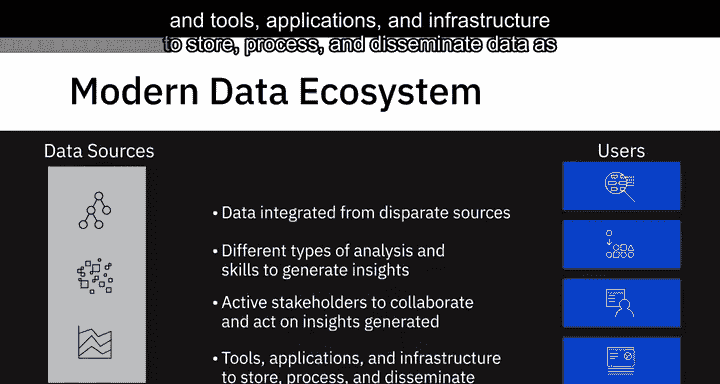

Let's start with the data sources data is available in a variety of structured and unstructured data sets。

 residing in text， images， videos， click streams， user conversations， social media platforms。

 the Internet of things or IoT devices， realtime events that stream data， legacy databases。

 and data sourced from professional data providers and agencies。

The sources have never before been so diverse and dynamic。

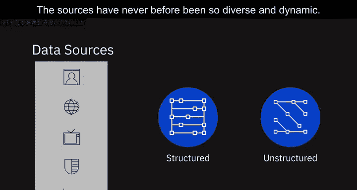

When you're working with so many different sources of data。

 the first step is to pull a copy of the data from the original sources into a data repository At this stage。

 you're only looking at acquiring the data you need， working with data formats。

 sources and interfaces through which this data can be pulled in。

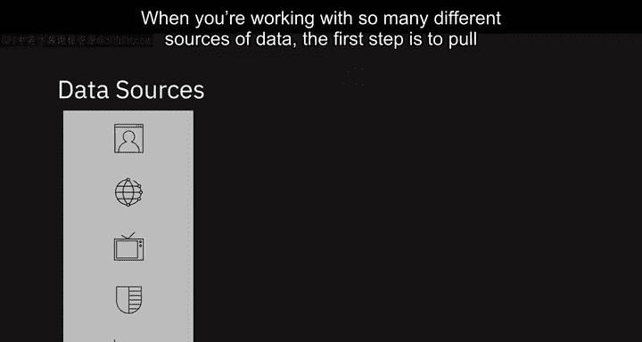

Reliability， security， and integrity of the data being acquired are some of the challenges you work through at this stage。

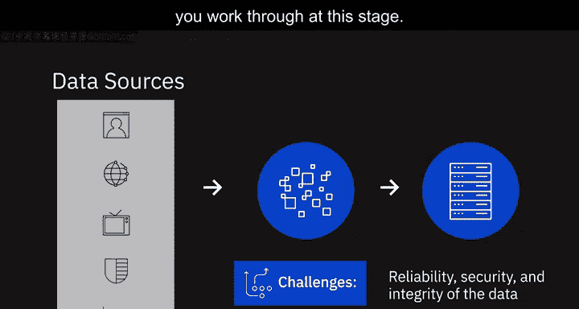

Once the raw data is in a commonplace， it needs to get organized。

 cleaned up and optimized for access by end users。 the data will also need to conform to compliances and standards enforced in the organization。

 For example， conforming to guidelines that regulate the storage and use of personal data such as health。

 biometrics or household data in the case of IoT devices。

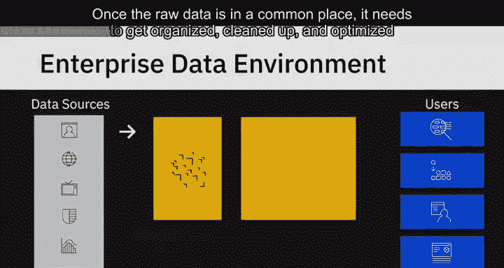

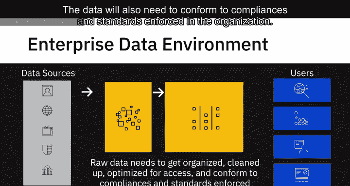

Adhering to master data tables within the organization to ensure standardization of master data across all applications and systems of an organization is another example。

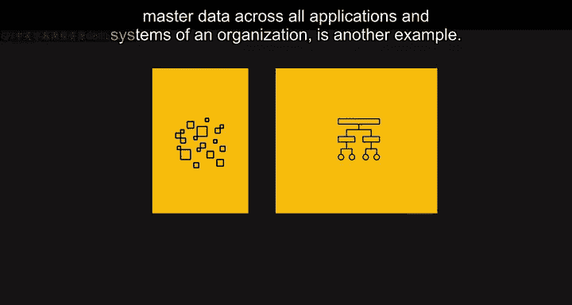

The key challenges at this stage could involve data management and working with data repositories that provide high availability。

 flexibility， accessibility， and security。

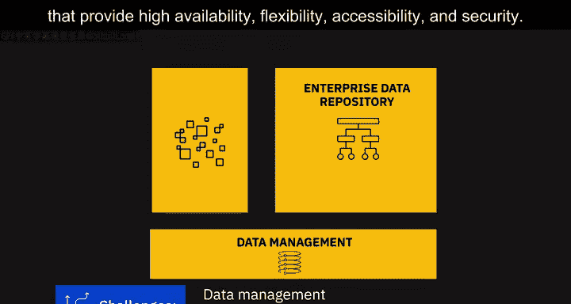

Finally， we have our business stakeholders， applications， programmers， analysts。

 and data science use cases all pulling this data from the enterpriseterprise Data repository。

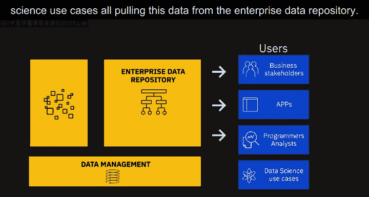

The key challenges at this stage could include the interfaces， APIs。

 and applications that can get this data to the end users in line with their specific needs。

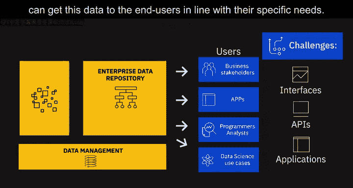

For example， data analysts may need the raw data to work with。

 business stakeholders may need reports and dashboards。

 applications may need custom APIs to pull this data。

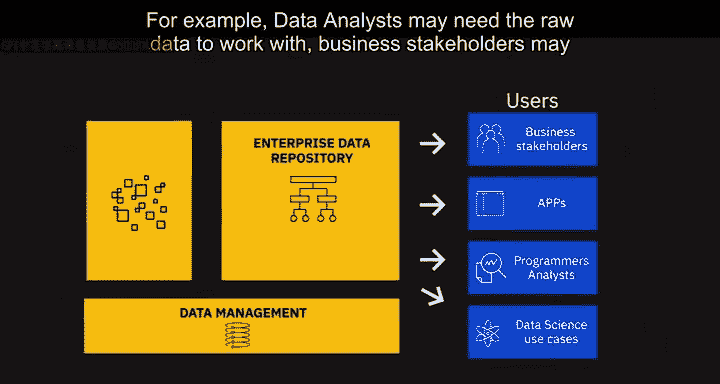

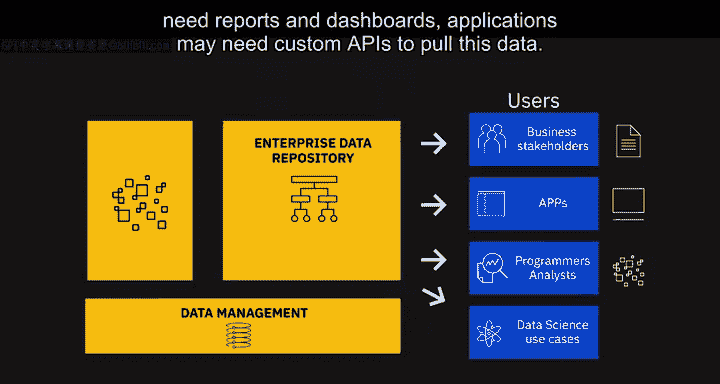

It's important to note the influence of some of the new and emerging technologies that are shaping today's data ecosystem and its possibilities。

 for example， cloud computing， machine learning and big data to name a few。

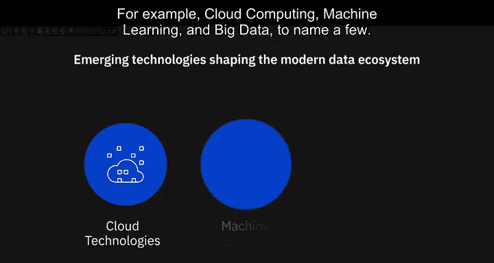

Thanks to cloud Techologies， every enterprise today has access to limitless storage。

 high performance computing， open source technologies， machine learning technologies。

 and the latest tools and libraries data scientists are creating predictive models by training machine learning algorithms on past data。

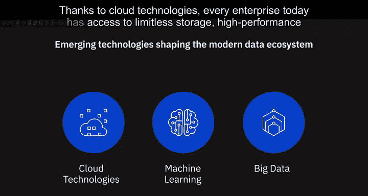

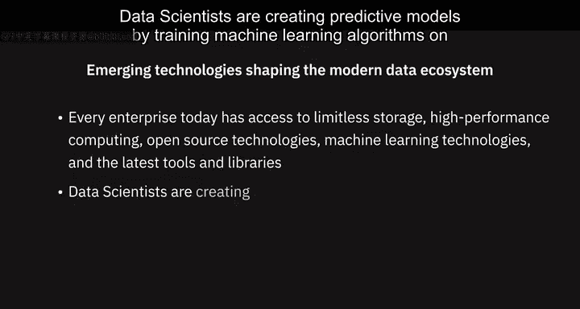

Also big data Today， we're dealing with data sets that are so massive and so varied that traditional tools and analysis methods are no longer adequate。

 paving the way for new tools and techniques and also new knowledge and insights。

We'll learn more about big data and its influence in shaping business decisions further along in this course。

