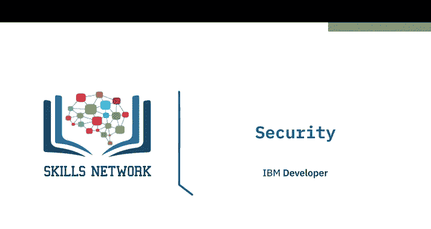
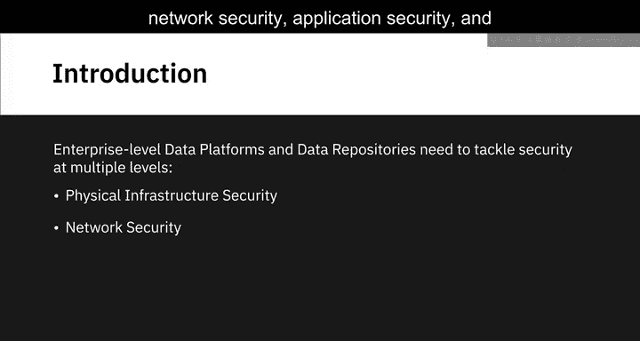
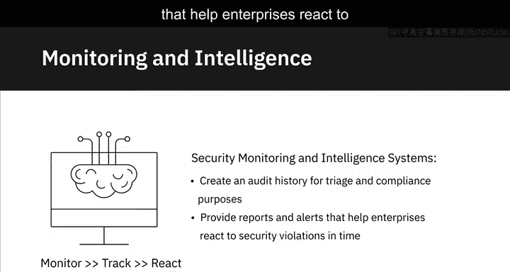
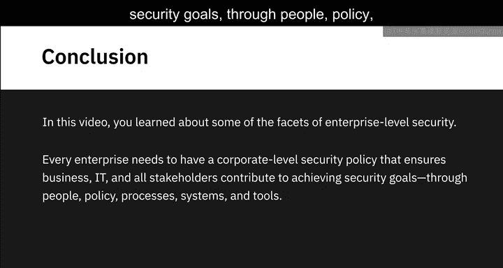
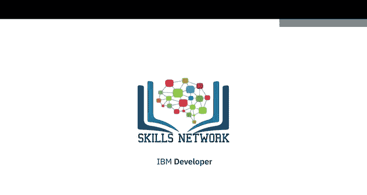

# IBM数据工程专业证书第1课：《数据工程入门课程（IBM）》introduction-to-data-engineering - P30：29_安全.zh_en - GPT中英字幕课程资源 - BV1G94y1y7oT

Enterprise levelve data platforms and data repositories need to tackle security at multiple levels In this video。

 we will learn about the various facets of security as it applies to data platforms and data lifecycle management these include physical infrastructure security network security application security and data security Let us first look at the three key components to creating an effective strategy for information security in general these are popularly referred to as the CIA triad The C in this triad stands for confidentiality through controlling unauthorized access I for integrity through validating that your resources are trustworthy and have not been tampered with and A is for availability by ensuring authorized users have access to resources when they need it the CIA triad is applicable to all facets of security be it infrastructure network application or data security。

Now we'll look at the four different facets or levels of security。

 The first level is physical infrastructure security。

 A key component of security for an I system is the security of the physical infrastructure and facilities that housed the system In the case of cloud computing。

 this extends to the cloud service providers infrastructure and facility。

 Here are some of the measures that are taken to ensure physical infrastructure security access to the perimeter of the facility based on authentication and round the clock surveillance for entry and exit points。

 Multi power feeds from independent utility providers with dedicated generators and U battery backup heating and cooling mechanisms for managing the temperature and humidity levels in the facility and by factoring in environmental threats before considering the location of the facility For example。

 infrastructure facilities are never housed in floodplains in areas prone to earthquakes that。

Infrastructure is housed in an earthquake resistant structure。

 multi level lightning protection and earthing systems are also installed in such facilities。

The next level is network security Network security is vital to keep interconnected systems and data safe Network security solutions include firewalls to prevent unauthorized access to private networks that are connected to the internet network access control to ensure endpoint security by allowing only authorized devices to connect to the network for example。

 a corporate network may not allow devices with outdated service packs to connect to their network network segmentation to create silos or virtual local area networks within a network so that you can segregate your assets into individual silos based on the level of security required for different assets security protocols to ensure attackers can tap into data while it is in transit and intrusion detection and intrusion prevention systems that inspect incoming traffic for intrusion attempts and vulnerabilities the third dimension of security is application security application。

Security is critical for keeping customer data private and ensuring applications are fast and responsive Security needs to be built into the foundation of an application in order to prevent other applications and services from introducing vulnerabilities you can make your application safe by following security engineering practices such as threat modeling to identify relative weaknesses and attack patterns related to the application Se design that mitigates risks。

 Se coding guides and practices that prevent vulnerabilities and security testing to fix problems before the application is deployed and to validate that it is free from known security issues。

And the fourth and final dimension is data security Data is either at rest in storage or in transit between systems。

 applications， services and workloads， be it at rest or in motion data needs to be protected one of the primary controls for data security is to enable access to data through a system of authentication and authorization Aation systems verify that you are who you say you are and they accomplish this using passwords。

 tokens， biometrics or a combination of these Authorization ensures that users access information based on their roles and the privileges assigned to their roles Data at rest includes files。

 objects and storage This type of data is stored physically such as in a database。

 data warehouse tapes， offsite backups or on mobile devices organizations can use encryption to fight threats to their data at rest Enrypting data protects information from disclosure。

Even if that information is lost or intercepted data that is moving from one place to another。

 such as when it is transmitted over the internet， is referred to as data in transit or data in motion encryption methods such as HTTPS SSL and TLS are often used to protect data in motion Later on in the course you will learn more about the different stages of data lifecycle the vulnerabilities data can be exposed to and the security features that help protect data end to end through its lifecycle it is vital to proactively monitor。

 track and react to security violations in time and for that you need end to end visibility and integration of security processes and tools throughout the enterprise security monitoring and intelligent systems create a complete audit history for triage and compliance purposes and provide reports and alerts that help enterprises react to security violations in time。

In this video， you learned about some of the facets of security as it applies to the enterprise level。

 every enterprise needs to have a corporate level security policy that ensures business。

 IT and all stakeholders contribute to achieving security goals through people， policy， processes。

 systems， and tools。

