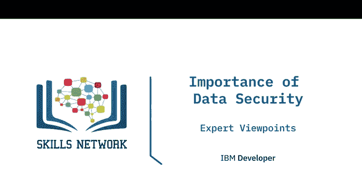
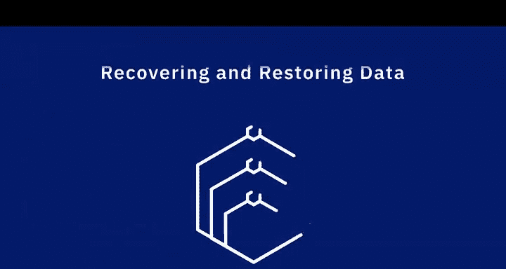
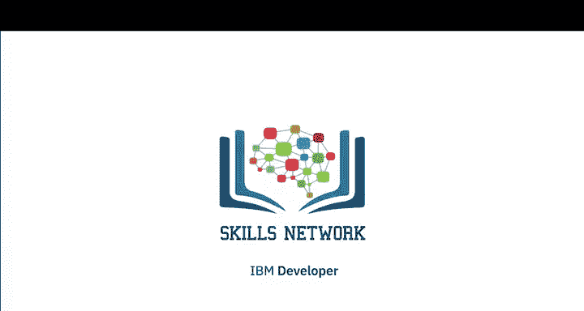

# IBM数据工程专业证书第1课：《数据工程入门课程（IBM）》introduction-to-data-engineering - P31：30_数据安全重要性视角.zh_en - GPT中英字幕课程资源 - BV1G94y1y7oT

In this video， we will listen to several data professionals talk about the importance of data security as it relates to data engineering。

So if your data is not secure， nothing else about it really is going to matter in the long run。

 there are many companies who are examples of serious data breaches and while that won't necessarily put you out of business these days that depends on the size of your organization somewhat to begin with。

If you're a smaller organization and you lose access to your own data that's certainly a potentially company ending problem you really can't understand the importance of data security it's often something we think of oh we'll harden it after go live or we'll harden it just before go live but really it's something that you have to be thinking about data security along every step of the way the importance of。

Security of data can't be stressed enough。A few years ago。

 the Economist magazine published an article saying。

The world's most valuable resource is no longer oil， but data。

So data is the most valuable resource an organization has。It needs to be secured and protected。

And failure to do so can have catastrophic consequences。So data security， governance， compliance。

These are not just things that a data engineer needs to worry about。

This needs to be an important part of not just the data architecture。

 but the entire organizational processes and every part of the organization needs to keep on top of these things。

We have to make sure that when we have separate production and non-production environments that our production data doesn't get unmasked into a lower environment。

 there are absolutely data breaches that can happen that way we have to think about making sure that people who have access to production data really need that access to production data the important thing is to understand the security levels and roles for the tool you're using and make sure that each user is getting the least privilege they need in order to do their jobs It's when we give people more access that we really open things up to to data breaches and data security problems the most of of the threats to your data are actually more likely to come from within your organization than without it may be exciting or whatever to think of somebody coming from outside of your organization to get to。

Data but most often that threat is going to come from inside your organization A lot of the things that we hear about in the data profession are things like people at prescription drug places accessing the prescriptions of celebrities there are things along those lines that we have to be very careful in protecting protecting the data data is a natural resource these days right the world of big data data is oil that's our new natural resource so it's our job to make sure that that financial aspect of valuable data is protected and that our organization is not at risk for being in the news is one of those causing a data breach or even worse being put out of business because of a data breach。

I consider part of data security， the ability to restore my data and the ability to recover if a particular set of hardware fails。

 to me that's part of security because if we lose the data because of a hardware failure。

 that means we don't have access to the data， which is part of data security in my own estimation。

