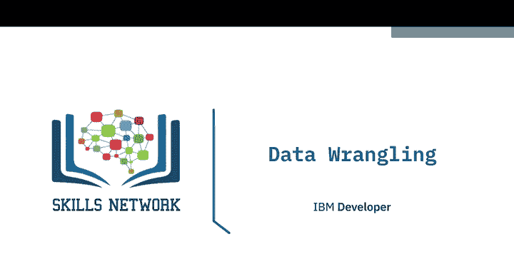
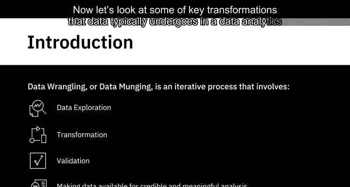
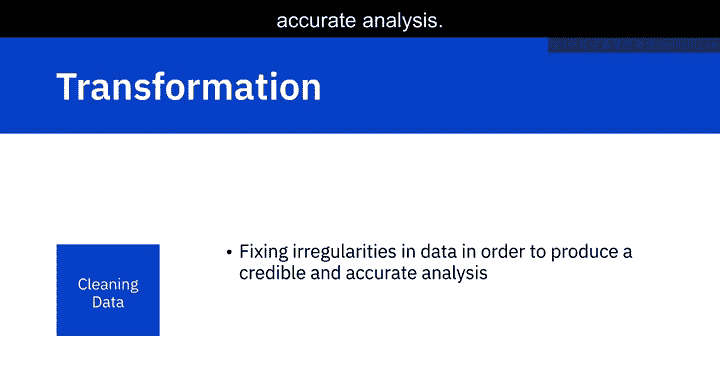
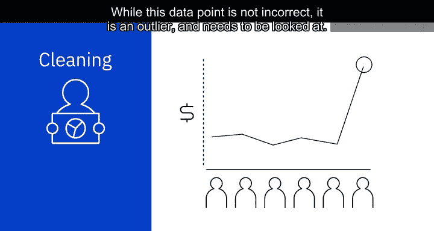
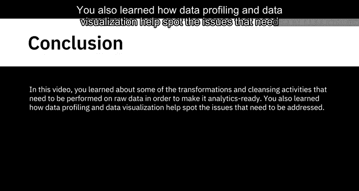

# IBM数据工程专业证书第1课：《数据工程入门课程（IBM）》introduction-to-data-engineering - P33：32_数据清洗.zh_en - GPT中英字幕课程资源 - BV1G94y1y7oT

Raw data has to undergo a series of transformations and cleansing activities in order to be analytics ready data wrangling。

 also known as data muing is an iterative process that involves data exploration。

 transformation validation and making data available for credible and meaningful analysis it includes a whole range of transformations and cleansing activities。

 some of which we will learn about in this video Now let us look at some of the key transformations that data typically undergoes in a data analytics scenario Let's begin with the first transformation task structuring this task includes actions that change the form and schema of your data the incoming data can be in varied formats you might。

 for example， have some data coming from a relational database and some data from web APIs in order to merge them you will need to change the form or schema of your data。

may be as simple as changing the order of fields within a record or data set。

 or as complex as combining fields into complex structures。

Joins and unions are the most common structural transformations used to combine data from one or more tables。

 How they combine the data is different。 Joins combine columns when two tables are joined together。

 Cols from the first source table are combined with columns from the second source table in the same row。

 So each row in the resultant table contains columns from both tables。

Unions combine rows rows of data from the first source table are combined with rows of data from the second source table into a single table。

 Each row in the resultant table is from one source table or another。

Transformation can also include normalization and denormalization of data normalmalization focuses on cleaning the database of unused data and reducing redundancy and inconsistency。

Data coming from transactional systems， for example， where a number of insert。

 update and delete operations are performed on an ongoing basis are highly normalized。

Deormalization is used to combine data from multiple tables into a single table so that it can be queried faster。

For example， normalized data coming from transactional systems is typically denormalized before running queries for reporting and analysis。

Another transformation type is cleaning。 Cleaning tasks are actions that fix irregularities in data in order to produce a credible and accurate analysis。

 The first step in the data cleaning workflow is to detect the different types of issues and errors that your data set may have。

 You can use scripts and tools that allow you to define specific rules and constraints and validate your data against these rules and constraints。

 You can also use data profiling and data visualization tools for inspection。

Data profiling helps you to inspect the source data to understand the structure， content。

 and interrelationships in your data。It uncovers anomalies and data quality issues。For example。

 blank or null values， duplicate data， or whether the value of a field falls within the expected range。

Visualizing the data using statistical methods can help you to spot outliers。For example。

 plotting the average income in a demographic data set can help you spot outliers。

That brings us to the actual cleaning of the data the techniques you apply for cleaning your data set will depend on the use case and the type of issues you encounter。

Let's look at some of the more common data issues。Let's start with missing values。

 Miss values are very important to deal with， as they can cause unexpected or biased results。

 You can choose to filter out the records with missing values or find a way to source that information in case it is intrinsic to your use case。

For example， missing age data from a demographic study。

 a third option is a method known as imputation， which calculates the missing value based on statistical values。

 Your decision on the course of action you choose needs to be anchored in what's best for your use case。

You may also come across duplicate data， data points that are repeated in your data set。

 these need to be removed。Another type of issue you may encounter is that of irrelevant data data that does not fit within the context of your use case can be considered irrelevant data。

 For example， if you are analyzing data about the general health of a segment of the population。

 their contact numbers may not be relevant for you。Cleaning can involve data type conversion as well。

 This is needed to ensure that values in a field are stored as the data type of that field。

 For example， numbers stored as numerical data type or dates stored as a date data type。

 You may also need to clean your data in order to standardize it。 For example， for strings。

 you may want all values to be in lower case。 Similarlyly。

 date formats and units of measurement need to be standardized。And there may be syntax errors。

 for example， white spaces or extra spaces at the beginning or end of a string is a syntax error that needs to be rectified。

 This can also include fixing typos or format。 For example。

 the state name being entered as a full form， such as New York versus an abbreviated form such as NY in some records。

Data can also have outliers or values that are vastly different from other observations in the data set。

Outliers may or may not be incorrect。 For example， when an age field in a voter database has the value 5。

 you know， it is incorrect data and needs to be corrected。Now。

 let's consider a group of people where the annual income is in the range of $100000 to $200000。

 except for that one person who earns a million dollars a year。

 While the data point is not incorrect， it is an outlier and needs to be looked at。

In this video you learned about some of the transformations and cleansing activities that need to be performed on raw data in order to make it analytics ready。

 you also learned how data profiling and data visualization help spot the issues that need to be addressed。

