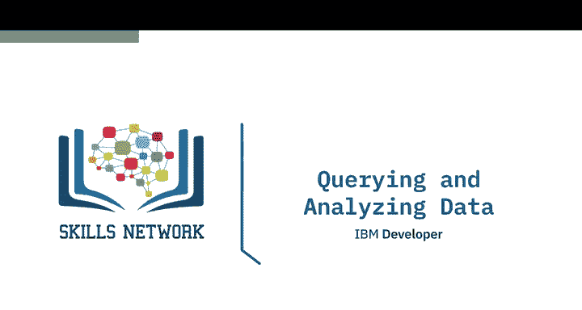
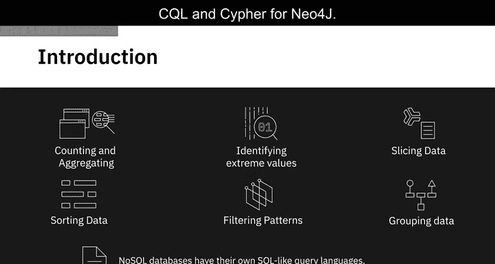
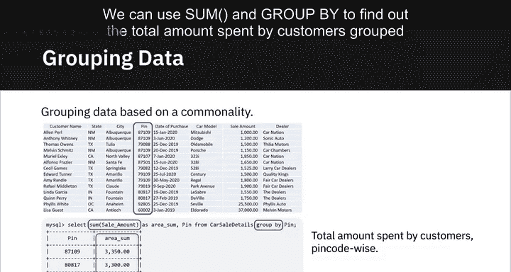
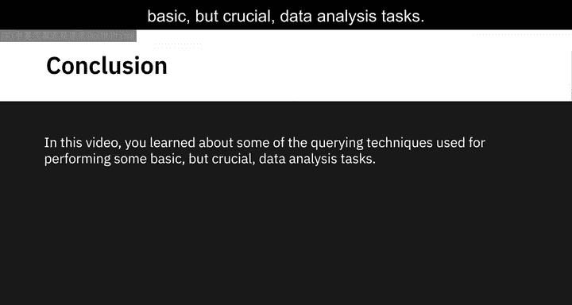

# IBM数据工程专业证书第1课：《数据工程入门课程（IBM）》introduction-to-data-engineering - P35：34_数据查询与分析.zh_en - GPT中英字幕课程资源 - BV1G94y1y7oT

One of the things query languages help us do is access data in the database so that we can understand it better In this video we will learn about some basic querying techniques for analyzing data in a database。

 These include counting and aggregating your dataset identifying an extreme values， slicing data。

 sorting data， filtering patterns and grouping data references to specific functions and operators in this video mapped to SQL。

 which we all know is a query language for RDBMSss。 however。

 the querying techniques are applicable to other query languages as well。 No SQL databases。

 for example， have their own SQL like query languages such as Cassandra CqL and cipher for Neo4j Also APIpis that can be used to query data something very basic that you do when you start with a data for analysis is to take stock of how much data you have in SQL。

Exle， you can use the count function to count the number of rows or records you have in your dataset The sample data that you now see on your screen includes data for customers who have purchased used cars in this dataset there are a total number of 15 records and if you want to see how many unique car dealers there are in the dataset you can use the distinct function to isolate the unique car dealers If you combine count with distinct you get account of the total number of unique or distinct car dealers。

 which in our data is8 aggregation functions also help to provide an overview of the data from different perspectives such as using the sum function to calculate the sum of a numeric column in a table using the average function to calculate the average number of a numeric column and using the STD dev function to measure how spread out the numbers are in a dataset in our dataset for example。

 we can use the。dev function to see how spread out the cost of a used car is the average cost for a used car is a little less than $6000。

 but if you look at some of the individual rows， you see a significant number of records showing less than 2000 and just two records with $25000 and above and the standard deviation is over $11000 the greater the standard deviation value。

 the wider the spread So as you can see from this example。

 looking at the standard deviation brings a different perspective to the data the next type of analysis is to identify extreme value in a data column。

 such as the max function， which gives you the maximum value in a column for example。

 the highest amount spent by a customer in our data is $37。

000 and the min function which gives you the minimum value in a column which in our data is $1000 Now。

 let us say you want to find。Customers based on a specific condition or set of conditions。

 Slicing a dataset lets you do that in this dataset， for example。

 you would use the slice function if you want to retrieve data for customers who live in a certain area or who have purchased their car from dealers in a specific area or those who have spent between $1000 and 2000 for their car。

 you can also use operators that allow you to specify multiple levels。 For example。

 customers who spent between $1000 and2000 on their car and live in a specific area。

 This brings us to sorting data， which helps to arrange data in a meaningful order making it easier to understand and analyze。

 For example， if you want to see if car sales go up around festival time you can sort the data on the data of purchase to see if a large number of sales transactions took place around that time and you can do this by using the order by。

The order by function also allows you to sort a data column in ascending or descendending order。

 Another powerful querying technique is filtering patterns。

 which allows us to perform partial matches of data values unlike an equal to operator that returns records in which a data value matches a certain value the like operator helps you to specify a pattern to return records that match of data value partially in our data。

 for example， let us say we want to filter data for all purchases that happen in a region the first three digits in the pin codes within this region are constant but the remaining two digits vary for each area within that region。

 In this case， we can use the like operator to specify the pattern we know we are looking for which in this case is the first three digits and use wild card characters for the fourth and fifth digits in the pin code since these will be different for each area which brings us to。

Another important tool for analysis grouping data grouping of data is performed using the group by statement。

For example， you want to find out the total amount spent by customers pincode wise。

 we can use some and group by to find out the total amount spent by customers grouped by their pin code。

In this video， you learned about some of the querying techniques used for performing some basic but crucial data analysis tasks。

