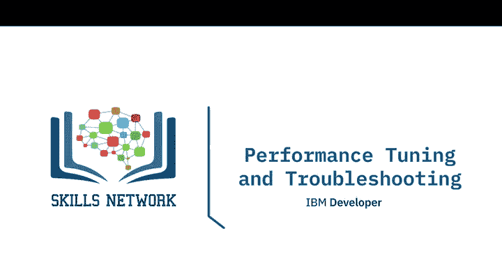
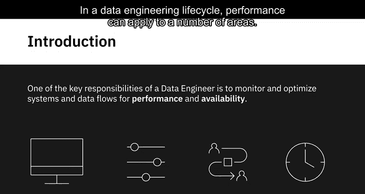
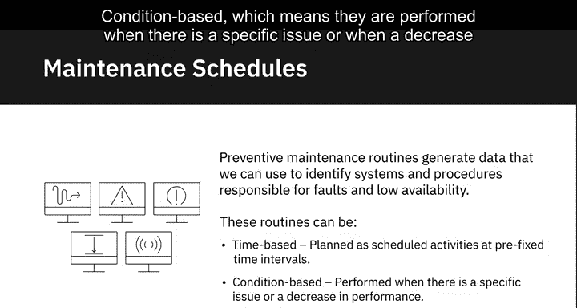
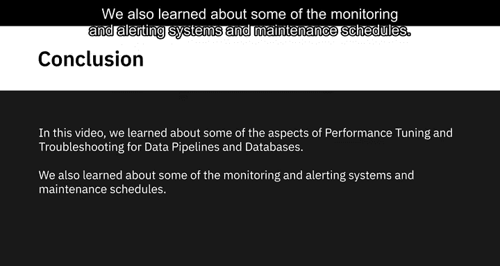
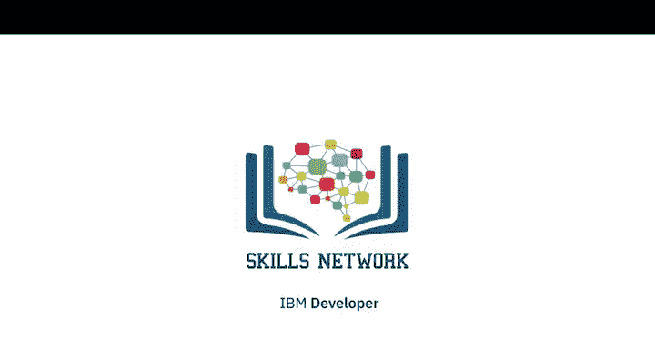

# IBM数据工程专业证书第1课：《数据工程入门课程（IBM）》introduction-to-data-engineering - P36：35_性能调优与故障排除.zh_en - GPT中英字幕课程资源 - BV1G94y1y7oT

One of the key responsibilities of a data engineer is to monitor and optimize systems and data flows for performance and availability In a data engineering lifecycle。

 performance can apply to a number of areas In this video we will look at some of those areas data pipelines encompass the journey of data from source to destination through multiple systems applications and processes a data pipeline typically runs with a combination of complex tools and can face several different types of performance threats such as scalability in the face of increasing data sets and workloads application failures schedule jobs not starting per schedule。

 awaiting dependencies or some tasks not running in correct sequence or not running at all and tool incompatibilities since data pipelines consist of a variety of tools handling different tasks when you need to benchmark or to evaluate performance you need to have performance metrics in the case of data pipeline。

The performance metrics would include latency that is the time it takes for a service to fulfill a request failures。

 which is the rate at which a service fails resource utilization and utilization patterns and traffic or number of user requests received in a given period So what's the best way to go about troubleshooting performance issues in a data pipeline it depends on the issue but generically speaking。

 these are some of the steps you will probably take The first step would be to collect as much information about the incident as possible。

 most importantly to ascertain if the observed behavior is actually an issue The issue could have been reported through an alerting system by a user or flagged during a maintenance check The next step would be to check if you're working with all the right versions of software and source codes and in case of any recent deployments。

 you could check what is changed and investigated if there could be a connection。

SoCheck the logs and metrics early on in your troubleshooting process to isolate whether an issue is related to infrastructure data。

 software or a combination of these Air messages and logs and the network load。

 memory and CPU utilization at the time of the failure can help with this but if the logs don't help you isolate the issue then you'll probably need to reproduce the issue in a test environment This can be an iterative and timeconing process Once you have the root cause hypothesis and have validated the hypothesis through a series of tests you can plan to take it to production as per your team's process Another essential dimension of performance tuning is optimizing databases for performance let us first understand the performance metrics that need to be monitored in a database these include system outages capacity utilization application slowdown。

 performance of queries and conflicting activities and queries。

Be executed based on multiple users giving requests at the same time and batch activities causing resource constraints。

 Let us look at some of the best practices for database optimization such as capacity planning and database design activities such as indexing partitioning and normalization capacity planning includes the process of determining the optimal hardware and software resources required for performance even as the load on the system continues to fluctuate on a day to-day basis capacity planning also factors in future growth requirements。

 Data indexing helps to quickly locate data without searching each row in a database It minimizes the number of times a disk needs to be accessed when a query is processed Data partitioning is another feature that provides multiple performance benefits。

 It's a process whereby very large tables are divided into smaller individual tables queries run faster because they're。

Asing a smaller part of the data Partitioning also improves data manageability Data normalization is a design technique to reduce inconsistencies arising out of data redundancy and anomalies arising out of update。

 delete and insert operations on databases This impacts the efficiency and speed of querying。

 cleansing and analyzing operations Mon and learning systems help us collect quantitative data about our systems and applications in real time In the data engineering lifecycle these systems give us visibility into the performance of our data pipelines。

 platforms， databases， applications， tools， queries， schedule jobs and more。

Let us look at some of these systems and understand how they work database monitoring tools take frequent snapshots of the performance indicators of a database This can help you track when and how a problem really started to occur This can help you isolate and get to the root of the issue more efficiently application performance management tools help us measure and monitor the performance of applications They do this by tracking request response time and error messages These tools also track the amount of resources being utilized by each process which helps in the proactive allocation of resources to improve application performance tools for monitoring the performance of queries gather statistics about query through put execution performance resource utilization and utilization patterns for better planning and allocation of resources data pipelines typically have longrun processes that take significant time to complete which also。

means that the cost of failure is higher when errors are observed or flagged at the end of a process Jo levelve runtime monitoring breaks up a job into a series of logical steps which are monitored for completion and time to completion monitoring the amount of data being processed through a data pipeline helps to assess if size of the workload could be slowing down a system Another thing you can do to help you operate your systems at optimal levels is to run maintenance routines。

Preventative maintenance routines generate data that we can use to identify systems and procedures responsible for faults and low availability These routines can be time based。

 that is they can be planned as scheduled activities at prefixed time intervals or condition based which means they are performed when there is a specific issue or when a decrease in performance has been noted or flagged In this video we learned about some of the aspects of performance tuning and troubleshooting for data pipelines and databases。

We also learned about some of the monitoring and learning systems and maintenance schedules。

