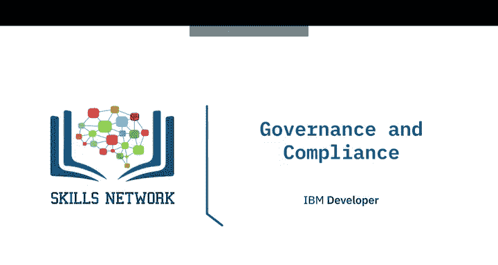
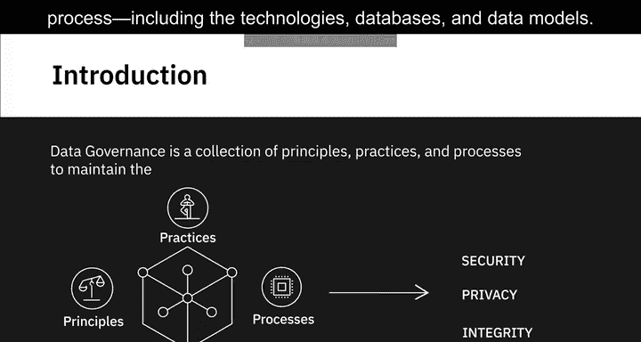
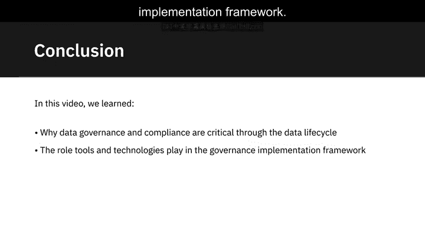
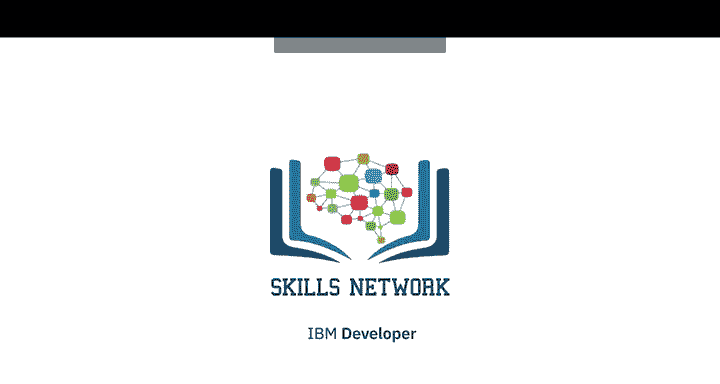

# IBM数据工程专业证书第1课：《数据工程入门课程（IBM）》introduction-to-data-engineering - P37：36_治理与合规.zh_en - GPT中英字幕课程资源 - BV1G94y1y7oT

Data governance is a collection of principles， practices， and processes to maintain the security。

 privacy and integrity of data through its life cycle。

 a data governance framework encompasses every part of an organization's data management process。

 including technologies， databases and data models。

What are the types of data these regulations seek to protect from misuse。

 primarily personal and sensitive data that is data which can be traced back to an individual can be used to identify the individual or contains information that can be used to cause harm to the person for example。

 data about race， sexual orientation or genetic information The general data protection regulation or GDPR is a regulation specific to the European Union It protects the personal data and privacy of EU citizens for transactions that occur within EU member states In the United States individual states have formulated their own regulations for instance。

 California created the California Consumer Priva Act or CCPA to better protect customer data there are also industryspec regulations that govern the collection and use of sensitive and personal data。

 for example， in healthcare， HIPAA privacy rules。Govern the collection and disclosure of protected health information in retail。

 the PCI DSSS standards govern credit card data， and in finance。

 SOX regulations govern the handling and reporting of financial information。

What is compliance compliance covers the processes and procedures through which an organization adheres to regulations and conducts its operations in a legal and ethical manner。

 organizations need to establish controls and checks in order to comply with regulations and maintain a verifiable audit trail that can establish their adherence to these regulations。

 consequences of non-compliance with the standards can be severe。

 They can result in financial penalties bar public perception and result in loss of trust amongst clients and partners It is important to mention that compliance is not a one-time activity It is an ongoing process requiring a blend of people。

 process and technology that continues to evolve。Governance regulations require enterprises to know their purpose and be clear and transparent in their actions at every step of the data lifecycle Let us understand this better by walking through a typical data lifecycle and just a few of the considerations that may apply at each stage a typical data lifecycle in an organization includes the following stages in the data acquisition stage。

 you need to establish what data needs to be collected and the contracts and consent that give you a legal basis for procuring this data the intended use of this data published as a privacy policy and communicated internally and with individuals whose data is being collected and the amount of data you need to meet your defined purposes for example。

 does the email address meet your purpose or do you also need to have the phone numbers and pin codes。

In the data processing stage， you will be required to establish the details of how you are going to process personal data and your legal basis for the processing of personal data。

 such as a contract or consent。In the data storage stage。

 you will be required to establish where the data will be stored。

 including specific measures that will be taken to prevent internal and external security breaches。

In the data sharing stage， you will establish which third party vendors in your supply chain may have access to the data you are collecting。

 as well as how you will hold them contractually accountable to the same regulations you are liable for。

In the data retention and disposal stages， you will be required to establish what policies and processes you will follow for the retention and deletion of personal data after a designated time and how you will ensure that in the case of data deletion。

 it will be removed from all locations， including third-party systems at each of these stages you will be required to maintain an Aable trail of personal data acquisition。

 processing， storage， access， retention and deletion。

Now let us look at some of the controls made available through different tools and technologies for ensuring compliance to governance regulations。

Authentation and access control Today's platforms offer layered authentication processes。

 such as a combination of passwords， tokens and biometrics to provide fullproof protection against unauthorized access of data Aation systems are designed to verify that you are who you say you are access control systems ensure that authorized users have access to resources。

 both systems and data based on their user group and role Datas， for example。

 have the concept of roles and privileges， so only authorized users and applications can access specific objects such as tables or rows or columns in a database encryptncion and data masking using encryption data is converted to an encoded format that can only be legible once it is decrypted via a secure key encryptncryion of data is available both for data at rest as it resides in the storage systems and data in transit。

It moves through browsers， services， applications， and storage systems。

Data masking provides anonymization of data for downstream processing and pseudonymization of data using anonymization。

 the presentation layer is abstracted without changing the data in the database itself。 For example。

 replacing characters with symbols when they are displayed on the screen。

 pseudonymization of data is a deident process where personally identifiable information is replaced with artificial identifiers so that a data cannot be traced back to an individual's identity。

 For example， replacing the name with a random value from the name's dictionary。

Hosting options in on premiseise and cloud systems that comply with the requirements and restrictions for international data transfers monitoring and alerting functionalities Security monitoring helps to proactively monitor。

 track and react to security violations across infrastructure applications and platforms。

 Mon systems also provide detailed audit reports that track access and other operations on the data。

Alerting functionalities flag security breaches as they occur so that immediate remedial actions can be triggered。

 the alerts are based on the severity and urgency level of the breach。

 which is predefined in the system。Data erasure Data erasure is a software based method of permanently clearing data from a system by overr this is different from a simple deletion of data since deleted data can still be retrieved。

In this video， we learned why data governance and compliance。

 which go hand in hand are critical through the data lifecycle。

 and the role tools and technologies play in the governance implementationm framework。

