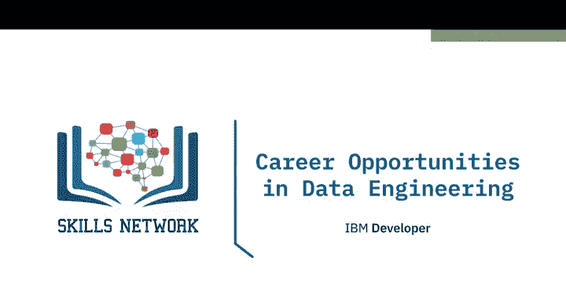
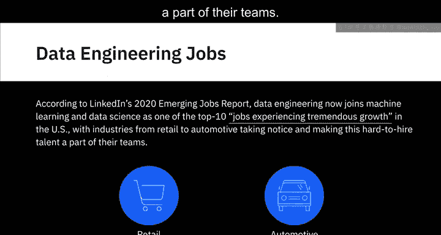
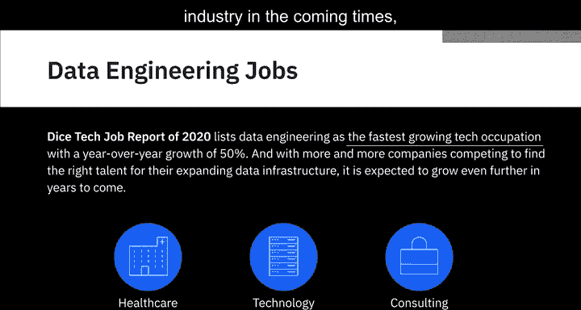
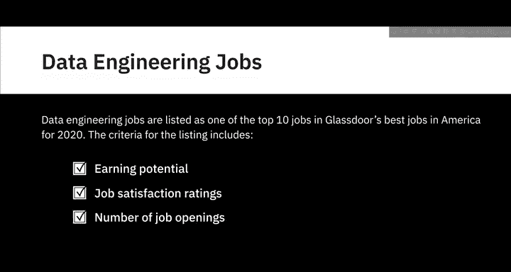
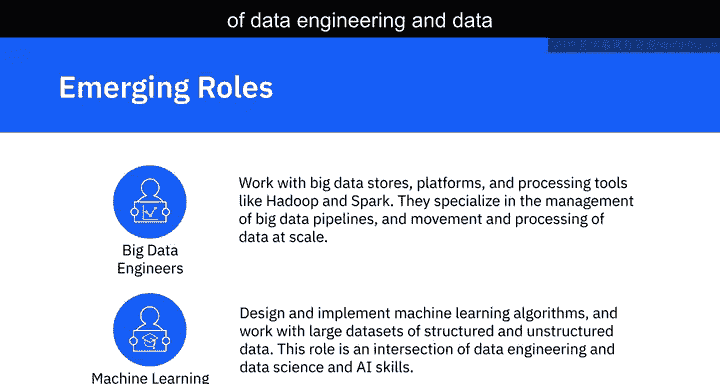
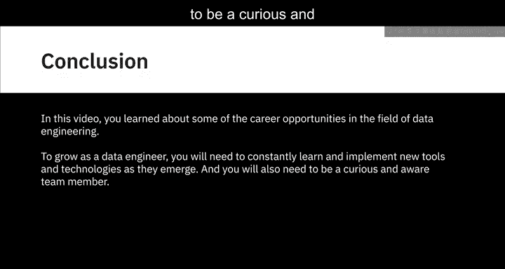
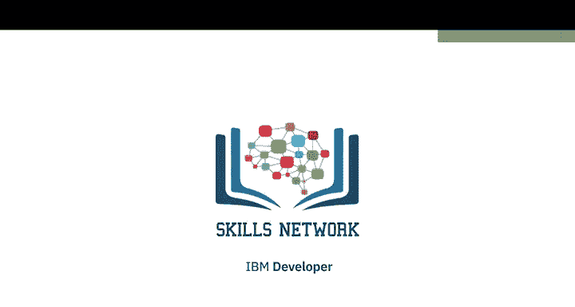

# IBM数据工程专业证书第1课：《数据工程入门课程（IBM）》introduction-to-data-engineering - P38：37_数据工程职业机会.zh_en - GPT中英字幕课程资源 - BV1G94y1y7oT

In this video， we will learn about career opportunities in data engineering to start with。

 let's get a high level view of this job market as cited in some of the popular and credible sources in the industry。

According to LinkedIn's 2020 Emerging jobsbs report。

 data Engine now joins machine learning and data science as one of the top 10 jobs experiencing tremendous growth in the US。

 with industries from retail to automotive taking notice and making this hard to hire talent a part of their teams。

Dice Tech Jo report of 2020 lists data engineering as the fastest growing tech occupation with a year over year growth of 50%。

 and with more and more companies competing to find the right talent for their expanding data infrastructure。

 it is expected to grow even further in years to come。 The report goes on to identify healthcare。

 technology and consulting as the three fields with the largest need for data science talent as a whole。

 including data engineering， though no industry in the coming times says the report is going to be untouched by this discipline。

Data engineering jobs are listed as one of the top 10 jobs in Glassdoors's best jobs in America for 2020。

 the criteria for the listing includes earning potential。

 job satisfaction ratings and number of job openings。

There is a wide variety of job roles available for data engineers job titles are fluid and a data engineering role can look a little different in every company typically data engineering roles in organizations tend to break up the specialization into data architecture。

 Data design and architecture， Data platforms， Data pipelines and ETL， data warehouses and big data。

 the roles may all be labeled generically as data engineers or carry specific titles such as data Arch。

 Data architect， ETL engineer， data warehouse engineer and big data engineer if your organization wants you to focus on implementing and managing a cloud-based data lake for example。

 your job title probably will be data lake Engine。But in each of these niche openings。

 knowledge of operating systems， languages， databases， and infrastructure components。

 such as virtual machines， networking， and application services would be a given expectation。

 as also data's potential application in business。It may also be that you get an opportunity to work on the whole data engineering lifecycle at once。

 typically in a small team or startup that is just starting to build their data engineering practice。

 but as the practice grows， a multidisciplinary engineering team would start to take shape。

If you are part of an organization that has set up a data engineering practice。

 then you will likely start your journey as an associate or junior data engineer and work your way up through data engineer。

 senior data engineer， lead data engineer， and principal data engineer roles。

Growing up the ranks could be a bit like navigating a matrix。

 you will be required to not only expand your skills in your niche。

 but also branch into other areas of data engineering， for example。

 from being a data architect to gaining a functional understanding if not hands-on experience of data warehouses。

 data lakes， data pipelines and the ETL process， growth in data engineering is characterized not only by the expans of tools and technologies that you understand and can work with。

 but also how much the big picture you're able to see in the data engineering lifecycle your communication skills。

 your ability to collaborate with diverse technical and business stakeholders。

 your operational or project management skills all need to be growing progressively in order for you to grow into lead positions。

As a lead， you will handle growing responsibilities。

 such as spending more time on converting business requirements into technical specifications and being the bridge between what business wants and what technical teams develop。

 you would also be evaluating and weighing in on the tools and platforms that you should be using as a team。

 as well as gaining greater responsibility for implementing systems。

 processes and tools for ensuring data quality， data privacy and compliance with regulations。

Now let us look at a few of the emerging roles in the field。

 big data engineers and machine learning engineers are a couple of emerging roles that require specialized skills in addition to basic data engineering Big data engineers work with big data stores。

 platforms and processing tools like Hadoop and Spark they specialize in the management of big data pipelines and movement and processing of data at scale Ma learning engineers design and implement machine learning algorithms and work with large data sets of structured and unstructured data This role is an intersection of data engineering and data science and AI skills。

In this video you learned about some of the career opportunities in the field of data engineering to grow as a data engineer。

 you will need to constantly learn and implement new tools and technologies as they emerge。

 and you will also need to be a curious and aware team member。

