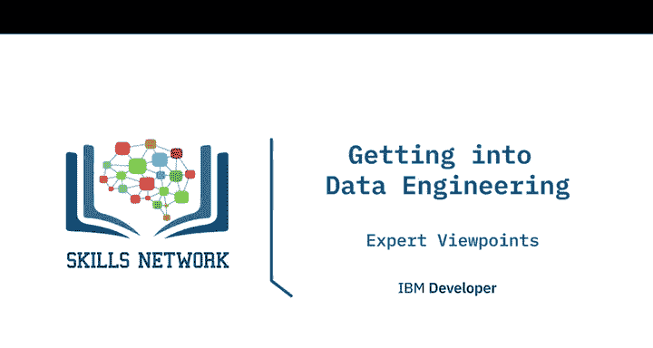
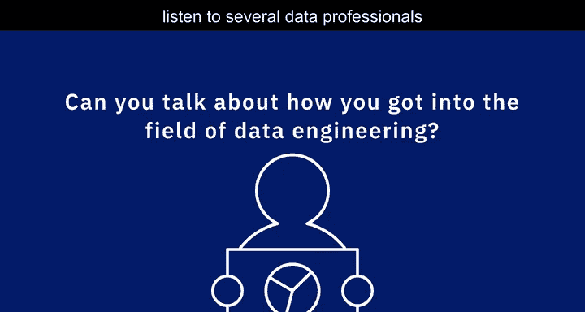
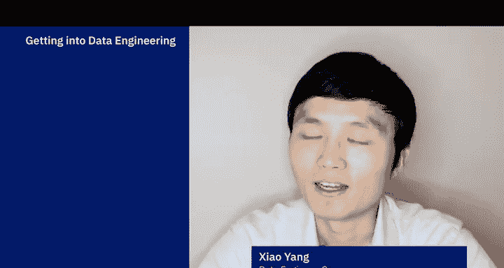
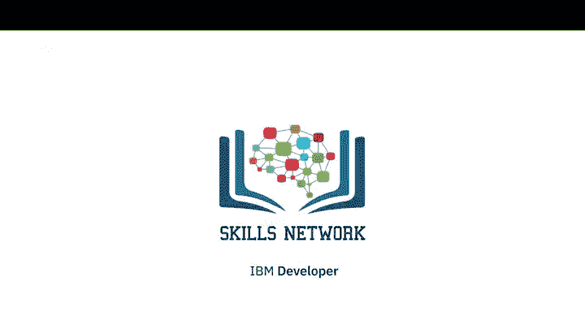

# IBM数据工程专业证书第1课：《数据工程入门课程（IBM）》introduction-to-data-engineering - P39：38_进入数据工程领域的视角.zh_en - GPT中英字幕课程资源 - BV1G94y1y7oT

In this video， we will listen to several data professionals talk about how they got into the field of data engineering。

I started off as a DBA on IBM DB2 or DBMS and I particularly really enjoyed solving performance problems for both OLTP and overlap databases as a DBA I got an opportunity to interact with the。

Web application developers， ETL developers and business intelligence users and business users and a few other groups within the organizations as our business requirements used to evolve。

 our need to invest and research other non-DBMS tools， and processes evolved as well。

 for example to solve to store our documents we invested in MongoDB， and then for our 24 by 7。

365 days availability， highly available application， we started exploring Cassandra。

 and for our analytical database we started exploring HadOop and laid out standalone cluster under a POC on it。

So all of a sudden after exploring all these technologies and started working on some of them。

 I'm a data engineer now not at EBA anymore So I have a somewhat unusual way of getting into data engineering I think of the two usual ways of getting into data engineering is either starting out in system administration and moving into a data profession or starting out in development and moving into a data profession but personally graduated college and I graduated college and when I did I got a job at IBM my goal on my resume at that point was to be a DBA I had a very targeted goal to get into a data profession and I was able to get into that data profession immediately within two years I could call myself a competent DBA before that I could call myself a DBA but maybe a beginner。

And so it's a little bit of an unusual way that I got there I think that might be a little bit more common these days I think there are more opportunities to go directly there but there are certain fields and technology that often come with expertise from other fields one of those is data another one of those is often DevOs where you're coming in with either systems operation experience or development experience or both there are several fields like that and I think data is one of them data can benefit from either of those because if you know some of the tenants of systems administration and how to deal with storage and the impact of network time and all of those details that can be very useful if on the other hand you know how developers deal with data and what they need out of data or what data scientists need out of data all of those are very valid areas to come into data engineering。

but it's absolutely an area you can start from scratch。

 the main thing you're looking for if you're starting from a college degree or if you're starting from no college degree。

 you're going to need a basic understanding of information technology and you're going to need a mentor to help you kind of find the way if you can find a mentor that's going to make things a lot more easy because it can help you know what areas to focus in and what areas to kind of ignore there are an amazing number of resources out on the web these days to help you I could go on for half a day just listing some of the sites you can go to and get more information there are online degrees you can work towards both undergraduate and graduate level there's so many opportunities to move in that direction these days that it's just amazing。

So my beginnings in this field go back to doing some simple data entry work as a student。

And that's what got me interested in working with data and understanding its power。

Although I have a degree in computer engineering。That alone did not get me the job of a data engineer。

At that time。We do not have online courses， so I bought some books and learned how to work with databases。

And more importantly， I applied what I learned from these books by creating database applications and then doing some volunteer work and some freelance work。

So these skills and experience of doing real work with databases is what really helped me get an internship。

And then after that， I mostly learned new technologies on the job with occasional training classes。

And nowadays， I mostly learn about data technology。

 the new stuff that comes out by watching YouTube videos and taking online courses。It is a。

Interesting journey。呃。

After graduating from college I taught science and geography in the middle school for two years and then I spent three years doing marketing and recruiting in nonprofits in educational nonprofits after that I went to graduate school to study nonprofits management and information systems and it was in the gra school I got interested in data。

So after graduation， I joined education nonprofits in Boston and become a business intelligence analyst there。

It was my first data related full time job。The learning curve for me was steep but I really enjoyed it after working there for one and a half year。

 though I was still passionate about education， I started to think about maybe doing something differently outside of the nonprofits sector yeah I worked in at that time I had worked in nonprofits for almost seven years。

So I started to look for opportunities in education technology companies。

 I applied for a data scientist position as Coursera。But I got rejected very soon。啊。

Luckily the team at the time was also looking for a data engineering role and they found that my background might be a potential fe。

 so they reached out to me and asked me whether I was interested in that position。To be honest。

 as I time data engineering was new to me， I didn't even know what's different between data engineering and business engineering and and data engineering between data engineering and data scientists。

 but anyway I took the opportunity and started the interview process with the and luckily I got the job so in the fall02018 I moved from Boston to the Bay area and started my journey in data engineering as Coursera。

😊。

