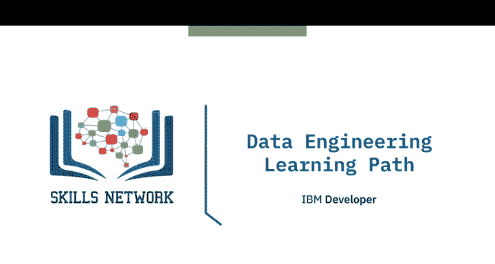
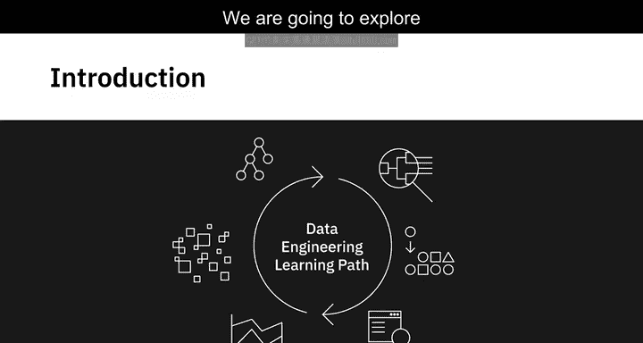
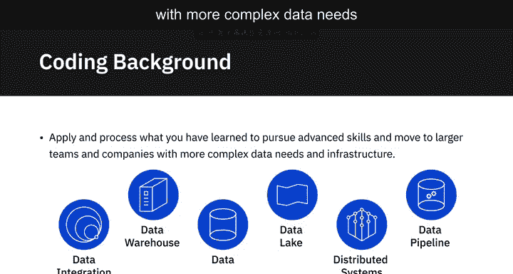
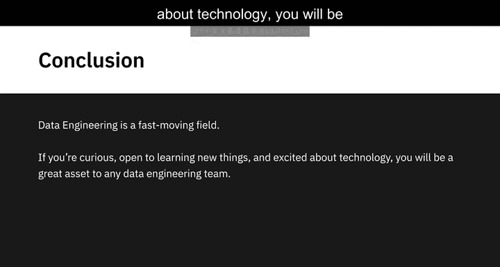

# IBM数据工程专业证书第1课：《数据工程入门课程（IBM）》introduction-to-data-engineering - P40：39_数据工程学习路径.zh_en - GPT中英字幕课程资源 - BV1G94y1y7oT

There are various pathways you can explore in order to get into the field of data engineering。

We are going to explore some of these pathways in this video。

Data engineering is a highly technical field， an academic degree in computer science or engineering will set you off on this path right away。

It is true that some of the employers will have this as entry level criteria。

 but what is also true is that a lot of data engineers。

 especially the ones who are coming with some background encoding are self taught。

There are comprehensive online programs and multiC specializations available by some of the well known learning platforms such as Coursera。

edX， and Udacity。Their curricula have been designed and delivered by some of the best colleges and technology companies in this space。

These courses will expose you to hands on assignments and real world projects。

 which will give you the confidence to venture into this field。

You can also earn professional certifications from these courses。

 which are recognized and valued in today's job market。By now。

 you have a fair idea of the breadth of subdomains and technical skills within data engineering。

So it should be fairly easy for you to select the path that meets your current skill level and aspirations。

For example， you may decide to build your skills and pipelines or distributed systems or data architecture to begin with before you venture into the other areas of data engineering。

Being clear on your short and long term goals will help you design a learning path for yourself that will support you on this journey。

While there are several different ways in which you can make an entry into this field。

Your technical abilities will be your mainstay in this profession。

 along with a broad understanding of the scope and use of data in business。

If you are not a graduate or you are a graduate in a non-related stream。

 but want to upskill or switch careers， then you too can take the help of professional certifications and other learning resources to gain data engineering skills。

 for example， you could be an IT support specialist， a software tester。

 a programmer or involved in any other technical role in your current job and upskill to gain these skills。

You can also be a statistician， a data analyst， a BI analyst， or any other type of data professional。

 and reskill yourself to get into data engineering。If you have some basic familiarity with coding。

 you can develop some baseline technical skills that can get you started。For example。

 programming and query languages， working with different operating systems and databases。

Having built some of these skills， you can gain an entry level job or create some projects which you can add to your portfolio before you start to pursue some of your more advanced skills。

Real world exposure is important to solidify your understanding in this field。

As you gain experience applying and processing what you have learned。

 you can move on to larger teams and companies with more complex data needs and infrastructure。

Data engineering is a fast moving field。If you're curious。

 open to learning new things and excited about technology。

 you will be a great asset to any data engineering team。

