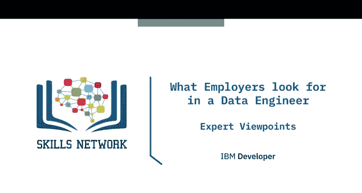
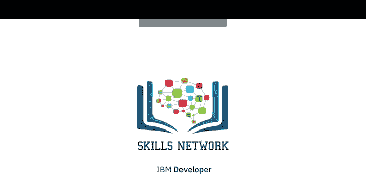

# IBM数据工程专业证书第1课：《数据工程入门课程（IBM）》introduction-to-data-engineering - P41：40_雇主对数据工程师的要求视角.zh_en - GPT中英字幕课程资源 - BV1G94y1y7oT

In this video， we will listen to several data professionals talk about what employers look for in a data engineer。

Very tricky question because there is no straight answer to this questionEmploys look for an individual who has exposure to a breadth of various data related technologies it really varies from job to job or roll to roll for example some roles looks for individuals who has exposure to various kinds of data sources from relation databases to the NoSQL databases to in memoryory databases or keyvalue stores so and some other roles looks for individuals with heavy experience geared towards the data moment processes that means they need to be able to work on moving the data from a variety of data sources from RDBMSs to NoSQL databases of pulling the data from social media using APIs and loading them into their L。

part that they also look for good analytical and problem solving skills in a when I'm hiring somebody in a data field there are a number of things I look for one is I look for somebody who is inquisitive somebody who doesn't just take the data given to them but asks additional questions just to figure out what direction to take something one of the primary questions I ask when' when I'm interviewing for that particular trait is I say hey。

 somebody comes to you they say the database is slow， what do you do。

And I'm not looking for them to say I tune memory， I'm not looking for them to say I look at this metric。

 I'm looking for them to ask questions and think about different directions of slowness could come from。

 things like that。So somebody who is inquisitive， somebody who can communicate really well。

 you're never working in a vacuum as a data professional。

And there's a lot of other people that you're going to have to interact with。

 somebody with a strong work ethics， somebody who really owns what they work with and what they do。

 those are all things that I'm really looking for I think it is wey company specific。

In a big company that engineer may be able to have a narrow focus， for example。

 just building ETO pipeline， while in a small startup。

 that engineer may need to wear different heights and the employer would have require would would expect the that engineer to have way broad skills。

 in many cases， I think。I think诶。SQL data model and ETL methodologies。

 as well as programming skills such as Python are pretty essential ones for data engineering and besides those technology skills and I believe employers also want to see curiosityiosities。

 good communications and。Love or learning in their data engineersEmploys employers look for skills on RDBMS。

They look for expertise on no SQL databases。They see if you have any expertise on schema design。

They want to know if you can work on ETL ELT。They also want to see if you can handle streaming data。

They would love you to be able to handle multiple data formats。F formats。

They also want to see you to be able to work on or to be able to work with web As。

 data scraping web scraping。And any kind of even basic data analytical skills or looked for。

And most importantly， they look for problem solving and if you can automate any routine work that has to be done at the workplace。

When I'm looking at technical skills， I mean the technical skills。

 I'm looking for somebody who's familiar with at least one of the technologies。

 I'm looking for somebody who has a good starting place to go to learn deeper in that area。

 if I'm looking at a very senior level position， then I'm looking for very specific technical skills because I have a specific technical need that I need filled。

But at a junior level， I'm looking for a general fluency with technology and more soft skills than I am specific technical skills。

 and some of that is asking them what they've done to learn the field。

 what have they done to what courses have they taken， what blogs do they read。

 what directions are they taking to learn more？So having the right credential。

 a degree or a certificate is a good starting point to get noticed。不。

You also need to be able to demonstrate that you have the right technical and soft skills and then stand out from the other candidates。

 so for example， what projects have you worked on， have you done any technical write ups。

 presentations， videos in this field？And then there are soft skills like being able to clearly communicate and articulate your work。

Whether you're a good fit with the organization is another thing that we look at。For example。

 if you're going to be working in a team。Of people， do you have the skills for good teamwork？

