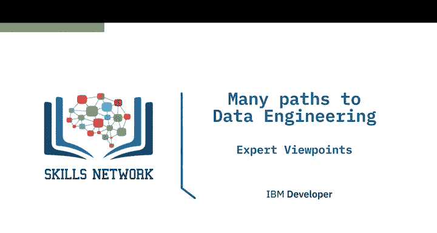
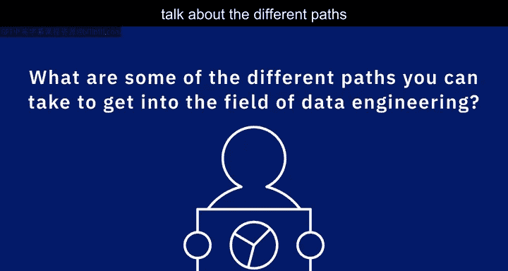
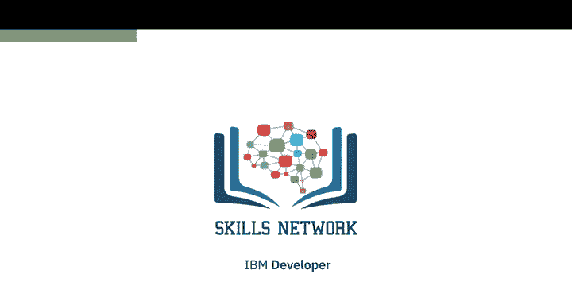

# IBM数据工程专业证书第1课：《数据工程入门课程（IBM）》introduction-to-data-engineering - P42：41_通往数据工程的多元路径.zh_en - GPT中英字幕课程资源 - BV1G94y1y7oT

In this video we will listen to several data professionals talk about the different paths you can take to get into data engineering So there's a number of ways of becoming a data engineer。

You can get a degree from a college or a university in a field like software engineering or computer science。

 and that's how I did it。But this option can be expensive and it requires an investment of a number of years of your life。

And even then。You you will need to likely supplement your skills with beyond what has been taught in school。

To match the requirements of a real job。But if you already have a degree in another field or you simply don't have the luxury to invest several years in getting a degree。

 you can do a shorter diploma program or boot camp in physical location or take online courses and certificate programs。

 which can be both part time and full time。So regardless of the option that you choose。

 be careful about selecting the right program。Look at its cost。

 the time it takes to complete whether it's from a reputed provider， is it the content up to date。

 and look at the reviews， you， talk to people who have completed the program。

And also make sure that the program matches your learning style。

 you know are you motivated enough to self learn online or do you require some handholding you can become a data engineer from a variety of existing rules。

So if you are a system administrator， that's a good starting point you can master an OS， a database。

 and then you can become。Data engineer， if you're a database administrator。

 you're only one step closer to being a data engineer。If you're an automation engineer。

 if you are good at automating manual tasks， then from that path。

 you can move into being a data engineer。If you're a data analyst， you already know a lot about data。

So that's also a good starting point for you to become a data engineer if you're a programmer。

 even from being a programmer you can move into a data engineer。

You can start as a DBA and transition into the data engineering which work pretty well for some of my colleagues and myself and another path that I can think of is a natural transition into the data engineering is from the ideal development track bottom line is a data engineer should be very knowledgeable with the databases and different kinds of data sources and data formats and use that knowledge to build the data pipelines and apart from these technical skills。

Technical track I think academically if you have a background in the computer science and mathematics。

 I think it will help you greatly it will reduce your time to become a great data engineer so the entire field all data engineering is very new。

And as as I mentioned earlier， different companies also have different requirements for each data engineer。

 so that basically means there are lots of different ways different paths you can get into data engineering。

And I have。I have several college at Cora， they started computer science at college and they entered into data engineering directly after graduation。

 I also have some data engineering friends they used to be software engineers。

Yeah those folks that have always shown technical background before entering into data engineering。

 but that's not really necessary， you can enter into data engineering without always shown computer science background。

 so my experience my experience is a good example。I works many years in non take positions in nonprofits。

 so I didn't have strong Baygu。But I started as a business intelligentent analyst in the non nonprofits。

Where I hone my skills hone my skills in SQL in datamoning on the database and then I entered into data engineering as Cosera So the typical paths I see for data engineering are coming in either through a system engineering or a developers side。

 those are the typical directions we see coming in from a help desk I tend to like that a little bit just because you get a sense of somebody's work ethic from having come in from that direction。

 but more often you're going to see somebody who started as a developer or somebody who started as a system administrator。

