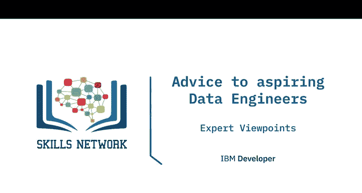
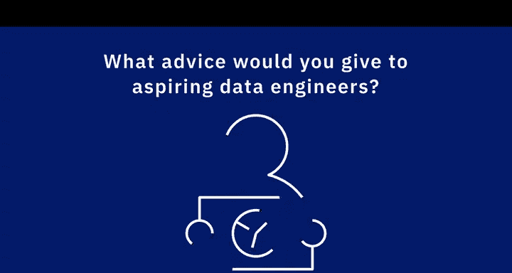
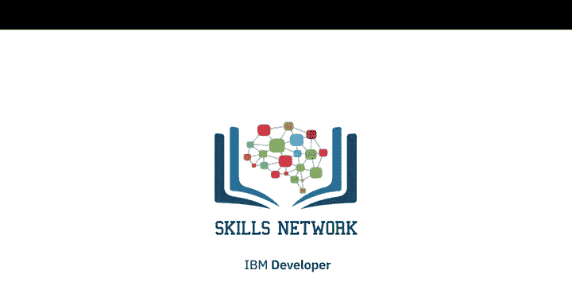

# IBM数据工程专业证书第1课：《数据工程入门课程（IBM）》introduction-to-data-engineering - P43：42_给数据工程新手的建议.zh_en - GPT中英字幕课程资源 - BV1G94y1y7oT

In this video， we will listen to several data professionals talk about the different paths you can take to get into data engineering。

For folks who want to be data engineers， I I want to share two pieces of advice。 First。

 focus on building a strong foundation。 data engineering is a relatively new field。

 and every year there are also of new technologies emerging。

It is important to learn those new technologies， but as a starting point。

 I think we should build a strong foundation in SQL， Python， data modeling and ETL method。Second。嗯。

Paying attention to Hands own experience。Mausum was more in that engineering than。

than hands experience， may you may think it is hard to get hands experience beside of full time job or internship。

 but it shouldn't be that hard。In data engineering we were developed lots of open source tools or freeraming tools with the support of enormous online learning materials I believe there are many ways you can leverage those tools to do your personal projects and do practice having hands experience would not only help readme to stand up in the Candace pro but it would also enable you to tackle a lot of questions during the interview process So my first advice to anybody working towards becoming a data engineer would be to practice to find things that you can do that that will give you practice in the area one of my favorite junior DBAs that I work with used to bring his laptop to me with a VM on it and say hey break my database and this was great because I would come up with every different way I had seen a database break and I would try to simulate it on his laptop。

He would come up with solutions and man， he was a great troublesshoooter for having gone through that because he had seen a lot of the things that it took me years of experience to actually run into。

So any way you can come up with to practice and that can be coming up with your own project that can be building a database for something in your life another one is to get involved with a professional organization it's great to get involved with other people who are working in that area and to learn from them give to the aspiring data engineerencies。

 learn database in the if you understand the data structures that power these data sources that's half the battle of the data engineer learnsSQL and a programming languages I would say ideally one procedural language such as shell scripting or PLSQL or a poll and an object or render programming language。

 either Java or Python and a functional programming language such as CalalA once you gain certain expertise。

 try to share your knowledge with your peers in the community for example share your code in the GitHub。

Public repositories start writing articles on LinkedIn or create your own blog and work extremely hard when you're relatively young and stay curious if you do some of these things I don't think you will have any kind of problem getting hired as a data engineering data engineerings are really in high demand these days I would recommend is to think about how you're sharing your knowledge and how you're giving back I'm a blogger I write a lot about about DB2 and about data in general at data geek。

 blog and that is one of the number one things even if you've been doing something for as little as six months you may know more about some aspect of that thing than anybody else so even if you've been working with a product for a very short amount of time。

 beginner blog entries are great so it's really important as you're starting your journey in data engineering to share your knowledge。

And make sure that you are giving back to the data engineering community So if you want to become a data engineer。

 you need to understand one thing。The whole concept of data engineering is a lot of skills。

 it's a lot of width， you need to master a variety of skills and tools。

It can be very overwhelming if you look at all those skills or technologies or tools at once。

One RDBMS choose any RDBMS that is available to you and you're comfortable with。

 and you can master one RDBMS。After that， move on to master at least one No SQL database it can mean a Mongo TV Cassandra。

 Neo4j VAC already Redis you can also understand concepts like web scraping and also start learning them and also understand that in the future you will be expected to work with APIs so As is a way with using which you can interact with other systems you seamlessly so the first thing is to build the right skills get your credentials and certificates。

And then demonstrate your expertise in technology or a product that you enjoy working with and is in demand。

You know，W blog posts， write articles， create some YouTube videos or screencasts and demos。

And you don't have to be an expert to be able to do so。

 One of great ways of learning something is to learn， to be able to teach it to others。

You going join a local networking group or a meetup。You know， not just to learn。

 but also to meet with other people in the field and share your insights and experiences。

Like other technology fields， data engineering is continuously evolving。

And so make learning a part of a continuous part of your lifelong process。You know。

 keep learning and。Keep up with the new technologies and approaches to working with data。

Wish you all the success on your journey to becoming a data engineer。

