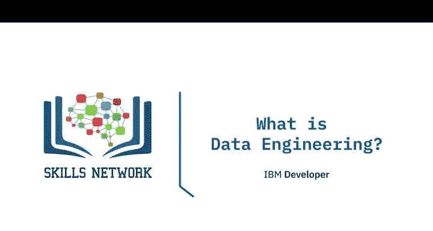
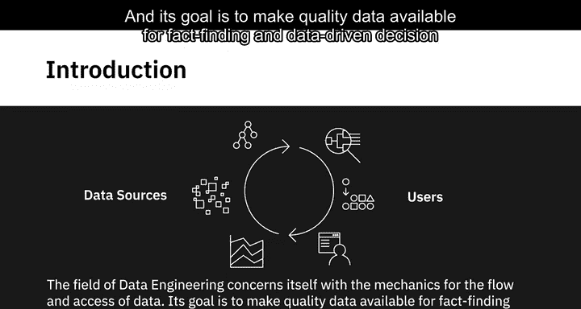
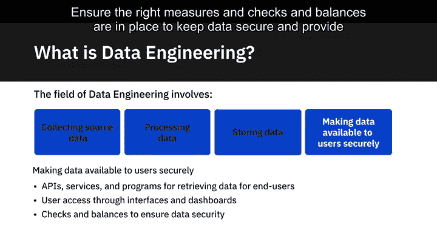
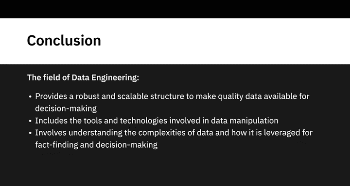

# IBM数据工程专业证书第1课：《数据工程入门课程（IBM）》introduction-to-data-engineering - P4：3_数据工程定义.zh_en - GPT中英字幕课程资源 - BV1G94y1y7oT

In this video， we will further explore the scope of data engineering within the modern data ecosystem In the simplest possible terms。

 the field of data engineering concerns itself with the mechanics for the flow and access of data and its goal is to make quality data available for factfin and data-dven decision making as data has grown so has the field of data engineering from data being available in a single database that was relatively easier to manage the world of data has grown to include wide-raning sources。

 structures and types of data the field of data engineering concerns itself with the tasks of collecting source data。

 processing data， storing data and making data available to users securely， collecting source data。

 including extracting， integrating and organizing data from disparate sources to collect required data you need to develop tools。

 workflows and processes。

That help you acquire data from multiple sources， as well as design。

 build and maintain scalable data architecture to store data data could be stored in databases。

 data warehouses， data lakes or any other type of data repository processing data includes cleaning。

 transforming and preparing data so that it is usable for this。

 you need to implement and maintain distributed systems for large scale processing of data design pipelines for extraction。

 transformation and loading of data into data repositories。

 design or implement solutions for validating and safeguarding quality。

 privacy and security of data Opim tools， systems and workflows for performance。

 reliability and scalability， and ensure data meets all regulatory and compliance guidelines。

Storing data for reliability and easy availability of data for this。

 you need to architect or implement data stores for the storage of process data。

 ensure systems are scalable， keeping in mind the evolving nature of data and business needs。

 and ensure tools and systems are in place that take care of data privacy， security compliance。

 monitoring， backup and recovery。 And finally， making data available to users securely。

 This includes the use of As， services and programs that retrieve data on defined parameters for use by end users。

 Inters and dashboards that present data to users so they can derive insights from the data and ensure the right measures and checks and balances are in place to keep data secure and provide rightsbased access to users。

 It is important to mention that data engineering is a team sport。 No one person is expected to have。

All the knowledge， skills and specializations required for the wideranging tasks covered within the scope of data engineering。

 for example， to architect any data management system be it for collecting source data or storing processed analysis ready data。

 you need to have the skills of an architect to ensure data stores are available and optimized for use。

 you need to have expertise in databases， Similarlyly， proficiency in database tools。

 programming languages and distributed systems all come under data engineering。

 but they may require different skills sets。Also， not all teams and organizations need to set up an end to end data engineering practice。

 There are tools， applications and solutions available in the market。

 both on premise and cloud based that can be evaluated for individual needs。In this video。

 we learned how data engineering works to provide a robust and scalable structure to make quality data available for decision making。

 More than any other data profession， data engineering is about the tools and technologies involved in data manipulation。

 but it is also about understanding the complexities of data and how it is ultimately leveraged for fact finding and decision making。

