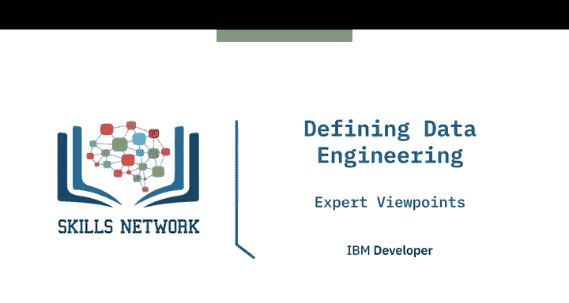
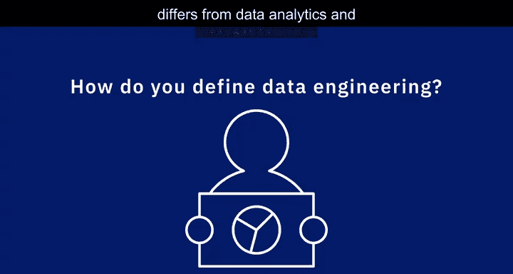
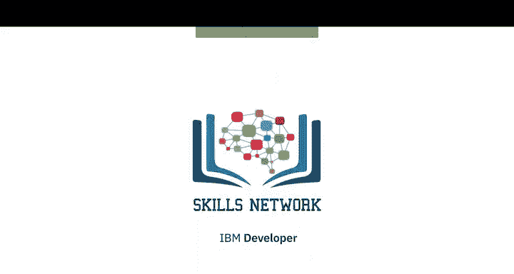

# IBM数据工程专业证书第1课：《数据工程入门课程（IBM）》introduction-to-data-engineering - P5：4_数据工程的定义视角.zh_en - GPT中英字幕课程资源 - BV1G94y1y7oT

In this video， we will listen to several data professionals。

 talk about how they define data engineering and how it differs from data analytics and data science。

Data engineering is the task of。Designing， building， maintaining data infrastructures and platforms。

These data infrastructures can include databases， big data repositories。

 as well as data pipelines for transforming and moving data between these systems。

So a data engineer is someone who performs these tasks of developing and optimizing data systems and make data available for analysis。

Whereas a data analyst is someone who analyzes data in these systems to report and derive insights。

And a data scientist takes this even further by performing deeper analysis on the data and developing predictive models to solve more complex data problems As data engineers。

 we are kind of the plumbers of data， we make sure that the data is highly available。

 we make sure that the data is consistent， we make sure that the data is secure and we make sure that the data is recoverable we don't spend as much time playing with the data or analyzing the data or actually using the data as we do making sure it's ready for others to do those jobs a lot of times data science and data analytics will make use of the data that that we store。

 they will it's also a scenario where we work closely with other data professionals to make sure that the data matches their needs and is is available in a way that actually helps them data engineering is all about design。

igning maintaining and optimizing systems。That will help enterprises and companies make the most of their data。

When we get into specifics， it's all about choosing the right databases， the right storage systems。

 the right cloud architectures or cloud platforms。So that when we put together all these things。

The data flow inside an organization is seamless and data can be delivered to whoever needs it at whatever time with minimal effort and as soon as possible。

In an ideal organization with the best data engineering processes。

Anybody can get access to any data that he or she is authorized to in a split second time。Now。

 if you talk about data analysts and data scientists。

Their work can be thought of as an upstream work that is after the job of a data engineer finishes and the data is made available。

 then data analysts and data scientists can make use of that data to work out their analysis and come up with their predictions。

Data engineers extract and collect raw data from multiple sources。

 transform them and store them in curable forms。While， a data scientist or a data analysis。

 they perform。Anaslysis on top of the data that's prepared by data engineering and try to。

Engage insights from those data you can think of data engineering as a precursor to the data analysis and data science data engineers act as enablers and make the data projects of data analysts and data scientists meize into reality。

 for example， they can assist the data analysts and data scientists with picking the right datas and tools and by building the required data pipelines to help with their data needs and build their reports and perform statistical analysis。

