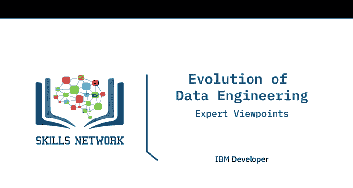
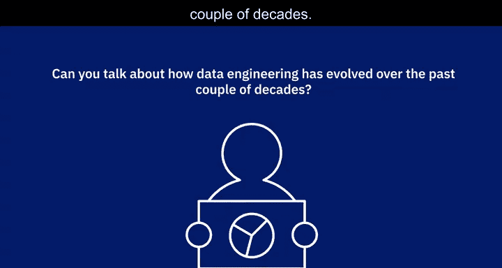
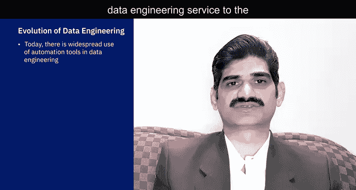
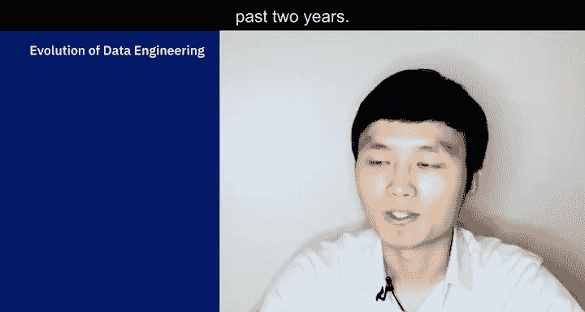
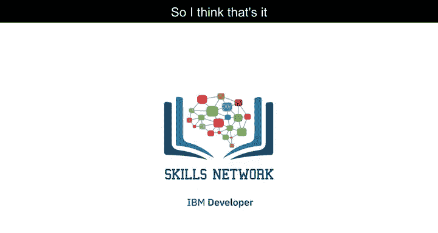

# IBM数据工程专业证书第1课：《数据工程入门课程（IBM）》introduction-to-data-engineering - P6：5_数据工程的演进视角.zh_en - GPT中英字幕课程资源 - BV1G94y1y7oT

In this video， we will listen to several data professionals。

 talk about how data engineering has evolved over the past couple of decades。

Compared to two decades back， the data engineering ecospace or landscape is a totally different one。

 it's almost unrecognizable compared to what it was two decades back。If you look at today's scenario。

 the sheer quantity of data that we handled today was unthinkable two decades back。

 we also handled with a variety of data and data formats which probably didn't even exist two decades back。

And two decades back， we were not talking about the concept of no SQL databases。

 but today we work with a variety of no SQL databases。And two decades back， big data was unheard of。

 whereas today it is pretty much stable to many enterprises and organizations。

One of the major difference that I see between you know before two to two decades and now is the expectations from data engineering they have grown a lot today when a data engineer is given a job。

 the turnaround time is a lot less。Earlier， we could take days to come back with a solution。

 but today the expectation is that okay， we come back with a solution within hours。And。Today。

 you cannot run a complete data engineering。Servicye without the use of automation tools。

 so you need a lot of automation tools to make sure that we deliver the data engineering service。

To the organization。So I started off in this field almost 25 years ago。

 and there's been a significant evolution。In technology in general。

 but specifically as data and data technologies and systems are concerned。So for example。

 with cloud computing。Data infrastructure is now available as a service。

 so data engineerer today needs to do a lot less from scratch。They can。Spend。

More time on doing things that matter and less time on setting up and managing these systems。

So when I started off in data engineering， it primarily involved using relational databases and data warehouses。

Now there's a lot of No SQL databases and other types of data repositories。

Another major revolution has been around big data， and data engineers today need to know how to work with several different big data systems and pipelines。

And while there are still specializations。Today I think a data engineer needs to know about a greater variety of tools and data systems and how they can be effectively used for solving different types of data problems So over the past couple of decades。

Data the way that we handled data has changed very significantly when I started it was a very hierarchical approach。

 there was somebody at the top an architect， an enterprise architect。

 a data architect people who decided how we were going to store data within an organization usually there were a couple or three supported platforms and we stuck to those those that was well definedfined for us and over the last 20 years it's been a very gradual transition from that to a situation where it's much more often that the way data is stored comes to us from a developer a developer once it's stored in a particular way a developer has specific requirements so it's interesting to have the requirements coming from a different direction and that changes our role a little bit so instead of making sure that we are really great on those two or three platforms that were previously defined for us what we have to do now is we have。

Take these varying sets of requirements and needs from developers and work with those developers to make sure that the choices they're making are appropriate for data operations for the longterm use of data and storage of data in a secure and reliable way so it's more of a conversation in how things happen and it's much more of a learning expedition for the data engineer to go out and figure out what's the best way to do this new thing that the developers need。

 what's the best way for me to do this and still have that reliable。

 highly available secure data platform that is what the organization really needs。

Data engineering evolved tremendously in the past couple of decades when I started 15 years ago as a database administrator data engineering was not that hot topic。

 there were data engineers but it's a full on a very hot requirement these days so the reason for this is it's basically the evolution of different kinds of data sources for example now we have internet of things related data。

 all these sensors related information being fed into these various kinds of data sources and API feeds from Twitter or whether APIs you name it and everything interconnected as a result the need for variety of data sources evolved for example you have relational databases from for a long time from maybe four or five decades now we have column stores。

White column shows like Cassandra our HBase and key value pair databases。Haoop for a big data。

Documents stores like Mongodb or Cobase， so as a data engineer。

You need to be familiar with all these kinds of data sources with the evolution of data sources and the variety of the data the data engineering role evolved significantly over a past couple of figures I have only works in data engineering for two years so I can only share what I have learned or I have observed during the past two years I think traditionally data engineering folks are large on database management's ETL pipelines and the data visualization。

Well， in recent years， I。I've seen a also of more and more demand for data engineering to understand distributed computing and DevOs and to implement machine learning models and so on。

