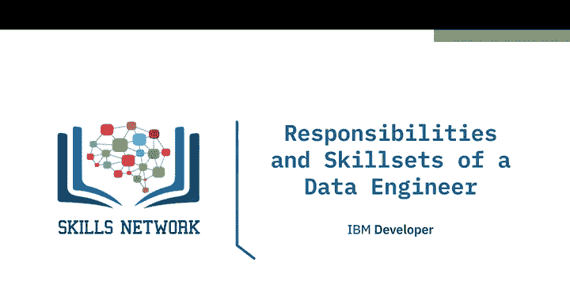
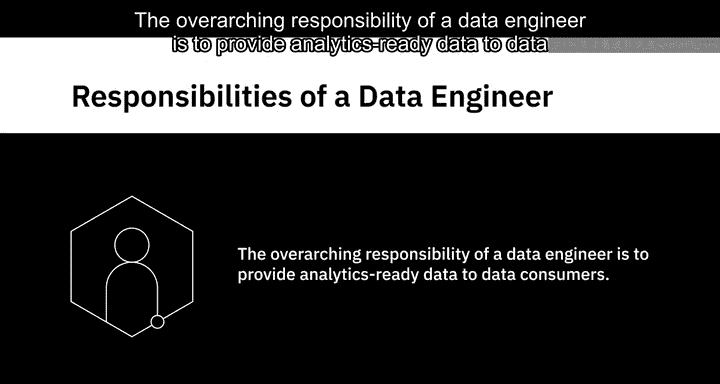
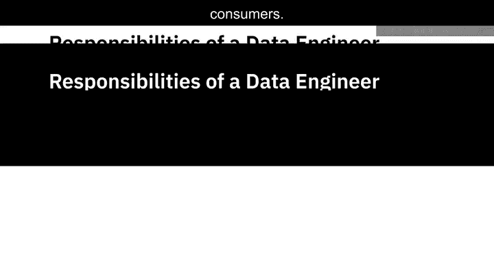
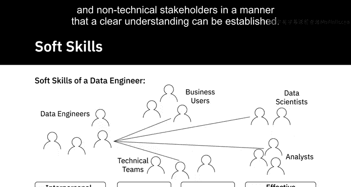
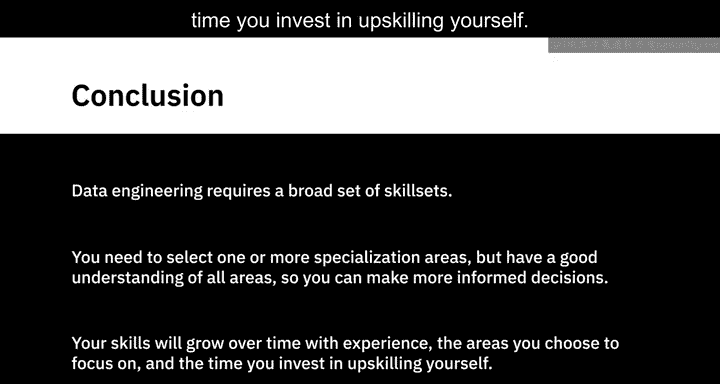
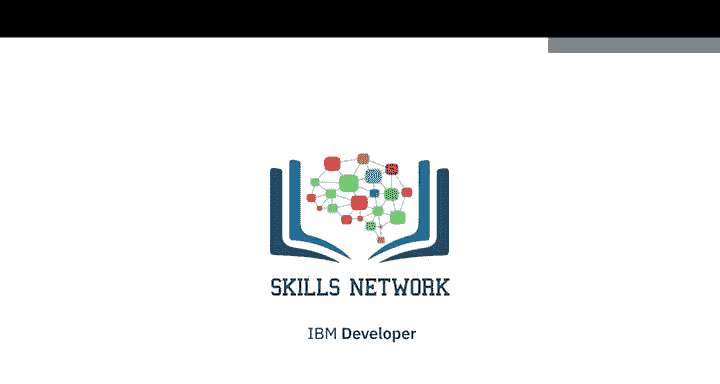

# IBM数据工程专业证书第1课：《数据工程入门课程（IBM）》introduction-to-data-engineering - P7：6_数据工程师职责与技能.zh_en - GPT中英字幕课程资源 - BV1G94y1y7oT

In this video we will learn about the responsibilities and skill sets of a data engineer the overarching responsibility of a data engineer is to provide analytics ready data to data consumers。

Data is analytics ready when it is accurate， reliable， complies to regulations it is governed by。

 and is accessible to consumers when they need it At a broad level， data engineers extract。

 organize and integrate data from disparate sources Prepare data for analysis and reporting by transforming and cleansing it design and manage data pipelines that encompass the journey of data from source to destination systems。

 and set up and manage the infrastructure required for the ingestion processing and storage of data。

 This can include data platforms， data stores for aggregating source data。

 distributed systems for large scale processing of data and data repositories for storage and dissemination of analysis ready data Next will learn about some of the technical functional and soft skills you may need as a data engineer Let us begin with the technical skills These include knowledge of working with operating systems such as you。

L and Windows， including commonly used administrative tools， system utilities， and commands。

Knowledge of infrastructure components such as virtual machines。

 networking and application services such as load balancing and application performance monitoring。

 also cloud based services such as those offered by Amazon， Google， IBM and Microsoft。

Experience of working with databases and data warehouses， which include RDBMSSs such as IBMDB2。

 My SQL， Oracle database and PostgresQL， No SQL databases such as Redis， MongoDB。

 Cassandra and Neo4j， and Data warehouses such as Oracle Exada， IBMDB2 warehouse on Cloud。

 IBM Natiza Perance Server and Amazon Redshift。A high level of proficiency working with data pipelines。

 popular data pipeline solutions include Apache beam， airflow and dataflow。

Experience of working with ETL tools such as IBM Infophere Information Server， AWS gluelue。

 and Improvvado。Proficiency in languages for querying。

 manipulating and processing data This includes query languages for accessing and manipulating data in a database such as SQL4 relational databases and SQL like query languages for no SQL databases。

 programming languages such as Python R and Java and Shell andscripting languages such as UniIX/ Linux Shell and PowerShell。

And finally， familiarity with big data processing tools such as Hadoop， Hive and Spark。

The data engineering process involves several different tools and technologies。

 having a working knowledge of comparable technologies can help you evaluate the tradeoffs between different tools and make appropriate recommendations。

Data engineering is at the intersection of software engineering and data science in addition to the tools and technologies that data engineers use on a daily basis。

 they also need to have a keen understanding of how data scientists。

 analysts and business users leverage analysis ready data。

 some of the functional skills that will serve you as a data engineer include the ability to convert business requirements into technical specifications。

 the ability to work with the complete software development lifecycle which includes ideation。

 architecture， design， prototyping， testing， deployment and monitoring。

 an understanding of data's potential application in business。

 and an understanding of the risks of poor data management， which essentially covers data quality。

 privacy， security and compliance。Data engineering is a team sport you could have multiple data engineers bringing in their specialization to collaborate on a project closely interacting with the data consumers。

 which includes the analysts， data scientists， business users and other technical teams， therefore。

 interpersonal skills， teamwork and collaboration are essential for data engineers As a data engineer。

 you need to be able to communicate effectively with both technical and non-technical stakeholders in a manner that a clear understanding can be established。

In this video you learned about some of the responsibilities and skill sets of a data engineer data engineering requires a broad set of skill sets。

 no one data engineer can possibly master each one of these skills。

 which means you essentially need to select one or more specialization areas but have a good understanding of all areas so that you can make more informed decisions。

 your skills will grow over time with experience the areas you choose to focus on and the time you invest in upskilling yourself。

